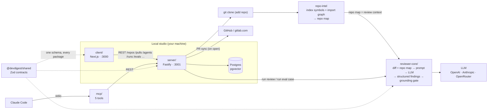

# DevDigest

Local-first AI pull-request review. Import a PR, run one or more reviewer agents
on it, and get grounded, structured findings — plus the context around them
(intent, risk-ordered diff, blast radius, PR brief) and an eval harness that
tells you whether an agent change made reviews better or worse. Course lessons
L01–L06 are implemented on `main`; see [_Features_](#features) and
[_Roadmap_](#roadmap).

Several standalone packages (no monorepo workspace — each has its own
`package.json` and lockfile; cross-package code is shared through tsconfig path
aliases, not published modules):

| Folder           | Package                     | What it is                                            | Port |
|------------------|-----------------------------|-------------------------------------------------------|------|
| `server/`        | `@devdigest/api`            | Fastify API + Drizzle/Postgres (pgvector)             | 3001 |
| `client/`        | `@devdigest/web`            | Next.js 15 web app (the studio)                       | 3000 |
| `reviewer-core/` | `@devdigest/reviewer-core`  | Pure review engine: diff → prompt → LLM → findings    | —    |
| `e2e/`           | `@devdigest/e2e`            | Deterministic browser e2e (agent-browser)             | —    |
| `mcp/`           | `@devdigest/mcp`            | Local stdio MCP server for Claude Code (5 tools, HTTP proxy to the API) | — |
| `evals/`         | `@devdigest/evals`          | Harness evals for the Claude Code skills/agents/workflow (vitest + Claude Agent SDK) | — |
| `server/src/vendor/shared` | `@devdigest/shared` | Zod contracts shared across every package             | —    |

`repo-intel` (the codebase indexer that builds the repo map for
reviews and the import graph behind Blast Radius) lives inside the server at
[`server/src/modules/repo-intel`](server/src/modules/repo-intel). Only
**Postgres** runs in Docker; the API and web app run on the host via `pnpm dev`.

## Architecture



The review flow end to end: **add a repo** → server clones it and `repo-intel`
indexes it → **import PRs** from GitHub or GitLab → open a PR and
**Review** → `reviewer-core` assembles a prompt from the diff + the repo map,
calls the LLM, validates every finding against the diff (the **grounding gate**
drops hallucinated line references), and persists structured findings with a
severity and score. All local; the only outbound calls are to the git host (GitHub or gitlab.com —
PR data) and the LLM (via OpenRouter).

The PR list is **synced on open** (both providers): opening a repo's Pull
Requests page renders the stored list immediately and, unless the repo was
synced in the last 60 s, starts one background sync for that repo (single-flight
— other viewers join it). When it finishes the list updates in place. There is
no periodic refresh; **Refresh** forces a sync regardless of the TTL.

Each package has its own README with deeper diagrams:
[`client`](client/README.md) (UI route map) ·
[`server`](server/README.md) (API map) ·
[`reviewer-core`](reviewer-core/README.md) (review pipeline) ·
[`e2e`](e2e/README.md) ·
[`mcp`](mcp/README.md) ·
[`evals`](evals/README.md).

## Features

Base flow — **local launch** (one command), **Settings** (LLM key + GitHub /
GitLab token), **add repository** (clone + index), **import PRs** (diff, commits, body,
linked issue), GitHub-like **diff view**, **agents** (five seeded reviewers —
General, Security, Performance, Test Quality, API Contract; create/edit your own: model + system prompt + skills), and
**run a review** (structured findings with severity + score, grounding gate,
repo-map context). Each run has a **trace drawer** (prompt assembly, raw output,
live log).

### GitLab (gitlab.com)

A workspace can mix GitHub and GitLab repositories — the provider is chosen per
repo from its URL. Specs: [`gitlab-merge-requests`](specs/2026-10-16-gitlab-merge-requests.md),
[`gitlab-comments`](specs/2026-10-20-gitlab-comments.md).

- **Token** — one GitLab access token per workspace (personal, group or project
  token), set in **Settings → API Keys → GitLab access token** and checked with
  **Test connection**. **Required scope: `api`** (Reporter role recommended) —
  DevDigest posts comments with it. It is used for every GitLab call (sync, PR
  page, clone, comments), whoever triggers it. Save & Test checks the scopes
  *before* storing: a token without `api` is rejected
  (`gitlab_token_insufficient_scope`) and the previously stored token stays.
  The row shows the token health: *Configured*, *Invalid — missing api scope*,
  *Invalid — rejected by GitLab* or *Configured — not verified yet*.
- **Upgrading: read-only tokens stop working.** A token saved under the old
  `read_api` + `read_repository` guidance is **invalid** now: on its first use
  DevDigest checks its scopes once, then every GitLab operation (add repo,
  clone/resync, PR sync, PR refresh, comments, issue lookups) fails with
  `gitlab_token_insufficient_scope` — there is no anonymous fallback. Persisted
  repos, PRs, reviews and findings stay readable, and the GitLab PR list / PR
  page show a persistent notice (Admins get a link to Settings → API Keys).
  Replace the token with one that has the `api` scope.
- **Add a repo** — paste a gitlab.com URL on the Add repository screen. Nested
  groups work (`https://gitlab.com/space-profit/platform/crm-frontend`), and so
  do a trailing `/`, a `.git` suffix, `/-/…` route suffixes (`/-/tree/main`,
  `/-/merge_requests/5`) and the SSH form `git@gitlab.com:group/project.git`.
  Only `gitlab.com` is supported; self-managed GitLab is not.
- **Pull requests** — open merge requests appear in the PR list as
  "Pull request" `#<iid>` (no "MR" wording); the only provider-specific label is
  **View on GitLab**. Draft MRs get a **Draft** badge and stay reviewable. The
  list stores metadata and `+/−` stats only; diffs, files and commits load when
  you open the PR page.
- **Sync on open** — same model as GitHub (see above): the list header shows
  *Synced N ago* / *Updating…*; if a sync fails the list stays visible with a
  *Couldn't sync — showing data from …* notice.
- **Everything else works** — review runs, findings, Intent, PR Brief, Smart
  Diff, Blast Radius and eval cases behave as on GitHub.
- **Inline comments** — the Files changed tab shows the MR's diff discussions
  (system and overview notes are skipped; notes on an older head render as
  outdated) and lets any Member or Admin post a new inline comment or reply to a
  thread, as on GitHub. A FindingCard on a GitLab PR also offers **Copy finding**.
  - **Service account.** Comments are posted **as the GitLab user the workspace
    token belongs to**. In `google` auth mode every comment and reply gets the
    footer ``— posted by `<name>` via DevDigest`` (the acting user's display
    name, sanitised, rendered as inline code so it never mentions anyone);
    DevDigest strips that footer when reading the note back and shows
    "via DevDigest · <name>" instead. `local` mode adds no footer.
  - **Quick actions are neutralised.** Every line shaped like a quick action
    (`/merge`, `/close`, `/label ~x`, any `/<name>` followed by end of line or
    a space) is neutralised before posting, wherever it appears, so it never
    changes the MR's state, labels, approvals or assignees. Outside code the
    `/` is escaped (`\/merge`, renders as typed); inside a fenced code block an
    invisible zero-width space (U+200B) is inserted before the `/` instead, so
    code still looks unchanged. Lines like `/usr/bin/env` or `// comment` are
    left alone. Line endings are normalised to LF first (GitLab drops `\r`
    before looking for quick actions).
  - **Head moved → reload.** Before every post DevDigest reads the MR's current
    diff refs; if new commits were pushed since the diff was loaded, the post is
    refused (409 `comment_diff_outdated`, "New commits were pushed — reload the
    diff") and nothing is written. Reload the PR page and post again.
  - **No silent duplicates.** A write is retried only on 429; after a 5xx,
    timeout or network error DevDigest makes no second attempt and says
    "GitLab didn't confirm the comment — check the MR before posting again".
    A failed post keeps the draft in the composer and offers **Copy text**.
  - Each successful post or reply records a `pr_comment.create` audit event
    (`google` mode; both providers).
  - Manual check still pending: the quick-action escaping is covered by offline
    tests only; a one-time smoke on a sandbox gitlab.com MR (post
    `/label ~smoke\n/shrug\nLGTM` with a Reporter-role `api` token in google
    mode — no label, no shrug, footer without a mention) has not been run yet.

| Lesson | Feature | What it does | Where in the UI | Spec |
|--------|---------|--------------|-----------------|------|
| L01 | Run cost badge | USD cost of a run, rolled up per PR | PR list (cost column) · run history | — |
| L01 | Finding counters | Per-severity finding chips for each agent's latest review, hover card lists the findings | PR list (FINDINGS column) | — |
| L02 | Skills Lab | Reusable markdown rule blocks, versioned, linked to agents and appended to their prompt | `/skills` · agent editor → Skills tab | [`02-skills-lab`](specs/02-skills-lab.md) |
| L02 | Conventions Extractor | Extracts candidate house-rules from the repo, drops ungrounded ones, merges accepted ones into a skill | `/conventions` | [`03-conventions-extractor`](specs/03-conventions-extractor.md) |
| L03 | Intent Layer | Classifies why the PR exists (in/out of scope), injects it into the review prompt, filters out-of-scope findings | PR → Overview → Intent card | [`04-intent-layer`](specs/04-intent-layer.md) |
| L03 | Smart Diff | Deterministic (no-LLM) risk ordering of files into core / wiring / boilerplate, findings inline | PR → Files changed → Smart order | [`05-smart-diff`](specs/05-smart-diff.md) |
| L04 | MCP server | 5 Claude Code tools (list agents, run agent on PR, get findings, conventions, blast radius) via root `.mcp.json` | Claude Code | [`l04-mcp-server`](docs/plans/l04-mcp-server.md) |
| L04 | Blast Radius | Changed symbols → callers → endpoints/crons + prior PRs, from the `repo-intel` index (no LLM) | PR → Overview → Blast card | [`l04-blast-radius`](docs/plans/l04-blast-radius.md) |
| L05 | Project Context | Attach `specs/` / `docs/` / `insights/` markdown from the clone to an agent; injected as untrusted context on every run | `/repos/:repoId/project-context` · agent editor → Context tab | [`project-context`](specs/2026-08-27-project-context.md) |
| L05 | PR Brief | Why + risk brief for the PR (cached), Risk Areas and a Review Focus block | PR → Overview → PR Brief card | [`pr-brief`](specs/2026-08-27-pr-brief.md) |
| L06 | Eval Pipeline | In-app regression harness for reviewer agents: accepted findings become `must_find` cases, dismissed ones `must_not_flag`; cases run through the real engine, scored by code | Finding → "Turn into eval case" · `/evals` · `/evals/:agentId` · agent editor → Evals tab | [`06-eval-pipeline`](specs/06-eval-pipeline.md) |
| — | GitLab | gitlab.com repos (nested groups) beside GitHub ones, MR import, sync-on-open PR list, Draft badge, post/reply inline comments as the token's service account (`api` scope required, Reporter role recommended; "posted by … via DevDigest" footer in google mode), token-health notice — [details](#gitlab-gitlabcom) | Add repository · Settings → API Keys · PR list · PR → Files changed | [`gitlab-merge-requests`](specs/2026-10-16-gitlab-merge-requests.md) · [`gitlab-comments`](specs/2026-10-20-gitlab-comments.md) |

**Two different "evals".** The **Eval Pipeline** above is a product feature
(server `modules/eval`, Postgres, Eval Dashboard) that evaluates the in-app
reviewer agents. The [`evals/`](evals/README.md) package is unrelated
developer tooling: it evaluates this repo's **Claude Code harness**
(`.claude/skills`, `.claude/agents`, `CLAUDE.md`) with vitest + the Claude Agent
SDK, and runs in CI via `harness-evals.yml`.

## Roadmap

Not implemented yet — later course lessons:

| Lesson | Planned |
|--------|---------|
| L05 | Onboarding generator |
| L06 | Secret / Phantom-API gates · Export to CI |
| L07 | Multi-agent review · Persistent memory · per-agent stats |
| L08 | Plugin export/import · Agent performance dashboard · weekly digest |

## Prerequisites

- **Node** ≥ 22 · **pnpm** ≥ 10 (`npm i -g pnpm`) · **Docker** (for Postgres)

## Quick start (from zero)

```sh
./scripts/dev.sh
```

This script:
1. starts Postgres (`docker compose up -d`) and waits until it's healthy,
2. creates `server/.env` and `client/.env` from `.env.example` if missing,
3. installs deps in `server/`, `client/` (pnpm) and `reviewer-core/` (npm) — only when `node_modules` is absent,
4. applies DB migrations and seeds demo data,
5. launches the API (`:3001`) and the web app (`:3000`).

Open **http://localhost:3000**. Press **Ctrl-C** to stop the dev servers —
Postgres keeps running (`docker compose down` to stop it).

Flags: `--no-seed` · `--no-client` · `--db-only` · `--help`.

> Add your keys in `server/.env` (`OPENAI_API_KEY` / `ANTHROPIC_API_KEY`,
> `GITHUB_TOKEN`, `GITLAB_TOKEN`) or via the Settings UI at runtime.

## Manual steps (what the script does)

```sh
docker compose up -d                                   # Postgres + pgvector

cd server && pnpm install
pnpm db:migrate          # apply migrations (NOT run automatically on boot)
pnpm db:seed             # idempotent demo data (optional)
pnpm dev                 # API on :3001

cd ../client && pnpm install && pnpm dev               # web on :3000
```

Optional: `cd mcp && pnpm install` once to let Claude Code spawn the MCP server
from the root `.mcp.json`; `cd evals && pnpm install` to run the harness evals.

## Useful scripts

`server/`: `dev` · `build` · `db:migrate` · `db:seed` · `db:generate` · `test` · `typecheck` · `verify:l03` · `verify:l06`
(unit/integration split: `pnpm exec vitest run --exclude '**/*.it.test.ts'` / `pnpm exec vitest run .it.test`)
`client/`: `dev` · `build` · `start` · `test` · `typecheck`
`mcp/`: `dev` · `inspect` (MCP Inspector) · `test` · `typecheck`
`evals/`: `eval` · `eval:skills` · `eval:agents` · `eval:workflow` · … (see [`evals/README.md`](evals/README.md))

## Testing & CI

One test suite per package, each gated by its own GitHub Actions workflow with a
path filter — full strategy in **[`TESTING.md`](TESTING.md)**.

| Suite | Workflow | Needs Docker |
|-------|----------|--------------|
| client (vitest + jsdom) | `client.yml` | no |
| server unit (hermetic) + `verify:l06` eval gate | `server-unit.yml` | no |
| server integration (real Postgres) | `server-integration.yml` | yes |
| reviewer-core (engine) | `reviewer-core.yml` | no |
| web e2e (agent-browser, real stack) | `e2e-web.yml` | yes |
| harness evals (`evals/`, on `.claude/**` / `CLAUDE.md` changes) | `harness-evals.yml` | no |
| `@devdigest/shared` copies identical (`node scripts/check-shared-sync.mjs`) | `shared-sync.yml` | no |

Server tests split by filename: `*.it.test.ts` are DB-backed (testcontainers
Postgres); everything else is hermetic. The browser e2e flows live in
[`e2e/`](e2e/README.md) and run deterministically (no LLM).

## Troubleshooting

- **`relation ... does not exist` / API errors on first run** — migrations weren't
  applied. The server does **not** migrate on boot: run `cd server && pnpm db:migrate`.
- **Port 5432 already in use** — another Postgres is running. Stop it, or change the
  host port in `docker-compose.yml`.
- **`vector` type errors** — the pgvector extension is enabled by migration `0000`;
  make sure migrations ran against the Dockerized DB, not a different one.
- **`pnpm db:migrate` fails with `migration 0020: GitLab repos differing only by
  case in full_name exist`** (or `… differing only by host casing`) — migration
  `0020` adds a case-insensitive identity index and aborts rather than deleting
  data. Nothing is applied (all pending migrations run in one transaction).
  Remove the newer duplicate repository (keep the oldest), then re-run
  `pnpm db:migrate`.
- **Upgrading a database created before migration `0024` (settings dedupe)** —
  `0024` makes settings workspace-wide and collapses per-user duplicates of a
  key to ONE row, keeping the "most recently written" one by `age(xmin)`. That
  ranking is unreliable after a dump/restore or a `VACUUM FREEZE`, so when the
  duplicates hold *different* values the wrong one may survive. If
  `SELECT to_regclass('settings_ws_key_uq');` returns `NULL` (0024 not applied
  yet), before `pnpm db:migrate`:
  1. back up: `docker compose exec postgres pg_dump -U devdigest devdigest > devdigest-pre-0024.sql`;
  2. list the conflicting duplicates:
     ```sql
     SELECT workspace_id, key, count(*) AS rows,
            jsonb_agg(jsonb_build_object('id', id, 'user_id', user_id, 'value', value)) AS candidates
     FROM settings
     GROUP BY workspace_id, key
     HAVING count(DISTINCT coalesce(value::text, '<sql null>')) > 1;
     ```
  3. for each row returned, keep the value you want and delete the others
     (`DELETE FROM settings WHERE id IN (...)`), then run `pnpm db:migrate`.
  Duplicates with identical values are harmless — `0024` keeps one of them.
- **Adding a gitlab.com repo fails** — *Add a GitLab access token in Settings →
  API Keys* means no token is set; *token was rejected* means it is invalid or
  expired; *project can't be accessed* means the token can't see that project
  (GitLab answers 404 for projects outside the token's access);
  `gitlab_token_insufficient_scope` means the stored token lacks the `api`
  scope — save a token with `api` (Reporter role recommended).
- **Posting a GitLab comment fails with "New commits were pushed — reload the
  diff"** — the MR head moved since the diff was loaded; reload the PR page and
  post again. "GitLab didn't confirm the comment" means the outcome is unknown —
  check the MR before posting again.
- **Reset everything** — `docker compose down -v` drops the volume, then re-run
  `./scripts/dev.sh`.
