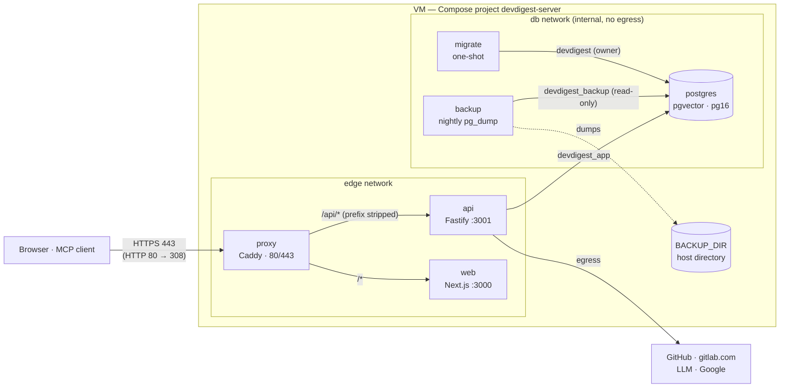
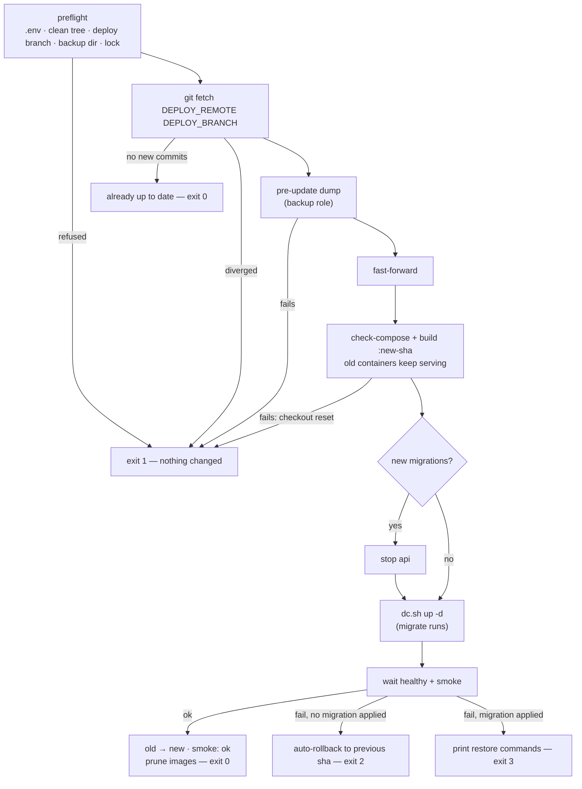

# Deploying DevDigest for a team (server mode)

This runbook takes one Linux VM from nothing to a running DevDigest that a team
signs in to with Google: `https://<PUBLIC_HOSTNAME>`. It then covers updates,
rollback, backups and troubleshooting. Run every command from the repository
root on the VM unless a step says otherwise.

The deployment is `deploy/compose.yml`, a separate Compose project
(`devdigest-server`) from the local-dev `docker-compose.yml`. Always call it
through **`deploy/dc.sh`**. The wrapper runs `docker compose -f compose.yml` from
`deploy/` and exports the deployed release (`DEVDIGEST_IMAGE_TAG`,
`DEVDIGEST_RELEASE`) from `deploy/.state/release.env`. Without that file the
images fall back to `:local` and the release to `unknown`.



Only `proxy` publishes ports. `postgres` sits on the internal `db` network with
no host port. The start order is `postgres` healthy → `migrate`
(`pnpm db:migrate && pnpm db:bootstrap` + DB grants) exits 0 → `api` healthy →
`proxy`. The API never runs migrations itself.

## Prerequisites

- **VM size:** at least 2 vCPU, 4 GiB RAM + 2 GiB swap and 40 GB SSD.
  Recommended: 4 vCPU, 8 GiB and 80 GB. Building the images on the VM needs
  about 2 GiB of free memory.
- **OS:** Ubuntu 22.04 / 24.04 or Debian 12.
- **Docker Engine ≥ 24** with the **Compose plugin ≥ 2.24**.
- **git**, **curl**, and **Node.js 22 LTS**. Node is used only by
  `deploy/check-compose.sh` and `deploy/update.sh`, not by the containers.
- **Inbound firewall:** 80/TCP, 443/TCP and 443/UDP (HTTP/3).
- **A DNS A (and/or AAAA) record** for the host name pointing at the VM,
  created *before* the first start (see [DNS](#dns)).
- **Read access to the repository through a read-only GitHub deploy key.**
  Create an SSH key on the VM (`ssh-keygen -t ed25519`). Add the public key in
  the repository's *Settings → Deploy keys* **without** write access, then clone
  over SSH. The VM tracks `DEPLOY_BRANCH` (default `main`) on `DEPLOY_REMOTE`
  (default `origin`).

> **Write access to the deploy branch = deploy access to the VM.** Whoever can
> push to `DEPLOY_BRANCH` decides what the next `deploy/update.sh` builds and
> runs. Protect that branch.

## DNS

Point an A record (and an AAAA record if the VM has IPv6) for
`PUBLIC_HOSTNAME` at the VM's public IP. Wait until it resolves from outside
before the first start: Caddy needs it to get the Let's Encrypt certificate.
`PUBLIC_HOSTNAME` is a bare DNS name, with no scheme, port or path. The origin
becomes `https://<PUBLIC_HOSTNAME>` and the API `https://<PUBLIC_HOSTNAME>/api`.

## Google OAuth client

In Google Cloud Console (APIs & Services):

1. **OAuth consent screen:** user type **Internal**, so only accounts of your
   Google Workspace can sign in.
2. **Credentials → Create credentials → OAuth client ID:** type **Web
   application**.
3. **Authorized redirect URI:** exactly
   `https://<PUBLIC_HOSTNAME>/api/auth/google/callback`.
   Use `https`, no trailing slash, and your real host name in place of the
   placeholder.

Map the result to `deploy/.env`:

| Google Console | `deploy/.env` |
| --- | --- |
| Client ID | `GOOGLE_CLIENT_ID` |
| Client secret | `GOOGLE_CLIENT_SECRET` |
| Your Workspace email domain (e.g. `example.com`) | `AUTH_ALLOWED_DOMAIN` |

## Fill `deploy/.env`

```sh
cp deploy/.env.example deploy/.env
chmod 600 deploy/.env
```

Replace every `replace-me…` value. Generate each secret with its own command:

| Setting | Command |
| --- | --- |
| `POSTGRES_PASSWORD` | `openssl rand -hex 24` |
| `APP_DB_PASSWORD` | `openssl rand -hex 24` |
| `BACKUP_DB_PASSWORD` | `openssl rand -hex 24` |
| `SECRETS_MASTER_KEY` | `openssl rand -base64 32` |

The three DB passwords must each be at least 32 chars of `[A-Za-z0-9_-]`, and
all three must differ. `migrate` refuses placeholders, short values and reused
values, and names only the setting, never the value. Set `AUTH_ADMIN_EMAILS`
to the email(s) of the first Admin(s) (see [First Admin](#first-admin)).
Every setting is listed in the [Settings reference](#settings-reference).

**Store these four values off the VM** (in a password manager or vault):
`SECRETS_MASTER_KEY` and the three DB passwords. **A database dump cannot
decrypt the stored provider secrets (LLM keys, GitHub / GitLab tokens) without
the `SECRETS_MASTER_KEY` that encrypted them.** If you lose the key, every
stored secret has to be re-entered.

Never commit `deploy/.env`. Provider tokens and LLM keys are **not**
`deploy/.env` settings in server mode. An Admin enters them in the UI (see
[Provider & LLM keys](#provider--llm-keys)).

## Static check

```sh
bash deploy/check-compose.sh deploy/.env
```

It starts no containers. It checks that the Compose file renders with your
`.env` and that only `proxy` publishes ports. It checks the DB role wiring and
the hardening, the `backup` service, log rotation and resource limits on every
service, and the CSP vs. the web Sentry DSN. Because the file is not
`.env.example`, it also runs the secret-value checks (placeholders, length,
reuse), printing setting names only. It ends with `✔ all deployment checks
passed`. Fix every `FAIL` before going on.

## First start

1. Create the backup directory, owned by uid/gid 999 (the `postgres` user of
   the backup image) with mode 0700. Without it the `backup` container cannot
   write:

   ```sh
   sudo install -d -m 0700 -o 999 -g 999 deploy/backups
   ```

   If you set `BACKUP_DIR` to another path, create that one instead.
2. `bash deploy/check-compose.sh deploy/.env` (see [Static check](#static-check)).
3. Build and start:

   ```sh
   deploy/dc.sh up -d --build
   deploy/dc.sh ps          # wait for api / web / backup to be healthy
   ```

4. Run the [smoke check](#smoke-check) from your workstation.
5. The first Admin signs in (see [First Admin](#first-admin)).
6. Add the provider and LLM keys, or run `secrets:import` (see
   [Provider & LLM keys](#provider--llm-keys)).
7. Create review agents by hand (see
   [Create review agents](#create-review-agents)). **Production starts with zero
   agents and no demo data.** `migrate` runs `db:bootstrap` (the workspace and
   the system user only), never `db:seed`.
8. Connect the first repository (*Add repository*).

## First Admin

`AUTH_ADMIN_EMAILS` (comma-separated) gives Admin to those accounts on their
first sign-in. Everyone else in `AUTH_ALLOWED_DOMAIN` signs in as Member.
Open `https://<PUBLIC_HOSTNAME>` and sign in with Google as one of those
accounts. Admins manage roles in **Settings → Members**.

If the API finds no active Admin and an empty `AUTH_ADMIN_EMAILS`, it logs at
boot: `No admin — the workspace has no active Admin and AUTH_ADMIN_EMAILS is
empty.` Set the setting, run `deploy/dc.sh up -d`, and sign in again.

## Provider & LLM keys

Signed in as Admin, open **Settings → API Keys**. Enter the LLM key(s) and the
GitHub and/or GitLab token, then use **Test connection**. The values are stored
encrypted with `SECRETS_MASTER_KEY` in Postgres.

To import existing values once instead (key names `OPENAI_API_KEY`,
`ANTHROPIC_API_KEY`, `OPENROUTER_API_KEY`, `GITHUB_TOKEN`, `GITLAB_TOKEN`),
pass them from your shell environment. Never pass them on the command line:

```sh
read -rs GITHUB_TOKEN && export GITHUB_TOKEN
deploy/dc.sh run --rm -e GITHUB_TOKEN api pnpm secrets:import
unset GITHUB_TOKEN
```

The import prints key names only. Leftover provider keys in the API
environment are ignored in server mode, and the API warns about them at boot.

## Create review agents

No built-in agents exist in production. An Admin creates them on the
**Agents** page. Each agent gets a model, a system prompt and optional skills.
`/agents?create=1` opens the create dialog directly. On a PR the **Run review**
menu shows "No agents yet — create one" to Admins (it links there) and "No
agents yet — ask an Admin to create one" to Members. "Run all" with no enabled
agent is rejected with `409 no_enabled_agents`, and no run is created.

## Connect MCP

Each developer who uses the MCP server with Claude Code:

1. Creates a personal token in **Settings → API tokens** (the value is shown
   once).
2. Sets these in their **local, uncommitted** MCP environment:
   - `DEVDIGEST_API_BASE=https://<PUBLIC_HOSTNAME>/api`
   - `DEVDIGEST_API_TOKEN=<the token>`

Never commit the token (not in `.mcp.json`, not in any repository). With a
token set, the MCP server refuses a non-`https` base, except for a loopback
host. See [`mcp/README.md`](../mcp/README.md). Admins can list and revoke
anyone's tokens in Settings → Members. See
[`specs/2026-11-03-admin-token-revocation.md`](../specs/2026-11-03-admin-token-revocation.md).

## Smoke check

```sh
bash deploy/smoke.sh <PUBLIC_HOSTNAME>
```

It needs no credentials, and it sends and stores no cookies. The argument is a
bare host name: a scheme, port, path, credentials or an unresolvable name fail
fast (exit 2). It prints one `ok|FAIL <check> [hint]` line per check, in this
order:

| Check | Passes when |
| --- | --- |
| `http-redirect` | `http://<host>/` permanently redirects to `https://<host>/` |
| `tls-hsts` | the certificate is valid (never bypassed) and HSTS `max-age` ≥ 31536000 |
| `ready` | `GET /api/health/ready` → 200 `ready: true` |
| `auth-barrier` | unauthenticated `GET /api/repos` → 401 |
| `google-redirect` | `/api/auth/google/start` redirects to `accounts.google.com` (a redirect to the sign-in error page fails with a `TRUST_PROXY` hint) |
| `web-html` | `GET /` → 200 HTML |

Exit 0 means every check passed. Exit 1 means at least one `FAIL`. Each request
is capped at 10 s and the whole run at 60 s.

**Running it on the VM itself:** many clouds block "hairpin" traffic from a VM
to its own public IP. Pin the host to the local proxy instead. SNI and
certificate validation stay the same:

```sh
SMOKE_RESOLVE_IP=127.0.0.1 bash deploy/smoke.sh <PUBLIC_HOSTNAME>
```

`deploy/update.sh` always runs the smoke check this way.

## Update

```sh
deploy/update.sh            # same as: deploy/update.sh update
deploy/update.sh --help     # the full contract
```

Run updates outside working hours: the API restarts, and with new migrations
it is stopped while they run. Before every update, compare the new
`deploy/.env.example` against your `deploy/.env`
(`git diff HEAD..<remote>/<branch> -- deploy/.env.example` after a
`git fetch`) and add any new settings. A new *required* setting makes
`check-compose.sh` fail during the update.



What it does, in order:

1. **Preflight**, which changes nothing on refusal. It needs `deploy/.env`, no
   local changes to tracked files, the checkout on `DEPLOY_BRANCH`, a backup
   directory owned by uid 999, and no other update or rollback running (lock
   `deploy/.state/update.lock.d`).
2. `git fetch`. If there are no new commits it prints `already up to date` and
   exits 0, with no dump, build or restart. If the branches have diverged it
   refuses, because only fast-forwards are allowed.
3. **Pre-update dump**: `deploy/dc.sh run --rm -T backup dump pre-update <sha7>`.
   The result is recorded in `deploy/.state/update.env`. A failed dump aborts
   with nothing changed.
4. Fast-forward. Then `check-compose.sh` and an image build tagged with the new
   commit (`devdigest-api:<sha12>`, `devdigest-web:<sha12>`) while the old
   containers keep serving. If either fails, the checkout is reset and the
   containers are untouched.
5. If the new commit adds migrations, `api` is stopped first. Then
   `deploy/dc.sh up -d` runs, and `migrate` runs as part of it.
6. It waits up to `UPDATE_HEALTH_TIMEOUT` seconds (default 180) for `api` and
   `web` to be healthy, then runs the smoke check.
7. On success it re-tags the new images as `:local` and removes the other
   DevDigest images (it keeps the current, previous and `:local` tags). It
   prunes dangling images and the build cache, then prints `<old> → <new>` and
   `smoke: ok`.

Images are tagged by commit sha. The deployed release lives in
`deploy/.state/release.env` (`DEVDIGEST_RELEASE` = full sha,
`DEVDIGEST_IMAGE_TAG` = first 12 chars). `deploy/dc.sh` exports it. Neither is
a `deploy/.env` setting.

| Exit | Meaning |
| --- | --- |
| `0` | updated (`smoke: ok`), or already up to date |
| `1` | preflight / check / build failure, or refused: nothing new deployed |
| `2` | deployed but unhealthy: rolled back automatically to the previous commit (`rolled back to <sha>`) |
| `3` | deployed, unhealthy, **and migrations were applied**: manual restore required. The exact commands and the dump name are printed, and the database is not touched automatically |

**Migrations are forward-only.** Rolling back across a migration means
restoring the pre-update dump. Everything written since that dump (reviews,
comments, settings, audit events, sessions) is lost. For exit 3, follow the
printed commands, which are the [restore procedure](#backup--restore) plus
resetting the checkout and `release.env` to the previous commit.

### Adopting this on an existing deployment (one time)

A deployment that runs a version from before `deploy/update.sh` has no
`backup` service, no backup role and no `BACKUP_DB_PASSWORD`, so `update.sh`
cannot bootstrap itself. Do this once by hand:

1. Take a manual dump as the owner role:

   ```sh
   docker compose -f deploy/compose.yml exec -T postgres \
     pg_dump -U devdigest -d devdigest -Fc > ~/devdigest-before-adoption.dump
   chmod 600 ~/devdigest-before-adoption.dump
   ```

2. `git pull --ff-only`
3. Add `BACKUP_DB_PASSWORD` (`openssl rand -hex 24`) and any other new settings
   from `deploy/.env.example` to `deploy/.env`.
4. `sudo install -d -m 0700 -o 999 -g 999 deploy/backups`
5. `bash deploy/check-compose.sh deploy/.env && deploy/dc.sh up -d --build`
6. Run the [smoke check](#smoke-check).

From then on, use `deploy/update.sh`.

## Rollback

```sh
deploy/update.sh rollback
```

This redeploys the previous commit recorded by the last update
(`previous_sha` in `deploy/.state/update.env`). It reuses that commit's images
and rebuilds them only if they are missing. Then it waits for health and runs
the smoke check. It **refuses** (exit 1) when the database has more applied
migrations than the previous commit knows. In that case it names the
pre-update dump and prints the restore commands, because rolling back the code
alone would be unsafe. A rollback resets the deploy branch to the previous
commit, and the next `update` fast-forwards it again.

## Backup & restore

The `backup` service makes a nightly full dump (`pg_dump -Fc`) at
`BACKUP_SCHEDULE` (HH:MM UTC, default `03:15`). It runs as the read-only
`devdigest_backup` role, which `migrate` creates and re-keys from
`BACKUP_DB_PASSWORD`. It writes to a temp file, verifies it with
`pg_restore --list`, then renames it into `BACKUP_DIR`. Dumps are mode 0600,
the directory 0700:

- `devdigest-<yyyymmddThhmmssZ>-nightly.dump`: the newest `BACKUP_RETAIN`
  (default 14) are kept.
- `devdigest-<yyyymmddThhmmssZ>-pre-update-<sha7>.dump`: made by
  `deploy/update.sh`. The newest `BACKUP_RETAIN_PRE_UPDATE` (default 5) are
  kept.

A failed dump removes its temp file, keeps every earlier dump and skips
rotation. The service turns **unhealthy** when no nightly dump has succeeded in
the last 26 h (with a 26 h grace period after its first start). Check it with
`deploy/dc.sh ps backup` and `sudo ls -l deploy/backups`. For an on-demand dump:
`deploy/dc.sh run --rm -T backup dump nightly`.

> **Warning: backups are local only.** Dumps live on the VM's disk next to the
> database. **Losing the VM loses all backups.** Copy dumps off the VM yourself
> on a schedule that fits your data, and keep `SECRETS_MASTER_KEY` off the VM
> as well. A dump restored without the same key cannot decrypt the stored
> provider secrets.

### Restore a dump

Run from the repository root. `<dump>` is a file in `BACKUP_DIR`, e.g.
`deploy/backups/devdigest-…-nightly.dump`:

1. Stop everything that talks to the database:

   ```sh
   deploy/dc.sh stop api web backup
   ```

2. Drop and recreate the database:

   ```sh
   deploy/dc.sh exec -T postgres psql -U devdigest -d postgres -c 'DROP DATABASE devdigest WITH (FORCE)' -c 'CREATE DATABASE devdigest OWNER devdigest'
   ```

3. Restore the dump (`sudo`, because the dump belongs to uid 999):

   ```sh
   sudo cat <dump> | deploy/dc.sh exec -T postgres pg_restore -U devdigest -d devdigest --no-owner --no-privileges
   ```

4. Start again. `migrate` re-runs and re-applies the DB grants:

   ```sh
   deploy/dc.sh up -d
   ```

5. `bash deploy/smoke.sh <PUBLIC_HOSTNAME>` (add `SMOKE_RESOLVE_IP=127.0.0.1`
   on the VM).

**Restore with the same `SECRETS_MASTER_KEY`** that was active when the dump
was taken, or every stored provider secret becomes undecryptable. Everything
written after the dump is lost. If the dump is older than the deployed code's
migrations, first redeploy the matching commit (the exit-3 output of
`update.sh` lists those extra steps).

## Disk & logs

Sources of disk growth and how to measure each:

| Source | What grows | Usage command |
| --- | --- | --- |
| `pgdata` volume | the database | `sudo du -sh "$(docker volume inspect devdigest-server_pgdata --format '{{.Mountpoint}}')"` |
| `clones` volume | one git clone per repository ever connected. **Never deleted when a repo is removed** | `sudo du -sh "$(docker volume inspect devdigest-server_clones --format '{{.Mountpoint}}')"` |
| `BACKUP_DIR` | nightly + pre-update dumps (bounded by the retention settings) | `sudo du -sh deploy/backups` |
| images & build cache | one image pair per kept commit, plus the cache | `docker system df -v` |
| container logs | `json-file`, at most `LOG_MAX_FILE` × `LOG_MAX_SIZE` per container (default 5 × 10m) | `sudo du -sh /var/lib/docker/containers` |

Check `df -h /` regularly and **act at 80 % disk usage**: delete clones of
removed repositories, lower the backup retention, copy old dumps off the VM
and delete them, or run `docker builder prune`.

**Deleting the clone of a removed repository (manual).** First make sure the
repository is gone from DevDigest (it no longer appears in the UI). Clones live
under `/data/clones` in the `api` container. GitHub repos use
`/data/clones/<owner>/<repo>`, and gitlab.com repos use
`/data/clones/@gitlab.com/<namespace…>/<project>`:

```sh
deploy/dc.sh exec api ls /data/clones
deploy/dc.sh exec api rm -rf /data/clones/<owner>/<repo>
```

## Sentry

Error reporting is opt-in. An empty DSN means off, with no SDK initialised and
no connection made.

- `SENTRY_DSN`: the **API** DSN, read at runtime. Treat it as sensitive: it
  never reaches the web bundle. A malformed value logs one boot warning naming
  the setting, and reporting stays off.
- `SENTRY_WEB_DSN`: the **web** DSN. It is **public and build-time**: inlined
  into the browser bundle as `NEXT_PUBLIC_SENTRY_DSN`. Changing it needs a
  rebuild (`deploy/dc.sh up -d --build`, or the next `update.sh`).
- `SENTRY_ENVIRONMENT`: the environment tag for both (default `production`;
  web: build time).
- **Release:** both report the deployed commit sha (`DEVDIGEST_RELEASE`, set by
  `deploy/update.sh` and exported by `deploy/dc.sh`). Without it the release is
  `unknown`.
- **Errors only:** no tracing, profiling or session replay. No source maps are
  uploaded, so web stack traces stay minified. The API reports internal 5xx
  errors and internal background-job failures, never 4xx or provider errors.
  Events carry the user id only, and secrets are scrubbed.
- **Hosting region:** any DSN works (sentry.io US or EU, or self-hosted).
  Which one is allowed is your company's policy decision.
- **CSP caveat:** the proxy CSP does not restrict `connect-src` today. If you
  add a `connect-src` / `default-src` directive to `deploy/Caddyfile`, it must
  allow the web DSN's `https://` origin, or `check-compose.sh` fails.

## Troubleshooting

| Symptom | Cause | Fix |
| --- | --- | --- |
| Browser shows a certificate error; `deploy/dc.sh logs proxy` shows ACME errors | DNS does not point at the VM yet, or 80/443 are blocked | Fix the A/AAAA record and the firewall (80/TCP, 443/TCP, 443/UDP), then `deploy/dc.sh restart proxy` |
| Certificate still not issued after several attempts | Let's Encrypt rate limit after repeated failed attempts | Fix DNS / firewall first, then wait for the rate-limit window (Caddy retries by itself); do not delete the `caddy_data` volume |
| Google shows `redirect_uri_mismatch` | The OAuth client's redirect URI differs from what the API sends | Set it to exactly `https://<PUBLIC_HOSTNAME>/api/auth/google/callback`, the same host as `PUBLIC_HOSTNAME` |
| Sign-in bounces back to the sign-in page (`/sign-in?error=…`) | `auth_domain_not_allowed`: the account is outside `AUTH_ALLOWED_DOMAIN`. `auth_state_invalid` with the API log `sign-in reached over plain HTTP — no cookie set (check TRUST_PROXY / the proxy)`: the request did not reach the API over HTTPS through Caddy | Fix `AUTH_ALLOWED_DOMAIN`; open the site via `https://<PUBLIC_HOSTNAME>` only; keep the stock proxy (its static IP is `TRUST_PROXY`); run the smoke check (`google-redirect`) |
| `migrate` exits non-zero; `api` never starts | A failed migration, or a bad DB password (placeholder, too short, reused) | `deploy/dc.sh logs migrate` names the setting or the failing step; fix `deploy/.env`, run `bash deploy/check-compose.sh deploy/.env`, then `deploy/dc.sh up -d` |
| API exits at boot: `another DevDigest API instance is running` | A second API process holds the instance lock on the same database | Run exactly one `api` (`deploy/dc.sh ps`); stop the other instance or the stray container |
| API logs `No admin — the workspace has no active Admin and AUTH_ADMIN_EMAILS is empty.` | No Admin yet and an empty allowlist | Set `AUTH_ADMIN_EMAILS`, `deploy/dc.sh up -d`, sign in with that account |
| API logs `secrets can't be decrypted with the current master key: …` | `SECRETS_MASTER_KEY` changed or was restored wrongly | Restore the original key from your off-VM copy, or set the old one as `SECRETS_MASTER_KEY_PREVIOUS` during a rotation, or re-enter the listed keys in Settings → API Keys |
| Writes fail, Postgres or the build errors with "no space left on device" | Disk full | See [Disk & logs](#disk--logs): delete removed repos' clones, prune build cache, move old dumps off the VM |
| A container restarts repeatedly; `docker inspect --format '{{.State.OOMKilled}}' $(deploy/dc.sh ps -q api)` prints `true` | It exceeded its memory limit (OOM kill); `restart: unless-stopped` brings it back, and review runs left running are marked failed on boot | Raise `<SERVICE>_MEM_LIMIT` (e.g. `API_MEM_LIMIT`) within the VM's RAM, then `deploy/dc.sh up -d` |
| `update.sh` smoke check fails on the VM, but works from a workstation | Hairpin NAT (the VM cannot reach its own public IP) | `update.sh` already uses `SMOKE_RESOLVE_IP=127.0.0.1`; for manual runs on the VM set it too |
| `backup` is unhealthy | No nightly dump in 26 h, often a backup dir not owned by uid 999 | `deploy/dc.sh logs backup`; `sudo chown 999:999 deploy/backups && sudo chmod 0700 deploy/backups` |

## Settings reference

All settings live in `deploy/.env` (template: `deploy/.env.example`). An
optional setting left empty uses its default. These are fixed in
`deploy/compose.yml` and are not settings: `AUTH_MODE=google`,
`NODE_ENV=production`, `TRUST_PROXY` (the proxy's static IP),
`DEVDIGEST_CLONE_DIR=/data/clones` and the web build arg
`NEXT_PUBLIC_API_BASE=/api`. `DEVDIGEST_RELEASE` / `DEVDIGEST_IMAGE_TAG` live in
`deploy/.state/release.env`.

| Setting | Secret | Required | Default | Purpose |
| --- | --- | --- | --- | --- |
| `PUBLIC_HOSTNAME` | no | yes | — | Bare public DNS name; certificate, origin, smoke and update target |
| `POSTGRES_PASSWORD` | yes | yes | — | Owner role `devdigest`, used only by `postgres` and `migrate` |
| `APP_DB_PASSWORD` | yes | yes | — | Runtime role `devdigest_app` used by `api` |
| `BACKUP_DB_PASSWORD` | yes | yes | — | Read-only role `devdigest_backup` used by `backup` |
| `GOOGLE_CLIENT_ID` | no | yes | — | Google OAuth web client ID |
| `GOOGLE_CLIENT_SECRET` | yes | yes | — | Google OAuth client secret |
| `AUTH_ALLOWED_DOMAIN` | no | yes | — | Email / Workspace domain allowed to sign in |
| `AUTH_ADMIN_EMAILS` | no | no | — | Comma-separated emails granted Admin on first sign-in |
| `SECRETS_MASTER_KEY` | yes | yes | — | AES-256-GCM key (base64 of 32 bytes) for stored provider secrets |
| `SECRETS_MASTER_KEY_PREVIOUS` | yes | no | — | Previous master key during a rotation |
| `LOG_LEVEL` | no | no | `info` | API log level |
| `EMBEDDINGS_ENABLED` | no | no | `false` | Enable embeddings |
| `REPO_INTEL_ENABLED` | no | no | `true` | Enable the repo-intel indexer |
| `BACKUP_SCHEDULE` | no | no | `03:15` | Nightly dump time, HH:MM UTC |
| `BACKUP_RETAIN` | no | no | `14` | Nightly dumps kept (min 1) |
| `BACKUP_RETAIN_PRE_UPDATE` | no | no | `5` | Pre-update dumps kept (min 1) |
| `BACKUP_DIR` | no | no | `./backups` | Host dump directory (relative to `deploy/`), owned by 999:999, mode 0700 |
| `SENTRY_DSN` | yes | no | — | API Sentry DSN (runtime; empty = off) |
| `SENTRY_WEB_DSN` | no | no | — | Web Sentry DSN (public, build time; empty = off) |
| `SENTRY_ENVIRONMENT` | no | no | `production` | Sentry environment tag (web: build time) |
| `LOG_MAX_SIZE` | no | no | `10m` | Max size of one container log file |
| `LOG_MAX_FILE` | no | no | `5` | Log files kept per container |
| `PROXY_MEM_LIMIT` | no | no | `256m` | Memory limit, `proxy` |
| `PROXY_CPUS` | no | no | `0.5` | CPU limit, `proxy` |
| `WEB_MEM_LIMIT` | no | no | `512m` | Memory limit, `web` |
| `WEB_CPUS` | no | no | `1.0` | CPU limit, `web` |
| `API_MEM_LIMIT` | no | no | `2g` | Memory limit, `api` |
| `API_CPUS` | no | no | `1.5` | CPU limit, `api` |
| `MIGRATE_MEM_LIMIT` | no | no | `1g` | Memory limit, `migrate` |
| `MIGRATE_CPUS` | no | no | `1.0` | CPU limit, `migrate` |
| `POSTGRES_MEM_LIMIT` | no | no | `1g` | Memory limit, `postgres` |
| `POSTGRES_CPUS` | no | no | `1.0` | CPU limit, `postgres` |
| `BACKUP_MEM_LIMIT` | no | no | `512m` | Memory limit, `backup` |
| `BACKUP_CPUS` | no | no | `0.5` | CPU limit, `backup` |
| `DEPLOY_BRANCH` | no | no | `main` | Branch the VM tracks (`update.sh`) |
| `DEPLOY_REMOTE` | no | no | `origin` | Git remote `update.sh` fetches from |
| `UPDATE_HEALTH_TIMEOUT` | no | no | `180` | Seconds `update.sh` waits for `api` + `web` health |
