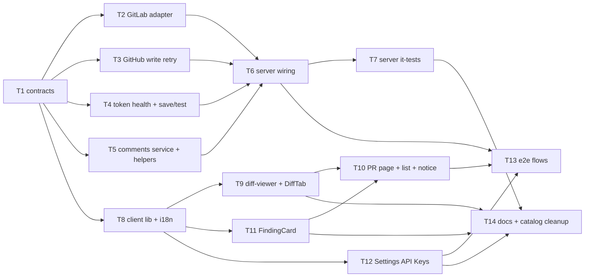

# Implementation Plan: GitLab phase 2 — posting inline comments and replies

## Overview
GitLab MRs are read-only in DevDigest today: `GET /pulls/:id/comments` answers `[]`, `POST` answers
`provider_read_only`, and the UI shows a disabled post control. This plan implements
`specs/2026-10-20-gitlab-comments.md` (SPEC-2026-10-20-gitlab-comments, approved, AC-1 – AC-42).
It reads diff-anchored GitLab discussions, posts new inline comments and replies as the workspace
service account, makes the `api` scope mandatory and tracks token health, and adds attribution
(a GitLab footer plus a `pr_comment.create` audit event). It also removes automatic re-sends of
comment writes after a 5xx or timeout, on both GitHub and GitLab.

## Execution mode
multi-agent (parallel). The user chose parallel `implementer` agents on the same branch
(`feat/gitlab-comments`). Concurrent tasks have strictly non-overlapping `Owned paths`. Executed by
`/run-plan`, gated by architecture-reviewer and plan-verifier. `/run-plan` runs **no test-writer**,
so every task below writes its own tests.

## Requirements (verified)
Source: `specs/2026-10-20-gitlab-comments.md`. The ids are the spec's AC ids, restated briefly.
- R-AC1: GET comments (GitLab) returns every note of every diff-anchored, `text`-positioned discussion, across all pages. It excludes system notes, overview/individual notes and image/file positions.
- R-AC2: First note = thread root. Later notes carry `in_reply_to_id` = root note id. Every note carries `discussion_id`.
- R-AC3: A position with `new_line` maps to `RIGHT`@new_line. A position with only `old_line` maps to `LEFT`@old_line.
- R-AC4: Position `head_sha` ≠ the MR's current head → `is_outdated: true`, `line: null`.
- R-AC5: `html_url` = `<project web_url>/-/merge_requests/<iid>#note_<id>`.
- R-AC6: Any read failure → `200 []` plus a secret-free warning log.
- R-AC7: A service-account note with an exact trailing AC-16 footer → body without the footer, plus `devdigest_attribution.name`. A footer typed by any other author is left untouched. The client shows "via DevDigest · <name>".
- R-AC8: New comment → one create-discussion request with a text position using the **current** base/start/head SHAs. Response in the read shape.
- R-AC9: Context line → old_line and new_line. Added line → new_line. Removed line → old_line.
- R-AC10: A renamed file sends old_path = previous path and new_path = current path.
- R-AC11: A target outside the persisted diff → `400 comment_position_invalid`, 0 GitLab calls. The 5 listed cases.
- R-AC12: Read the current diff_refs. Head ≠ persisted diff head → `409 comment_diff_outdated` ("New commits were pushed — reload the diff"), 0 writes. Applies to replies.
- R-AC13: No posted text executes a GitLab quick action. The visible text is preserved, fenced code is untouched, and MR state is unchanged.
- R-AC14: An empty or whitespace-only body → 400, no host call, on both providers. The client post button is disabled for such a body.
- R-AC15: Posted text (body + footer) > 1,000,000 chars → `400 comment_too_long`, 0 GitLab calls.
- R-AC16: Google mode + GitLab repo → append `"\n\n— posted by `<name>` via DevDigest"`. `—` is U+2014. The name is the display name, or the email when the name is empty.
- R-AC17: Local mode, or a GitHub repo → no footer.
- R-AC18: Sanitise the name: strip control chars, line breaks and backticks; collapse whitespace; truncate to 100; fall back to "a DevDigest user".
- R-AC19: Reply → one add-note request to that discussion id. Response `in_reply_to_id` = root note id. AC-12 – AC-18 apply.
- R-AC20: A reply to a missing discussion → `404 comment_thread_not_found`, 0 notes created.
- R-AC21: Save/test a token whose known scopes lack `api` → `ok:false`, `code: gitlab_token_insufficient_scope`, the exact spec message. On save, nothing is stored and the previous token is kept.
- R-AC22: Save/test a token with `api` → stored (on save), `ok:true`, "Connected as @<username>".
- R-AC23: While health = `insufficient_scope`, every GitLab op fails with `gitlab_token_insufficient_scope` and sends no GitLab request beyond the scope check. Ops: add/import, clone/refresh/resync, list sync, detail refresh, comment read/post, issue lookups for intent/brief. No anonymous fallback. Persisted data stays readable.
- R-AC24: Determine health on save, and before first use when it is unknown. Remember it until the token value changes. Re-check after a 401, or a 403 `insufficient_scope`.
- R-AC25: Health `insufficient_scope`/`invalid` → the PR list and PR page show a persistent notice with the exact text. Admins get a link to Settings → API Keys; Members get "Ask an admin to update it." It replaces the generic sync-failure notice. The post button is disabled and `aria-describedby` the notice.
- R-AC26: Settings → API Keys GitLab badge: ok → "Configured"; insufficient_scope → "Invalid — missing api scope"; invalid → "Invalid — rejected by GitLab"; unchecked → "Configured — not verified yet". Admins see the input; Members see the badge and the existing notice.
- R-AC27: Hint "Required scope: api (Reporter role recommended)" via i18n. No `read_api` hint rendered.
- R-AC28: Scopes not determinable → a transient failure gives `gitlab_token_unverified` (not stored; a stored token stays `unchecked` and the op fails). A definitive non-answer (403/404/no list) gives `insufficient_scope`.
- R-AC29: No token → `gitlab_token_missing`, 0 calls. A 401 → `gitlab_token_invalid`, and health becomes `invalid`.
- R-AC30: Other GitLab rejections → `gitlab_comment_failed` with a human, secret-free message. A 403/404 on the project → `gitlab_project_inaccessible`.
- R-AC31: GitLab write: retry 429 within the existing back-off budget. A 5xx, timeout or network error → exactly 1 attempt, then `gitlab_comment_failed` with "GitLab didn't confirm the comment — check the MR before posting again."
- R-AC32: Client post failure: the composer stays open with the draft, the message is shown in a `role="alert"` live region, and "Copy text" is offered. Both providers.
- R-AC33: GitHub comment create/reply: retry on 429 or a secondary rate limit. A 5xx, timeout or network error → exactly 1 request, then `github_comment_failed` with "GitHub didn't confirm the comment — check the PR before posting again."
- R-AC34: GitHub is otherwise unchanged (GET shape and 100-item page, codes, no footer, UI, FindingCard).
- R-AC35: GitLab open PR with health ok/unchecked → "+" affordance, threads, reply composer, Show/Hide toggle. No read-only notice.
- R-AC36: The post button is disabled while in flight (two rapid clicks → one request).
- R-AC37: On success, refresh the comment list and reveal comments.
- R-AC38: The GitLab FindingCard shows "Copy finding", with no disabled post control and no "not supported yet" note. The GitHub card is unchanged.
- R-AC39: Comments are labelled with the host username. GitLab attributed notes add "via DevDigest · <name>".
- R-AC40: All new or changed strings come from i18n. "isn't supported yet" no longer renders anywhere.
- R-AC41: Members and Admins may post. Unauthenticated → 401, 0 host calls.
- R-AC42: A successful post or reply on either provider (google mode) → one audit row `pr_comment.create`, target `pull_request`/PR uuid, metadata `{provider, host_comment_id, discussion_id?, is_reply}`. Never the body. A failure → 0 rows.

Requirements resting on an unconfirmed planner default are marked "(assumed default — confirm)" in the questions below.

## Open questions & recommendations
- Q1: Where does token health live? → **default: in memory, no migration.** A process-wide `GitLabTokenHealthService` singleton in the container keeps `{fingerprint → health, username}`. The fingerprint is a sha256 of the token value that is held in memory only and never logged, persisted or returned. Reasons:
  - the server is documented as single-instance per DB (`server/CLAUDE.md`, stale-run reaping);
  - health is cheap to recompute;
  - the `settings` table is unsuitable because `GET /settings` returns every row to Members, which would leak the fingerprint;
  - a new table would need migration `0026`, which collides with PR #14's `0026` and the shared `meta/_journal.json`.

  Cost: after an API restart, a token goes back to `unchecked` and is re-checked once on its first GitLab use. That is one scope lookup per process lifetime rather than strictly "per stored-token value" (spec NFR "Scope-check cost"). (assumed default — confirm)
- Q2: What is the health when **no** GitLab token is configured? → default: `gitlab_health: null`. The client treats `null` like `unchecked`: the composer is enabled, and a post answers `gitlab_token_missing` inline (AC-29/AC-32). There is no notice. (assumed default — confirm)
- Q3: How is `in_reply_to_id` filled for a GitLab reply? GitLab's add-note response does not carry the root note id. → default: `GET …/discussions/:discussion_id` **before** the write. It validates existence (AC-20, so no orphan write) and yields the root note id (AC-19). Cost: one extra read (300 ms in the latency NFR), well inside p95 ≤ 3 s. (assumed default — confirm)
- Q4: AC-15 length basis → default: the **exact text sent**, i.e. the neutralised body plus the footer, because that is what GitLab limits. It equals the typed length unless lines start with `/`. (assumed default — confirm)
- Q5: A GitLab reply that sends `in_reply_to` without `discussion_id` → default: `400 validation_error` ("discussion_id is required to reply on GitLab"), with no host call.
- Q6: HTTP status of an "unconfirmed" GitHub write (AC-33) → default: `502` (same as GitLab). A GitHub 4xx keeps today's `400 github_comment_failed`.
- Q7: AC-24 vs AC-29 on 401 → default: a 401 sets health `invalid` (AC-29, shown in the UI), and the **next** GitLab use runs one scope re-check (AC-24) before deciding. `invalid` does **not** block ops on its own the way `insufficient_scope` does (AC-23 names only `insufficient_scope`).
- Rec1: **Merge PR #14 (`feat/task-g-followups`) into `main` and rebase this branch before Phase 2.**
  - T4 and T6 touch `modules/settings/{routes,helpers}.ts` and `platform/auth/route-policy.ts`.
  - #14's G1 (typed `toSecretsStatusDto`) and G4 (move `secret.save` into the service transaction) rewrite the same lines.
  - This plan adds **no migration**, so the only conflicts are code ones.
  - If #14 lands first, T4 must record `secret.save` the #14 way: inside the GitLab save path, only when the key was actually stored. It must not use the route descriptor.
- Rec2: Change the route-policy `secret.save` descriptor, a spec gap. Today a test-connection with a key always saves and is audited. Under AC-21 a rejected GitLab key is **not** stored, so the descriptor's `when` must also require `response.ok === true` for `provider: 'gitlab'`. Otherwise a phantom `secret.save` row is written. Planned in T6.
- Rec3: Raise `bodyLimit` on `POST /pulls/:id/comments` to 4 MiB. With the global 1 MiB limit, a 1,000,000-character body with multi-byte characters is rejected with 413 before AC-15 can answer `comment_too_long`. Planned in T6.
- Rec4: Convert the hardcoded "Show comments"/"Hide comments" strings in `DiffTab.tsx` to i18n. They predate this spec and AC-40 covers only new or changed strings. Left out of scope; candidate follow-up.
- Rec5: Hidden retry layer, not in the spec. The `octokit` v4 package bundles `@octokit/plugin-retry` (retries 5xx, POST included) and `@octokit/plugin-throttling` (`server/node_modules/octokit/dist-src/octokit.js`). Removing the outer `withRetry` alone would **not** satisfy AC-33. See T3.

### Quick-action neutralisation (AC-13) — decision
Research (GitLab source on master, fetched 2026-10-20) shows the extractor works like this:
- `lib/gitlab/quick_actions/extractor.rb` strips `\r`.
- It renders through Banzai `quick_action` (`lib/banzai/filter/quick_action_filter.rb`) and keeps only **top-level `<p>`** blocks whose text starts with `/`. Fenced code, indented code, blockquotes, lists and raw HTML never qualify.
- It then matches `^\/(?<cmd>NAMES)(?:[ ](?<arg>[^\n]*))?(?:\s*\n|$)` (flags `m`, `i`) on each **raw** line of those paragraphs. Inline code is excluded by `EXCLUSION_REGEX`.
- No API parameter disables quick actions.

**Chosen technique: escape the leading slash with a backslash (`\/`) on every line outside fenced code
whose first non-blank character is `/` after 0–3 leading spaces.** The same applies after a leading run
of Unicode spaces or zero-width characters (U+00A0, U+2000–U+200B, U+202F, U+205F, U+3000, U+FEFF).
- `\/` no longer matches `^\/`, so the extractor finds no command (verified against the regex).
- CommonMark treats `\/` as an escaped ASCII punctuation character, so it renders as `/` and the visible text is unchanged.
- Lines inside a fenced block are byte-identical. Fence rules: ```` ``` ```` or `~~~` of length 3 or more, with 0–3 leading spaces. A fence closes only on the same character with a length at least as long. An unclosed fence runs to the end of the document, exactly as GitLab treats it.
- Lines indented 4 or more spaces or with a tab are left alone. They are either an indented code block, where a backslash would show, or a paragraph continuation, which the raw-line regex cannot match because of the leading whitespace.
- **Hardening (2026-10-20, after verified bypasses):** line endings are normalised first (`\r\n` → `\n`, then lone `\r` → `\n`), so the text sent is exactly the text analysed and GitLab's own `\r` deletion cannot re-shape lines (CRLF is not preserved). A `/` line is left unescaped only if BOTH the fence heuristic above AND a real CommonMark parse (`commonmark`, source positions) place it inside a code block; a fence-looking line inside an HTML block, block quote or list therefore no longer shields the lines after it. The offline oracle models the extractor: delete `\r` → CommonMark parse → top-level paragraphs' source lines (+1 trailing blank) → command regex.
- **Redesign (2026-10-20, user decision, after comrak bypasses):** GitLab renders with comrak + GLFM extensions (`>>>` multiline block quotes, description lists, alerts, footnotes, tables, math), which neither the heuristic nor `commonmark` models; `>>>\n~~~\n>>>\n/close` and `Term\n: def\n   ~~~\n\n/close` executed `/close` on the hardened output. New invariant: **every command-shaped line is neutralised; the code/paragraph guess only picks the invisible form.** A line is command-shaped when, after the lead above, it is `/` + a generic name (`[\p{L}\p{N}_][\p{L}\p{M}\p{N}_]*` — wider than ASCII because Ruby's `/i` case-folds e.g. U+212A → `k`, U+017F → `s`) followed by end of line or whitespace; `/usr/bin/env`, `/path/to`, `// c`, `/* x */` are not. Where both parsers agree the line is code, U+200B ZERO WIDTH SPACE is inserted before the `/` (invisible in rendered code); everywhere else `\` is inserted. When a CPU guard skips the parse, everything gets `\`. Either way the raw line no longer starts with `/`, so a wrong guess affects rendering only. Offline security test: no output line matches `^\/[A-Za-z_][A-Za-z0-9_]*(?:[ ][^\n]*)?\s*$` (raw lines, parser-independent) over all fixtures plus a deterministic fuzz corpus of GLFM containers, fences and line-ending variants; the CommonMark oracle remains a secondary check. This supersedes "fenced content byte-identical" below for command-shaped lines, and the zero-width rejection below for code blocks only.
- Rejected alternatives:
  - zero-width characters change the stored bytes, copy/paste and search;
  - inline code and indentation change the rendering.

Verification:
- **Offline (T5):** a test oracle ports the extractor regex verbatim with a command list (`merge, close, reopen, approve, unapprove, assign, unassign, label, unlabel, relabel, milestone, draft, ready, rebase, submit_review, shrug, tableflip, spend, estimate`). For every fixture the oracle must find **0 matches** outside fences in the output. Fenced content must be byte-identical. Removing exactly the inserted backslashes must give back the input. Fixtures cover CRLF, uppercase `/MERGE`, 1–3 leading spaces, a tab, `- /merge`, `> /merge`, ```` ``` ```` and `~~~` fences, an unclosed fence, `/merge` mid-line, and the spec example `"/merge\n/close\nLGTM"`.
- **Not verifiable offline (flagged):** the real Banzai paragraph detection and GitLab's render of `\/`. These need a **one-time manual smoke** on a throwaway gitlab.com MR. Post `"/label ~smoke\n/shrug\nLGTM"` and check that no label is added, no shrug is added, and the text renders as typed. The result is recorded in the PR description. This is the AC-13 "manual check on a sandbox MR".

## Affected modules & contracts
- **server**:
  - GitLab adapter: write transport, discussions, diff refs, scope lookup;
  - GitHub adapter: write retry rule;
  - `modules/pulls`: new comments application service and pure helpers; routes slimmed;
  - `modules/settings`: token health and token save/test service;
  - `platform/container.ts`: GitLab gate, wiring, fetch override slots;
  - `platform/auth/route-policy.ts`: `pr_comment.create` audit and the `secret.save` guard;
  - `modules/identity`: display name and email lookup;
  - `modules/pulls/sync-service.ts`: error code prefix.
- **client**:
  - lib types and hooks, i18n catalogs;
  - diff-viewer (composer, thread, card);
  - DiffTab, FindingCard and FindingsTab;
  - Settings → API Keys;
  - PR page and PR list (token notice, SyncStatus suppression).
- **e2e**: flows `10-gitlab-pr-detail`, `11-settings-gitlab`.
- **reviewer-core, mcp**: unchanged.
- **Contracts (new files only; both vendored copies byte-identical):**
  - `server/src/vendor/shared/contracts/host-comments.ts` (Zod):
    - `HostComment`
    - `HostCommentInput`
    - `GitLabTokenHealth`
    - `SecretsStatusWithHealth`
    - `ConnTestResultWithCode`
    - `HostCommentErrorCode`
    - `PrCommentAuditMetadata`
  - `server/src/vendor/shared/host-comments-ports.ts` (interfaces):
    - `GitLabCommentsHost`
    - `GitLabDiffRefs`
    - `GitLabTextPosition`
    - `GitLabDiffNote`
    - `GitLabDiscussionRef`
    - `GitLabScopeCheck`
  - `index.ts` in both copies: **append** two `export *` lines only.
  - No existing contract file is edited.
  - `provider_read_only` stays in `HostErrorCode` and is no longer emitted for comments.
- **Migrations:** none. This avoids any collision with PR #14's `0026`.

## Architecture changes
- **Core ring (contracts and ports):** the two new shared files above. `GitLabCommentsHost` is named after the conversation (diff discussions), not the vendor. `RestGitLabClient` implements both `GitLabClient` (unchanged) and `GitLabCommentsHost`. Port members are **function-typed properties** (server INSIGHTS: `host-git.ts` bivariance trap).
- **Infrastructure:**
  - `adapters/gitlab/http.ts`: `post<T>(path, body)` with a write retry policy (429 only) and an `authFailure` classification on `GitLabHttpError`, plus an `onAuthFailure` hook option.
  - `adapters/gitlab/client.ts` and the new `adapters/gitlab/discussions.ts` (pure mappers of the GitLab wire format).
  - `adapters/github/octokit.ts`: a dedicated write Octokit with plugins disabled, plus a rate-limit-only `withRetry`.
- **Application:**
  - `modules/pulls/comments-service.ts` (`PrCommentsService`): the use case for GET and POST, both providers, over an explicit deps object.
  - Pure helpers in `modules/pulls/{comment-body,comment-position,gitlab-comment-mapper}.ts`.
  - `modules/settings/gitlab-token-health.ts` (`GitLabTokenHealthService`, gate plus memo).
  - `modules/settings/gitlab-token-service.ts` (`GitLabTokenService`, save/test).
  - The pulls service consumes a **consumer-shaped** structural interface for the gate (`GitLabCommentAccess`), so `modules/pulls` never imports `modules/settings`. This is the `no-cross-module` rule.
- **Composition root (`platform/container.ts`):**
  - `gitlabTokenHealth` getter.
  - `gitlab()` runs the gate before returning a client when a token exists.
  - `gitCredential()` runs the gate for gitlab refs.
  - New getters `prComments` and `gitlabToken`.
  - New override slots `gitlabFetch`, `githubFetch`, `prComments`.
  - The real `RestGitLabClient` is built with `onAuthFailure` bound to the health service.
- **Presentation:**
  - `modules/pulls/routes.ts`: the comments routes become thin translators to `container.prComments`, with `HostCommentInput` as the body schema, `HostComment` as the response, and `bodyLimit: 4 MiB` on POST.
  - `modules/settings/routes.ts`: GitLab save/test goes to `container.gitlabToken`, and secrets-status adds `gitlab_health`.
  - `route-policy.ts`: the audit descriptor.
- **Client (RSC boundary unchanged):** every touched component is already `"use client"`. The new `components/gitlab-token-notice/` is a client component (it uses a session hook).



Parallel waves:
- W1: T1.
- W2: T2, T3, T4, T5, T8.
- W3: T6, T9, T11, T12.
- W4: T7, T10.
- W5: T13, T14.

## Phased tasks

### Phase 1 — Contracts

- **T1**
  - **Action:** Add the new contract and port files, mirror them into the client copy, and append to both `index.ts` barrels.
    - `contracts/host-comments.ts`:
      - `HostComment = PrReviewComment.extend({ discussion_id: z.string().nullish(), provider: RepoProvider.optional(), devdigest_attribution: z.object({ name: z.string() }).nullish() })`.
      - `HostCommentInput = PrCommentInput.extend({ body: z.string().refine(s => s.trim().length > 0, 'Comment body must not be empty'), discussion_id: z.string().min(1).optional() }).refine(v => !(v.in_reply_to != null && v.discussion_id != null), { message: 'Set at most one of in_reply_to / discussion_id', path: ['discussion_id'] })`.
      - `GitLabTokenHealth = z.enum(['ok','insufficient_scope','invalid','unchecked'])`.
      - `SecretsStatusWithHealth = SecretsStatusDetailed.extend({ gitlab_health: GitLabTokenHealth.nullish() })`.
      - `ConnTestResultWithCode = ConnTestResultHost.extend({ code: z.string().optional() })`.
      - `HostCommentErrorCode = z.enum(['comment_position_invalid','comment_diff_outdated','comment_thread_not_found','comment_too_long','gitlab_token_insufficient_scope','gitlab_token_unverified','gitlab_comment_failed'])`.
      - `PrCommentAuditMetadata = z.object({ provider: RepoProvider, host_comment_id: z.number().int(), discussion_id: z.string().optional(), is_reply: z.boolean() }).strict()`.
      - A constant `GITLAB_COMMENT_MAX_CHARS = 1_000_000`.
    - `host-comments-ports.ts` (interfaces only, function-typed properties):
      - `GitLabDiffRefs { baseSha; startSha; headSha }`.
      - `GitLabTextPosition { baseSha; startSha; headSha; oldPath; newPath; oldLine: number|null; newLine: number|null }`.
      - `GitLabDiffNote { id: number; discussionId: string; rootNoteId: number; author: string; body: string; createdAt: string; position: { headSha: string; oldPath: string|null; newPath: string|null; oldLine: number|null; newLine: number|null } }`.
      - `GitLabDiscussionRef { id: string; rootNoteId: number; position: GitLabDiffNote['position'] | null }`.
      - `GitLabScopeCheck = { kind:'ok'; username; scopes: string[] } | { kind:'insufficient_scope'; username: string|null } | { kind:'invalid'; reason: GitLabTokenFailure } | { kind:'unverified' }`.
      - `GitLabCommentsHost`:
        - `listDiffNotes: (ref: HostRepoRef, iid: number) => Promise<GitLabDiffNote[]>`;
        - `getDiffRefs: (ref, iid) => Promise<GitLabDiffRefs>`;
        - `getDiscussion: (ref, iid, discussionId: string) => Promise<GitLabDiscussionRef|null>`;
        - `createDiffDiscussion: (ref, iid, input: { body: string; position: GitLabTextPosition }) => Promise<GitLabDiffNote>`;
        - `addDiscussionNote: (ref, iid, discussionId: string, body: string) => Promise<GitLabDiffNote>`;
        - `checkTokenScopes: () => Promise<GitLabScopeCheck>`.
    - Copy both files byte-identically to `client/src/vendor/shared/` and append `export * from './contracts/host-comments.js'; export * from './host-comments-ports.js';` to both `index.ts`.
  - **Module:** server (+ client vendored copy)
  - **Type:** backend
  - **Skills to use:** zod, typescript-expert, onion-architecture
  - **Owned paths:**
    - `server/src/vendor/shared/contracts/host-comments.ts`
    - `server/src/vendor/shared/host-comments-ports.ts`
    - `server/src/vendor/shared/index.ts`
    - `client/src/vendor/shared/contracts/host-comments.ts`
    - `client/src/vendor/shared/host-comments-ports.ts`
    - `client/src/vendor/shared/index.ts`
    - `server/test/contracts-host-comments.test.ts`
  - **Depends-on:** none
  - **Risk:** medium (cross-package lockstep)
  - **Known gotchas:**
    - Existing shared files are extend-only; only *append* to `index.ts`.
    - Use `.nullish()`/`.optional()` for new fields so existing `PrReviewComment` fixtures still parse (root INSIGHTS: `.nullable()` breaks fixtures).
    - Port members must be property syntax (server INSIGHTS, `host-git.ts:15-54`).
    - ZodError is matched by shape (duplicate zod instances).
    - `fastify-type-provider-zod` accepts a refined (ZodEffects) body schema. Keep the `.refine` at the top level and do not `.extend` after it.
  - **Acceptance:**
    - `node scripts/check-shared-sync.mjs` prints `✓ … in sync`.
    - `cd server && pnpm typecheck && cd ../client && pnpm typecheck` green.
    - `server/test/contracts-host-comments.test.ts` asserts:
      - a `PrReviewComment` fixture parses as `HostComment` (AC-34 additive);
      - `HostCommentInput` rejects `"   "` (AC-14) and rejects both `in_reply_to` + `discussion_id` set;
      - `PrCommentAuditMetadata` rejects a `body` key (AC-42);
      - `GitLabTokenHealth.options` equals the 4 spec values.
    - `git diff --stat main -- server/src/vendor/shared client/src/vendor/shared` shows only the 4 new files plus the 2 index files.

### Phase 2 — Adapters, application services, client data layer (parallel)

- **T2**
  - **Action:** GitLab adapter write support (AC-1 – AC-6, AC-8 – AC-10, AC-19, AC-20, AC-24, AC-28 – AC-31).
    1. **`http.ts`:**
       - Add `post<T>(path, body: unknown)`: JSON body, `PRIVATE-TOKEN` header, same origin pin and `redirect:'manual'`.
       - Give `send()` a `retryServerErrors` flag (default `true` for `rest()` GET and `graphql()`, `false` for `post()`). With `false`, only 429 is retried, inside the existing `GITLAB_MAX_RETRIES` / `GITLAB_MAX_EXTRA_WAIT_MS` / `Retry-After` budget. A 5xx throws immediately. Network errors and timeouts already throw without retry; keep that behaviour and add a comment that writes rely on it.
       - Add `authFailure: 'invalid' | 'insufficient_scope' | null` to `GitLabHttpError`. Set `invalid` on 401. Set `insufficient_scope` on 403 when `www-authenticate` contains `insufficient_scope` or the JSON `error === 'insufficient_scope'`.
       - Add `onAuthFailure?: (kind) => void` to `GitLabHttpOptions`, invoked once per such response.
    2. **New `discussions.ts`** (pure mappers):
       - `mapDiscussions(raw[]) → GitLabDiffNote[]`. It keeps a discussion only when it is not `individual_note`, its first note is `type === 'DiffNote'` and not `system`, and `position.position_type === 'text'`. It skips system notes inside kept discussions. `rootNoteId` = the first note id.
       - `mapDiffRefs`.
       - `toApiPosition(GitLabTextPosition)`, which omits a null `old_line`/`new_line`.
    3. **`client.ts`:**
       - Implement `GitLabCommentsHost`:
         - `listDiffNotes`: paginated `GET …/merge_requests/:iid/discussions`, `per_page` 100, via the existing `paginate`;
         - `getDiffRefs`: `GET` MR → `diff_refs`;
         - `getDiscussion`: `GET …/discussions/:encodeURIComponent(id)` (404 → `null`);
         - `createDiffDiscussion`: `POST …/discussions` `{ body, position }`;
         - `addDiscussionNote`: `POST …/discussions/:id/notes` `{ body }`;
         - `checkTokenScopes`: see below.
       - Set `readOnly = false`.
       - `checkTokenScopes`:
         - `GET /user`: 401/403 → `{kind:'invalid', reason}`; status 0, 429 or 5xx → `{kind:'unverified'}`.
         - Then `GET /personal_access_tokens/self`: an array including `api` → `ok`; an array without `api` → `insufficient_scope`; 403/404 or no `scopes` array → `insufficient_scope`; status 0, 429 or 5xx → `unverified`.
       - Keep `checkToken()` unchanged (frozen `GitLabClient` port).
       - Map write errors with a new `writeError(err)`:
         - 401 → `AppError('gitlab_token_invalid', …, 400)`;
         - authFailure `insufficient_scope` → `AppError('gitlab_token_insufficient_scope', SPEC_MSG, 400)`;
         - upstreamStatus 0 or ≥ 500 → `AppError('gitlab_comment_failed', "GitLab didn't confirm the comment — check the MR before posting again.", 502)`;
         - other 4xx → `AppError('gitlab_comment_failed', redacted upstreamDetail or 'GitLab rejected the comment.', 400)`.
       - Map read errors for the diff-refs read: 403/404 → `gitlab_project_inaccessible` (404), 401 → `gitlab_token_invalid`, 5xx/0 → `AppError('gitlab_comment_failed', 'GitLab is unavailable — try again.', 502)`.
       - Every message passes `redactSecret`.
    4. **`adapters/mocks.ts`:** extend `MockGitLabClient` with `GitLabCommentsHost` (configurable notes, diffRefs, scope check defaulting to `{kind:'ok', username:'devdigest-bot', scopes:['api']}`, recorded calls), and set `readOnly=false`.
  - **Module:** server
  - **Type:** backend
  - **Skills to use:** onion-architecture, typescript-expert, security, zod
  - **Owned paths:**
    - `server/src/adapters/gitlab/http.ts`
    - `server/src/adapters/gitlab/client.ts`
    - `server/src/adapters/gitlab/discussions.ts`
    - `server/src/adapters/gitlab/mappers.ts`
    - `server/src/adapters/gitlab/index.ts`
    - `server/src/adapters/mocks.ts`
    - `server/test/gitlab-http-write.test.ts`
    - `server/test/gitlab-comments-client.test.ts`
    - `server/test/gitlab-scope-check.test.ts`
    - `server/test/gitlab-http.test.ts`
    - `server/test/gitlab-client.test.ts`
  - **Depends-on:** T1
  - **Risk:** high (write path, duplicate-post risk)
  - **Known gotchas:**
    - Reads (REST GET and GraphQL POST) must keep retrying 5xx. Only `post()` changes.
    - The redirect and origin rules must apply to writes.
    - Never echo a token. Every `GitLabHttpError` message goes through `redact`.
    - `MockGitLabClient.readFile`-style "empty means absent" pitfalls (server INSIGHTS): make `getDiscussion` return `null` explicitly for unknown ids.
    - The discussion id must be URL-encoded.
  - **Acceptance (hermetic, `cd server && pnpm vitest run test/gitlab-http-write.test.ts test/gitlab-comments-client.test.ts test/gitlab-scope-check.test.ts test/gitlab-http.test.ts test/gitlab-client.test.ts`):**
    - Fake fetch 429 (`Retry-After: 0`) → 201 gives exactly 2 POSTs and returns a note.
    - 502 → exactly 1 POST and `gitlab_comment_failed` 502 with the spec message.
    - A fetch rejecting with `TimeoutError` → exactly 1 POST, same code.
    - A network error → 1 POST (AC-31).
    - A GET 503 → 200 is still retried (regression).
    - Fixture: 2 diff discussions (3 notes), 1 individual note, 2 system notes, 1 image-positioned → 3 notes (AC-1). 150 discussions over 2 pages → 150 roots (AC-1).
    - `createDiffDiscussion` sends a `position` with base/start/head, old/new path, and only the provided lines (AC-8/9/10).
    - `getDiscussion` 404 → `null` (AC-20).
    - Scope check: `['read_api','read_repository']` → `insufficient_scope`; `['api']` → `ok`; self 404 → `insufficient_scope`; self 503 → `unverified`; `/user` 401 → `invalid` (AC-21/22/28).
    - 403 with `www-authenticate: … error="insufficient_scope"` → `onAuthFailure('insufficient_scope')` called once; 401 → `onAuthFailure('invalid')` (AC-24/29).
    - No error message contains the token string (AC-30).
    - `pnpm typecheck` green.

- **T3**
  - **Action:** GitHub comment-write retry rule (AC-33, AC-34).
    - In `OctokitGitHubClient`, accept an optional second constructor argument `opts?: { fetch?: typeof fetch; sleep?: (ms:number)=>Promise<void> }`. Pass `request: { fetch }` to the Octokits.
    - Build a **second** internal Octokit `writeOctokit = new Octokit({ auth, retry: { enabled: false }, throttle: { enabled: false }, request: { fetch } })`. Use it **only** in `createReviewComment` (new comment and `createReplyForReviewComment`).
    - Wrap that call in `withRetry(…, { isRetryable: isGitHubRateLimited })`.
      - `isGitHubRateLimited(err)` = status 429, or status 403 with `x-ratelimit-remaining === '0'` or a message matching `/secondary rate limit/i`.
      - Timeouts (`TimeoutError`), 5xx and network errors are **not** retryable.
    - On final failure, throw:
      - `AppError('github_comment_failed', "GitHub didn't confirm the comment — check the PR before posting again.", 502)` when status ≥ 500, a `TimeoutError`, or no status (network);
      - otherwise `AppError('github_comment_failed', <redacted Octokit message>, 400)`.
    - Reads, `postReview`, etc. keep the existing Octokit and `withRetry` (AC-34).
  - **Module:** server
  - **Type:** backend
  - **Skills to use:** onion-architecture, typescript-expert, security
  - **Owned paths:**
    - `server/src/adapters/github/octokit.ts`
    - `server/test/github-comment-retry.test.ts`
  - **Depends-on:** T1
  - **Risk:** medium
  - **Known gotchas:**
    - The `octokit` package bundles plugin-retry and plugin-throttling (`server/node_modules/octokit/dist-src/octokit.js`). Disabling only the outer `withRetry` still re-sends a POST on 5xx, so disable **both** plugins on the write instance.
    - In tests, pass `Retry-After: 0`, or inject `sleep`, so the back-off does not slow the suite.
    - The container still calls `new OctokitGitHubClient(token)`; keep that signature valid.
  - **Acceptance (`cd server && pnpm vitest run test/github-comment-retry.test.ts`, stub fetch counting requests):**
    - 502 → exactly 1 create request and `github_comment_failed` 502 with the spec message.
    - 429 → 201 → exactly 2 requests and a mapped comment.
    - 403 "secondary rate limit" → 201 → 2 requests.
    - A hanging fetch with a short timeout → 1 request.
    - Reply path 502 → 1 request.
    - 422 → 400 `github_comment_failed`, 1 request.
    - `listReviewComments` 503 → 200 still retried (AC-34 regression).
    - Existing `server/test/pulls-comments.it.test.ts` passes unmodified.
    - `pnpm typecheck` green.

- **T4**
  - **Action:** Token health plus GitLab token save/test (AC-21 – AC-24, AC-26, AC-28, AC-29).
    1. **New `modules/settings/gitlab-token-health.ts`**, class `GitLabTokenHealthService`:
       - Deps: `{ readToken: () => Promise<string|null>; check: (token: string) => Promise<GitLabScopeCheck> }`.
       - State: `Map<fingerprint, { health: GitLabTokenHealth; username: string|null }>`, fingerprint = `createHash('sha256').update(token).digest('hex')`. Never logged or exported. Plus a single-flight `Map<fingerprint, Promise>` for checks.
       - `ensureUsable(): Promise<{ token: string; username: string } | null>`:
         - no token → `null`;
         - `ok` → return;
         - `insufficient_scope` → throw `AppError('gitlab_token_insufficient_scope', 'This token is missing the api scope. Required scope: api (Reporter role recommended).', 400)`;
         - `unchecked` or `invalid` → run the check (single-flight) and record it. `ok` → return. `insufficient_scope` → throw as above. `invalid` → throw `gitlab_token_invalid` 400. `unverified` → stay `unchecked` and throw `AppError('gitlab_token_unverified', "Couldn't verify the token's scopes — try again", 503)`.
       - `current(): Promise<GitLabTokenHealth | null>`: no check; `null` when no token; `unchecked` when the fingerprint is unknown.
       - `record(token, check)` (used by save/test).
       - `reportAuthFailure(token, kind)`: `invalid` → set `invalid`; `insufficient_scope` → set `unchecked`, so the next use re-checks (AC-24).
    2. **New `modules/settings/gitlab-token-service.ts`**, class `GitLabTokenService`:
       - Deps: `{ probe: (token) => Promise<GitLabScopeCheck>; readToken; saveToken: (token, actorUserId) => Promise<void>; invalidateCaches: () => void; health: GitLabTokenHealthService }`.
       - `test(key: string | null, actorUserId: string | null): Promise<ConnTestResultWithCode>`. The candidate is `key ?? stored`; if there is none → `{ok:false, code:'gitlab_token_missing', message:'No GitLab token is configured.'}`. Probe the candidate **before** storing it:
         - `ok` → if a key was given, `saveToken` then `invalidateCaches`; then `health.record`; return `{ok:true, message:'Connected as @<u>'}`.
         - `insufficient_scope` → `{ok:false, code:'gitlab_token_insufficient_scope', message: SPEC}`. Not stored. Health is recorded **only for the stored token** (test-only path).
         - `unverified` → `{ok:false, code:'gitlab_token_unverified', message:"Couldn't verify the token's scopes — try again"}`. Not stored.
         - `invalid` → `{ok:false, code:'gitlab_token_invalid', message:'GitLab token is <reason>'}`. Not stored.
    3. **`helpers.ts`:**
       - Add `toSecretsStatusWithHealth(entries, gitlabHealth)` built on `toSecretsStatusDto`.
       - Remove `gitlabCheckToResult`, which is now dead, and update `server/test/settings-helpers.test.ts`.
       - No route or container changes here (T6).
  - **Module:** server
  - **Type:** backend
  - **Skills to use:** onion-architecture, security, typescript-expert, zod
  - **Owned paths:**
    - `server/src/modules/settings/gitlab-token-health.ts`
    - `server/src/modules/settings/gitlab-token-service.ts`
    - `server/src/modules/settings/helpers.ts`
    - `server/test/gitlab-token-health.test.ts`
    - `server/test/gitlab-token-service.test.ts`
    - `server/test/settings-helpers.test.ts`
  - **Depends-on:** T1
  - **Risk:** high (gates every GitLab op)
  - **Known gotchas:**
    - No Fastify, Drizzle or container imports (onion §7). The hermetic tests use plain fakes and no Postgres.
    - The fingerprint must never reach a log, DTO, audit or error.
    - Concurrent first uses must share **one** scope check (single-flight), or AC-24's "1 scope check" fails under sync-on-open plus a detail refresh.
    - Rec1: PR #14 G1 rewrites `toSecretsStatusDto`. Rebase first if #14 is merged.
  - **Acceptance (`cd server && pnpm vitest run test/gitlab-token-health.test.ts test/gitlab-token-service.test.ts test/settings-helpers.test.ts`):**
    - Legacy `read_api` token: the first `ensureUsable` calls `check` once and throws `gitlab_token_insufficient_scope`; a second call throws with **0** further checks (AC-24).
    - Changing the token value gives `current()` = `unchecked` (AC-24).
    - 3 concurrent `ensureUsable` → 1 check.
    - `unverified` → `gitlab_token_unverified` 503 and health stays `unchecked`.
    - `reportAuthFailure('invalid')` → `current()` = `invalid`; the next `ensureUsable` re-checks once (AC-24/29).
    - `test('glpat-read', admin)` with an `insufficient_scope` probe → `{ok:false, code:'gitlab_token_insufficient_scope', message: SPEC}` and `saveToken` **not called** (AC-21).
    - An `ok` probe → `saveToken` called once, then `{ok:true, message:'Connected as @bot'}`, and health `ok` (AC-22).
    - An `unverified` probe → not stored, code `gitlab_token_unverified` (AC-28).
    - No result message contains the key.
    - `pnpm typecheck` green.

- **T5**
  - **Action:** Comments application service plus pure helpers (AC-1 – AC-20, AC-29 – AC-31 orchestration).
    1. **`comment-body.ts`** (pure):
       - `neutraliseQuickActions(body)` per the decision above.
       - `sanitiseFooterName(name|null, email|null)` per AC-18 (`\p{Cc}`, `\p{Cf}`, U+2028/2029, `\r\n`, backticks removed; `/\s+/gu`→' '; trim; 100 code points; fallback `a DevDigest user`).
       - `footerFor(name)` = ``"\n\n— posted by `" + name + "` via DevDigest"``.
       - `composeGitLabText(body, footerName|null)`.
       - `stripAttribution(body, isServiceAccount)`, with an exact-suffix regex ``/\n\n— posted by `([^`\n]{1,100})` via DevDigest$/u``. It returns `{ body, attribution }` and only strips when `isServiceAccount`.
    2. **`comment-position.ts`** (pure): `resolveGitLabTarget(files: PersistedFileLike[], path, side, line)`. It returns `GitLabTarget{ oldPath, newPath, oldLine, newLine }` or `null`.
       - Parse `@@ -a,b +c,d @@` hunks and classify lines as `+`, `-` or space.
       - RIGHT@n on an added line → `{newLine:n, oldLine:null}`; on a context line → both.
       - LEFT@n on a removed line → `{oldLine:n, newLine:null}`; on a context line → both.
       - File missing, `patch` null, `patchOmitted` set, or line not found → `null`.
       - `oldPath = previousPath ?? path`.
    3. **`gitlab-comment-mapper.ts`** (pure): `toHostComment(note, { currentHeadSha, webUrl, iid, serviceAccount })`. It applies AC-3 (side/line), AC-4 (outdated when `note.position.headSha !== currentHeadSha` → `line:null`, `is_outdated:true`), AC-5 (`html_url`), AC-2 (`in_reply_to_id` = rootNoteId unless id === rootNoteId → null; `discussion_id`) and AC-7 (via `stripAttribution`). It sets `provider:'gitlab'`, `original_line`, and `path = newPath ?? oldPath`.
    4. **`comments-service.ts`**, class `PrCommentsService`, deps object:
       - `github: () => Promise<GitHubClient>`;
       - `gitlabAccess: GitLabCommentAccess`, where `GitLabCommentAccess = { resolve: () => Promise<{ host: GitLabCommentsHost; serviceAccount: string } | null> }` is defined **in this file**;
       - `files: (prId) => Promise<PersistedFileLike[]>`;
       - `actorName: (userId) => Promise<{ name: string|null; email: string|null } | null>`;
       - `footerEnabled: boolean`;
       - `maxChars = GITLAB_COMMENT_MAX_CHARS`.

       Methods (`pr`/`repo` are structural, like `DetailPr`/`DetailRepo`):
       - `list(pr, repo, log)`:
         - GitHub: today's route logic (client failure or fetch failure → `[]` + warn), tagged `provider:'github'`.
         - GitLab: `resolve()` (null → `[]`), then `getDiffRefs`, then `listDiffNotes`, mapped. Any throw → `[]` + `log.warn({ code, upstreamStatus }, …)` with no token and no body (AC-6).
       - `create(pr, repo, input, actorUserId, log)`:
         - GitHub: same request mapping as today, and `discussion_id` ignored. `github()` failure → `github_unavailable` 400. Adapter `AppError`s pass through, and any other error → `github_comment_failed` 400.
         - GitLab, in **this order**:
           1. Reply without `discussion_id` → `validation_error` 400.
           2. Compose the text. If the footer is enabled, `actorName` → sanitise. If the text is longer than maxChars → `comment_too_long` 400.
           3. For a new comment, `resolveGitLabTarget`; `null` → `comment_position_invalid` 400.
           4. `resolve()`; `null` → `gitlab_token_missing` 400. Gate errors propagate.
           5. `getDiffRefs`. If `headSha !== pr.detailHeadSha` → `AppError('comment_diff_outdated','New commits were pushed — reload the diff',409)`.
           6. Reply: `getDiscussion`; `null` → `comment_thread_not_found` 404.
           7. Write (`createDiffDiscussion` with the refs, or `addDiscussionNote`).
           8. Map with `toHostComment`, using `currentHeadSha` = refs.headSha.
       - The service never logs the body or footer.
  - **Module:** server
  - **Type:** backend
  - **Skills to use:** onion-architecture, typescript-expert, security, zod
  - **Owned paths:**
    - `server/src/modules/pulls/comments-service.ts`
    - `server/src/modules/pulls/comment-body.ts`
    - `server/src/modules/pulls/comment-position.ts`
    - `server/src/modules/pulls/gitlab-comment-mapper.ts`
    - `server/test/comment-body.test.ts`
    - `server/test/comment-position.test.ts`
    - `server/test/gitlab-comment-mapper.test.ts`
    - `server/test/pr-comments-service.test.ts`
  - **Depends-on:** T1
  - **Risk:** high (security-relevant text transforms)
  - **Known gotchas:**
    - Do not import `adapters/git/diff-parser.ts` (that would add a concrete-adapter warning); write the small hunk walker locally.
    - Do not import `modules/settings/*` (`no-cross-module`). The gate is reached through the local `GitLabCommentAccess` interface.
    - No `Container` and no Fastify types. Use the structural `SyncLogger`-shaped logger.
    - The footer starts with `—`, so it never needs neutralising. Neutralise the user body **before** appending the footer.
    - Count length in UTF-16 `.length` consistently with what GitLab counts. Document this in the code.
  - **Acceptance (`cd server && pnpm vitest run test/comment-body.test.ts test/comment-position.test.ts test/gitlab-comment-mapper.test.ts test/pr-comments-service.test.ts`):**
    - Quick-action oracle (verbatim extractor regex): 0 matches on every fixture listed in the decision. The spec body `"/merge\n/close\nLGTM"` → `"\\/merge\n\\/close\nLGTM"`. Fenced content is byte-identical. Unescaping gives back the input (AC-13).
    - `composeGitLabText('Nit','Jane Doe')` === ``"Nit\n\n— posted by `Jane Doe` via DevDigest"`` (AC-16).
    - Name `"@all\n/merge"` → footer contains `` `@all /merge` `` and no output line starts with `/`.
    - A 500-char name truncates to 100; an empty name gives "a DevDigest user" (AC-18).
    - `stripAttribution` strips only for the service account (AC-7).
    - Position:
      - ctx/add/del targets → the 3 expected `{oldLine,newLine}` shapes (AC-9);
      - renamed → `oldPath ≠ newPath` (AC-10);
      - 5 invalid cases → `null` (AC-11).
    - Mapper: `RIGHT`/`LEFT` mapping (AC-3); outdated (AC-4); `html_url` form (AC-5); grouping fields (AC-2).
    - Service with fakes:
      - invalid position → `comment_position_invalid` and fake host calls = 0;
      - head moved → 409 with 1 `getDiffRefs` and 0 writes; equal → 1 read + 1 write using the read refs (AC-12);
      - reply to a missing discussion → 404 `comment_thread_not_found` and 0 writes (AC-20); reply → `in_reply_to_id` = root (AC-19);
      - google footer on → the body sent has the footer; `footerEnabled:false` → unchanged (AC-17);
      - too long → `comment_too_long` and 0 calls (AC-15);
      - `resolve()` null → `gitlab_token_missing` and 0 calls (AC-29);
      - list throws → `[]` and the warn payload has no token (AC-6);
      - GitHub path request mapping unchanged (AC-34).
    - `pnpm typecheck` green.

- **T8**
  - **Action:** Client data layer and i18n keys (adds only, no removals).
    1. **`lib/types.ts`:** re-export `HostComment`, `HostCommentInput`, `GitLabTokenHealth`, `SecretsStatusWithHealth`, `ConnTestResultWithCode`.
    2. **`lib/hooks/reviews.ts`:**
       - `usePrComments` returns `HostComment[]`.
       - `CreateCommentInput` adds `discussion_id?: string`.
       - `useCreatePrComment` returns `HostComment`. Its `onSuccess` invalidates `["pr-comments", prId]`. Its `onError` invalidates `["secrets-status"]` when `ApiError.code` ∈ {`gitlab_token_invalid`,`gitlab_token_insufficient_scope`} (AC-25 "next render").
    3. **`lib/hooks/core.ts`:**
       - `useSecretsStatus` typed `SecretsStatusWithHealth`.
       - `useTestConnection` typed `ConnTestResultWithCode`, and also invalidates `["secrets-status"]` whenever `provider === 'gitlab'`, whether or not `ok`.
    4. **New `lib/hooks/gitlab-health.ts`:** `useGitLabTokenHealth()` → `{ health: GitLabTokenHealth|null; blocked: boolean }`, where `blocked` = health ∈ {`insufficient_scope`,`invalid`}. Export it from `lib/hooks/index.ts`.
    5. **i18n.** Add these keys with these exact English values:
       - `messages/en/prHost.json`:
         - `comments.attribution` = "via DevDigest · {name}"
         - `comments.postsTo` = "Posted to {provider, select, gitlab {GitLab} other {GitHub}}"
         - `comments.copyText` = "Copy text"
         - `tokenNotice.insufficientScope` = "The GitLab token is invalid (missing the api scope). An admin must save a token with the api scope in Settings → API Keys."
         - `tokenNotice.invalid` = "The GitLab token is invalid (rejected by GitLab). An admin must save a token with the api scope in Settings → API Keys."
         - `tokenNotice.openSettings` = "Open Settings → API Keys"
         - `tokenNotice.askAdmin` = "Ask an admin to update it."
         - `tokenNotice.postDisabled` = "Posting is disabled until the GitLab token is fixed."
       - `messages/en/settings.json`:
         - `apiKeys.gitlabHintApi` = "Required scope: api (Reporter role recommended)"
         - `apiKeys.gitlabHealth.ok` = "Configured"
         - `apiKeys.gitlabHealth.insufficient_scope` = "Invalid — missing api scope"
         - `apiKeys.gitlabHealth.invalid` = "Invalid — rejected by GitLab"
         - `apiKeys.gitlabHealth.unchecked` = "Configured — not verified yet"
       - Do **not** remove or modify existing keys (T14 does that).
  - **Module:** client
  - **Type:** ui
  - **Skills to use:** next-best-practices, react-best-practices, typescript-expert, react-testing-library
  - **Owned paths:**
    - `client/src/lib/types.ts`
    - `client/src/lib/hooks/reviews.ts`
    - `client/src/lib/hooks/core.ts`
    - `client/src/lib/hooks/gitlab-health.ts`
    - `client/src/lib/hooks/gitlab-health.test.tsx`
    - `client/src/lib/hooks/index.ts`
    - `client/messages/en/prHost.json`
    - `client/messages/en/settings.json`
  - **Depends-on:** T1
  - **Risk:** low
  - **Known gotchas:**
    - `lib/api.ts` is the only place with `fetch`; don't add another.
    - Global query errors toast on 5xx. That is for **queries**; a mutation error is handled in the composer (T9).
    - The client copy of shared contracts arrives from T1; do not edit it.
  - **Acceptance:**
    - `cd client && pnpm typecheck && pnpm test` green; existing tests are unaffected because only keys were added.
    - `gitlab-health.test.tsx`: secrets-status with `gitlab_health:'insufficient_scope'` → `blocked:true`; `null` → `blocked:false`.
    - `node -e` JSON parse of both catalogs succeeds and contains every key listed (AC-40).

### Phase 3 — Server wiring, client components (parallel)

- **T6**
  - **Action:** Wire everything and update stale existing tests (AC-6, AC-14, AC-23 – AC-25 server half, AC-29, AC-41, AC-42).
    1. **`platform/container.ts`:**
       - `get gitlabTokenHealth()` (singleton) with `readToken = secrets.get('GITLAB_TOKEN')` and `check = (t) => this.gitlabProbe(t).checkTokenScopes()`.
       - `gitlabProbe(token)` builds `new RestGitLabClient({ token, fetch: overrides.gitlabFetch })`, or uses `overrides.gitlab` when injected.
       - `gitlab()`: when a token exists, build the client with `onAuthFailure: (k) => this.gitlabTokenHealth.reportAuthFailure(token, k)` and `fetch: overrides.gitlabFetch`, **await `gitlabTokenHealth.ensureUsable()` before returning** (no anonymous fallback; AC-23), and keep the `hostsOffline` check first.
       - `gitCredential(ref)`: for gitlab with a token, `await ensureUsable()` first.
       - `get prComments()` → `new PrCommentsService({ github: () => this.github(), gitlabAccess: { resolve: async () => { const ok = await this.gitlabTokenHealth.ensureUsable(); if (!ok) return null; return { host: (await this.gitlab()) as unknown as GitLabCommentsHost /* RestGitLabClient implements it */, serviceAccount: ok.username }; } }, files: (prId) => this.pullRequestRepo.getPersistedDetail(prId).then(d => d.files), actorName: (id) => this.identityRepo.displayIdentity(id), footerEnabled: this.config.authMode === 'google' })`. Prefer a typed getter `gitlabComments(): Promise<GitLabCommentsHost>` returning the concrete client typed by the port, over a cast.
       - `get gitlabToken()` → `GitLabTokenService` (`saveToken` → `secretsWriter.set('GITLAB_TOKEN', …)`).
       - `github()` passes `{ fetch: overrides.githubFetch }`.
       - Add the override slots `gitlabFetch`, `githubFetch`, `prComments`.
       - `invalidateSecretCaches()` keeps the health map; the map is keyed by fingerprint.
    2. **`modules/identity/repository/users.repo.ts` + `modules/identity/repository.ts`:** `displayIdentity(userId) → { name, email } | null`.
    3. **`modules/pulls/routes.ts`:**
       - GET/POST comments delegate to `container.prComments`.
       - Body schema `HostCommentInput`; response `{200: HostComment}` / `z.array(HostComment)`.
       - `bodyLimit: 4_194_304` on POST (Rec3).
       - Pass `(await getContext()).userId`.
       - Update the header comment.
    4. **`modules/pulls/detail-service.ts`:** remove `isReadOnly`/`assertWritable` from `PullDetail` and the class, along with the `provider_read_only` emission.
    5. **`modules/pulls/sync-service.ts`:** `describeSyncError` prefixes `[<code>] ` when `err.code` is a string in `HostErrorCode ∪ HostCommentErrorCode` (AC-23 "sync records failure with that code").
    6. **`modules/settings/routes.ts`:**
       - `provider === 'gitlab'` → `return { provider, ...(await container.gitlabToken.test(key ?? null, actorUserId)) }`, before any save.
       - Other providers are unchanged.
       - Secrets-status → `toSecretsStatusWithHealth(…, await container.gitlabTokenHealth.current())`, with the response schema `SecretsStatusWithHealth`.
    7. **`platform/auth/route-policy.ts`:**
       - `'POST /pulls/:id/comments': { access:'member', audit: audit('pr_comment.create','pull_request', { metadata: (ctx) => PrCommentAuditMetadata-shaped { provider: response.provider ?? 'github', host_comment_id: response.id, ...(response.discussion_id ? {discussion_id} : {}), is_reply: body.in_reply_to != null || body.discussion_id != null } }) }`. It reads ids only and never the body.
       - `secret.save` `when` additionally requires `!(body.provider === 'gitlab' && response.ok !== true)` (Rec2).
    8. **Update stale assertions in existing tests:**
       - `server/test/pulls-comments-gitlab.it.test.ts`: replace the read-only expectations with GET → `[]` without a token, and POST without a token → `gitlab_token_missing`.
       - `server/test/container-hosts.test.ts`.
       - `server/test/settings-gitlab.test.ts`: new save semantics.
       - Any route-policy/audit test that enumerates descriptors.
       - Do not weaken unrelated assertions.
  - **Module:** server
  - **Type:** backend
  - **Skills to use:** onion-architecture, fastify-best-practices, drizzle-orm-patterns, zod, security, typescript-expert
  - **Owned paths:**
    - `server/src/platform/container.ts`
    - `server/src/modules/pulls/routes.ts`
    - `server/src/modules/pulls/detail-service.ts`
    - `server/src/modules/pulls/sync-service.ts`
    - `server/src/modules/settings/routes.ts`
    - `server/src/platform/auth/route-policy.ts`
    - `server/src/modules/identity/repository.ts`
    - `server/src/modules/identity/repository/users.repo.ts`
    - `server/test/pulls-comments-gitlab.it.test.ts`
    - `server/test/container-hosts.test.ts`
    - `server/test/settings-gitlab.test.ts`
    - `server/test/route-policy*.test.ts`
    - `server/test/pr-sync-service.test.ts`
  - **Depends-on:** T2, T3, T4, T5
  - **Risk:** high (touches the gate of every GitLab operation)
  - **Known gotchas:**
    - `container.ts` is the only file allowed to name concrete classes.
    - Keep `hostsOffline` rejection **before** the gate: e2e runs offline, and the gate must not make a request.
    - `getContext` before any host resolution, so unauthenticated requests get 401 with 0 host calls (AC-41). The guard already handles this; assert it in T7.
    - Audit is written in `onSend` only for status < 400 and only with a principal (server INSIGHTS: onSend, not onResponse), which gives AC-42 "failure → 0 rows" and "local → none" for free.
    - PR #14 (Rec1) conflicts here in `route-policy.ts` and `settings/routes.ts`.
    - `pnpm arch` must show no new warnings. Services must not import the container.
    - Settings rate limit stays at 20/min.
  - **Acceptance:**
    - `cd server && pnpm typecheck && pnpm test` green (Docker running).
    - `PATH="$HOME/.nvm/versions/node/v22.14.0/bin:$PATH" pnpm arch` → 0 errors, warning count ≤ the `main` baseline recorded before T1.
    - `rtk proxy grep -rn "provider_read_only" server/src/modules` → no emission site (AC-8/19 supersede AC-44).
    - `GET /settings/secrets-status` response parses as `SecretsStatusWithHealth` and contains no token-derived field.

- **T9**
  - **Action:** Diff viewer and Files changed tab (AC-14, AC-32, AC-35 – AC-37, AC-39, AC-40).
    - **`comments.ts`:**
      - `DiffCommentApi` drops `readOnly` and adds `provider: 'github'|'gitlab'`, `postBlocked?: { describedById: string } | null` and `onSubmit(input & { discussion_id?: string })`.
      - `CommentThread` gains `discussionId: string | null`, from the root comment's `discussion_id`.
    - **`InlineComposer`:**
      - Delete `ReadOnlyComposerActions`.
      - The post button is disabled when `!text.trim() || posting || postBlocked`, with `aria-describedby={postBlocked?.describedById}`.
      - Submit sends the **untrimmed-internally** body as `text.trim()` (today's behaviour).
      - On rejection, keep the text, render `<div role="alert">{err.message || t('prHost.comments.postFailed')}</div>`, show a "Copy text" button (`useCopyToClipboard`), and keep focus in the textarea.
      - Replies on GitLab pass `discussion_id` from the thread; GitHub keeps `in_reply_to`.
      - The hint is `t('prHost.comments.postsTo', {provider})`.
    - **`CommentCard`:** the link label is `t('prHost.viewOn', {provider})`. When `c.devdigest_attribution` is set, render `t('prHost.comments.attribution', {name})` next to `c.user`.
    - **`CommentThreadView`:** pass `discussionId`.
    - **`DiffTab`:**
      - `DiffTabHost` becomes `{ provider: HostLabelKey; filesOmittedByHost: number; postBlocked: { describedById: string } | null }`.
      - Remove the `readOnly` branch and the `ReadOnlyPostNotice` import.
      - `canComment = !!canComment && !!prId`.
      - `onSubmit` no longer toasts. It rethrows so the composer shows the inline alert (one error channel); `setShowComments(true)` on success.
    - **`components/read-only-host/`:** delete `ReadOnlyPostNotice/`, keep exporting `useCopyToClipboard` from `index.ts`, and update its header comment.
    - **Tests:**
      - Delete `DiffTab.readonly.test.tsx`.
      - New `DiffTab.gitlab.test.tsx`: no "isn't supported yet"; post disabled for `"   "`; enabled for text; two rapid clicks → one `mutateAsync`; a rejected post keeps the draft and shows `role=alert` and Copy text; `postBlocked` → disabled and `aria-describedby`.
      - New `CommentCard.test.tsx`: attribution label; "View on GitLab".
      - Extend `FileCard.test.tsx` if the reply props change.
  - **Module:** client
  - **Type:** ui
  - **Skills to use:** react-best-practices, next-best-practices, react-testing-library, typescript-expert, security
  - **Owned paths:**
    - `client/src/components/diff-viewer/**`
    - `client/src/components/read-only-host/**`
    - `client/src/app/repos/[repoId]/pulls/[number]/_components/DiffTab/**`
  - **Depends-on:** T8
  - **Risk:** medium
  - **Known gotchas:**
    - Styles go in `styles.ts` with CSS tokens, not Tailwind.
    - Use the `@devdigest/ui` primitives; don't fork them.
    - The comment body is rendered via the existing `Markdown` (safe path; untrusted host text).
    - The attribution name is plain text, never HTML.
    - `useCopyToClipboard` is consumed by T11. Keep its export path `@/components/read-only-host` stable.
    - `page.tsx` (T10) still passes the old `host.readOnly` until T10 lands. Make `readOnly` an accepted-but-ignored optional field **only** if typecheck needs it during W3; T10 removes it.
  - **Acceptance:**
    - `cd client && pnpm typecheck && pnpm test` green.
    - The new tests above pass (AC-14, AC-32, AC-35, AC-36, AC-37 reveal on success, AC-39).
    - `rtk proxy grep -rn "isn't supported yet" client/src` → no matches in components (AC-40; the catalog key is removed by T14).

- **T11**
  - **Action:** FindingCard on GitLab (AC-38).
    - Replace `_components/ReadOnlyActions` with `_components/CopyFindingAction` (only the "Copy finding" button, `t('prHost.readOnly.copyFinding')`).
    - `host-context.tsx`: `FindingHost` becomes `{ repo; offerCopy: boolean }`.
    - `FindingCard` renders `CopyFindingAction` when `host?.offerCopy`. The GitHub card has no copy and no post (unchanged).
    - `FindingsTab`: rename the prop `readOnly` → `offerCopy` (T10 passes it).
    - Update `FindingCard.test.tsx` and `FindingsTab.gating.test.tsx`, and `helpers.test.ts` if it references read-only.
  - **Module:** client
  - **Type:** ui
  - **Skills to use:** react-best-practices, react-testing-library, typescript-expert
  - **Owned paths:**
    - `client/src/app/repos/[repoId]/pulls/[number]/_components/FindingCard/**`
    - `client/src/app/repos/[repoId]/pulls/[number]/_components/FindingsTab/**`
  - **Depends-on:** T8
  - **Risk:** low
  - **Known gotchas:** `page.tsx` passes `readOnly` until T10. T10 depends on this task, so the run order holds; expect `page.tsx` typecheck drift during W3 to be resolved in T10. If self-verify typecheck fails only on `page.tsx`, report that rather than editing `page.tsx`.
  - **Acceptance:**
    - `cd client && pnpm test -- FindingCard FindingsTab` green.
    - GitLab card: a "Copy finding" button is present; `queryByText(/isn't supported yet/)` is null; no disabled "Post comment".
    - GitHub card: no "Copy finding", no "Post comment" (AC-38).

- **T12**
  - **Action:** Settings → API Keys GitLab health (AC-21, AC-22, AC-26 – AC-28).
    - `constants.ts`: the GitLab `hintKey` becomes `apiKeys.gitlabHintApi`.
    - `SettingsApiKeys.tsx`:
      - The GitLab row badge comes from `useSecretsStatus().data.gitlab_health` through a `GitLabHealthBadge` (`apiKeys.gitlabHealth.<health>`), when the secret state is `set`. Otherwise the existing "Not set" badge.
      - The test result shows the server `message`. When `code === 'gitlab_token_insufficient_scope'` it is rendered as an error (the server message already equals the spec text).
      - The Admin/Member split is unchanged (the Member view shows the badge and the existing notice, with no input).
    - Tests:
      - Update `SettingsApiKeys.test.tsx` (hint now "Required scope: api (Reporter role recommended)", no `read_api`; 4 badge states).
      - Update `SettingsApiKeys.gating.test.tsx` (Member sees the badge, no input).
  - **Module:** client
  - **Type:** ui
  - **Skills to use:** react-best-practices, react-testing-library, next-best-practices
  - **Owned paths:** `client/src/app/settings/[section]/_components/SettingsView/_components/SettingsApiKeys/**`
  - **Depends-on:** T8
  - **Risk:** low
  - **Known gotchas:**
    - The badge must never display anything token-derived.
    - The `readOnly` styling names in `styles.ts` refer to the Member view, not the GitLab host. Leave them.
  - **Acceptance:**
    - `cd client && pnpm test -- SettingsApiKeys` green.
    - Badge text for `ok` / `insufficient_scope` / `invalid` / `unchecked` equals the 4 spec strings (AC-26).
    - The hint equals "Required scope: api (Reporter role recommended)".
    - `queryByText(/read_api/)` is null (AC-27).
    - The Member render has no `textbox` (AC-26).

### Phase 4 — Integration tests, page wiring (parallel)

- **T7**
  - **Action:** New server integration tests: Postgres plus a fake GitLab over the `gitlabFetch` override (and `githubFetch`). Each file uses a unique repo `fullName`. A fake GitLab records `{method, path, body}`.
    - **`pulls-comments-gitlab-post.it.test.ts`**:
      - AC-8, AC-9 (3 position payloads), AC-10, AC-11 (5 cases, 0 requests), AC-12 (head moved: 1 read and 0 writes; equal: 1 read and 1 write with the read refs), AC-13 (received body has 0 oracle matches), AC-15, AC-16/17, AC-19, AC-20, AC-29 (no secret: 0 requests; 401: `gitlab_token_invalid` and secrets-status health `invalid`), AC-30 (locked 403 → `gitlab_comment_failed`, no token substring in the body or captured logs), AC-31 (429→201: 2 writes; 502: 1 write; timeout: 1 write).
      - Response bodies in the read shape (AC-1 – AC-7 via a GET round-trip), and AC-14 on both providers.
    - **`pulls-comments-gitlab-read.it.test.ts`**: AC-1 (3 items; 150 discussions over 2 pages), AC-2 – AC-5, AC-6 (fake 500 → `200 []`; the log has no token), AC-7 (service-account footer stripped; another author's footer kept).
    - **`gitlab-token-gate.it.test.ts`**: stored `read_api` token →
      - `POST /repos` GitLab add → 400 `gitlab_token_insufficient_scope`;
      - `POST /repos/:id/pulls/sync` → sync failure whose `last_sync_error` starts with `[gitlab_token_insufficient_scope]` and 0 MR requests;
      - `GET /pulls/:id` serves persisted detail; `GET comments` → `[]`; `POST comments` → that code;
      - the fake records exactly 1 `/personal_access_tokens/self` request across all ops (AC-23, AC-24);
      - saving an `api` token via test-connection → health `ok`, and the next sync performs MR requests;
      - save with a `read_api` key → `ok:false`, code, and secrets-status unchanged (AC-21);
      - scope lookup 503 → `gitlab_token_unverified` and nothing stored (AC-28);
      - a GitHub repo in the same workspace still syncs (mixed workspace).
    - **`pr-comment-audit.it.test.ts`** (google mode, as in `settings-secrets-google.it.test.ts`):
      - GitLab reply → 1 `audit_events` row `pr_comment.create`, `is_reply:true`, `discussion_id`;
      - GitHub comment via `githubFetch` → 1 row, `is_reply:false`, `provider:'github'`;
      - a failed post → 0 rows;
      - a DB scan finds no body text;
      - a Member posts → 200; no session → 401 and 0 fake host requests (AC-41, AC-42);
      - google-mode GitHub post body forwarded without a footer (AC-17).
  - **Module:** server
  - **Type:** backend
  - **Skills to use:** fastify-best-practices, drizzle-orm-patterns, security, typescript-expert
  - **Owned paths:**
    - `server/test/pulls-comments-gitlab-post.it.test.ts`
    - `server/test/pulls-comments-gitlab-read.it.test.ts`
    - `server/test/gitlab-token-gate.it.test.ts`
    - `server/test/pr-comment-audit.it.test.ts`
    - `server/test/helpers/fake-gitlab.ts`
  - **Depends-on:** T6
  - **Risk:** medium
  - **Known gotchas:**
    - `*.it.test.ts` needs Docker. Under full-suite load the `beforeAll` may exceed 120 s; rerun the file alone before debugging (root INSIGHTS).
    - Use `auditWritesSettled(app)` before asserting audit rows, because writes are fire-and-forget in `onSend`.
    - A unique `fullName` per file (the `repos_ws_fullname_uq` trap).
    - Keep latency assertions loose; strict budgets only behind `PERF_STRICT=1`.
    - Seeded `acme/payments-api` exists already.
  - **Acceptance:** `cd server && pnpm vitest run test/pulls-comments-gitlab-post.it.test.ts test/pulls-comments-gitlab-read.it.test.ts test/gitlab-token-gate.it.test.ts test/pr-comment-audit.it.test.ts` green. Every AC listed above has at least one named `it(...)` whose title contains its AC id.

- **T10**
  - **Action:** Token notice and page wiring (AC-25, AC-35, AC-38 wiring).
    - **New `components/gitlab-token-notice/GitLabTokenNotice/{GitLabTokenNotice.tsx,index.ts,styles.ts}`:**
      - A persistent `role="note"` with a stable `id` prop.
      - Text `prHost.tokenNotice.<insufficientScope|invalid>`.
      - Admins (`usePermissions().isAdmin`) get a `next/link` to `/settings/api-keys` labelled `tokenNotice.openSettings`; Members get `tokenNotice.askAdmin`.
      - Not dismissible.
    - **PR page `pulls/[number]/page.tsx`:**
      - `const { health, blocked } = useGitLabTokenHealth()`; `isGitLab = hostLabelKey(repo) === 'gitlab'`.
      - When `isGitLab && blocked`, render the notice above the tabs with `id="gitlab-token-notice"`.
      - `DiffTab host={{ provider, filesOmittedByHost, postBlocked: isGitLab && blocked ? { describedById: 'gitlab-token-notice' } : null }}`.
      - `FindingsTab offerCopy={isGitLab}`.
      - Drop `isReadOnlyHost` usage.
    - **PR list `pulls/page.tsx`:** for a GitLab repo with `blocked`, render the notice and pass `suppressFailedNotice` to `SyncStatus`. `SyncStatus` hides its "showing data from…" note when that flag is set; "Updating…" and the age stay.
    - **Tests:**
      - New `GitLabTokenNotice.test.tsx`: Admin variant has a link to `/settings/api-keys`; Member variant has "Ask an admin to update it." and no link; exact text per health.
      - Extend `pulls/page.test.tsx`: GitLab repo plus `insufficient_scope` → notice visible, persisted rows rendered, no "showing data from".
      - New `pulls/[number]/page.gitlab-health.test.tsx`: notice visible and the post button `aria-describedby="gitlab-token-notice"` and disabled.
  - **Module:** client
  - **Type:** ui
  - **Skills to use:** next-best-practices, react-best-practices, react-testing-library, typescript-expert
  - **Owned paths:**
    - `client/src/components/gitlab-token-notice/**`
    - `client/src/app/repos/[repoId]/pulls/[number]/page.tsx`
    - `client/src/app/repos/[repoId]/pulls/[number]/page.gitlab-health.test.tsx`
    - `client/src/app/repos/[repoId]/pulls/page.tsx`
    - `client/src/app/repos/[repoId]/pulls/page.test.tsx`
    - `client/src/app/repos/[repoId]/pulls/_components/SyncStatus/**`
  - **Depends-on:** T9, T11, T8
  - **Risk:** medium
  - **Known gotchas:**
    - Routes are keyed by PR number and the API by uuid (unchanged).
    - `useSearchParams`-style hooks need Suspense. The notice uses only session and secrets hooks.
    - While the session probe is pending, `isAdmin` is false (fail closed), so render the Member text, never the link.
    - `lib/host-urls.ts` `isReadOnlyHost` may become unused. Leave it; it is owned by T8's area and harmless, and a candidate for later removal.
  - **Acceptance:**
    - `cd client && pnpm typecheck && rtk proxy pnpm lint && pnpm test` green.
    - The new and extended tests pass (AC-25 Admin/Member, list and page variants, post disabled; AC-35 GitLab with health `ok` → no notice, post enabled).

### Phase 5 — End-to-end and docs (parallel)

- **T13**
  - **Action:** Update the hermetic e2e flows (offline, no GitLab token → health `null`).
    - **`10-gitlab-pr-detail.flow.json`:**
      - Replace the step `wait --text "Posting comments to GitLab isn't supported yet"` with `eval "document.body.innerText.includes(\"isn't supported yet\")"` and `assert.stdoutIncludes: "false"`.
      - Add `eval "document.body.innerText.includes('The GitLab token is invalid')"` → `false` (no notice when health is null).
      - Update the `name`/`description` to cite SPEC-2026-10-20 AC-35/AC-40.
    - **`11-settings-gitlab.flow.json`:**
      - Assert `wait --text "Required scope: api (Reporter role recommended)"`.
      - Add `eval "document.body.innerText.includes('read_api')"` → `false`.
      - Cite AC-27.
    - **`e2e/README.md`:** update the coverage table rows for flows 10 and 11.
  - **Module:** e2e
  - **Type:** e2e
  - **Skills to use:** react-testing-library (assertion discipline), typescript-expert
  - **Owned paths:**
    - `e2e/specs/10-gitlab-pr-detail.flow.json`
    - `e2e/specs/11-settings-gitlab.flow.json`
    - `e2e/README.md`
  - **Depends-on:** T6, T10, T12
  - **Risk:** low
  - **Known gotchas:**
    - Deterministic locators only; no AI `chat`.
    - Flows 02/04/05 assume the seeded repo only, so use the hermetic runner.
    - Never `docker compose down -v`.
    - Offline mode means comment GET → `[]` and no post is attempted. Do not add a posting step (it would need a live host).
  - **Acceptance:** `./scripts/e2e.sh` → 11/11 flows pass.

- **T14**
  - **Action:** Docs and catalog cleanup.
    - **`client/messages/en/prHost.json`:**
      - Remove `readOnly.note`, `readOnly.postComment`, and `comments.postFailed` if unused (`rtk proxy grep` first).
      - Keep `readOnly.copyFinding`, `copyComment`, `copied` and `copyFailed` if still referenced.
    - **`client/messages/en/settings.json`:** remove the old `apiKeys.gitlabHint` (`read_api` text).
    - **`server/README.md`:** comments endpoints for GitLab, new error codes, `gitlab_health` in secrets-status, test-connection save semantics for GitLab.
    - **`README.md`:** GitLab feature row (post/reply inline comments, `api` scope required with the Reporter role recommended, attribution footer in google mode, token notice).
    - **Root `CLAUDE.md` "Read when":** add the line for `specs/2026-10-20-gitlab-comments.md`. Also replace the "Commenting on GitLab is read-only" statement only if it appears in a doc file owned here.
  - **Module:** client + docs
  - **Type:** ui
  - **Skills to use:** next-best-practices (i18n), mermaid-diagram (only if a diagram is updated)
  - **Owned paths:**
    - `client/messages/en/prHost.json`
    - `client/messages/en/settings.json`
    - `server/README.md`
    - `README.md`
    - `CLAUDE.md`
  - **Depends-on:** T7, T9, T11, T12
  - **Risk:** low
  - **Known gotchas:**
    - Removing a key still referenced makes next-intl throw in tests. Grep `client/src` for every removed key first.
    - Spec files under `specs/` are not edited.
  - **Acceptance:**
    - `rtk proxy grep -rn "isn't supported yet\|read_api" client/messages client/src` → no matches (AC-27, AC-40).
    - `cd client && pnpm test` green.
    - `README.md` and `server/README.md` mention `pr_comment.create` and the `api` scope.

## Testing strategy
- **Hermetic server (no Docker):** T2, T3, T4 and T5 unit tests as listed. `cd server && pnpm vitest run <files>`.
- **Server integration (`*.it.test.ts`, testcontainers Postgres):** T6 (updated existing) and T7 (new). `cd server && pnpm test`.
- **Client (vitest + jsdom, fetch mocked):** T8, T9, T10, T11 and T12. `cd client && pnpm test`.
- **e2e (hermetic, offline):** T13. `./scripts/e2e.sh`.
- **Manual, not verifiable offline (AC-13):**
  - Sandbox gitlab.com MR: post `"/label ~smoke\n/shrug\nLGTM"` through DevDigest with a Reporter-role `api` token in google mode.
  - Verify: no label or shrug; the text renders as typed; footer `— posted by \`<name>\` via DevDigest` with no mention notification for a name like `@all`.
  - Record the result in the PR description.
- **Full verification matrix** (docs/plans/2026-10-19-next-steps.md §3). All must pass before push, chained with `&&`:
  ```
  cd server && pnpm typecheck && pnpm test
  cd server && PATH="$HOME/.nvm/versions/node/v22.14.0/bin:$PATH" pnpm arch   # 0 errors; warnings ≤ main baseline
  cd client && pnpm typecheck && rtk proxy pnpm lint && pnpm test
  cd reviewer-core && pnpm typecheck && pnpm test      # must be untouched + green
  cd mcp && pnpm typecheck && pnpm test                # must be untouched + green
  node scripts/check-shared-sync.mjs
  ./scripts/e2e.sh                                     # 11 flows
  ```
  Then run `/pr-self-review` before push.

## Risks & mitigations
- **A duplicate post from a hidden retry layer** (Octokit plugins, GitLab 5xx retry) → T2/T3 tests count requests at the fetch level (1 on 5xx or timeout), and T7 re-asserts end-to-end.
- **The gate breaks GitLab entirely through a scope-check bug** → `unverified` never locks out (it stays `unchecked` and retries on next use). `ok` is memoised. The T7 mixed-workspace test proves GitHub is unaffected.
- **Legacy deployments with a `read_api` token stop syncing after deploy** → this is intended per D-4, and the AC-25 notice explains it. Call it out in the PR description and the README (T14).
- **Health resets on restart (Q1)** → one extra scope lookup per process. Documented. Revisit if multi-instance deployment ever lands (it would also need shared state).
- **Quick-action escaping is unverified against live Banzai** → regex oracle tests plus the mandatory manual sandbox smoke. Fallback if the smoke fails: wrap command lines in inline code. That is a T5-only change, because the helper is isolated.
- **PR #14 conflicts** (`route-policy.ts`, `settings/{routes,helpers}.ts`) → Rec1: merge #14 first and rebase. No migration in this plan, so there is no numbering clash with `0026`.
- **Transient typecheck drift in W3** (`page.tsx` still passes the old props until T10) → T9/T11 report rather than edit `page.tsx`. T10 closes it in W4. `/run-plan` must not treat W3 `page.tsx`-only type errors as a blocker for T9/T11.
- **Token leakage** through new error paths and logs → every `GitLabHttpError`/`AppError` message is redacted. T2 and T7 assert no token substring in bodies or logs. The fingerprint stays in memory only.

## Red-flags check
- [x] Every requirement maps to a task:
  - AC-1–7: T2, T5, T7
  - AC-8–12: T2, T5, T7
  - AC-13: T5 (+ manual)
  - AC-14: T1, T9
  - AC-15–20: T5, T7
  - AC-21–24: T2, T4, T6, T7
  - AC-25: T6, T8, T10
  - AC-26–27: T12, T14
  - AC-28: T2, T4
  - AC-29–31: T2, T5, T7
  - AC-32: T9
  - AC-33: T3
  - AC-34: T3, T5
  - AC-35–37: T9
  - AC-38: T11, T10
  - AC-39: T9
  - AC-40: T8, T9, T14
  - AC-41–42: T6, T7
- [x] No specification was authored or edited; the requirements were taken as input.
- [x] Execution mode is recorded (multi-agent) and the plan is shaped for it (5 waves).
- [x] Dependencies form a DAG (no cycles; see the mermaid graph).
- [x] (multi-agent) Concurrent tasks have non-overlapping Owned paths:
  - W2: T2 gitlab adapter + mocks; T3 octokit; T4 settings services/helpers; T5 pulls new files; T8 client lib + catalogs.
  - W3: T6 container/routes/identity/stale tests; T9 diff-viewer/DiffTab; T11 FindingCard/FindingsTab; T12 SettingsApiKeys.
  - W4: T7 new it-tests; T10 pages/notice/SyncStatus.
  - W5: T13 e2e; T14 catalogs/docs.
- [x] Every Acceptance is measurable (named tests, commands, request counts).
- [x] No edits to existing shared contracts: new files only, plus appended `export *` lines in both `index.ts` (called out in T1).
