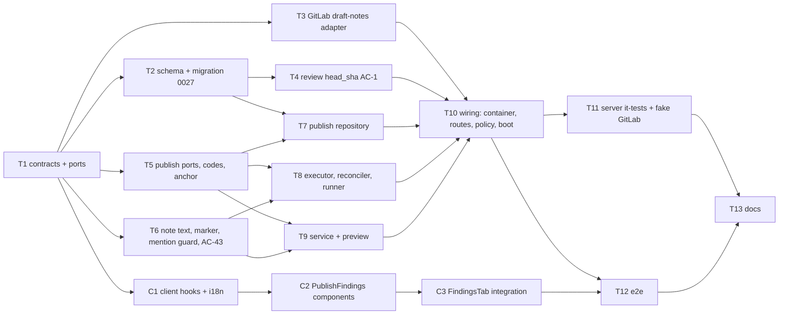

# Implementation Plan: Publish review findings to a GitLab MR (batch, via draft notes)

## Overview
DevDigest produces grounded findings, but a GitLab MR never sees them. This plan implements
`specs/2026-10-21-gitlab-publish-findings.md` (SPEC-2026-10-21-gitlab-publish-findings, approved,
AC-1 – AC-43, decisions D-1 – D-8). A user selects 1–50 findings of one review of a GitLab PR,
optionally adds a summary, and DevDigest publishes them as one GitLab review: one draft note per
finding, then one `bulk_publish`. The plan also closes the prerequisite gap that reviews do not
record the head SHA they reviewed (AC-1). It persists a finding → note link so nothing is published
twice, and it handles every partial-failure path without duplicate notes or stray drafts.

## Execution mode
multi-agent (parallel). The user chose parallel `implementer` agents on the same branch
(`feat/gitlab-publish-findings`). Concurrent tasks have strictly non-overlapping `Owned paths`.
Executed by `/run-plan`, gated by architecture-reviewer and plan-verifier. `/run-plan` runs **no
test-writer**, so every task below writes its own tests.

## Requirements (verified)
Source: `specs/2026-10-21-gitlab-publish-findings.md`. The ids are the spec's AC ids, restated briefly.
- R-AC1: A review records the head SHA of the diff it actually reviewed: local diff → the PR head it diffed; persisted-files fallback → `pull_requests.detail_head_sha`. Exposed as `head_sha` on `GET /pulls/:id/reviews` items. Pre-existing rows → `null`.
- R-AC2: The preview returns one entry per finding: `publishable`, one reason when not, the planned anchor (`multi_line|single_line|general`, path, start, end, `off_diff_reason`), `suggestion_eligible`, and the published link (who, when, URL). Plus review-level blockers. The preview makes **0** GitLab requests.
- R-AC3: GitHub PR → blocker `provider_not_supported`; the client renders no publish affordance.
- R-AC4: `head_sha` null → blocker `review_head_unknown` with the exact spec message; POST → 409, 0 GitLab requests.
- R-AC5: `head_sha` ≠ PR head, or ≠ `detail_head_sha` → blocker `review_diff_outdated` with the exact spec message.
- R-AC6: A publication of any review of the same PR in progress → blocker `publish_in_progress` with its id.
- R-AC7: Token missing / `insufficient_scope` / `invalid` → `gitlab_token_missing` / `gitlab_token_insufficient_scope` / `gitlab_token_invalid` blockers. Findings still listed.
- R-AC8: Persisted PR state not open (`merged`/`closed`) → `pr_not_open`. A draft MR is open.
- R-AC9: Anchors are decided only against the persisted GitLab MR diff (new-side lines: added + context). No new-side line in `[min,max]` → still publishable, anchor `general`, `off_diff_reason: not_on_diff_line`, sent with no position.
- R-AC10: Patch withheld/omitted → anchor `general`, `off_diff_reason: patch_unavailable`.
- R-AC11: Multi-line when `start<end` and every line is a new-side line of the same hunk (anchored at `end`, `line_range start..end`). Else single line at `end` if new-side, otherwise the in-range new-side line closest to `end` (tie → lower). Context lines carry old+new; added carry new only; renamed files send the previous path as old path.
- R-AC12: At publish start, read the MR's current diff refs before any write. Head ≠ review `head_sha` → whole publish rejected `409 review_diff_outdated`, 0 writes, client offers "Re-run review". Otherwise every positioned draft uses exactly those refs.
- R-AC13: A 400 on a multi-line draft → re-send once as single-line at `end`; a range-dependent suggestion is downgraded to a plain block.
- R-AC14: Note body order: header line (severity label, category, flattened title); location line for `general` only; blank line; rationale; suggestion (per AC-17); trifecta evidence list; marker; footer (google mode) as the final line.
- R-AC15: Quick actions neutralised in every finding body, the summary and the footer name (comments AC-13 unchanged).
- R-AC16: Finding-derived text never triggers a mention, a cross-reference (`#1`, `!2`, `~l`, `%m`, `g/p#1`) or an image load; same visible text; code untouched. The summary keeps mentions/references/images.
- R-AC17: An applicable `suggestion:-N+0` block only when all eight preconditions hold (toggle on, not general, kind `finding`/absent, multi-line or single added line, all lines added, `N ≤ 100`, exactly one fenced block, no command-shaped line). Otherwise plain Markdown with a fence longer than any backtick run inside. Preview's `suggestion_eligible` = every condition except the toggle.
- R-AC18: Composed body (incl. marker and footer) > 1,000,000 chars → not publishable, `body_too_long`.
- R-AC19: `secret_leak` → fixed redacted body (header, fixed sentence, marker, footer); never the rationale, suggestion or any matched value.
- R-AC20: Validation before any GitLab request, in order: permission; review in workspace; 1–50 unique finding ids of that review; summary ≤ 10,000 and not whitespace-only, `apply_suggestions` boolean (default false); review-level blockers; each finding publishable and not already published. Any failure rejects the whole request with its code; 0 GitLab requests.
- R-AC21: On success: create a publication (`in_progress`), answer `202` with it in < 1 s regardless of batch size, continue in the background.
- R-AC22: At most one in-progress publication per PR, across reviews and users, under **concurrent** requests. The loser gets `409 publish_in_progress` with the running id, 0 GitLab requests.
- R-AC23: Before creating drafts, list the service account's drafts on the MR. Drafts without this workspace's marker are untouched and published by the single `bulk_publish`; their count → `other_drafts_published`. This workspace's marked drafts of another publication are deleted first; their unpublished findings → `rolled_back` on the old publication.
- R-AC24: Every finding draft carries an invisible, deterministic, ids-only marker (workspace, publication, finding). Only service-account-authored notes/drafts are matched.
- R-AC25: One draft per selected finding, positioned per AC-11/AC-12 or unpositioned for `general`. Order: severity (CRITICAL, WARNING, SUGGESTION), then file, then line. After each draft persist its draft id and the progress counter.
- R-AC26: Exactly one `bulk_publish` with the neutralised (+ footer in google mode) summary when given, no `reviewer_state`, not internal. Then read **all** discussions, match by marker, persist discussion id, note id and `<project web_url>/-/merge_requests/<iid>#note_<id>`. Unmarked notes are linked to nothing.
- R-AC27: A confirmed-published finding whose note is not found by marker → `published` with link null ("Published — link unavailable"); never re-published.
- R-AC28: 429 on create/`bulk_publish` → wait per `Retry-After` and retry, ≤ 60 s total waiting per publication; budget exhausted → rollback with `gitlab_rate_limited`.
- R-AC29: A definitive per-finding 4xx (400/422, after AC-13) → that finding `failed` `gitlab_position_rejected`, continue; publish when ≥ 1 own draft exists (`partially_published`). All fail → no `bulk_publish`, publication `failed`.
- R-AC30: Create fails with 401/403/404/5xx/timeout/network → no re-send, stop, list drafts, delete every draft with **this** publication's marker (incl. an unconfirmed create that landed), never touch other drafts, no `bulk_publish`, publication `failed` with the mapped code, nothing published. Deletes and list reads may be retried.
- R-AC31: Rollback cannot delete every marked draft → `failed` `gitlab_drafts_left_behind`, message says drafts remain; the next publish removes them (AC-23).
- R-AC32: `bulk_publish` 5xx/timeout/network → no re-send; reconcile by reading: marked published notes → `published`; remaining own marked drafts → deleted, findings unpublished; other drafts untouched. Status `published`/`partially_published`/`failed` (`gitlab_publish_unconfirmed` when nothing published).
- R-AC33: Reconciliation reads fail → `unconfirmed` with the exact spec message; selected findings stay non-selectable (`publish_unconfirmed`) until reconciled.
- R-AC34: On server start, or when a review's publish state is requested, reconcile every publication of that scope that is `in_progress` > 10 min or `unconfirmed`, per the AC-32 rules; no write re-sent except idempotent deletes of marked drafts.
- R-AC35: Never record a finding as published twice; never create a second draft for a finding that is `published` or has a draft in an in-progress publication (DB constraint + retry tests).
- R-AC36: GitLab PR + permission → per-review selection UI: checkbox per publishable finding; tri-state "Select all publishable"; "Publish N to GitLab" disabled at N = 0; disabled checkbox + reason for unpublishable; off-diff labelled "Posts as a general MR comment (not on a changed line)"; published → "Published by <name> · <time>" + "View on GitLab" (http/https only, new tab, `rel="noopener noreferrer"`). Nothing selected by default; not persisted.
- R-AC37: A review-level blocker → one notice with its message, button disabled with `aria-describedby` → notice; "Re-run review" for `review_head_unknown`/`review_diff_outdated`; token blockers reuse the comments token notice.
- R-AC38: Confirm dialog: `!<iid>`, per-severity counts, general-comment count, "Make code suggestions applicable" toggle (default off; shows the eligible count; hidden when 0), the other-drafts warning (count / fallback text; never disables Publish), summary textarea with live counter (max 10,000), the google-mode note, Publish/Cancel. Focus trap, Esc cancels, focus returns to the trigger. The count read is one GitLab list request, read-only.
- R-AC39: In progress → "Publishing k of N…" in a polite live region, refreshed ≤ every 2 s, selection disabled on that PR. Result views for published / partially_published / failed / unconfirmed with `role="status"` / `role="alert"`; finding states refresh; a reload resumes progress from server state.
- R-AC40: One permission-matrix row for the publish route at `member`; the client derives visibility from the same permission; flipping that one row to `admin` restricts both server and client. Status, preview and other-drafts reads are `member`. Sessions and API tokens allowed. 401/403 with 0 GitLab requests.
- R-AC41: google mode: exactly one `review.publish` audit event when a publication reaches a terminal status after ≥ 1 GitLab write; strict metadata with counts only; nothing before a write; none in local mode; no `pr_comment.create` events.
- R-AC42: local mode: no footer on notes or summary, no audit event; otherwise identical.
- R-AC43: Comments read-back strips the publish marker from service-account notes (like the footer); other authors' notes unchanged; general finding notes stay not shown in Files changed.

Requirements resting on an unconfirmed planner default are marked "(assumed default — confirm)" in the questions below.

## Open questions & recommendations
The spec has no blocking open questions. These are gaps or inconsistencies found while grounding the
plan; each has a default that the plan implements.

- Q1: **AC-12 says `409 review_diff_outdated`, but the sequence diagram fails the publication after the `202`.** → default: **do the diff-refs read synchronously, before the `202`.** Order: validate → take the per-PR lock (insert the publication) → token gate → read diff refs. On a head mismatch, **delete** the just-inserted publication (its items cascade) and answer `409 review_diff_outdated` with 0 writes. This satisfies AC-12's 409 and AC-22 (the loser of the lock race makes no GitLab request). It costs one 300 ms read inside AC-21's 1 s budget. Gate/scope-check failures at this point are answered synchronously the same way (row deleted, mapped 4xx). (assumed default — confirm)
- Q2: **AC-34 "in_progress for more than 10 minutes" vs boot.** On boot, a publication killed seconds ago is < 10 min old, but the AC-34 observable ("kill the server mid-batch → after restart reconciled") needs it reconciled. → default: same reasoning as `reapStaleRunningRuns` (single instance per DB, `server/CLAUDE.md`): **at boot every `in_progress` row is orphaned.** An awaited DB step flips them to `unconfirmed` before `listen`; host reconciliation of all `unconfirmed` rows then runs as a fire-and-forget background pass. At runtime, the 10-minute rule applies to `in_progress` rows whose task is not alive in this process. (assumed default — confirm)
- Q3: **AC-34 (reconcile when publish state is requested) vs AC-2 (preview makes no GitLab call, p95 ≤ 500 ms).** → default: the preview **triggers** reconciliation asynchronously (single-flight per publication) and returns current DB state immediately. The client polls, so the settled state appears on the next read. (assumed default — confirm)
- Q4: **403 mapping.** AC-30 lists 401/403/404 → `gitlab_token_invalid` / `gitlab_project_inaccessible` / `gitlab_publish_failed`, and the edge case says "MR or discussions locked → 403 → `gitlab_publish_failed`". → default: 401 → `gitlab_token_invalid`; 403 with `insufficient_scope` → `gitlab_token_insufficient_scope` (reused code); any other 403 → `gitlab_publish_failed`; 404 → `gitlab_project_inaccessible`; 5xx / timeout / network → `gitlab_publish_failed`. (assumed default — confirm)
- Q5: **Publication code when every finding fails with a 4xx (AC-29).** The spec says "ends `failed`" without a code. → default: `gitlab_position_rejected` on the publication too.
- Q6: **AC-40 "the client derives visibility from the same permission".** The client cannot read `route-policy.ts`. → default: the preview carries `viewer_can_publish: boolean`, computed by the route from the **same** policy row (`lookupPolicy('POST /reviews/:id/publications').access` vs the caller's role; local mode = Admin). Flipping that one row flips both server enforcement and the client button. This adds one field to the preview contract (new file, additive). (assumed default — confirm)
- Q7: **AC-1 fallback when `detail_head_sha` is null** (some GitHub rows, or a GitLab PR whose detail was never fetched). → default: record `head_sha: null`. The review is then blocked as `review_head_unknown`, which is correct: DevDigest cannot prove which diff it reviewed.
- Q8: **AC-28 budget vs the existing per-request retry cap.** `adapters/gitlab/http.ts` retries a 429 at most `GITLAB_MAX_RETRIES = 3` times per request. → default: keep the per-request cap **and** add the per-publication 60 s budget (whichever ends first). A persistent 429 therefore fails after 4 attempts even with `Retry-After: 0`, which satisfies "persistent 429 → rollback `gitlab_rate_limited`".
- Rec1: **Do not run the publish on `JobRunner`.** Use an in-process task (`PublishRunner`, see Architecture), for these reasons:
  - `JobRunner.enqueue` wraps the handler in `withRetry` (`retries: 2`), so a failed attempt re-runs the handler. That would re-send non-idempotent draft creates and `bulk_publish`, which violates AC-30, AC-32 and the "Writes" NFR.
  - Its 120 s `withTimeout` would reject while the handler keeps running.
  - Its concurrency-3 queue is shared with clone/index jobs, so progress could stall behind an indexing run (AC-39 / NFR).
  - The `jobs` row would duplicate the publication's state.

  PR #18 (`fix/job-runner-unhandled-rejection`) is **already merged into `main`** (commit `0042624` is in this branch's history), so there is no dependency on it either way.
- Rec2: **Relocate the pure GitLab text helpers to `modules/_shared/`** (`comment-body.ts` → `_shared/gitlab-note-text.ts`, with `pulls/comment-body.ts` kept as a one-line re-export shim). The new `publish` module needs `neutraliseQuickActions`, `sanitiseFooterName` and `footerFor`, and the `pulls` mapper needs the marker parser. Importing across modules would add `no-cross-module` warnings above the `pnpm arch` baseline.
- Rec3: **Seed one GitLab review with findings later** so an e2e flow can cover the publish UI offline (blocker notice, checkboxes). Today `seed-gitlab.ts` seeds no reviews, so this plan only adds a GitHub-negative e2e assertion (AC-3). Candidate follow-up.
- Rec4: Reconcile the two `walkPatch` hunk walkers (`pulls/comment-position.ts` and the new `publish/anchor.ts`) into one `_shared` helper later. This plan keeps `comment-position.ts` untouched to avoid churn in a shipped, security-relevant path.

### Marker technique — decision (AC-24, AC-43)
- **Format:** an HTML comment alone on its own line, ids only, lowercase UUIDs:
  `<!-- devdigest:publish:v1 w=<workspace-uuid> p=<publication-uuid> f=<finding-uuid> -->`.
  - No user text, no newline inside, no trailing whitespace. That makes it immune to GitLab's documented normalisation ("strips carriage returns, trims trailing whitespace").
  - It starts with `<`, so it is never command-shaped (the AC-15 neutraliser leaves it alone).
  - It contains no `@`, `#`, `!`, `~`, `%`, so the AC-16 guard is a no-op on it (the guard still runs **before** the marker is appended).
- **Placement:** after the content and before the footer, separated by a blank line. The footer stays the final line (AC-14), so the existing `stripAttribution` suffix regex still matches first. The marker is stripped second.
- **Parsing:** `parseMarker(body)` finds the **last** line matching `^<!-- devdigest:publish:v1 w=(uuid) p=(uuid) f=(uuid) -->$` and returns `{ workspaceId, publicationId, findingId } | null`.
  - Callers only trust a marker on a **service-account-authored** item: drafts come from GitLab's own-drafts endpoint, which lists only the token user's drafts, and notes are compared by `author.username === serviceAccount`. So a pasted marker by another author is ignored (AC-24).
  - A marker with another workspace id counts as an "other draft" (AC-23).
- **Encapsulation:** `build/parse/strip` live in **one** file (`modules/_shared/publish-marker.ts`). If manual verification #9 shows GitLab drops or renders the HTML comment, the fallback is a CommonMark link-reference definition (`[//]: # (devdigest:publish:v1 …)`), which is a one-file change.
- **Test strategy:**
  - Hermetic round-trip tests: build → parse → strip.
  - A normalisation simulator (delete `\r`, trim trailing whitespace per line and at the end) applied before parse.
  - The marker survives `neutraliseQuickActions` and the AC-16 guard.
  - Parse rejects malformed UUIDs, uppercase variants, a marker that is not on its own line, and a marker followed by extra text.
  - Strip removes only the exact marker line and the blank line before it.
  - Whether the comment is invisible when rendered and preserved after `bulk_publish` is **manual verification #9**, recorded in the PR description (not verifiable offline).

### Mention / reference / image guard — decision (AC-16)
- Applied to finding-derived text only (title, rationale, suggestion prose, evidence), never to the summary. It runs **outside** code spans and fenced/indented code. The code-region detection reuses the fence logic from `gitlab-note-text.ts`, plus inline backtick spans.
- **Technique: insert U+200B (zero-width space) right after the trigger character** of every mention/reference-shaped token. It is invisible, and it breaks GitLab's reference patterns: `@​all`, `#​12`, `!​45`, `~​label`, `%​milestone`, `group/project#​1`. HTML entities (`&#64;`) do **not** work, because Banzai's reference filters run on decoded text nodes, and backslash escapes also decode to text nodes.
- **Images:**
  - `` and `![alt][ref]` → `\`. CommonMark renders a literal `!` plus a normal link, so nothing auto-loads and the URL text stays clickable.
  - Raw HTML media tags (`<img`, `<picture`, `<video`, `<audio`, `<iframe`, `<object`, `<embed`, case-insensitive) → `\<…`, so they render as text.
- **Tests:** tables built from ported GitLab reference regexes (user `@[\w.\-]+`, issue `#\d+`, MR `!\d+`, label `~\w`, milestone `%\w`, cross-project `[\w.\-]+/[\w.\-]+[#!]\d+`, image `!\[`, `` of live tasks.
  - It catches and logs failures by code only (structural `JobLogger`-shaped logger, never a body).
  - `isActive(id)` lets the reconciler skip live tasks; `whenIdle()` is for tests and for `onClose`.
- **Exactly-once terminal transition:** the repository's `finish(publicationId, from: ['in_progress'|'unconfirmed'], …)` is a conditional `UPDATE … WHERE id = ? AND status = ANY(?) RETURNING`. The audit event (AC-41) is written only when that update returned a row, so a race between the executor and a reconcile can never produce two events.
- **Boot (`app.ts`, next to `reapStaleRuns`):**
  1. Awaited: `publishRepo.markOrphanedUnconfirmed()` (`in_progress` → `unconfirmed`, message per AC-33).
  2. Then, not awaited: `publishReconciler.reconcileAll()`, sequential, non-fatal. `ConfigError` (hosts offline) leaves rows `unconfirmed`.
- **Runtime:** the preview and list reads call `reconciler.trigger(prId)`, fire-and-forget and single-flight per publication. It reconciles `unconfirmed` rows and `in_progress` rows with `updated_at` older than 10 min that are not `runner.isActive`.

### Fake gitlab.com for the it-tests — decision
Extend `server/test/helpers/fake-gitlab.ts` (T11), keeping its existing API:
- per-MR, per-author draft store: `drafts: { id, author, note, position | null }[]`;
- `GET …/merge_requests/:iid/draft_notes` (only the token user's drafts, `x-next-page` pagination);
- `POST …/draft_notes` (validates `position` shape: a `line_range` without `start/end` → 400);
- `DELETE …/draft_notes/:id` (204; unknown → 404);
- `POST …/draft_notes/bulk_publish`: moves **all** of that author's drafts into discussions. Positioned → `DiffNote` discussion; unpositioned → a non-diff discussion (`type: null`, `individual_note: true`). Records `note` as a summary note when given.
- New reply options:
  - `{ status, applyFirst: true }` — run the default handler (the write lands), then answer `status`. Used for "502 on the 3rd create with the draft actually stored" and "publishes then 504".
  - `delayMs` on any reply, plus a global `latencyMs`, for the AC-21 / NFR latency tests.
- Helpers: `drafts(fullPath, iid)`, `addHumanDraft(fullPath, iid, author, note)`, `markerCount(...)`, and `hideNote(noteId)` (AC-27).
- `writes` keeps meaning "POST to the REST API". A new `deletes` getter is added.

## Affected modules & contracts
- **server:**
  - `db/schema` + migration 0027;
  - GitLab adapter: draft notes, all-notes read, DELETE, wait budget;
  - `modules/reviews`: `head_sha` recording + DTO (AC-1);
  - **new `modules/publish`** (vertical slice: routes, service, preview, executor, reconciler, runner, repository, pure helpers);
  - `modules/_shared` (text helpers relocated, publish marker);
  - `modules/pulls/gitlab-comment-mapper.ts` (AC-43 strip);
  - `platform/container.ts`, `platform/auth/route-policy.ts`, `app.ts` (boot reconcile), `modules/index.ts`.
- **client:**
  - lib hooks/types, i18n (`messages/en/prHost.json`);
  - new `_components/PublishFindings/`;
  - ReviewRunAccordion, FindingsPanel, FindingCard, FindingsTab.
- **e2e:** flow `04-pr-findings` (GitHub negative assertion).
- **reviewer-core, mcp:** unchanged (the grounding gate is untouched; anchoring is an additional placement check in the server).
- **Contracts (new files only; both vendored copies byte-identical):**
  - `server/src/vendor/shared/contracts/review-publish.ts` (Zod):
    - `ReviewRecordWithHead`, `PublishBlockerCode`, `FindingUnpublishableReason`, `PublishErrorCode`;
    - `PublishAnchorKind`, `OffDiffReason`, `PublishAnchor`, `PublishedLink`, `PublishPreviewFinding`, `PublishBlocker`, `PublishPreview` (+ `viewer_can_publish`, Q6);
    - `OtherDraftsCount`, `PublishRequest`;
    - `PublicationStatus`, `PublicationItemState`, `PublicationItem`, `Publication`;
    - `ReviewPublishAuditMetadata` (strict);
    - constants `PUBLISH_MAX_FINDINGS = 50`, `PUBLISH_SUMMARY_MAX_CHARS = 10_000`, `PUBLISH_BODY_MAX_CHARS = GITLAB_COMMENT_MAX_CHARS`, `PUBLISH_SUGGESTION_MAX_SPAN = 100`.
  - `server/src/vendor/shared/review-publish-ports.ts` (interfaces, function-typed properties): `GitLabDraftNotesHost`, `GitLabDraftNote`, `GitLabDraftPosition`, `GitLabMrNote`, `GitLabWriteFailure`, `GitLabWriteResult<T>`, `WaitBudget`.
  - `index.ts` in both copies: **append** two `export *` lines only.
  - No existing contract file is edited.

## Architecture changes
- **Core ring (contracts and ports):** the two new shared files. `GitLabDraftNotesHost` is named after the conversation (draft review), not the vendor. `RestGitLabClient` implements it next to `GitLabClient` and `GitLabCommentsHost`.
- **Infrastructure:**
  - `adapters/gitlab/http.ts`:
    - `delete(path)` uses the **read/idempotent** policy (5xx retried; 404 surfaced so the caller can treat it as already gone);
    - `post(path, body, opts?: { waitBudget?: WaitBudget })`, where the 429 waits are charged to the shared budget and the per-request cap stays.
  - New `adapters/gitlab/draft-notes.ts` (pure mappers + `toApiDraftPosition` incl. `line_range` and `line_code`).
  - `client.ts`: the new port methods. Writes return `GitLabWriteResult` (no throw) so the executor can tell "definitively rejected" from "may have landed".
  - `modules/publish/repository.ts`: the only SQL; maps rows to domain types; conditional terminal updates; unique-violation → domain errors.
- **Application (`modules/publish/`):**
  - `ports.ts` — consumer-shaped interfaces: `PublishStore`, `PublishGitLabAccess { resolve(): Promise<{ host: GitLabDraftNotesHost & Pick<GitLabCommentsHost,'getDiffRefs'>; serviceAccount: string } | null> }`, `PublishAudit`, `PublishClock`, `PublishLogger`;
  - `service.ts` (validate → lock → gate → refs → 202);
  - `preview.ts` (pure builder);
  - `executor.ts` (the background algorithm);
  - `reconciler.ts`;
  - `runner.ts`.

  No `Container`, no Fastify, no Drizzle imports.
- **Domain-like pure helpers** (no I/O):
  - `modules/publish/anchor.ts`, `note-body.ts`, `mention-guard.ts`, `codes.ts`;
  - `modules/_shared/publish-marker.ts`, `modules/_shared/gitlab-note-text.ts`.
- **Composition root:** container getters `publishRepo`, `publishService`, `publishRunner`, `publishReconciler`, wired with the GitLab gate, the identity repo (footer name), `config.authMode` (footer + audit on/off), and `container.audit`.
- **Presentation:** `modules/publish/routes.ts` (registered in `modules/index.ts`), uuid-keyed and review-scoped:
  - `GET /reviews/:id/publish-preview` → `PublishPreview`
  - `GET /reviews/:id/publish-other-drafts` → `OtherDraftsCount`
  - `POST /reviews/:id/publications` → `202 Publication` (body parsed **in the service**, so AC-20's order and codes hold; the route declares params + response only)
  - `GET /reviews/:id/publications` → `Publication[]` (newest first)
  - `GET /publications/:id` → `Publication`
- **Client (RSC boundary unchanged):** every touched component is already `"use client"`. The new components are client components (selection state, dialog, polling).



Parallel waves:
- W1: T1.
- W2: T2, T3, T5, T6, C1.
- W3: T4, T7, T8, T9, C2.
- W4: T10, C3.
- W5: T11, T12.
- W6: T13.

## Phased tasks

### Phase 1 — Contracts

- **T1**
  - **Action:** Add the new contract and port files, mirror them into the client copy, and append to both `index.ts` barrels.
    - `contracts/review-publish.ts`:
      - `ReviewRecordWithHead = ReviewRecordWithActor.extend({ head_sha: z.string().nullish() })` (AC-1, optional so old payloads parse).
      - Enums exactly as the spec's *Contracts*: `PublishBlockerCode` (8), `FindingUnpublishableReason` (4), `PublishErrorCode` (14 new + the 5 reused codes, as one enum for the client's message table), `PublicationStatus` (5), `PublicationItemState` (5), `PublishAnchorKind`, `OffDiffReason`.
      - `PublishAnchor { kind, path, start_line, end_line, off_diff_reason: OffDiffReason.nullable() }`.
      - `PublishedLink { discussion_id: string|null; note_id: number().int()|null; url: string().url().startsWith('https://')|null; published_at; published_by: {id,name}|null; publication_id }`.
      - `PublishPreviewFinding { finding_id; publishable; reason: FindingUnpublishableReason.nullable(); anchor; suggestion_eligible; published: PublishedLink.nullable() }`.
      - `PublishBlocker { code; message; publication_id?: string }`.
      - `PublishPreview { review_id; provider: RepoProvider; mr_iid: number|null; viewer_can_publish: boolean; blockers; findings }`.
      - `OtherDraftsCount { other_drafts: number().int().min(0).nullable() }`.
      - `PublishRequest = z.object({ finding_ids: z.array(z.string().uuid()).min(1).max(50), summary: z.string().max(10_000).optional(), apply_suggestions: z.boolean().default(false) })`, with uniqueness and the whitespace-only summary check as a top-level `superRefine` that reports `path` `finding_ids` / `summary` (the service maps the path to the code).
      - `PublicationItem { finding_id; state; code: string|null; link: PublishedLink|null }`.
      - `Publication { id; review_id; pr_id; status; code; message; requested; drafted; published; failed; general_notes; other_drafts_published; has_summary; apply_suggestions; created_by: ActorRef-compatible {id,name}|null; created_at; finished_at; items }`.
      - `ReviewPublishAuditMetadata = z.object({ provider: z.literal('gitlab'), publication_id, pr_id, outcome: PublicationStatus.exclude(['in_progress']), requested, published, failed, general_notes, other_drafts_published, applicable_suggestions, has_summary }).strict()`.
      - The constants listed under Contracts.
    - `review-publish-ports.ts` (interfaces only, function-typed properties):
      - `WaitBudget { remainingMs: number }` (mutable, shared per publication).
      - `GitLabDraftPosition = GitLabTextPosition & { lineRange?: { start: { oldLine: number|null; newLine: number|null }; end: { oldLine: number|null; newLine: number|null } } }`.
      - `GitLabDraftNote { id: number; note: string }`.
      - `GitLabMrNote { id: number; discussionId: string; author: string; body: string; system: boolean }`.
      - `GitLabWriteFailure = { kind:'rejected'; status: number } | { kind:'rate_limited' } | { kind:'token_invalid' } | { kind:'insufficient_scope' } | { kind:'forbidden' } | { kind:'not_found' } | { kind:'unconfirmed' }`.
      - `GitLabWriteResult<T> = { ok: true; value: T } | { ok: false; failure: GitLabWriteFailure }`.
      - `GitLabDraftNotesHost`:
        - `listOwnDraftNotes: (ref: HostRepoRef, iid: number) => Promise<GitLabDraftNote[]>` (throws a mapped `AppError` on failure);
        - `createDraftNote: (ref, iid, input: { note: string; position: GitLabDraftPosition | null }, opts: { waitBudget: WaitBudget }) => Promise<GitLabWriteResult<GitLabDraftNote>>`;
        - `deleteDraftNote: (ref, iid, draftId: number) => Promise<'deleted' | 'not_found'>` (throws on failure after idempotent retries);
        - `bulkPublishDraftNotes: (ref, iid, input: { note: string | null }, opts: { waitBudget: WaitBudget }) => Promise<GitLabWriteResult<null>>`;
        - `listMrNotes: (ref, iid) => Promise<GitLabMrNote[]>` (every non-system note of every discussion, diff and general, all pages).
    - Copy both files byte-identically to `client/src/vendor/shared/`. Append `export * from './contracts/review-publish.js'; export * from './review-publish-ports.js';` to both `index.ts`.
  - **Module:** server (+ client vendored copy)
  - **Type:** backend
  - **Skills to use:** zod, typescript-expert, onion-architecture
  - **Owned paths:**
    - `server/src/vendor/shared/contracts/review-publish.ts`
    - `server/src/vendor/shared/review-publish-ports.ts`
    - `server/src/vendor/shared/index.ts`
    - `client/src/vendor/shared/contracts/review-publish.ts`
    - `client/src/vendor/shared/review-publish-ports.ts`
    - `client/src/vendor/shared/index.ts`
    - `server/test/contracts-review-publish.test.ts`
  - **Depends-on:** none
  - **Risk:** medium (cross-package lockstep)
  - **Known gotchas:**
    - Existing shared files are extend-only; only *append* to `index.ts` (root CLAUDE.md do-not-touch).
    - New optional fields use `.nullish()` / `.optional()`, never a bare `.nullable()` on an extended existing schema (root INSIGHTS: it breaks fixtures).
    - Port members must be property syntax (server INSIGHTS, `host-git.ts` bivariance trap).
    - ZodError is matched by shape (duplicate zod instances).
    - Keep `PublishRequest`'s `superRefine` outermost; do not `.extend` it afterwards.
  - **Acceptance:**
    - `node scripts/check-shared-sync.mjs` prints `✓ … in sync`.
    - `cd server && pnpm typecheck && cd ../client && pnpm typecheck` green.
    - `server/test/contracts-review-publish.test.ts` asserts:
      - a `ReviewRecordWithActor` fixture without `head_sha` parses as `ReviewRecordWithHead` (AC-1 additive);
      - `PublishRequest`: 51 ids → issue at `finding_ids`; duplicate ids → issue at `finding_ids`; `"   "` summary → issue at `summary`; 10,001 chars → issue at `summary`; no `apply_suggestions` → `false` (AC-20);
      - `ReviewPublishAuditMetadata` rejects a `summary`, `body` or `note_id` key (AC-41);
      - `PublishBlockerCode.options` equals the 8 spec values; `FindingUnpublishableReason.options` equals the 4;
      - `PublishedLink` rejects an `http://` URL.
    - `git diff --stat main -- server/src/vendor/shared client/src/vendor/shared` shows only the 4 new files plus the 2 index files.

### Phase 2 — Schema, adapter, pure helpers, client data layer (parallel)

- **T2**
  - **Action:** Schema and migration 0027 (persistence model above).
    - Add `headSha: text('head_sha')` to `reviews` in `db/schema/reviews.ts`.
    - New `db/schema/publications.ts` with `reviewPublications` and `reviewPublicationItems`: columns, CHECKs (`check()`), FKs and indexes exactly as in the decision. Partial uniques use `uniqueIndex(...).on(...).where(sql\`…\`)`. Import the status literal arrays from `@devdigest/shared` (`PublicationStatus.options`, `PublicationItemState.options`) so schema and contract cannot drift.
    - Re-export both tables from `db/schema.ts` and add them to the barrel's table object.
    - Generate: `cd server && npx pnpm@11 db:generate --name review_publications`. Review the SQL by hand: the partial-index `WHERE` clauses, the CHECKs, `ON DELETE` actions. Commit the `.sql`, the `meta/0027_snapshot.json` and the `_journal.json` entry.
    - New `server/test/review-publications-schema.it.test.ts` (`startPg()`), proving at the DB level:
      - two `in_progress` rows for one `pr_id` → unique violation; one `in_progress` + one `failed` → ok (AC-22 lock);
      - two items with `state='published'` for one finding (different publications) → violation; `drafted` + `published` → violation; `failed` + `published` → ok (AC-35);
      - bad `status` / `state` / `anchor_kind` → CHECK violation; `url 'http://x'` → violation;
      - deleting the review cascades publications and items;
      - a pre-existing review row reads `head_sha = null`.
  - **Module:** server
  - **Type:** backend
  - **Skills to use:** postgresql-table-design, drizzle-orm-patterns, onion-architecture
  - **Owned paths:**
    - `server/src/db/schema/reviews.ts`
    - `server/src/db/schema/publications.ts`
    - `server/src/db/schema.ts`
    - `server/src/db/migrations/0027_review_publications.sql`
    - `server/src/db/migrations/meta/0027_snapshot.json`
    - `server/src/db/migrations/meta/_journal.json`
    - `server/test/review-publications-schema.it.test.ts`
  - **Depends-on:** T1
  - **Risk:** medium (the lock and dedupe guarantees live here)
  - **Known gotchas:**
    - Never edit applied migrations 0000–0026. On `main` the latest is 0026, so this is 0027. If another branch lands a 0027 first, regenerate on rebase.
    - Drizzle's migrator runs all pending migrations in one transaction (server INSIGHTS). No `CONCURRENTLY`.
    - `ON CONFLICT` cannot target a partial unique index without repeating its predicate (server INSIGHTS on `reposIdentityWhere`). The repository (T7) catches the violation instead of using `ON CONFLICT`.
    - `server/test/global-setup.ts` migrates a **template** once per run: a new migration needs no test change, but a stale local template is rebuilt per run anyway.
    - `relation … does not exist` locally → `cd server && pnpm db:migrate`.
  - **Acceptance:**
    - `cd server && pnpm typecheck` green.
    - `pnpm vitest run test/review-publications-schema.it.test.ts` green (Docker).
    - `rtk proxy grep -c "where" server/src/db/migrations/0027_review_publications.sql` ≥ 2 (both partial indexes present).
    - Existing `server/test/db-constraints.it.test.ts` and `multi-user-migration.it.test.ts` still pass.

- **T3**
  - **Action:** GitLab adapter for draft notes (AC-13, AC-23 – AC-26, AC-28, AC-30 – AC-32; NFR Writes/Security).
    1. **`http.ts`:**
       - Widen `send()` to `'GET'|'POST'|'DELETE'`.
       - Add `delete(path)` with `retryServerErrors = true` (idempotent) and the same origin pin, `redirect:'manual'` and token header. `204`/empty body → no JSON parse.
       - Extend `post(path, body, opts?: { waitBudget?: WaitBudget })`: each 429 wait is `min(wanted, budget.remainingMs, GITLAB_MAX_EXTRA_WAIT_MS - extraWaitMs)`, and the budget is decremented. A budget at 0 with another 429 → throw the 429 `GitLabHttpError`. `GITLAB_MAX_RETRIES` still caps attempts per request (Q8).
       - `rest()` / `graphql()` behaviour unchanged.
    2. **New `draft-notes.ts`** (pure):
       - `mapDraftNote(raw) → GitLabDraftNote | null` (`id` positive int, `note` string).
       - `mapMrNotes(rawDiscussions) → GitLabMrNote[]`: every non-system note of every discussion, individual notes included. Contrast `mapDiscussions`, which keeps diff discussions only.
       - `toApiDraftPosition(p: GitLabDraftPosition)`: `position_type:'text'`, SHAs, paths; `new_line` / `old_line` only when non-null; when `lineRange` is set, `line_range: { start: { line_code, type, old_line?, new_line? }, end: {…} }`. Here `type` is `'new'` for added lines and `null` otherwise, and `line_code = sha1(newPath) + '_' + (oldLine ?? '') + '_' + (newLine ?? '')`. Keep this in one function with a comment pointing at manual verification #4 (gitlab-org/gitlab#571619).
    3. **`client.ts`:** implement `GitLabDraftNotesHost`:
       - `listOwnDraftNotes`: paginated `GET …/merge_requests/:iid/draft_notes`; failure → `readError`.
       - `createDraftNote`: `POST …/draft_notes` `{ note, position? }`. A missing position means no `position` key (a general note).
       - `deleteDraftNote`: `DELETE …/draft_notes/:id`; 404 → `'not_found'`; other failures → `readError`.
       - `bulkPublishDraftNotes`: `POST …/draft_notes/bulk_publish`, with `{ note }` only when non-null. **Never** send `reviewer_state` or `internal`.
       - `listMrNotes`: paginated `GET …/discussions` → `mapMrNotes`.
       - Writes go through a new `classifyWrite(err) → GitLabWriteFailure`:
         - 401 → `token_invalid`;
         - `authFailure === 'insufficient_scope'` → `insufficient_scope`;
         - other 403 → `forbidden`;
         - 404 → `not_found`;
         - 429 (budget exhausted) → `rate_limited`;
         - status 0, ≥ 500 or an unreadable 2xx → `unconfirmed`;
         - other 4xx → `rejected` with the status.

         Never throw from the two write methods; return `{ ok:false, failure }`.
       - Every message passes `redactSecret`.
    4. **`adapters/mocks.ts`:** `MockGitLabClient` implements `GitLabDraftNotesHost` (in-memory drafts and notes, recorded calls, scripted failures by method).
    5. **`index.ts`:** export the new mappers if tests need them.
  - **Module:** server
  - **Type:** backend
  - **Skills to use:** onion-architecture, typescript-expert, security, zod
  - **Owned paths:**
    - `server/src/adapters/gitlab/http.ts`
    - `server/src/adapters/gitlab/client.ts`
    - `server/src/adapters/gitlab/draft-notes.ts`
    - `server/src/adapters/gitlab/index.ts`
    - `server/src/adapters/mocks.ts`
    - `server/test/gitlab-draft-notes-client.test.ts`
    - `server/test/gitlab-http-delete-budget.test.ts`
  - **Depends-on:** T1
  - **Risk:** high (non-idempotent writes; duplicate-note risk)
  - **Known gotchas:**
    - Reads and deletes keep retrying 5xx; only POST writes are 429-only (comments AC-31 rule, and the octokit-retry lesson in server INSIGHTS: count requests at the fetch level).
    - Network errors and timeouts are never retried for any method (existing `send` behaviour). Keep it.
    - Don't change `GitLabCommentsHost` behaviour or `mapDiscussions`: comments read (AC-43 "general notes not shown") depends on it.
    - `MockGitLabClient` "empty means absent" pitfalls (server INSIGHTS): return explicit `'not_found'` / `[]`.
    - The draft id and MR iid go into the path. Validate them as positive integers before building the path (`mrIid` helper pattern).
  - **Acceptance (hermetic, `cd server && pnpm vitest run test/gitlab-draft-notes-client.test.ts test/gitlab-http-delete-budget.test.ts test/gitlab-http.test.ts test/gitlab-http-write.test.ts test/gitlab-comments-client.test.ts`):**
    - Create 429 (`Retry-After: 1`, injected `sleep`) → 201: 2 POSTs, `ok:true`, budget reduced by 1000 ms (AC-28).
    - Persistent 429 → `{ok:false, failure:{kind:'rate_limited'}}` after ≤ 4 POSTs. Two creates sharing one budget of 1500 ms with `Retry-After: 1` → the second exhausts it (per-publication budget).
    - Create 502 / timeout / network → exactly 1 POST, `unconfirmed` (AC-30). 400 → 1 POST, `rejected` 400. 422 → `rejected` 422. 401 → `token_invalid`. 403 `insufficient_scope` → `insufficient_scope`. 403 → `forbidden`. 404 → `not_found`.
    - DELETE 503 → 204 retried (idempotent); 404 → `'not_found'`.
    - `bulkPublishDraftNotes({note:null})` sends `{}`, and the body never has `reviewer_state` / `internal` keys. 504 → 1 POST, `unconfirmed` (AC-32).
    - Unpositioned create sends no `position` key (AC-9). Multi-line create sends `line_range` with both ends; a context line carries `old_line` + `new_line` (AC-11).
    - `listMrNotes`: fixture with a diff discussion, a general note, a system note and 2 pages → the non-system notes of both kinds (AC-26).
    - No error message contains the token string. Existing GitLab adapter tests are still green. `pnpm typecheck` green.

- **T5**
  - **Action:** Publish module foundations: consumer ports, codes and messages, and the pure anchor resolver (AC-9 – AC-11, AC-13 downgrade input).
    1. **`modules/publish/ports.ts`** (interfaces only):
       - `PublishStore`: every repository method the service, executor and reconciler need, named for the operation:
         - `loadReviewContext(workspaceId, reviewId)` → `{ review{ id, prId, headSha, workspaceId }, pr{ id, number, status, headSha, detailHeadSha }, repo{ provider, fullName, webUrl… }, findings: PublishFindingRow[], files: PersistedFileLike[] } | null`;
         - `findingStates(findingIds)` → published links / live states;
         - `inProgressForPr(prId)`;
         - `createPublication(...)` → throws `PublishInProgressError(runningId)` / `FindingAlreadyPublishedError(ids)`;
         - `deletePublication(id)`;
         - `markItemDrafted`, `markItemFailed`, `markItemsPublished`, `markItemsRolledBack`, `rollBackLeftoverFindings(publicationIds, findingIds)`;
         - `setOtherDrafts`, `setBulkPublishSent`, `touch(id)`;
         - `finish(id, fromStatuses, patch)` → `boolean` (CAS);
         - `getPublication(workspaceId, id)`, `listForReview(workspaceId, reviewId)`;
         - `reconcileCandidates({ prId? , staleBefore })`, `markOrphanedUnconfirmed()`.
       - `PublishGitLabAccess` (see Architecture); `PublishAudit { record(e: AuditEventInput): Promise<void> } | null` (null ⇒ local mode); `PublishClock`; `PublishLogger` (structural, warn/error).
       - Domain error classes `PublishInProgressError`, `FindingAlreadyPublishedError` (no Fastify, no Drizzle).
    2. **`modules/publish/codes.ts`:**
       - The exact user messages for every blocker (AC-4/5 spec text; AC-6/7/8/3 plain sentences) and every terminal code (AC-31, AC-33 spec text; `gitlab_rate_limited`, `gitlab_publish_failed`, `gitlab_publish_unconfirmed`, `gitlab_position_rejected` plain sentences, no upstream detail beyond a redacted status).
       - `failureToPublicationCode(GitLabWriteFailure)` per Q4.
       - The HTTP status table for synchronous codes (spec *Contracts*).
    3. **`modules/publish/anchor.ts`** (pure):
       - `buildNewSideIndex(file: PersistedFileLike)` → `{ unavailable: true } | { lines: Map<newLine, { kind: 'added'|'context'; oldLine: number|null; hunk: number }> }`. It walks `@@ -a,b +c,d @@` hunks locally (do not import `comment-position.ts` internals; Rec4). `patch == null || patchOmitted` → unavailable.
       - `resolveAnchor(finding: { file; start_line; end_line }, files)` → `PlannedAnchor = { kind:'multi_line'|'single_line'; path; oldPath; startLine; endLine; anchorLine; anchorOldLine; rangeStart?: {old,new}; rangeEnd?: {old,new}; allAdded: boolean; anchorIsAdded: boolean } | { kind:'general'; path; startLine; endLine; offDiffReason }`:
         - normalise `lo = min`, `hi = max`;
         - file absent or `changeType === 'deleted'` → general `not_on_diff_line`; unavailable → general `patch_unavailable`; no new-side line in `[lo,hi]` → general `not_on_diff_line`;
         - multi-line iff `lo < hi` and every line in `lo..hi` is new-side in the same hunk;
         - else single line: `hi` if new-side, else the in-range new-side line minimising `|hi - n|` (tie → lower);
         - `oldPath = previousPath ?? path`.
       - `singleLineFallback(anchor)` → the AC-13 single-line anchor at `end`.
       - `compareForSend(a, b)`: severity rank (CRITICAL < WARNING < SUGGESTION), then file, then start line, then finding id (stable).
  - **Module:** server
  - **Type:** backend
  - **Skills to use:** onion-architecture, typescript-expert
  - **Owned paths:**
    - `server/src/modules/publish/ports.ts`
    - `server/src/modules/publish/codes.ts`
    - `server/src/modules/publish/anchor.ts`
    - `server/test/publish-anchor.test.ts`
    - `server/test/publish-codes.test.ts`
  - **Depends-on:** T1
  - **Risk:** medium
  - **Known gotchas:**
    - Anchors use the **persisted GitLab MR diff** (`pr_files`), never the review's local diff (AC-9; the spec edge case "local diff ≠ GitLab diff").
    - Removed (`-`) lines have no new-side number. Only `+` and space lines count.
    - Handle `\ No newline at end of file` lines (skip them).
    - `PersistedFileLike` already exists in `modules/pulls/comment-position.ts`. Declare a structurally identical local type in `ports.ts` rather than importing across modules.
  - **Acceptance (`cd server && pnpm vitest run test/publish-anchor.test.ts test/publish-codes.test.ts`):**
    - 6 general fixtures → `general` + `not_on_diff_line`: file absent, deleted file, range between hunks, range after the last hunk, `secret_leak` full-file range outside the diff, `phantom` outside (AC-9).
    - `patch_omitted:'too_large'` and `patch: null` → `general` + `patch_unavailable` (AC-10).
    - Contiguous added range → `multi_line` `start..end` with `rangeStart`/`rangeEnd` (AC-11).
    - Range spanning two hunks → `single_line` at the nearest-to-end new-side line.
    - `end` on an unchanged line outside the hunk → nearest new-side line inside the range.
    - A context-line anchor carries old + new; a renamed file → `oldPath ≠ path`.
    - `start > end` → normalised.
    - A range that only partly touches a hunk → positioned (AC-9 last clause).
    - The sort puts CRITICAL before WARNING before SUGGESTION, then file, then line (AC-25).
    - The AC-4 / AC-5 / AC-31 / AC-33 messages equal the spec strings byte-for-byte.
    - `pnpm typecheck` green.

- **T6**
  - **Action:** Note text: relocation, marker, mention guard, body composer, and the AC-43 read-back strip (AC-14 – AC-19, AC-24, AC-43).
    1. **Relocate** `server/src/modules/pulls/comment-body.ts` → `server/src/modules/_shared/gitlab-note-text.ts` (content unchanged). Replace `pulls/comment-body.ts` with `export * from '../_shared/gitlab-note-text.js';` and a header comment saying why (Rec2). `server/test/comment-body.test.ts` must pass unmodified.
    2. **`modules/_shared/publish-marker.ts`:** `buildMarker({workspaceId, publicationId, findingId})`, `parseMarker(body)`, `stripMarker(body)`, `MARKER_LINE_LENGTH` (fixed, for AC-18 bounds) per the marker decision.
    3. **`modules/publish/mention-guard.ts`:** `guardFindingText(text)` per the mention/reference/image decision. Code-aware, idempotent.
    4. **`modules/publish/note-body.ts`:**
       - `composeFindingNote(input: { finding; anchor: PlannedAnchor; applySuggestion: boolean; marker: string; footerName: string | null })` → `{ body: string; suggestionApplicable: boolean }`. The order is exactly AC-14:
         1. Header: ``**<SEVERITY>** · <category> · <title flattened>``. Flattening collapses all `\r\n\t` and Unicode line/paragraph separators to single spaces and trims; the title then goes through `guardFindingText`.
         2. For `general` only: ``📍 `<path>:<s>–<e>` (not on a changed line of this MR)`` (or `:<line>` when s = e). Backticks and line breaks are removed from the path. U+2013 is used for the range.
         3. A blank line.
         4. The rationale (guarded).
         5. `**Suggestion**` + rendering.
         6. For `lethal_trifecta` with evidence: `**Evidence**` list, each ``- <component> `file:line` ``.
         7. The marker.
         8. The footer.

         Then apply `neutraliseQuickActions` to everything **except** the footer, which is appended after (it starts with `—`). Neutralisation runs after the guard.
       - `secret_leak` (AC-19): header + `A possible secret was detected on this line. Rotate it and remove it from history.` + marker + footer. The rationale, suggestion and evidence are never read.
       - `suggestionEligibility(finding, anchor)` → boolean, covering every AC-17 condition except the toggle:
         - not general;
         - kind `finding`/null;
         - multi-line or (`start==end` and added);
         - `allAdded`;
         - `N = end − start ≤ 100`;
         - trimmed suggestion is exactly one fenced block (``` or ~~~, any info string) with nothing outside;
         - its code has no command-shaped line (reuse the `COMMAND_LINE` test exported from `gitlab-note-text.ts`; export a predicate `isCommandShapedLine` there).
       - Applicable rendering: fence `"```suggestion:-" + N + "+0"` with the extracted code, using a backtick fence longer than any run inside. Otherwise plain rendering: prose stays Markdown (guarded); each code block is re-fenced with a fence longer than the longest backtick run inside (minimum 3).
       - `downgradeForSingleLine(...)` for AC-13 (applicable → plain when the range is lost).
       - `composeSummary(summary, footerName)` = `neutraliseQuickActions(summary)` + footer (no guard; AC-16 summary exception).
       - `noteLengthUpperBound(finding, anchor)`: the length with the fixed marker length and a worst-case 100-char footer name, used by preview and validation for AC-18 (UTF-16 `.length`, as comments AC-15).
    5. **`modules/pulls/gitlab-comment-mapper.ts`:** after `stripAttribution`, for service-account notes only, apply `stripMarker` (AC-43). Other authors are unchanged.
  - **Module:** server
  - **Type:** backend
  - **Skills to use:** security, typescript-expert, onion-architecture
  - **Owned paths:**
    - `server/src/modules/_shared/gitlab-note-text.ts`
    - `server/src/modules/_shared/publish-marker.ts`
    - `server/src/modules/pulls/comment-body.ts`
    - `server/src/modules/pulls/gitlab-comment-mapper.ts`
    - `server/src/modules/publish/mention-guard.ts`
    - `server/src/modules/publish/note-body.ts`
    - `server/test/publish-marker.test.ts`
    - `server/test/publish-mention-guard.test.ts`
    - `server/test/publish-note-body.test.ts`
    - `server/test/gitlab-comment-mapper.test.ts`
  - **Depends-on:** T1 (T5's `PlannedAnchor` type: declare the `anchor` parameter structurally in `note-body.ts`, or wait for T5 by importing `type` only after T5 lands. Prefer a local structural type `{ kind; startLine; endLine; path; allAdded; anchorIsAdded }` so T5 and T6 stay parallel.)
  - **Risk:** high (security-relevant transforms)
  - **Known gotchas:**
    - Root and server INSIGHTS: quick-action safety must be **context-independent**. Never skip neutralising a line because "it is in code". The existing `neutraliseQuickActions` already does `\/` outside code and U+200B inside code. That is exactly why an applicable suggestion must contain **no** command-shaped line (AC-17): U+200B would corrupt the applied code.
    - Never re-implement neutralisation. Call the relocated function.
    - Check security transforms against the real downstream parser when possible (root INSIGHTS, comrak). Repo tests assert the parser-independent invariant on raw lines with the existing `quickActionMatches` / `rawCommandLines` helpers from `server/test/helpers/fake-gitlab.ts` (import read-only; T11 owns edits to that file).
    - The footer is appended **after** neutralisation and is the final line; `stripAttribution` relies on it.
    - The mention guard must not touch the marker, URLs' `#fragment` inside link destinations (`[x](https://a/b#c)`; only text nodes), or code.
  - **Acceptance (`cd server && pnpm vitest run test/publish-marker.test.ts test/publish-mention-guard.test.ts test/publish-note-body.test.ts test/gitlab-comment-mapper.test.ts test/comment-body.test.ts test/pr-comments-service.test.ts`):**
    - Marker: the decision's test strategy. `parseMarker(stripMarker(x))` is null; another workspace's marker is parsed with its own ids (the caller decides).
    - Guard: rationale `"ping @all, see #12 "` → output has 0 matches for the user/issue/image regexes outside code and the same visible text when U+200B and the escape are removed. `` `@all` `` in a code span is unchanged. A fenced block containing `#12` is byte-identical (AC-16).
    - Body snapshots (inline `toBe` strings): plain finding, general finding, finding with applicable suggestion, with plain suggestion, trifecta with evidence, `secret_leak` with `AKIA…` in the rationale (output contains no rationale text and no `AKIA` substring), each in google (footer last line) and local (marker last line) (AC-14, AC-19, AC-42).
    - Title `"/merge"`, rationale lines `/close` and `/approve`, summary `/label ~x` → `rawCommandLines(output)` is empty (AC-15).
    - AC-17 table: each failing precondition (toggle off, general, `phantom` kind, one context line inside, `N = 101`, prose outside the fence, two fences, a `/merge` line in code) → plain block; all hold → a `suggestion:-N+0` fence. A suggestion containing ```` ``` ```` → the fence is longer than any inner run.
    - `noteLengthUpperBound` ≥ the actual composed length for 20 random fixtures; a 1,000,000-char rationale → over the limit (AC-18).
    - Mapper: a service-account note with marker + footer → body without both, attribution present; the same text by another author → unchanged (AC-43).
    - `comment-body.test.ts` and `pr-comments-service.test.ts` pass unmodified (relocation is behaviour-neutral).
    - `pnpm typecheck` green.

- **C1**
  - **Action:** Client data layer and i18n keys (adds only).
    1. **`lib/types.ts`:** re-export `PublishPreview`, `PublishPreviewFinding`, `PublishBlocker`, `Publication`, `PublicationItem`, `PublishRequest`, `OtherDraftsCount`, `PublishErrorCode`.
    2. **New `lib/hooks/publish.ts`:**
       - `usePublishPreview(reviewId, { enabled })` (key `["publish-preview", reviewId]`). It is only enabled for GitLab repos (AC-3: no request for GitHub).
       - `useOtherDraftsCount(reviewId, { enabled })` (key `["publish-other-drafts", reviewId]`, `staleTime: 0`, never retried, an error → treated as `null`).
       - `useCreatePublication(reviewId)` (POST; `onSuccess` seeds `["publication", id]` and invalidates `["review-publications", reviewId]`).
       - `usePublication(id)`: `refetchInterval` 2000 while `status === 'in_progress'`, else false (AC-39 ≤ 2 s). When it turns terminal it invalidates `["publish-preview", reviewId]` and `["reviews", prId]`.
       - `useReviewPublications(reviewId)` (resume after reload: the newest `in_progress` one, AC-39).
       - Export from `lib/hooks/index.ts`.
    3. **i18n** in `messages/en/prHost.json` under `publish.*`, with these exact English values:
       - `select` = "Select {title} ({location})" (checkbox label, NFR a11y)
       - `selectAll` = "Select all publishable"
       - `publishButton` = "Publish {count} to GitLab"
       - `offDiff` = "Posts as a general MR comment (not on a changed line)"
       - `publishedBy` = "Published by {name} · {time}"
       - `publishedLinkUnavailable` = "Published — link unavailable"
       - `viewOnGitLab` = "View on GitLab"
       - `reason.body_too_long` = "Too long to post on GitLab"
       - `reason.dismissed` = "Dismissed — un-dismiss it to publish"
       - `reason.already_published` = "Already published"
       - `reason.publish_unconfirmed` = "GitLab didn't confirm an earlier publish — check the MR"
       - `rerun` = "Re-run review"
       - `dialog.title` = "Publish to GitLab !{iid}"
       - `dialog.counts` = "{critical} critical · {warning} warning · {suggestion} suggestion"
       - `dialog.general` = "{count, plural, one {# finding posts} other {# findings post}} as a general MR comment"
       - `dialog.applicable` = "Make code suggestions applicable"
       - `dialog.applicableCount` = "{count} eligible"
       - `dialog.otherDrafts` = "{count} other draft comments of this account will be published together"
       - `dialog.otherDraftsUnknown` = "Couldn't check for other draft comments of this account — any will be published together"
       - `dialog.summary` = "Summary (optional)"
       - `dialog.summaryCounter` = "{count} / 10,000"
       - `dialog.googleNote` = "Comments are posted as the GitLab service account and signed with your name"
       - `dialog.publish` = "Publish"
       - `dialog.cancel` = "Cancel"
       - `progress` = "Publishing {done} of {total}…"
       - `result.published` = "Published {count} findings to GitLab"
       - `result.otherDrafts` = "{count} other draft comments of this account were published with them"
       - `result.partial` = "Published {published}, failed {failed}"
       - `result.tryAgain` = "Try again"
       - `result.checkGitLab` = "Check GitLab"
       - `result.viewMr` = "View merge request"
       - `code.<code>` for every `PublishErrorCode` value (fallback text when the server message is absent).
  - **Module:** client
  - **Type:** ui
  - **Skills to use:** next-best-practices, react-best-practices, typescript-expert, react-testing-library
  - **Owned paths:**
    - `client/src/lib/types.ts`
    - `client/src/lib/hooks/publish.ts`
    - `client/src/lib/hooks/publish.test.tsx`
    - `client/src/lib/hooks/index.ts`
    - `client/messages/en/prHost.json`
  - **Depends-on:** T1
  - **Risk:** low
  - **Known gotchas:**
    - `lib/api.ts` is the only place with `fetch`; use `api.get/post`.
    - Global query errors toast on 5xx. The other-drafts query must opt out (`meta` from `lib/query-meta.ts`) because a failure is an expected fallback (AC-38).
    - The client copy of shared contracts arrives from T1; do not edit it.
  - **Acceptance:**
    - `cd client && pnpm typecheck && pnpm test` green.
    - `publish.test.tsx`:
      - `usePublication` polls while `in_progress` and stops on `published`;
      - a terminal transition invalidates the preview key;
      - `useOtherDraftsCount` maps an HTTP 500 to `null` without a toast;
      - preview is not fetched when `enabled:false`.
    - `node -e "JSON.parse(require('fs').readFileSync('client/messages/en/prHost.json'))"` succeeds, and the file contains every key above (NFR i18n).

### Phase 3 — Head SHA, repository, application services, UI components (parallel)

- **T4**
  - **Action:** Record the reviewed head (AC-1).
    - `diff-loader.ts`: `LoadedDiff` gains `headSha: string | null`. Local → `pull.headSha` (the head actually diffed); fallback → `pull.detailHeadSha` (Q7: null stays null).
    - `run-executor.ts`: pass `loaded.headSha` into `insertReview({ …, headSha })`. Keep the diff variable scope so the value reaches the persist step for every agent.
    - `repository.ts` / `repository/*.repo.ts`: `insertReview` accepts and writes `headSha`.
    - `helpers.ts`: `ReviewDto.head_sha: string | null`; `reviewToDto` maps it.
    - Do not change grounding, intent or prompts.
  - **Module:** server
  - **Type:** backend
  - **Skills to use:** onion-architecture, drizzle-orm-patterns, typescript-expert
  - **Owned paths:**
    - `server/src/modules/reviews/diff-loader.ts`
    - `server/src/modules/reviews/run-executor.ts`
    - `server/src/modules/reviews/repository.ts`
    - `server/src/modules/reviews/repository/**`
    - `server/src/modules/reviews/helpers.ts`
    - `server/test/reviews-head-sha.it.test.ts`
    - `server/test/diff-loader-gitlab.test.ts`
    - `server/test/reviews-helpers.test.ts`
  - **Depends-on:** T2
  - **Risk:** medium (core run path)
  - **Known gotchas:**
    - TRACE_BEFORE_STATUS ordering in `run-executor.ts` must stay (server INSIGHTS). Only the `insertReview` arguments change.
    - `reviews` service/executor already carry `$inferSelect` backlog warnings. Do not add new imports of `db/schema` in `service.ts`. `pnpm arch` warnings must not rise.
    - `markReviewed(pull.id, pull.headSha)` stays as is (PR-list semantics).
  - **Acceptance:**
    - `cd server && pnpm vitest run test/diff-loader-gitlab.test.ts test/reviews-helpers.test.ts test/reviews-head-sha.it.test.ts test/reviews.it.test.ts test/run-executor-trace-order.test.ts` green.
    - `reviews-head-sha.it.test.ts`:
      - a run whose local diff succeeds on head `abc` → review row and `GET /pulls/:id/reviews` item `head_sha: "abc"`;
      - a fallback-diff run (mock git diff throws) → `head_sha` = the PR's `detail_head_sha`;
      - a row inserted without the column → `head_sha: null` (AC-1).

- **T7**
  - **Action:** `PublishRepository implements PublishStore` (Drizzle; AC-6, AC-22, AC-23, AC-25 – AC-27, AC-33 – AC-35).
    - `createPublication(...)`: one transaction inserts the publication (`in_progress`) and its items (`pending`, `position`, `anchor_kind`).
      - A unique violation on `review_publications_pr_in_progress_uq` → select the running id and throw `PublishInProgressError(id)`.
      - A violation on `review_publication_items_finding_live_uq` → throw `FindingAlreadyPublishedError(ids)`. Match the violation by `code === '23505'` and the constraint **name** (by shape).
    - Progress updates bump `updated_at`. `finish` is a conditional update (CAS) that also sets `finished_at` for terminal statuses.
    - `loadReviewContext` scopes everything by `workspace_id`. It returns the PR (`status`, `head_sha`, `detail_head_sha`, `number`), the repo identity (provider, full path, web URL via the existing `_shared/repo-ref` helpers) and `pr_files`.
    - `findingStates` returns the live item per finding plus publication `created_by` → `users.name` for `published_by` (AC-2, AC-36).
    - `reconcileCandidates` uses the partial status index.
    - Row → domain mapping happens here; no `$inferSelect` escapes.
  - **Module:** server
  - **Type:** backend
  - **Skills to use:** drizzle-orm-patterns, postgresql-table-design, onion-architecture, typescript-expert
  - **Owned paths:**
    - `server/src/modules/publish/repository.ts`
    - `server/src/modules/publish/repository/**`
    - `server/test/publish-repository.it.test.ts`
  - **Depends-on:** T2, T5
  - **Risk:** high (correctness of the lock and dedupe)
  - **Known gotchas:**
    - Use a unique repo `fullName` per it-file (`repos_ws_fullname_uq`, server INSIGHTS).
    - It-tests share one cluster (`startPg()`). Don't query cluster-wide catalogs without `current_database()`.
    - The repository must not open its own transaction around calls that a service composes. Accept an optional `tx` where the executor needs to span item + counter updates.
    - Translate postgres errors to domain errors here (onion §5). Never leak a `PostgresError`.
  - **Acceptance (`cd server && pnpm vitest run test/publish-repository.it.test.ts`):**
    - Two **concurrent** `createPublication` for different reviews of one PR (`Promise.allSettled`) → exactly one fulfilled, one `PublishInProgressError` carrying the winner's id (AC-22).
    - `createPublication` including a finding with a `published` item → `FindingAlreadyPublishedError([id])`, and no rows inserted (AC-35).
    - `finish` called twice → the first returns `true`, the second `false` (exactly-once audit basis).
    - `markOrphanedUnconfirmed` flips only `in_progress`.
    - `findingStates` returns `published_by.name`.
    - Workspace B cannot read workspace A's publication (`getPublication` → null).

- **T8**
  - **Action:** Background execution: `executor.ts`, `reconciler.ts`, `runner.ts` (AC-12 refs use, AC-13, AC-23 – AC-35, AC-41, AC-42).
    - **`PublishExecutor.run(input)`**. Input:
      - `{ publicationId, workspaceId, actorUserId, repoRef, iid, webUrl, refs (from the synchronous pre-check), serviceAccount, items: [{ itemId, finding, anchor }], summary: string|null, applySuggestions, footerName: string|null, budget: WaitBudget }`.
      - Deps: `{ store: PublishStore; host: GitLabDraftNotesHost; audit: PublishAudit; clock; log }`. The host is the gated client resolved by the service; pass it in, don't re-resolve.

      Algorithm (write `wrote = true` on the first create/delete/bulk call):
      1. `listOwnDraftNotes`. Classify by `parseMarker`:
         - this workspace + other publication → delete each (retry is idempotent) and `rollBackLeftoverFindings`;
         - everything else → `other`.

         Persist `other_drafts_published` provisionally. A list failure → finish `failed` `gitlab_publish_failed` (no writes yet → no audit).
      2. For each item in `compareForSend` order: compose with `buildMarker(ws, pub, finding)`.
         - `createDraftNote` (position from the anchor and refs, or null for general).
         - `ok` → `markItemDrafted(draftId)`, `drafted++`, `general_notes++` if general, `applicable_suggestions++` if applicable.
         - `rejected` 400 on multi_line → one single-line re-send with the downgraded body (AC-13); a second rejection → `failed` `gitlab_position_rejected`.
         - `rejected` (other) → item `failed` `gitlab_position_rejected` (AC-29).
         - `rate_limited` / `token_invalid` / `insufficient_scope` / `forbidden` / `not_found` / `unconfirmed` → **stop**, `rollback(code)` (AC-28, AC-30).
      3. No drafted items → finish `failed` `gitlab_position_rejected` without `bulk_publish` (AC-29, Q5).
      4. `setBulkPublishSent` (**persist before sending**), then `bulkPublishDraftNotes({ note: summary ? composeSummary(summary, footerName) : null })`:
         - `ok` → `readBack()`.
         - `rejected` / `forbidden` / `not_found` / `token_invalid` / `rate_limited` (definitive, not published) → `rollback(mapped)`.
         - `unconfirmed` → `reconcile(this)` (AC-32).
      5. `readBack()`:
         - `listMrNotes` → keep `author === serviceAccount` and a marker with this ws + pub → `markItemsPublished` with `discussion_id`, `note_id` and URL `${webUrl}/-/merge_requests/${iid}#note_${id}` (https only).
         - Drafted items not found → `published` with null link (AC-27).
         - A read failure after a confirmed publish → all drafted → `published` with null link.
         - Finish `published` when `failed == 0`, else `partially_published`.
      6. `rollback(code)`:
         - `listOwnDraftNotes` → delete each with **this** pub marker (including a landed unconfirmed create, AC-30); never others;
         - drafted/pending items → `rolled_back`;
         - any delete or the list failing → finish `failed` `gitlab_drafts_left_behind` (AC-31), else `failed` with `code`.
      7. Terminal: `finish` is a CAS from `['in_progress']`. If it returned true **and** `wrote` **and** `audit` is non-null → record exactly one `review.publish` event: actor, target `review`/reviewId, metadata parsed with `ReviewPublishAuditMetadata` (AC-41). Local mode passes `audit: null` (AC-42).

      Log codes and counts only, never a body, summary or token.
    - **`PublishReconciler`**:
      - `reconcile(publicationId, from)`:
        - resolve access (`null` or `ConfigError` → leave as is);
        - `listMrNotes` → marked published → `published`;
        - `listOwnDraftNotes` → delete this pub's drafts → `rolled_back`;
        - pending → `rolled_back`;
        - finish from `[from]`: `published` / `partially_published` / `failed` (`gitlab_publish_unconfirmed` when `bulk_publish_sent_at` is set, else `gitlab_publish_failed`).
        - Any read failing → set `unconfirmed` with the AC-33 message (not terminal, no audit).
        - Audit on terminal per the same rule (the actor is the publication's `created_by`).
      - `trigger(prId)`: single-flight, skips `runner.isActive`, `in_progress` older than 10 min (`updated_at`) or `unconfirmed`.
      - `reconcileAll()` for boot.
      - **Never** calls create or `bulk_publish` (AC-34).
    - **`PublishRunner`**: as in the decision. `start()` never throws to the caller; `whenIdle()`.
  - **Module:** server
  - **Type:** backend
  - **Skills to use:** onion-architecture, typescript-expert, security
  - **Owned paths:**
    - `server/src/modules/publish/executor.ts`
    - `server/src/modules/publish/reconciler.ts`
    - `server/src/modules/publish/runner.ts`
    - `server/test/publish-executor.test.ts`
    - `server/test/publish-reconciler.test.ts`
    - `server/test/publish-runner.test.ts`
  - **Depends-on:** T5, T6
  - **Risk:** high (the duplicate/stray-draft guarantees)
  - **Known gotchas:**
    - **Never** re-send a create or `bulk_publish` after `unconfirmed`. Only list reads and deletes repeat.
    - `bulk_publish` publishes **every** own draft, including human ones. Never call it with zero own drafts (AC-29, D-3).
    - Persist `bulk_publish_sent_at` **before** the request. After a crash the reconciler must know a publish may have happened.
    - A finding's marker must use the **finding id**, not the item id, so read-back and AC-23 cleanup work across publications.
    - Executor and reconciler are hermetic-testable with a fake `PublishStore` and the T3 `MockGitLabClient`. No Postgres here (onion §10: if a service test needs Postgres, the layering is wrong).
    - No `Container`, Fastify or Drizzle imports.
  - **Acceptance (`cd server && pnpm vitest run test/publish-executor.test.ts test/publish-reconciler.test.ts test/publish-runner.test.ts`):**
    - Happy path, 3 findings (1 general) + 2 human drafts + 1 stale marked draft (this ws, other pub) → 1 delete (the stale one), 3 creates in severity order, 1 bulk publish with the composed summary, items `published` with URLs `…/-/merge_requests/5#note_<id>`, `other_drafts_published: 2`, `general_notes: 1`, human drafts never deleted (AC-23, AC-25, AC-26).
    - A note of another author with a copied marker → ignored (AC-24).
    - Multi-line 400 → exactly one more create for that finding, single-line, 1 draft (AC-13).
    - 422 on the 3rd of 5 → 4 drafts, 1 bulk, item 3 `failed` `gitlab_position_rejected`, `partially_published`; 422 on all → 0 bulk, `failed` (AC-29).
    - `unconfirmed` on the 3rd create where the mock stored it → exactly 1 create for finding 3; afterwards 0 marked drafts, the human draft unchanged, 0 bulk, `failed` (AC-30).
    - Delete failure during rollback → `gitlab_drafts_left_behind` (AC-31).
    - `rate_limited` → rollback, `gitlab_rate_limited` (AC-28).
    - Bulk `unconfirmed` where the mock published → `published`, links stored, 1 bulk call. Where it didn't → drafts deleted, `failed` `gitlab_publish_unconfirmed`. Reads also failing → `unconfirmed` + AC-33 message (AC-32, AC-33).
    - A hidden note on read-back → `published`, link null, no extra writes (AC-27).
    - Audit: google → exactly 1 record with counts on each terminal outcome; local (`audit: null`) → 0; a refs/list failure before any write → 0; metadata never contains the summary, title or a draft id (AC-41, AC-42).
    - Reconciler: an `in_progress` row with a marked draft and no published note → draft deleted, `failed`. With a published marked note → `published`. `isActive` → skipped. The reconciler's recorded host calls never include a create or bulk publish (AC-34).
    - `pnpm typecheck` green.

- **T9**
  - **Action:** `PublishService` and the pure preview builder (AC-2 – AC-8, AC-12 synchronous pre-check, AC-17 eligibility flag, AC-18, AC-20 – AC-22, AC-38 count).
    - **`preview.ts`** (pure): `buildPreview({ ctx, states, inProgress, tokenHealth, viewerCanPublish })` → `PublishPreview`.
      - Blockers in this order:
        - `provider_not_supported` (GitHub, and **only** this one for GitHub);
        - `review_head_unknown`;
        - `review_diff_outdated` (`headSha ≠ pr.headSha || headSha ≠ pr.detailHeadSha`);
        - `pr_not_open` (`status ∈ {merged, closed}`);
        - `publish_in_progress` (+ id);
        - the token blocker from health (`null` → missing; `insufficient_scope`; `invalid`; `ok`/`unchecked` → none).
      - Per finding:
        - `dismissed_at` → `dismissed`;
        - a published item → `already_published` + link;
        - a live item of an `unconfirmed` or `in_progress` publication → `publish_unconfirmed` (in progress is covered by the blocker);
        - `noteLengthUpperBound > PUBLISH_BODY_MAX_CHARS` → `body_too_long`.
      - Anchor via `resolveAnchor` (preview shows `general` when blocked by `review_diff_outdated`, computed on current files). `suggestion_eligible` via `suggestionEligibility`.
    - **`service.ts`**, class `PublishService` with deps `{ store; gitlab: PublishGitLabAccess; tokenHealth: () => Promise<GitLabTokenHealth|null>; actorName; footerEnabled; runner: { start(...) }; reconciler: { trigger(prId) }; clock }`:
      - `preview(workspaceId, reviewId, viewerCanPublish)`: 404 when the review is missing; `reconciler.trigger(prId)` (not awaited; Q3); **0 GitLab calls**.
      - `otherDraftsCount(workspaceId, reviewId)`: GitHub → `AppError('provider_not_supported', …, 400)`. Otherwise resolve → `listOwnDraftNotes` → count drafts **without** this workspace's marker. Any failure (gate included) → `{ other_drafts: null }`. One list request, no writes (AC-38).
      - `create(workspaceId, reviewId, rawBody, actorUserId)`, strictly in AC-20 order:
        1. Load review → 404 `not_found`.
        2. `PublishRequest.safeParse`: `finding_ids` issues → 400 `publish_selection_invalid`; `summary` issues → 400 `publish_summary_invalid`; ids not all in the review → 400 `publish_selection_invalid`.
        3. Blockers → first blocker as `AppError(code, message, status)` (status table; `publish_in_progress` carries `details.publication_id`).
        4. Per-finding:
           - dismissed / too long / unconfirmed → 400 `finding_not_publishable`, `details.finding_ids`;
           - published → 409 `finding_already_published`, `details.finding_ids`;
           - off-diff accepted (AC-9).
        5. `store.createPublication` (lock). Errors → 409 `publish_in_progress` / 409 `finding_already_published`.
        6. Resolve GitLab access (null → delete the row, 400 `gitlab_token_missing`; gate errors → delete the row, rethrow).
        7. `getDiffRefs`; `headSha ≠ review.headSha` → delete the row, 409 `review_diff_outdated` (Q1, AC-12). A read error → delete the row, mapped 4xx/5xx.
        8. Footer name (google) via `actorName` + `sanitiseFooterName`.
        9. `runner.start({...})`.
        10. Return the `Publication` DTO (202 set by the route).

        Steps 1–5 make **0** GitLab requests.
      - `get(workspaceId, id)`, `listForReview(workspaceId, reviewId)` (also `trigger`).
      - `toPublicationDto(...)` maps the repository domain type to the contract.
  - **Module:** server
  - **Type:** backend
  - **Skills to use:** onion-architecture, zod, security, typescript-expert
  - **Owned paths:**
    - `server/src/modules/publish/service.ts`
    - `server/src/modules/publish/preview.ts`
    - `server/test/publish-service.test.ts`
    - `server/test/publish-preview.test.ts`
  - **Depends-on:** T5, T6
  - **Risk:** high (validation order is a security property: no GitLab request before checks)
  - **Known gotchas:**
    - Parse the body in the service, not the route schema, or AC-20's order (review existence before selection) and codes break. ZodError by shape.
    - `tokenHealth` must be `GitLabTokenHealthService.current()`, which makes no GitLab call. `ensureUsable()` only runs at step 6.
    - Never log the summary.
    - The 202 path must not await the runner.
  - **Acceptance (`cd server && pnpm vitest run test/publish-service.test.ts test/publish-preview.test.ts`, fakes only, a recording fake host):**
    - Preview over a fixture with one finding per reason (`dismissed`, `already_published`, `publish_unconfirmed`, `body_too_long`) and one off-diff finding → the expected reasons and `general` anchor; host requests = 0 (AC-2).
    - GitHub → only `provider_not_supported` (AC-3).
    - `head_sha` null → `review_head_unknown` with the exact message (AC-4).
    - Head moved / detail head stale → `review_diff_outdated` (AC-5).
    - In-progress → blocker with id (AC-6).
    - The 3 token states → their blockers; `unchecked` → none (AC-7).
    - `merged` → `pr_not_open`; `is_draft` + open → no blocker (AC-8).
    - AC-20 table, each with 0 host requests:
      - 51 ids → 400 `publish_selection_invalid`;
      - a foreign id → 400 `publish_selection_invalid`;
      - a dismissed id → 400 `finding_not_publishable` listing it;
      - a published id → 409 `finding_already_published` listing it;
      - whitespace summary → 400 `publish_summary_invalid`;
      - legacy review → 409 `review_head_unknown`;
      - an off-diff id → accepted.
    - Refs head ≠ review head → 409 `review_diff_outdated`, 1 read, 0 writes, publication deleted (AC-12).
    - `create` resolves before the runner finishes (the runner fake never resolves) (AC-21).
    - Other-drafts: 3 human + 1 own-workspace marked → `3`; a list error → `null` (AC-38).

- **C2**
  - **Action:** New publish UI components (AC-36 – AC-39) in `_components/PublishFindings/`, each with `index.ts` + `styles.ts` (CSS tokens, no Tailwind):
    - `usePublishSelection(previewFindings)`:
      - `Set` state;
      - `toggle`, `selectAllPublishable`, `clear`;
      - tri-state (`none|some|all`) derived, not stored;
      - selection pruned when a finding stops being publishable;
      - nothing selected initially; never persisted.
    - `PublishToolbar`:
      - tri-state "Select all publishable" checkbox (`aria-checked="mixed"`);
      - "Publish N to GitLab" button, disabled at N = 0 or with any blocker or while publishing;
      - when a blocker exists, `aria-describedby` → the notice id.
    - `PublishBlockerNotice`:
      - one notice with the server message;
      - "Re-run review" (`onRerun` prop) for `review_head_unknown` / `review_diff_outdated`;
      - token blockers render the existing `components/gitlab-token-notice` (Admin link vs Member text) with a stable `id`.
    - `FindingPublishControl({ entry, checked, onToggle, disabled })`:
      - publishable → a checkbox labelled `publish.select` (title + `file:start–end`);
      - off-diff → plus the `offDiff` label;
      - unpublishable → a disabled checkbox with `aria-describedby` → the reason text;
      - published → "Published by <name> · <time>" + "View on GitLab", only when `isSafeHttpUrl(url)` (http/https), `target="_blank" rel="noopener noreferrer"`; a null link → `publishedLinkUnavailable`.
    - `PublishConfirmDialog`:
      - built on `Modal` from `@devdigest/ui` (focus trap, Esc, focus restore);
      - shows `!iid`, severity counts, general count;
      - the toggle (hidden when 0 eligible; shows the count; default off);
      - the other-drafts warning from `useOtherDraftsCount` (loading state does not block; `null` → fallback text; count 0 → nothing);
      - summary textarea with a live counter and `maxLength` 10,000;
      - the google-mode note when `useCan().mode === 'google'`;
      - Publish / Cancel. Publish is disabled while the mutation is in flight (double-click guard).
    - `PublishProgress`:
      - `role="status" aria-live="polite"` "Publishing k of N…";
      - result views per status: `role="status"` for published; `role="alert"` for failed / unconfirmed / partially_published failures, listing each failed finding with its reason;
      - "Try again" (failed) clears the result and re-opens the dialog;
      - "Check GitLab" (unconfirmed) links the MR.
    - Tests (RTL, colocated): one flow test per component covering the AC observables; the dialog includes a keyboard-only flow (Tab cycles, Esc closes, focus returns).
  - **Module:** client
  - **Type:** ui
  - **Skills to use:** react-best-practices, next-best-practices, react-testing-library, typescript-expert, security
  - **Owned paths:** `client/src/app/repos/[repoId]/pulls/[number]/_components/PublishFindings/**`
  - **Depends-on:** C1
  - **Risk:** medium
  - **Known gotchas:**
    - Styles go in `styles.ts` with `var(--…)` tokens, not Tailwind (client CLAUDE.md). Use `@devdigest/ui` primitives; don't fork `Modal`.
    - Status must not be conveyed by color alone (NFR a11y): the reason text is always rendered.
    - URLs from the server are still validated client-side (`http:`/`https:` only) before `href`.
    - Derive, don't store (react skill): counts and tri-state are computed in render.
    - Don't put data fetching in presentational components: hooks come from C1 and are called in the container component (C3's accordion section) or `PublishConfirmDialog`.
  - **Acceptance:**
    - `cd client && pnpm typecheck && pnpm test -- PublishFindings` green. Tests prove:
      - reasons rendered; select-all selects only publishable and shows `mixed` for partial; the N label updates (AC-36);
      - per-blocker notice + `aria-describedby` + Re-run callback (AC-37);
      - dialog: count 3 → warning text with 3 and Publish enabled; count `null` → fallback warning, Publish enabled; toggle off by default and submitted as `apply_suggestions:false` (AC-38);
      - progress / result per outcome with the right roles (AC-39);
      - `javascript:` URL → no link rendered.

### Phase 4 — Wiring and UI integration (parallel)

- **T10**
  - **Action:** Wire everything (AC-3, AC-21, AC-34 boot, AC-40, AC-41/42 config).
    1. **`platform/container.ts`:**
       - `get publishRepo()` → `PublishRepository(this.db)`.
       - `get publishRunner()` (singleton, process logger).
       - `get publishReconciler()` with `gitlab` = `PublishGitLabAccess` built like `prComments`: `resolveGitLab()` → `{ host: client, serviceAccount: usable.username }` or null.
       - `get publishService()` with `tokenHealth: () => this.gitlabTokenHealth.current()`, `actorName: identityRepo.displayIdentity`, `footerEnabled: authMode === 'google'`, `audit: authMode === 'google' ? this.audit : null`.
       - Widen `resolveGitLab()`'s client type to include `GitLabDraftNotesHost`.
       - Override slot `publishService?` only if a hermetic route test needs it.
    2. **New `modules/publish/routes.ts`:** the 5 routes listed in Architecture.
       - `getContext(container, req)` first.
       - Params `IdParams`; response schemas `PublishPreview` / `OtherDraftsCount` / `Publication` / `z.array(Publication)`.
       - `POST` has **no** body schema (the service parses) and `reply.code(202)`.
       - The preview passes `viewerCanPublish = roleSatisfies(ctx.role, lookupPolicy('POST', '/reviews/:id/publications').access)` (Q6; local mode role = admin).
    3. **`modules/index.ts`:** register `publish`.
    4. **`platform/auth/route-policy.ts`:**
       - `'POST /reviews/:id/publications': { access: 'member' }` — **the single publish row**, with a comment citing AC-40;
       - `GET /reviews/:id/publish-preview`, `GET /reviews/:id/publish-other-drafts`, `GET /reviews/:id/publications`, `GET /publications/:id`: `MEMBER`.
       - No route audit descriptor (the executor audits at the terminal status; server INSIGHTS: never audit from an HTTP status when the outcome is decided later).
       - Export a pure `roleSatisfies(role, access)` if no equivalent exists.
       - Not `sessionOnly` (tokens allowed).
    5. **`app.ts`:** after `reapStaleRuns`, awaited `container.publishRepo.markOrphanedUnconfirmed()` (non-fatal try/catch, log a count), then `void container.publishReconciler.reconcileAll().catch(log)`. In `onClose`, `await container.publishRunner.whenIdle()` bounded by a short timeout.
    6. Tests:
       - `route-policy-publish.test.ts`:
         - the matrix lists the POST row at `member`;
         - with the row temporarily set to `admin` (`try/finally`, or `vi.spyOn(lookupPolicy)`), a Member POST → 403 with 0 fake host requests, and the preview's `viewer_can_publish` is `false` for a Member;
         - unauthenticated → 401 with 0 host requests (AC-40).
       - `publish-routes.test.ts` (hermetic `buildApp` with overrides): the 202 shape; 404 for a foreign review.
       - Update `auth-guard-matrix.test.ts` / `route-policy-complete.test.ts` / `routes-smoke.test.ts` only where they enumerate routes.
  - **Module:** server
  - **Type:** backend
  - **Skills to use:** onion-architecture, fastify-best-practices, zod, security, typescript-expert
  - **Owned paths:**
    - `server/src/platform/container.ts`
    - `server/src/modules/publish/routes.ts`
    - `server/src/modules/index.ts`
    - `server/src/platform/auth/route-policy.ts`
    - `server/src/app.ts`
    - `server/test/route-policy-publish.test.ts`
    - `server/test/publish-routes.test.ts`
    - `server/test/auth-guard-matrix.test.ts`
    - `server/test/route-policy-complete.test.ts`
    - `server/test/routes-smoke.test.ts`
  - **Depends-on:** T3, T4, T7, T8, T9
  - **Risk:** high
  - **Known gotchas:**
    - `container.ts` is the only file naming concrete classes. Services never import the container (`no-container-inward`).
    - Keep the `hostsOffline` rejection before the gate (e2e offline). Boot reconcile must swallow `ConfigError`.
    - A route missing from the policy table fails `auth-guard-matrix.test.ts` (deny by default) — classify all 5.
    - `pnpm arch`: 0 errors and warnings ≤ the `main` baseline recorded **before T1** (record it in the PR description). The new module must add none.
    - The per-user 120/min limit applies by default; don't add a stricter limit to the status route (polling every 2 s = 30/min).
  - **Acceptance:**
    - `cd server && pnpm typecheck && pnpm test` green (Docker).
    - `PATH="$HOME/.nvm/versions/node/v22.14.0/bin:$PATH" pnpm arch` → 0 errors, warnings ≤ baseline.
    - `rtk proxy grep -n "reviews/:id/publications" server/src/platform/auth/route-policy.ts` → exactly one `POST` row.

- **C3**
  - **Action:** Integrate the publish UI into the review accordions (AC-3, AC-36 – AC-39).
    - `FindingsTab`: derive `isGitLab` from `repo` (`hostLabelKey(repo) === 'gitlab'`) and pass `publishEnabled={isGitLab}` to each `ReviewRunAccordion`. GitHub → nothing new renders and no preview request is made (AC-3).
    - `ReviewRunAccordion`: when `publishEnabled`, render a `ReviewPublishSection` (new local component under `ReviewRunAccordion/_components/`). It owns `usePublishPreview(review.id)`, `useReviewPublications`, `usePublication`, `usePublishSelection`, the toolbar, the dialog, the progress view, and the Re-run wiring (`useRunReview().mutate({ prId, agentId: review.agent_id })`). It renders nothing when `!preview.viewer_can_publish` (AC-40). Selection is disabled while any `publish_in_progress` blocker or own publication is in progress (AC-39).
    - `FindingsPanel`: accept an optional `renderFindingAddon?: (f) => ReactNode` and pass it through to `FindingCard`.
    - `FindingCard`: render the addon slot in its header row. With no addon it is unchanged (GitHub snapshots unchanged).
    - Update `FindingsTab.gating.test.tsx` and `FindingCard.test.tsx` (GitHub: no checkbox, no "Publish" button, no preview fetch). Add `ReviewRunAccordion.publish.test.tsx`: GitLab + Member + preview → checkboxes and button; a reload with an in-progress publication → the progress view resumes (AC-39); `viewer_can_publish:false` → no button.
  - **Module:** client
  - **Type:** ui
  - **Skills to use:** react-best-practices, next-best-practices, react-testing-library, typescript-expert
  - **Owned paths:**
    - `client/src/app/repos/[repoId]/pulls/[number]/_components/ReviewRunAccordion/**`
    - `client/src/app/repos/[repoId]/pulls/[number]/_components/FindingsPanel/**`
    - `client/src/app/repos/[repoId]/pulls/[number]/_components/FindingCard/**`
    - `client/src/app/repos/[repoId]/pulls/[number]/_components/FindingsTab/**`
  - **Depends-on:** C2
  - **Risk:** medium
  - **Known gotchas:**
    - `ReviewRunAccordion`'s header is a `role="button"` toggle. Checkboxes live in the body, never in the header, or a click toggles the accordion.
    - Keep `FindingCard` under 200 lines (react skill). The addon slot keeps publish logic out of it.
    - `page.tsx` is not touched. `FindingsTab` already receives `repo`.
    - Routes are keyed by PR number; APIs by uuid (`review.id`, `prId`).
  - **Acceptance:**
    - `cd client && pnpm typecheck && rtk proxy pnpm lint && pnpm test` green.
    - The tests above pass (AC-3, AC-36, AC-39 resume, AC-40 hide).

### Phase 5 — Integration tests and e2e (parallel)

- **T11**
  - **Action:** Extend the fake gitlab.com (decision above) and add the server integration suites. Each file uses a unique repo `fullName`, a seeded GitLab repo/PR/`pr_files` (with `detail_head_sha` = the review head) and a review with findings, built by a new `test/helpers/publish-fixtures.ts`.
    - **`review-publish.it.test.ts`** (local mode):
      - happy path: AC-21 202 + id, AC-23 (2 human + 1 stale → 1 delete, humans published by the single bulk, `other_drafts_published: 2`), AC-25 progress readable during the run (fake `delayMs`), AC-26 (N creates + 1 bulk with the summary; links for positioned and general notes; the human note linked to nothing), AC-24 (marker in every create payload);
      - AC-12 (head ≠ → 409, 1 read, 0 writes);
      - AC-15 / AC-16 (`rawCommandLines` / `quickActionMatches` empty on every received body and the summary; no mention/reference token outside code);
      - AC-42 (local: bodies end with the marker, 0 audit rows);
      - AC-43 (`GET /pulls/:id/comments` after publish → the positioned finding note without marker, general note absent);
      - AC-1 / AC-2 reads.
    - **`review-publish-failures.it.test.ts`:** AC-13, AC-27, AC-28 (429 `Retry-After: 0` → 201: 2 requests; persistent → `gitlab_rate_limited`), AC-29 (both variants), AC-30 (`applyFirst` 502 on the 3rd create), AC-31 (DELETE 500 → `gitlab_drafts_left_behind`; the next publish deletes the leftover first), AC-32 (both variants), AC-33, AC-35 (retry after every failure path → note count per finding ≤ 1).
    - **`review-publish-concurrency.it.test.ts`:** two simultaneous POSTs for different reviews of one PR → one 202 + one 409 `publish_in_progress` with the id, and the fake sees one batch (AC-22). A published finding in a new request → 409 (AC-35).
    - **`review-publish-reconcile.it.test.ts`:** start a publish with fake latency, close the app mid-batch **without** draining the runner, build a new app on the same DB → after boot plus `reconcileAll` the publication is terminal and the fake holds 0 marked drafts (AC-34). An `unconfirmed` publication + a preview request → reconciled on the next read (Q3).
    - **`review-publish-audit.it.test.ts`** (google mode, as `pr-comment-audit.it.test.ts`): published → 1 `review.publish` row with counts; partial → outcome `partially_published`; validation 409 → 0 rows; a DB scan of `audit_events` and `review_publications*` finds no body, summary or title text; no `pr_comment.create` rows; Member → 202; no session → 401 with 0 fake requests (AC-40, AC-41).
    - **Latency** (`PERF_STRICT=1` only, else loose): 50 findings at 300 ms/request → 202 < 1 s (warm the token health first), terminal ≤ 25 s; preview of 100 findings ≤ 500 ms.
  - **Module:** server
  - **Type:** backend
  - **Skills to use:** fastify-best-practices, drizzle-orm-patterns, security, typescript-expert
  - **Owned paths:**
    - `server/test/helpers/fake-gitlab.ts`
    - `server/test/helpers/publish-fixtures.ts`
    - `server/test/review-publish.it.test.ts`
    - `server/test/review-publish-failures.it.test.ts`
    - `server/test/review-publish-concurrency.it.test.ts`
    - `server/test/review-publish-reconcile.it.test.ts`
    - `server/test/review-publish-audit.it.test.ts`
  - **Depends-on:** T10
  - **Risk:** medium
  - **Known gotchas:**
    - It-tests share one Postgres via `startPg()` (`test/global-setup.ts`). Never `startEmptyPg()` here; never query cluster catalogs without `current_database()`.
    - Use `auditWritesSettled(app)` only for route audits. Publish audits come from the runner, so `await container.publishRunner.whenIdle()` before asserting.
    - Under full-suite load a `beforeAll` may exceed 120 s; rerun the file alone before debugging (root INSIGHTS).
    - Keep existing `fake-gitlab.ts` behaviour byte-compatible for current suites (`pulls-comments-gitlab-*.it.test.ts`, `gitlab-token-gate.it.test.ts`). `writes` must still mean "REST POSTs".
    - Every AC listed has at least one `it(...)` whose title contains its AC id.
  - **Acceptance:** `cd server && pnpm vitest run test/review-publish.it.test.ts test/review-publish-failures.it.test.ts test/review-publish-concurrency.it.test.ts test/review-publish-reconcile.it.test.ts test/review-publish-audit.it.test.ts test/pulls-comments-gitlab-post.it.test.ts test/pulls-comments-gitlab-read.it.test.ts` green.

- **T12**
  - **Action:** e2e (offline, hermetic runner). In `04-pr-findings.flow.json` (seeded GitHub PR with findings), add `eval "document.body.innerText.includes('to GitLab')"` → `false` and `eval "document.querySelectorAll('input[type=checkbox][aria-label^=\"Select \"]').length"` → `0` (AC-3). Update the flow `description` to cite SPEC-2026-10-21 AC-3. Update the `e2e/README.md` coverage row. No new flow (Rec3: no seeded GitLab review).
  - **Module:** e2e
  - **Type:** e2e
  - **Skills to use:** react-testing-library (assertion discipline), typescript-expert
  - **Owned paths:**
    - `e2e/specs/04-pr-findings.flow.json`
    - `e2e/README.md`
  - **Depends-on:** T10, C3
  - **Risk:** low
  - **Known gotchas:**
    - Deterministic locators only; no AI `chat`.
    - Offline mode (`DEVDIGEST_HOSTS_OFFLINE=true`): boot reconcile must not fail the server.
    - Never `docker compose down -v`.
  - **Acceptance:** `./scripts/e2e.sh` → 11/11 flows pass.

### Phase 6 — Docs

- **T13**
  - **Action:** Documentation.
    - `server/README.md`: the 5 routes, the error codes and HTTP statuses, the publication lifecycle (state diagram), boot reconciliation, the `review.publish` audit event, migration 0027.
    - `README.md`: GitLab feature row ("Publish findings to the MR as one review", `api` scope, applicable suggestions opt-in, other-drafts warning).
    - Root `CLAUDE.md` "Read when": add `specs/2026-10-21-gitlab-publish-findings.md` — "when touching publish to GitLab (publish module, draft notes, marker, review head_sha, PublishFindings UI)".
    - Spec files under `specs/` are not edited.
  - **Module:** docs
  - **Type:** ui
  - **Skills to use:** mermaid-diagram
  - **Owned paths:**
    - `server/README.md`
    - `README.md`
    - `CLAUDE.md`
  - **Depends-on:** T11, T12
  - **Risk:** low
  - **Known gotchas:** Document only what the code does (verify against T10's routes). Never paste a token or body example from a real MR.
  - **Acceptance:** `rtk proxy grep -n "publications" server/README.md` finds the routes; `rtk proxy grep -n "2026-10-21-gitlab-publish-findings" CLAUDE.md` finds the line.

## Testing strategy
- **Hermetic server (no Docker):** T1, T3, T5, T6, T8, T9 and T10 unit tests as listed. Run them with `cd server && pnpm vitest run <files>`.
- **Server integration (`*.it.test.ts`, one shared testcontainers Postgres via `test/global-setup.ts` → `startPg()`):** T2 (schema), T4 (head SHA), T7 (repository), T11 (end-to-end with the fake gitlab.com over `ContainerOverrides.gitlabFetch`). Run with `cd server && pnpm test`.
- **Client (vitest + jsdom):** C1, C2, C3. Run with `cd client && pnpm test`.
- **e2e (hermetic, offline):** T12. Run with `./scripts/e2e.sh`.
- **Manual, not verifiable offline (spec "Manual verification before merge", items 1–12):**
  - Run on a throwaway gitlab.com project with a Reporter-role `api` token, google mode.
  - Record each result in the PR description.
  - The items most likely to change code are #4 (`line_range` payload / `line_code`), which is isolated in `adapters/gitlab/draft-notes.ts`, and #9 (marker survival and invisibility), which is isolated in `_shared/publish-marker.ts`.
  - A contradicting result goes back through a spec revision before merge.
- **Full verification matrix** (`docs/plans/2026-10-19-next-steps.md` §3). All must pass before push, chained with `&&`:
  ```
  cd server && pnpm typecheck && pnpm test
  cd server && PATH="$HOME/.nvm/versions/node/v22.14.0/bin:$PATH" pnpm arch   # 0 errors; warnings ≤ main baseline (record before T1)
  cd client && pnpm typecheck && rtk proxy pnpm lint && pnpm test
  cd reviewer-core && pnpm typecheck && pnpm test      # untouched + green
  cd mcp && pnpm typecheck && pnpm test                # untouched + green
  node scripts/check-shared-sync.mjs
  ./scripts/e2e.sh                                     # 11 flows
  ```
  Then run `/pr-self-review` before push. Give the security reviewer concrete vectors: `>>>`/`~~~` containers around `/close`, `@all` inside link text, `` inside a list, `` raw HTML, a backtick-heavy suggestion, a copied marker by another author (root INSIGHTS). Compute `head_sha` / `worktree_hash` for the verdict with `rtk proxy git …` (root INSIGHTS).

## Risks & mitigations
- **Duplicate notes from a hidden re-send** (`JobRunner` retry, http 5xx retry on POST) → no `JobRunner` (Rec1). POST stays 429-only. T3 and T8 count requests per finding. T11 asserts note count per finding ≤ 1 after every failure path.
- **Human drafts published alone** → `bulk_publish` only when this publication has ≥ 1 own draft (T8 test "422 on all → 0 bulk").
- **Stray drafts after a crash** → `bulk_publish_sent_at` is persisted before the call; boot flips orphans to `unconfirmed`, then reconciles by deleting this publication's marked drafts (T11 reconcile suite).
- **Lock race** → the DB partial unique index, not an application check (T2 and T7 concurrent tests).
- **Marker stripped or visible on gitlab.com** → manual check #9; one-file fallback to a link-reference definition.
- **`line_range` bug (gitlab-org/gitlab#571619)** → AC-13 single-line re-send; payload builder isolated for a quick fix after manual check #4.
- **Mention/quick-action bypass through GLFM containers** → neutralisation is context-independent (reused). The mention guard is applied to every text node outside code, and its invariant tests run on raw output lines.
- **Migration number clash** → 0027 is free on `main` today. If another PR lands one first, regenerate on rebase (never edit an applied file).
- **`pnpm arch` regressions** from the new module → explicit deps objects, consumer-shaped ports, `_shared` relocation (Rec2). T10 records the baseline.
- **Transient typecheck drift in W3/W4** (C2 components exist before C3 mounts them; T8/T9 compile against T5/T6 types) → each task typechecks its own files. `/run-plan` should not treat cross-wave drift as a blocker until W4 ends.

## Red-flags check
- [x] Every requirement maps to a task:
  - AC-1: T2, T4
  - AC-2 – AC-8: T1, T9, T11; AC-3 also C3, T12
  - AC-9 – AC-11: T5, T3 (payload), T11
  - AC-12: T9, T8, T11
  - AC-13: T5, T6, T8, T11
  - AC-14 – AC-19: T6, T11
  - AC-20 – AC-22: T1, T2, T7, T9, T11
  - AC-23 – AC-33: T3, T8, T11
  - AC-34: T8, T10, T11
  - AC-35: T2, T7, T11
  - AC-36 – AC-39: C1, C2, C3
  - AC-40: T10, C3, T11
  - AC-41 – AC-42: T8, T10, T11
  - AC-43: T6, T11
- [x] No specification was authored or edited. The requirements were taken as input; gaps are raised as Q1–Q8.
- [x] Execution mode is recorded (multi-agent) and the plan is shaped for it (6 waves).
- [x] Dependencies form a DAG (no cycles; see the mermaid graph).
- [x] (multi-agent) Concurrent tasks have non-overlapping Owned paths:
  - W2: T2 db schema/migrations; T3 gitlab adapter + mocks; T5 `publish/{ports,codes,anchor}`; T6 `_shared/*`, `pulls/{comment-body,gitlab-comment-mapper}`, `publish/{note-body,mention-guard}`; C1 client lib + `prHost.json`.
  - W3: T4 `modules/reviews/*`; T7 `publish/repository*`; T8 `publish/{executor,reconciler,runner}`; T9 `publish/{service,preview}`; C2 `PublishFindings/**`.
  - W4: T10 container/routes/policy/app/index + route tests; C3 accordion/panel/card/tab.
  - W5: T11 test helpers + new it-tests; T12 e2e.
  - W6: T13 docs.
- [x] Every Acceptance is measurable (named tests, commands, request counts, exact strings).
- [x] No edits to existing shared contracts: new files only, plus appended `export *` lines in both `index.ts` (T1). `pulls/comment-body.ts` becomes a re-export shim (server-internal, not a contract).
