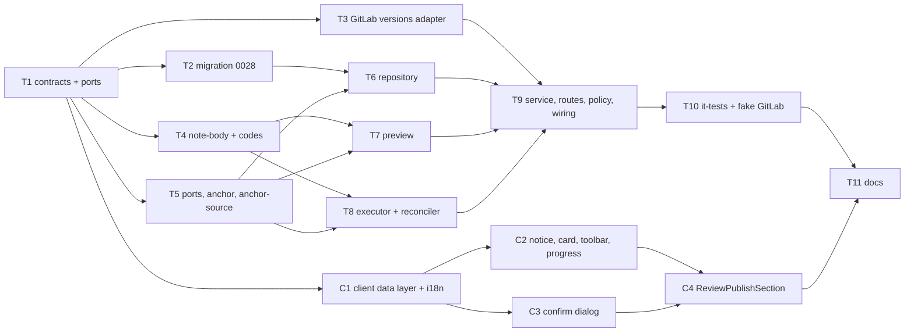

# Implementation Plan: Publish findings from an outdated review run, marked "deprecated"

## Overview
Today a GitLab review cannot be published at all when the MR moved on after the run
(`review_diff_outdated`) or when the review predates head tracking (`review_head_unknown`). This
plan implements `specs/2026-10-23-gitlab-publish-outdated-findings.md`
(SPEC-2026-10-23-gitlab-publish-outdated-findings, approved, AC-1 – AC-28, decisions D-9 – D-17).
It extends the already-implemented base feature (`specs/2026-10-21-gitlab-publish-findings.md`,
plan `docs/plans/gitlab-publish-findings.md`). Such runs become publishable as **deprecated**:
- each finding is anchored on the GitLab MR diff **version** whose head is the reviewed head;
- a finding falls back to a general note when that is impossible;
- every note carries a visible deprecated line;
- the server refuses a deprecated publish the client did not acknowledge.

## Execution mode
multi-agent (parallel). The user chose parallel `implementer` agents on the same branch
(`feat/gitlab-publish-findings`), with strictly non-overlapping `Owned paths` for concurrent tasks.
The plan is executed by `/run-plan` with **no test-writer**, so every task writes and runs its own tests.

## Requirements (verified)
Source: `specs/2026-10-23-gitlab-publish-outdated-findings.md`. The ids below are the spec's AC ids,
restated briefly. Base-spec ACs that are not superseded stay in force (spec preamble).
- R-AC1: The preview reports a review-level `deprecation`, computed from persisted state only (0 GitLab requests):
  - `head_sha` null → `{ head_unknown, null }`;
  - `head_sha` ≠ the PR's persisted head → `{ head_moved, sha }`;
  - otherwise `null`.
- R-AC2: `review_head_unknown` and `review_diff_outdated` are no longer preview blockers. The other base blockers are unchanged.
- R-AC3: At publish start, the live diff refs are read before any write. The run is deprecated when `head_sha` is null (`head_unknown`) or differs from the live head (`head_moved`). This is decided once and recorded on the publication.
- R-AC4: A deprecated run without `acknowledge_deprecated: true` is rejected:
  - `409 review_diff_outdated` or `409 review_head_unknown`;
  - fixed message "This review is outdated — confirm publishing its findings as deprecated.";
  - 0 writes, no publication kept.
- R-AC5: A non-deprecated run publishes exactly as in the base spec: bodies byte-identical, and the flag is ignored.
- R-AC6: The persisted diff is the anchor source only when the run is not deprecated **and** `detail_head_sha == head_sha`. Otherwise:
  - list the MR versions;
  - take the most recent version whose head equals `head_sha`;
  - read its diff;
  - apply the base AC-9 – AC-11 rules to it.
- R-AC7: Version-anchored positions carry the version's base, start and head SHAs, never the live refs.
- R-AC8: The version may be unusable:
  - no matching version, or the reads stay unreadable (5xx / timeout / network) → every finding is general, `reviewed_version_unavailable`;
  - 401 / 403 / 404 on those reads → the publication ends `failed` with the mapped code before any write, and its findings become selectable again.
- R-AC9: `head_unknown` → no version lookup; every finding is general, `review_head_unknown`.
- R-AC10: The base AC-9 / AC-10 rules are applied to the version:
  - a too-large, collapsed or empty file diff → `patch_unavailable`;
  - a file absent from the version, a deleted file, or no new-side line in range → `not_on_diff_line`.
- R-AC11: The version lookup and the version-diff read run in the background after the `202`, which still arrives in under 1 s.
- R-AC12: A deprecated run whose positioned draft is rejected with 400/422:
  - first base AC-13 (a multi-line draft is re-sent once as a single line);
  - then one general re-send, `position_rejected`, counted in `position_fallbacks`;
  - only a third rejection → `failed` `gitlab_position_rejected`;
  - at most 3 creates per finding; any non-400/422 failure follows base AC-30 with no re-send.
- R-AC13: A non-deprecated run keeps base AC-29: no general fallback.
- R-AC14: A deprecated run's every finding note (positioned, general, `secret_leak`) carries a deprecated line directly after the header line:
  - `head_moved` wording, with a hex-validated 8-character SHA;
  - `head_unknown` wording, also used when the SHA is not lowercase hex.
- R-AC15: A deprecated run's general notes get a location-line suffix per `off_diff_reason` (5-row table).
- R-AC16: Suggestions are never applicable for a deprecated run. While the preview's `deprecation` is set, every `suggestion_eligible` is false.
- R-AC17: A deprecated run's summary note begins with the deprecated line, a blank line, then the summary. With no summary, no summary note is sent.
- R-AC18: The `body_too_long` check always counts the worst-case overhead (the longest deprecated line + the longest location line), in both the preview and the publish.
- R-AC19: Preview anchors:
  - `head_moved` → anchor kind `deferred` (path and lines, `off_diff_reason: null`);
  - `head_unknown` → `general` with `review_head_unknown`;
  - the client labels a deferred anchor "Placement decided at publish (outdated review)".
- R-AC20: While a deprecation is reported, the accordion shows one non-blocking warning notice:
  - the wording depends on the reason, and the notice offers "Re-run review";
  - selection and Publish stay enabled;
  - Publish has `aria-describedby` pointing at the notice.
- R-AC21: When the dialog opens, a read-only **publish plan** is requested. It extends the other-drafts read and is computed from live reads (refs, versions, version diff). It contains:
  - the live deprecation (with `live_head_sha`);
  - the positioned and general counts for the selected ids;
  - `plan_available`.

  The plan never writes.
- R-AC22: The dialog warning block:
  - heading "Outdated review" and a reason line;
  - the placement line "K of N…" or "All N…";
  - the plan-failure line when the plan could not be read;
  - "Code suggestions can't be made applicable…" in place of the toggle.

  The confirm reads "Publish as deprecated" and sends `acknowledge_deprecated: true`. Without a deprecation, the dialog is the base dialog and sends `false`.
- R-AC23: On a 409 head code, the dialog stays open, refreshes the preview and the plan, shows the warning, and needs a second explicit confirm. No automatic retry.
- R-AC24: The result reads "Published N findings to GitLab as deprecated", plus "M were posted as general MR comments" when M > 0. A published finding shows "Published as deprecated by <name> · <time>".
- R-AC25: The publication shape exposes `deprecated`, `deprecation_reason`, `reviewed_version_found` (null when there was no lookup) and `position_fallbacks`. `general_notes` includes the fallbacks.
- R-AC26: The `review.publish` audit metadata adds the same 4 fields, and still carries no body, summary, title, rationale, SHA or note id.
- R-AC27: Base AC-23 – AC-35 hold for deprecated runs: marker on every draft (fallbacks included), rollback of own drafts only, reconcile by marker, no duplicate publish.
- R-AC28: The decisions taken at start (deprecation, anchor source, refs) are never re-read during the run.
- NFR:
  - the plan read is p95 ≤ 3 s at 300 ms per request;
  - ≤ 20 version pages, beyond which the version counts as not found;
  - ≤ 3 creates per finding;
  - creates and `bulk_publish` are never re-sent after 5xx / timeout;
  - the audit carries no SHA;
  - version-diff text is never logged, stored or prompted;
  - accessibility: `aria-describedby`, the warning inside the focus trap, text not color only;
  - i18n: every new client string comes from the catalogs.

Requirements that rest on a planner default are marked "(assumed default — confirm)" in the questions below.

## Open questions & recommendations
The spec has no blocking open questions. These are the gaps found while grounding the plan in the
code on this branch. Each one has a default, and the plan implements the default.

- Q1: **Stale persisted files on a non-deprecated review (`head_sha == pr.head_sha` ≠ `detail_head_sha`).** AC-19 only defines `deferred` for `head_moved`. If the preview resolved anchors against the stale `pr_files`, it would show placements the publish will not use (AC-6 reads the version instead). → default: the preview reports `deferred` whenever the anchor source would be the reviewed version, which covers `head_moved` **or** stale files. `deprecation` stays `null` in the stale-files case, so there is no notice and suggestions stay eligible. The label "Placement decided at publish (outdated review)" is reused as is, with no new string. (assumed default — confirm)
- Q2: **AC-24 "Published as deprecated by …" needs a per-finding flag that the contract does not carry.** The base `PublishedLink` has no `deprecated`. → default: the new contract file adds `PublishedLinkWithDeprecation = PublishedLink.extend({ deprecated: z.boolean().optional() })`. It is used in the widened preview finding and the widened publication item. The store's `findingStates` returns the publication's `deprecated`.
- Q3: **The shape of the publish-plan endpoint.** It is a read, so → default: `GET /reviews/:id/publish-plan?finding_ids=<uuid>,<uuid>…` (≤ 50 ids ≈ 1.9 KB of query, which is fine). The rules:
  - same selection validation as the publish → `400 publish_selection_invalid`;
  - GitHub → `400 provider_not_supported`, as the other-drafts read does;
  - route policy `member`.

  The existing `GET /publish-other-drafts` stays for compatibility, but the dialog switches to the plan read, which also carries `other_drafts`. (assumed default — confirm)
- Q4: **Validating `acknowledge_deprecated`.** The base `PublishRequest` ends in an outermost `superRefine` ("do not `.extend`"). → default: a separate `PublishAcknowledgement = z.object({ acknowledge_deprecated: z.boolean().default(false) })`, parsed from the same raw body after `PublishRequest` (base AC-20 step 4). A non-boolean value → `400 publish_summary_invalid`, the same code as a non-boolean `apply_suggestions`. `PublishRequest` itself is untouched.
- Q5: **Mapping 401/403/404 on the version reads (AC-8).** The adapter's `readError` maps 403 **and** 404 to `gitlab_project_inaccessible`, 401 to `gitlab_token_invalid`, and `insufficient_scope` to `gitlab_token_insufficient_scope`. → default: reuse `readError` unchanged and classify by `AppError.code` shape in `anchor-source.ts`:
  - those three codes → fatal;
  - `gitlab_comment_failed` (transient) or any other code → `unavailable` (all general).

  This differs from the base write mapping (Q4 of the base plan: write 403 → `gitlab_publish_failed`) only for reads, and that is acceptable: a 403 on a read means no access.
- Q6: **The SHA rule for the deprecated line.** "Lowercase hexadecimal" → default: `/^[0-9a-f]{7,64}$/` on the full `head_sha`, then the first 8 characters. Anything else → the `head_unknown` wording. The client's `shortSha` helper applies the same rule for the notice and the dialog.
- Q7: **The `anchor_kind` of an item whose placement is decided in the background.** The base DB CHECK allows only `multi_line | single_line | general`. → default: migration 0028 widens the CHECK to include `deferred`, and the background resolution updates each item's `anchor_kind` to its final value. That keeps the reconciler's general-note count (which reads item anchor kinds) correct after a crash.
- Rec1 — **Contracts: a new file (default) versus editing `review-publish.ts` in place.** `contracts/review-publish.ts` exists only on this branch. Neither it nor migration 0027 is merged to `main`, so editing it in place would be **technically safe**: there is no released consumer, both vendored copies change in lockstep, and `check-shared-sync` guards the copies. It would also avoid the parallel widened schemas (`PublishPreviewWithDeprecation`, `PublicationWithDeprecation`, …) and the swap of the route response schemas.
  - However, the approved spec explicitly says "a **new** contract file … no existing contract file is edited", and root `CLAUDE.md` says the same.
  - The plan therefore **defaults to the new file** `contracts/review-publish-deprecation.ts`.
  - If you prefer the in-place edit, the change is mechanical: T1 edits `review-publish.ts` instead (widen `PublishAnchorKind` / `OffDiffReason`, add the fields to `PublishPreview` / `Publication` / `PublishedLink` / the audit metadata), and every `…WithDeprecation` name below collapses into the base name. No other task changes shape. This needs your explicit go-ahead, because it is a spec deviation.
- Rec2 — **Migration: a new 0028 (default) versus amending the unmerged 0027.** 0027 is already applied in local dev databases and in the testcontainers template of this branch, and drizzle's journal and snapshot hashes would drift. Use the **new `0028_publish_deprecation`**. Do not edit 0027.
- Rec3 — **One shared version-anchor helper.** `modules/publish/anchor-source.ts` is used by both the dialog plan read and the executor, so the placement counts in the dialog and the real placement cannot diverge. It is the same idea as the base plan's "preview and publish share `findingReason`".
- Rec4 — **Manual verification gate.** The spec's *Manual verification before merge* items #1 – #6 (outdated-version positions accepted, version fields and pagination, shared-head versions, 400 vs 422, rate-limit accounting, "⚠" survives `bulk_publish`) cannot be verified offline. Record them in the PR description, as the base plan did with its #4 / #9 / #12.

### Anchor-source decision (AC-3, AC-6 – AC-11, AC-28)
Decided **once**, synchronously, right after the live refs read in `PublishService.create`, and
passed to the background task. It is never re-read (AC-28).

| Condition (review `head_sha` = H, live head = L, persisted `detail_head_sha` = D) | `deprecation` | `anchorSource` | Positions use |
|---|---|---|---|
| H null | `head_unknown` | `none` (all general `review_head_unknown`, 0 version reads) | — |
| H ≠ L | `head_moved` | `reviewed_version` | the version's SHAs |
| H = L, D ≠ H | null | `reviewed_version` | the version's SHAs |
| H = L = D | null | `persisted` (base behaviour, byte-identical) | the live refs |

- `reviewed_version` runs in the background via `resolveReviewedVersion`:
  1. list the versions (≤ 20 pages);
  2. pick the newest whose `head_commit_sha == H` (tie → the larger id);
  3. read `GET …/versions/:id` diffs, mapped through the existing `mapRestDiff` (too_large / collapsed → `patch_omitted`, empty diff → `patch: null`);
  4. `resolveAnchor` on those files.
- Outcomes: `found` → `reviewed_version_found: true`; `unavailable` → `false`, all general; `fatal` → the publication `failed` before any write, items rolled back, no audit (no write happened).
- The fallback (AC-12) is enabled iff `deprecation != null`.

### Persistence — decision (migration 0028)
`cd server && npx pnpm@11 db:generate --name publish_deprecation` → `0028_publish_deprecation.sql`.
Additive only; existing rows get valid defaults.
- `review_publications`:
  - `deprecated boolean not null default false`;
  - `deprecation_reason text null`, CHECK `deprecation_reason in ('head_moved','head_unknown')`;
  - CHECK `review_publications_deprecation_ck`: `deprecated = (deprecation_reason is not null)`;
  - `reviewed_version_found boolean null`;
  - `position_fallbacks integer not null default 0`, CHECK `>= 0`.
- `review_publication_items.anchor_kind`: the CHECK is widened to `('multi_line','single_line','general','deferred')`. The generated SQL drops and re-adds `review_publication_items_anchor_kind_ck`.
- Still no SHA beyond the base `diff_head_sha`, and no body or diff text (NFR Security). For version-anchored runs, `diff_head_sha` records the version head (ids only, as in the base).

## Affected modules & contracts
- **server:**
  - migration 0028 + `db/schema/publications.ts`;
  - GitLab adapter (version list + version diff read) + `MockGitLabClient`;
  - `modules/publish`: ports, anchor, the new `anchor-source.ts`, note-body, codes, preview, service, executor, reconciler, repository, routes;
  - `platform/auth/route-policy.ts` (plan route row);
  - `platform/container.ts` (only if the gated client type needs widening).
- **client:**
  - `lib/types.ts`, `lib/hooks/publish.ts`, `messages/en/prHost.json`;
  - `PublishFindings/**` (new `PublishDeprecationNotice`; FindingPublishControl, PublishToolbar, PublishProgress, PublishConfirmDialog, helpers, constants);
  - `ReviewPublishSection`.
- **reviewer-core, mcp, e2e:** unchanged (spec scope).
- **Contracts (new files only; both vendored copies byte-identical):**
  - `server/src/vendor/shared/contracts/review-publish-deprecation.ts`:
    - `DeprecationReason`, `PublishDeprecation`, `PublishLiveDeprecation`;
    - `PublishAnchorKindAll`, `OffDiffReasonAll`, `PublishAnchorWithDeprecation`;
    - `PublishedLinkWithDeprecation`, `PublishPreviewFindingWithDeprecation`, `PublishPreviewWithDeprecation`;
    - `PublishPlanQuery`, `PublishPlan`, `PublishAcknowledgement`;
    - `PublicationItemWithDeprecation`, `PublicationWithDeprecation`, `ReviewPublishAuditMetadataWithDeprecation`;
    - `PUBLISH_VERSIONS_MAX_PAGES = 20`.
  - `server/src/vendor/shared/review-publish-versions-ports.ts`: `GitLabMrDiffVersion`, `GitLabDiffVersionsHost`.
  - `index.ts` in both copies: **append** two `export *` lines only.
  - `review-publish.ts` and `review-publish-ports.ts` are **not edited** (see Rec1 for the alternative).

## Architecture changes
- **Core ring:** the two new shared files. The port is named after the conversation ("diff versions"), and `RestGitLabClient` implements it.
- **Infrastructure:**
  - `adapters/gitlab/client.ts`: `listMrDiffVersions` / `getMrDiffVersionFiles`, on the **read** policy (`http.rest` GET with the existing 5xx back-off; network errors and timeouts are not retried, as today). Failures go through `readError`.
  - `modules/publish/repository.ts`: the new columns plus 3 operations.
- **Application (`modules/publish/`):**
  - new `anchor-source.ts` (version selection + classification; pure apart from the injected port);
  - `service.ts`: deprecation decision, acknowledgement check, `publishPlan`;
  - `executor.ts`: background version resolution, version refs, deprecated bodies, AC-12 fallback;
  - `reconciler.ts`: audit fields.
- **Pure helpers:**
  - `note-body.ts`: deprecated line, suffixes, summary prefix, worst-case bound;
  - `anchor.ts`: widened off-diff reasons, `deferredAnchor`, `generalBoundAnchor`;
  - `preview.ts`: deprecation, deferred anchors, head blockers removed.
- **Presentation:**
  - new `GET /reviews/:id/publish-plan` → `PublishPlan`;
  - the response schemas of the preview / publications / publication routes become the `…WithDeprecation` schemas. **Required:** fastify-type-provider-zod serialisation strips unknown keys and rejects `kind: 'deferred'` under the old schema.
- **Client:** every touched component is already `"use client"`; the RSC boundary is unchanged.

Parallel waves (`Owned paths` within a wave are disjoint):
- W1: T1.
- W2: T2, T3, T4, T5, C1.
- W3: T6, T7, T8, C2, C3.
- W4: T9, C4.
- W5: T10.
- W6: T11.

## Phased tasks

### Phase 1 — Contracts

- **T1**
  - **Action:** Add the new contract and port files, mirror them into the client copy, and append to both `index.ts` barrels.
    - `contracts/review-publish-deprecation.ts` (imports from `./review-publish.js`; it does not modify it):
      - `DeprecationReason = z.enum(['head_moved','head_unknown'])`.
      - `PublishDeprecation = z.object({ reason: DeprecationReason, reviewed_head_sha: z.string().nullable() })`.
      - `PublishLiveDeprecation = PublishDeprecation.extend({ live_head_sha: z.string() })`.
      - `PublishAnchorKindAll = z.enum([...PublishAnchorKind.options, 'deferred'])`.
      - `OffDiffReasonAll = z.enum([...OffDiffReason.options, 'reviewed_version_unavailable', 'review_head_unknown', 'position_rejected'])`.
      - `PublishAnchorWithDeprecation = PublishAnchor.extend({ kind: PublishAnchorKindAll, off_diff_reason: OffDiffReasonAll.nullable() })`.
      - `PublishedLinkWithDeprecation = PublishedLink.extend({ deprecated: z.boolean().optional() })` (Q2).
      - `PublishPreviewFindingWithDeprecation = PublishPreviewFinding.extend({ anchor: PublishAnchorWithDeprecation, published: PublishedLinkWithDeprecation.nullable() })`.
      - `PublishPreviewWithDeprecation = PublishPreview.extend({ deprecation: PublishDeprecation.nullable(), findings: z.array(PublishPreviewFindingWithDeprecation) })`.
      - `PublishPlanQuery = z.object({ finding_ids: z.string() })`, preprocessed: split on `,`, trim, then `z.array(z.string().uuid()).min(1).max(PUBLISH_MAX_FINDINGS)` with a uniqueness refine.
      - `PublishPlan = OtherDraftsCount.extend({ plan_available: z.boolean(), deprecation: PublishLiveDeprecation.nullable().optional(), placement: z.object({ positioned: z.number().int().min(0), general: z.number().int().min(0) }).nullable() })`.
      - `PublishAcknowledgement = z.object({ acknowledge_deprecated: z.boolean().default(false) })` (Q4), plus `PublishAcknowledgementInput`.
      - `PublicationItemWithDeprecation = PublicationItem.extend({ link: PublishedLinkWithDeprecation.nullable() })`.
      - `PublicationWithDeprecation = Publication.extend({ deprecated: z.boolean(), deprecation_reason: DeprecationReason.nullable(), reviewed_version_found: z.boolean().nullable(), position_fallbacks: z.number().int().min(0), items: z.array(PublicationItemWithDeprecation) })`.
      - `ReviewPublishAuditMetadataWithDeprecation = ReviewPublishAuditMetadata.extend({ deprecated: z.boolean(), deprecation_reason: DeprecationReason.nullable(), reviewed_version_found: z.boolean().nullable(), position_fallbacks: z.number().int().min(0) }).strict()`.
      - `PUBLISH_VERSIONS_MAX_PAGES = 20`.
    - `review-publish-versions-ports.ts` (function-typed properties only):
      - `GitLabMrDiffVersion { id: number; headSha: string; baseSha: string; startSha: string; createdAt: string }`.
      - `GitLabDiffVersionsHost`:
        - `listMrDiffVersions: (ref: HostRepoRef, iid: number, opts: { maxPages: number }) => Promise<{ versions: GitLabMrDiffVersion[]; truncated: boolean }>`;
        - `getMrDiffVersionFiles: (ref: HostRepoRef, iid: number, versionId: number) => Promise<PrFileHost[]>` (reuse the existing host file type that `mapRestDiff` returns).
        - Both throw mapped `AppError`s (read policy).
    - Copy both files byte-identically to `client/src/vendor/shared/`, then append the two `export *` lines to both `index.ts` files.
  - **Module:** server (+ client vendored copy)
  - **Type:** backend
  - **Skills to use:** zod, typescript-expert, onion-architecture
  - **Owned paths:**
    - `server/src/vendor/shared/contracts/review-publish-deprecation.ts`
    - `server/src/vendor/shared/review-publish-versions-ports.ts`
    - `server/src/vendor/shared/index.ts`
    - `client/src/vendor/shared/contracts/review-publish-deprecation.ts`
    - `client/src/vendor/shared/review-publish-versions-ports.ts`
    - `client/src/vendor/shared/index.ts`
    - `server/test/contracts-review-publish-deprecation.test.ts`
  - **Depends-on:** none
  - **Risk:** medium (cross-package lockstep)
  - **Known gotchas:**
    - Do **not** edit `review-publish.ts` or `review-publish-ports.ts` (root CLAUDE.md, spec *Contracts*; see Rec1).
    - `PublishRequest` is a `ZodEffects`: never `.extend` it. The acknowledgement is a separate schema.
    - `.extend` on a `.strict()` object: re-apply `.strict()` explicitly, and test that an unknown key is rejected.
    - Port members use property syntax (the `host-git.ts` bivariance trap). ZodError is matched by shape.
    - Zod is 3.25 here. `z.enum([...X.options, 'y'])` needs a non-empty tuple type, so cast the spread with `as [string, ...string[]]` only if inference fails.
  - **Acceptance:**
    - `node scripts/check-shared-sync.mjs` prints in-sync.
    - `cd server && pnpm typecheck` and `cd client && pnpm typecheck` are green.
    - `cd server && pnpm vitest run test/contracts-review-publish-deprecation.test.ts` asserts:
      - a base `PublishPreview` fixture **without** `deprecation` fails `PublishPreviewWithDeprecation` (the field is required), and one with `deprecation: null` parses;
      - `kind: 'deferred'` parses in the widened anchor and is rejected by the base `PublishAnchor`;
      - `OffDiffReasonAll.options` has exactly 5 values;
      - `PublishAcknowledgement.parse({})` → `false`, and `{ acknowledge_deprecated: 'yes' }` → an issue;
      - `PublishPlanQuery` rejects 51 ids, duplicates and a non-uuid;
      - the audit metadata rejects `head_sha`, `body` and `summary` keys and accepts the 4 new fields;
      - `PublicationWithDeprecation` requires the 4 new fields.
    - `git diff --stat HEAD -- server/src/vendor/shared client/src/vendor/shared` shows only the 4 new files plus the 2 index files.

### Phase 2 — Schema, adapter, pure helpers, client data layer (parallel)

- **T2**
  - **Action:** Migration 0028 (see *Persistence — decision*).
    - Add `deprecated`, `deprecationReason`, `reviewedVersionFound` and `positionFallbacks` to `reviewPublications` in `db/schema/publications.ts`, with the CHECKs. Take the reason literals from `DeprecationReason.options`.
    - Switch the item `anchor_kind` enum and CHECK to `PublishAnchorKindAll.options`.
    - Generate with `cd server && npx pnpm@11 db:generate --name publish_deprecation`.
    - Hand-review the SQL: `ADD COLUMN … DEFAULT`, the constraint drop and re-add, no table rewrite of `NOT NULL` without a default.
    - Commit the `.sql`, `meta/0028_snapshot.json` and the `_journal.json` entry.
    - Extend `server/test/review-publications-schema.it.test.ts` with:
      - `deprecated=true, reason=null` → CHECK violation; `false` + `'head_moved'` → violation; `true` + `'head_unknown'` → ok;
      - `position_fallbacks = -1` → violation;
      - an item `anchor_kind 'deferred'` → ok, `'bogus'` → violation;
      - a base row inserted without the new columns reads `false / null / null / 0`.
  - **Module:** server
  - **Type:** backend
  - **Skills to use:** postgresql-table-design, drizzle-orm-patterns, onion-architecture
  - **Owned paths:**
    - `server/src/db/schema/publications.ts`
    - `server/src/db/migrations/0028_publish_deprecation.sql`
    - `server/src/db/migrations/meta/0028_snapshot.json`
    - `server/src/db/migrations/meta/_journal.json`
    - `server/test/review-publications-schema.it.test.ts`
  - **Depends-on:** T1
  - **Risk:** medium
  - **Known gotchas:**
    - Never edit 0000 – 0027 (Rec2). If `main` gains a 0027 / 0028 before merge, regenerate on rebase.
    - The drizzle migrator runs all pending migrations in one transaction, so no `CONCURRENTLY`.
    - `global-setup.ts` rebuilds the test template per run, so no test-harness change is needed.
    - `relation … does not exist` locally → `cd server && pnpm db:migrate`.
  - **Acceptance:**
    - `cd server && pnpm typecheck` is green.
    - `pnpm vitest run test/review-publications-schema.it.test.ts` is green (needs Docker).
    - `db-constraints.it.test.ts` and `multi-user-migration.it.test.ts` are still green.
    - `rtk proxy grep -c "deferred" server/src/db/migrations/0028_publish_deprecation.sql` ≥ 1.

- **T3**
  - **Action:** GitLab adapter for MR diff versions (AC-6, AC-8, AC-11; NFR version bound).
    1. `client.ts`, implementing `GitLabDiffVersionsHost`:
       - `listMrDiffVersions(ref, iid, { maxPages })`: paginated `GET /projects/:id/merge_requests/:iid/versions?per_page=100`. Stop after `maxPages` and return `truncated: true` when `x-next-page` is still set.
       - Map each entry `{ id, head_commit_sha, base_commit_sha, start_commit_sha, created_at }`. Drop entries with a non-positive id or a non-string SHA.
       - `getMrDiffVersionFiles(ref, iid, versionId)`: `GET …/versions/:versionId` → `raw.diffs.map(mapRestDiff)`. A missing or non-array `diffs` → `[]`.
       - Validate `versionId` as a positive integer before building the path (the `mrIid` helper pattern).
       - Errors → `readError` (401 → `gitlab_token_invalid`, `insufficient_scope` → `gitlab_token_insufficient_scope`, 403/404 → `gitlab_project_inaccessible`, transient → `gitlab_comment_failed` 502).
       - Never log or embed diff text in an error message.
    2. A pure mapper `mapDiffVersion(raw)` in `draft-notes.ts` (next to the other publish mappers), exported via `index.ts` if the tests need it.
    3. `adapters/mocks.ts`: `MockGitLabClient` implements the port with in-memory `versions` / `versionFiles`, recorded calls, and scripted failures per method.
  - **Module:** server
  - **Type:** backend
  - **Skills to use:** onion-architecture, typescript-expert, security
  - **Owned paths:**
    - `server/src/adapters/gitlab/client.ts`
    - `server/src/adapters/gitlab/draft-notes.ts`
    - `server/src/adapters/gitlab/index.ts`
    - `server/src/adapters/mocks.ts`
    - `server/test/gitlab-diff-versions-client.test.ts`
  - **Depends-on:** T1
  - **Risk:** medium
  - **Known gotchas:**
    - Reads keep the existing 5xx back-off. Do not add retries for timeouts or network errors (the existing `send` behaviour).
    - `mapRestDiff` already turns `too_large` / `collapsed` into `patch_omitted` and an empty `diff` into `patch: null` (`strOrNull`), so AC-10 `patch_unavailable` follows with no new mapping. Assert it in the test.
    - `MockGitLabClient` "empty means absent" pitfalls: return explicit `[]`.
    - Don't touch the draft-notes or comments methods.
  - **Acceptance:** `cd server && pnpm vitest run test/gitlab-diff-versions-client.test.ts test/gitlab-draft-notes-client.test.ts test/gitlab-comments-client.test.ts` is green, and `pnpm typecheck` is green. The new test asserts:
    - 3 pages of versions → 3 GETs, mapped in order;
    - 25 pages with `maxPages: 20` → 20 GETs and `truncated: true`;
    - a version GET 503 → 200 is retried and succeeds;
    - a network error → 1 GET, then it throws;
    - 401 → `gitlab_token_invalid`, 403 → `gitlab_project_inaccessible`, 404 → `gitlab_project_inaccessible`;
    - a version diff with too_large / collapsed / empty / renamed / deleted files → `patch_omitted` / `patch: null` / `previous_path` / `change_type` as expected;
    - `versionId: 0` throws before any fetch;
    - no thrown message contains the token or the diff text.

- **T4**
  - **Action:** Note composition and codes for deprecated runs (AC-4 message, AC-14 – AC-18).
    - `note-body.ts`:
      - New exported type `NoteDeprecation = { reason: 'head_moved'|'head_unknown'; reviewedHeadSha: string|null }`.
      - `deprecatedLine(dep)`: Q6 hex rule; the exact AC-14 wording, with the SHA in inline code.
      - `ComposeFindingNoteInput` gains `deprecation?: NoteDeprecation | null`.
      - The general `NoteAnchor` variant gains `offDiffReason?: string`, so `anchor.ts`'s `GeneralAnchor` stays assignable.
      - Placement: for a deprecated run, the deprecated line goes directly after the header line, before the location line, on every path, `secret_leak` included.
      - Location-line suffix: for a deprecated run, use the AC-15 table by `offDiffReason`. Otherwise keep the base "(not on a changed line of this MR)" byte for byte.
      - A deprecated run forces `applySuggestion = false` (AC-16), also in `downgradeForSingleLine`.
      - `composeSummary(summary, footerName, deprecation?)`: `deprecatedLine + '\n\n' + summary`, then neutralisation and the footer (AC-17).
      - `suggestionEligibility(finding, anchor, deprecated = false)` → false when `deprecated`.
      - `noteLengthUpperBound` (AC-18) = the existing bound + `WORST_OVERHEAD`, where `WORST_OVERHEAD` = the longest deprecated line (the `head_unknown` or the 8-char `head_moved` wording, whichever is longer) + 1 newline + the longest location line for this anchor's path and range under the longest AC-15 suffix + 1 newline. Positioned anchors are charged the location line too ("always counts").
      - The new body helper `generalOverheadFor(path, start, end)` is exported for tests.
    - `codes.ts`:
      - New `DEPRECATED_NOT_ACKNOWLEDGED_MESSAGE` = the exact AC-4 text.
      - `PUBLISH_MESSAGES.review_head_unknown` and `.review_diff_outdated` both map to it.
      - HTTP status stays 409.
      - Keep `REVIEW_HEAD_UNKNOWN_MESSAGE` / `REVIEW_DIFF_OUTDATED_MESSAGE` exported only if other code imports them. Otherwise remove them, after a `rtk proxy grep -rn` check.
  - **Module:** server
  - **Type:** backend
  - **Skills to use:** typescript-expert, security, onion-architecture
  - **Owned paths:**
    - `server/src/modules/publish/note-body.ts`
    - `server/src/modules/publish/codes.ts`
    - `server/test/publish-note-body.test.ts`
    - `server/test/publish-codes.test.ts`
  - **Depends-on:** T1
  - **Risk:** medium (byte-identical non-deprecated bodies; AC-5)
  - **Known gotchas:**
    - The deprecated line contains `⚠` and a backtick span only. It must pass the quick-action neutraliser unchanged (it is not command-shaped), and it is **not** run through the mention guard (DevDigest-composed text, spec *Untrusted inputs*).
    - The marker stays the last content line before the footer (base AC-14 / AC-24). `stripAttribution` relies on the footer staying last.
    - Existing snapshots in `publish-note-body.test.ts` must stay **unchanged** for the non-deprecated paths, except the AC-18 bound values, which grow by the overhead.
  - **Acceptance:** `cd server && pnpm vitest run test/publish-note-body.test.ts test/publish-codes.test.ts test/publish-mention-guard.test.ts` is green. It asserts:
    - every existing non-deprecated snapshot is byte-identical (AC-5);
    - new inline snapshots for positioned / general / `secret_leak` × `head_moved` / `head_unknown` (AC-14);
    - a non-hex SHA (`'ABCDEF12…'`, `'zz'`) → the `head_unknown` wording;
    - one snapshot per AC-15 suffix;
    - a deprecated run with `applySuggestion: true` on an eligible finding → a plain fenced block, `suggestionApplicable: false` (AC-16);
    - the summary with a deprecation starts with the deprecated line + a blank line (AC-17);
    - a finding whose base bound is `PUBLISH_BODY_MAX_CHARS - 50` → `isBodyTooLong` is true (AC-18);
    - `PUBLISH_MESSAGES.review_diff_outdated === PUBLISH_MESSAGES.review_head_unknown ===` the AC-4 text.

- **T5**
  - **Action:** Publish ports, anchor widening, and the shared version-anchor helper (AC-6 – AC-10, AC-19).
    1. `ports.ts`:
       - `PublishReviewContext` is unchanged.
       - `PublishGitLabHost = GitLabDraftNotesHost & GitLabDiffVersionsHost & Pick<GitLabCommentsHost,'getDiffRefs'>`.
       - `PublicationRecord` gains `deprecated`, `deprecationReason: DeprecationReason|null`, `reviewedVersionFound: boolean|null`, `positionFallbacks: number`.
       - `PublicationItemRecord.anchorKind` and `CreatePublicationInput.items[].anchorKind` widen to `PublishAnchorKindAll`.
       - `FindingLiveState` gains `publicationDeprecated: boolean` (Q2).
       - `FinishPublicationPatch.counters` gains `positionFallbacks`.
       - New store members:
         - `setStartDecision(publicationId, { deprecationReason: DeprecationReason|null; items: { findingId; anchorKind: PublishAnchorKindAll }[] })`: sets `deprecated` / `deprecation_reason` and the items' kinds, in one tx;
         - `setAnchorResolution(publicationId, { reviewedVersionFound: boolean|null; items: { findingId; anchorKind }[]; diffHeadSha: string|null })`;
         - `markItemDrafted(publicationId, findingId, draftId, opts?: { anchorKind?: PublishAnchorKindAll; positionFallback?: boolean })` (extends the existing signature, all options optional).
       - New exported types `AnchorSource = 'persisted' | 'reviewed_version' | 'none'` and `PublishDeprecationState = { reason: DeprecationReason; reviewedHeadSha: string|null }`.
    2. `anchor.ts`:
       - `GeneralAnchor.offDiffReason` widens to `OffDiffReasonAll`.
       - `toPublishAnchor` returns the widened contract type.
       - New `deferredPublishAnchor(finding) → PublishAnchorWithDeprecation` (kind `deferred`, normalised lines, `off_diff_reason: null`).
       - New `generalAnchor(finding, reason)`, exported. It is used for `head_unknown`, `reviewed_version_unavailable`, `position_rejected`, and as the AC-18 bound anchor for deferred findings.
       - `resolveAnchor` is otherwise unchanged. It works on any `PersistedFileLike[]`, the version files included.
    3. New `anchor-source.ts`:
       - `toPersistedFiles(files: PrFileHost[]) → PersistedFileLike[]` (field mapping `previous_path` / `patch_omitted` / `change_type`).
       - `resolveReviewedVersion(host: GitLabDiffVersionsHost, ref, iid, reviewedHeadSha, log?) → Promise<{ kind:'found'; refs: GitLabDiffRefs; files: PersistedFileLike[]; versionId: number } | { kind:'unavailable' } | { kind:'fatal'; code: PublishErrorCode }>`:
         - list with `maxPages: PUBLISH_VERSIONS_MAX_PAGES`;
         - the newest match by `createdAt` desc, tie → higher id;
         - a truncated list with no match → `unavailable`;
         - a version-diff read failure → classified the same way;
         - classification by `AppError.code` shape (Q5): `gitlab_token_invalid | gitlab_token_insufficient_scope | gitlab_project_inaccessible` → `fatal` with that code; anything else (transient, unknown) → `unavailable`.
         - Logs carry the code only.
       - `planAnchors(findings, source: { kind:'persisted'; files } | { kind:'none' } | Awaited<ReturnType<typeof resolveReviewedVersion>>)` → `Map<findingId, PlannedAnchor>`:
         - `none` → general `review_head_unknown`;
         - `unavailable` → general `reviewed_version_unavailable`;
         - `found` / `persisted` → `resolveAnchor`.
       - `countPlacement(map) → { positioned, general }`.
  - **Module:** server
  - **Type:** backend
  - **Skills to use:** onion-architecture, typescript-expert
  - **Owned paths:**
    - `server/src/modules/publish/ports.ts`
    - `server/src/modules/publish/anchor.ts`
    - `server/src/modules/publish/anchor-source.ts`
    - `server/test/publish-anchor.test.ts`
    - `server/test/publish-anchor-source.test.ts`
  - **Depends-on:** T1
  - **Risk:** medium
  - **Known gotchas:**
    - No sibling-module imports (onion §9). `PrFileHost` comes from `@devdigest/shared`, not from the adapter.
    - Widening `ports.ts` will make the repository (T6), executor (T8) and service (T9) fail typecheck until they land. That is expected within the wave DAG: **this task's acceptance runs vitest + `pnpm typecheck` filtered to its own files**, and the full typecheck gate is T9.
    - Keep `PlannedAnchor` free of a `deferred` variant: "deferred" is a preview / item state, not a placement. That keeps `toDraftPosition` and `note-body` exhaustive.
  - **Acceptance:** `cd server && pnpm vitest run test/publish-anchor.test.ts test/publish-anchor-source.test.ts` is green. It asserts:
    - the existing anchor tests are unchanged (base AC-9 – AC-11);
    - a version-diff fixture set reproduces the base outcomes (multi-line, nearest-to-end, context old+new, renamed old path) via `toPersistedFiles` (AC-6);
    - per AC-10 case → the expected `off_diff_reason`;
    - two versions with the same head → the newer `createdAt` is chosen; equal `createdAt` → the higher id;
    - no matching head → `unavailable`; truncated without a match → `unavailable` (NFR bound);
    - `gitlab_comment_failed` → `unavailable`; each of the 3 fatal codes → `fatal`;
    - `found.refs` carries the version's 3 SHAs (AC-7);
    - `planAnchors(…, {kind:'none'})` → all general `review_head_unknown` with 0 host calls (MockGitLabClient call log empty, AC-9).

- **C1**
  - **Action:** Client data layer, i18n and shared helpers (AC-19 – AC-24).
    - `lib/types.ts`: re-export the widened types: `PublishPreviewWithDeprecation`, `PublishPlan`, `PublicationWithDeprecation`, `PublishedLinkWithDeprecation`, `PublishAnchorWithDeprecation`, `DeprecationReason`, `PublishAcknowledgementInput`.
    - `lib/hooks/publish.ts`:
      - `usePublishPreview` and `usePublication` / `useReviewPublications` are typed with the widened shapes;
      - new `publishPlanKey(reviewId, ids)` (ids sorted) and `usePublishPlan(reviewId, findingIds, { enabled })` → `GET /reviews/:id/publish-plan?finding_ids=…`, with `staleTime: 0` and `retry: false`; a non-auth failure resolves to `{ other_drafts: null, plan_available: false, placement: null }` (no global toast, mirroring `useOtherDraftsCount`);
      - `useCreatePublication` input becomes `PublishRequestInput & PublishAcknowledgementInput`;
      - on an `ApiError` 409 with code `review_diff_outdated | review_head_unknown`, invalidate `publishPreviewKey` and `publishPlanKey(reviewId)` (prefix) — the mutation never retries (AC-23).
    - `client/messages/en/prHost.json`, under `prHost.publish`: **all** new strings, with the exact spec wording (D-17):
      - `deferredAnchor`;
      - `deprecation.notice.headMoved` (`{sha}`) and `deprecation.notice.headUnknown`;
      - `dialog.outdated.heading`;
      - `dialog.outdated.headMoved` (`{sha}`, `{liveSha}`) and `dialog.outdated.headUnknown`;
      - `dialog.outdated.placementSome` (`{general}`, `{total}`) and `dialog.outdated.placementAll` (`{total}`);
      - `dialog.outdated.planUnavailable`;
      - `dialog.outdated.noApplicable`;
      - `dialog.publishDeprecated`;
      - `result.publishedDeprecated` (`{count}`) and `result.generalCount` (`{count}`);
      - `publishedDeprecatedBy` (`{name}`, `{time}`).

      Update `code.review_diff_outdated` and `code.review_head_unknown` to the AC-4 text.
    - `PublishFindings/helpers.ts`:
      - `shortSha(sha)` (Q6 rule → 8 chars or null);
      - `previewDeprecation(preview)`;
      - `DEPRECATION_409_CODES`;
      - `summarizeSelection` counts `deferred` anchors as `deferred` (neither positioned nor general).
    - `PublishFindings/constants.ts`: `RERUN_BLOCKERS` stays for backward-compatible rendering.
    - `PublishFindings/test-fixtures.ts`: deprecated preview, plan and publication fixtures.
  - **Module:** client
  - **Type:** ui
  - **Skills to use:** next-best-practices, react-best-practices, react-testing-library, typescript-expert
  - **Owned paths:**
    - `client/src/lib/types.ts`
    - `client/src/lib/hooks/publish.ts`
    - `client/src/lib/hooks/publish.test.tsx`
    - `client/messages/en/prHost.json`
    - `client/src/app/repos/[repoId]/pulls/[number]/_components/PublishFindings/helpers.ts`
    - `client/src/app/repos/[repoId]/pulls/[number]/_components/PublishFindings/helpers.test.ts`
    - `client/src/app/repos/[repoId]/pulls/[number]/_components/PublishFindings/constants.ts`
    - `client/src/app/repos/[repoId]/pulls/[number]/_components/PublishFindings/test-fixtures.ts`
  - **Depends-on:** T1
  - **Risk:** low
  - **Known gotchas:**
    - Client routes are keyed by PR number, and every API call by row uuid (root CLAUDE.md).
    - No hardcoded strings. C2 / C3 only **consume** keys, so this task must add every key listed above (parallel-safe i18n).
    - Client styles are inline `styles.ts` + CSS tokens, not Tailwind.
  - **Acceptance:** `cd client && pnpm vitest run src/lib/hooks/publish.test.tsx src/app/repos/\[repoId\]/pulls/\[number\]/_components/PublishFindings/helpers.test.ts` is green, and `pnpm typecheck` is green (or green except for the components C2 / C3 update; then the gate is C4). The tests assert:
    - `usePublishPlan` builds the sorted, comma-joined query;
    - a 502 → the fallback object with no thrown error;
    - a 401 → it throws;
    - a 409 `review_diff_outdated` from `useCreatePublication` → the preview and plan queries are invalidated and exactly 1 POST is sent;
    - `shortSha('abcdef1234…')` → `'abcdef12'`, and `shortSha('XYZ')` → null;
    - `node -e` JSON parse of `prHost.json` succeeds, and every listed key exists (asserted in `helpers.test.ts`).

### Phase 3 — Repository, preview, executor, UI components (parallel)

- **T6**
  - **Action:** Repository support (AC-3, AC-6, AC-12, AC-24, AC-25).
    - Map the 4 new columns in `repository/mappers.ts`.
    - `createPublication` keeps its signature. Items accept `deferred`.
    - `findingStates` joins the publication's `deprecated` → `publicationDeprecated`.
    - Implement `setStartDecision`, `setAnchorResolution` (one transaction: the publication fields + a per-item `anchor_kind` update scoped by `publication_id`) and the extended `markItemDrafted`: when `positionFallback` is set, `position_fallbacks = position_fallbacks + 1`; when `anchorKind` is given, the item's `anchor_kind` is updated in the same statement batch.
    - `finish` writes `positionFallbacks` when present.
    - Workspace scoping as in the base.
  - **Module:** server
  - **Type:** backend
  - **Skills to use:** drizzle-orm-patterns, onion-architecture, postgresql-table-design
  - **Owned paths:**
    - `server/src/modules/publish/repository.ts`
    - `server/src/modules/publish/repository/mappers.ts`
    - `server/test/publish-repository.it.test.ts`
  - **Depends-on:** T2, T5
  - **Risk:** low
  - **Known gotchas:**
    - No `$inferSelect` beyond the repository. Map to `PublicationRecord`.
    - Keep `finish` a CAS.
    - `ON CONFLICT` cannot target the partial unique indexes (server INSIGHTS). Nothing new needs it.
  - **Acceptance:** `cd server && pnpm vitest run test/publish-repository.it.test.ts` is green (Docker). New cases:
    - `setStartDecision(head_moved, items deferred)` → the record reads `deprecated: true, deprecationReason: 'head_moved'` and the items read `deferred`;
    - `setAnchorResolution(false, [general…])` → `reviewedVersionFound: false` and the item kinds updated;
    - `markItemDrafted(…, { anchorKind: 'general', positionFallback: true })` twice → `positionFallbacks: 2`;
    - `findingStates` exposes `publicationDeprecated`;
    - the base cases are still green.

- **T7**
  - **Action:** Preview for deprecated reviews (AC-1, AC-2, AC-16, AC-18, AC-19; Q1, Q2).
    - `preview.ts`:
      - `previewDeprecation(ctx)`: `head_sha` null → `head_unknown`; ≠ `pr.headSha` → `head_moved`; else null (0 I/O).
      - `reviewBlockers` drops the two head blockers. The order of the rest is unchanged (AC-2).
      - Per-finding anchor: `head_unknown` → `generalAnchor(review_head_unknown)`; `head_moved` or `review.headSha !== pr.detailHeadSha` → `deferredPublishAnchor` (Q1); else `resolveAnchor`.
      - `findingReason` stays exported with the same signature. For deferred findings, the service and the preview pass `generalAnchor(finding, 'not_on_diff_line')` as the bound anchor. Export a helper `boundAnchorFor(finding, plannedOrNull)`.
      - `suggestion_eligible` = `deprecation == null && kind !== 'deferred' && suggestionEligibility(…)`.
      - `published` → `PublishedLinkWithDeprecation` with `deprecated: live.publicationDeprecated`.
      - `buildPreview` returns `PublishPreviewWithDeprecation`.
  - **Module:** server
  - **Type:** backend
  - **Skills to use:** onion-architecture, typescript-expert
  - **Owned paths:**
    - `server/src/modules/publish/preview.ts`
    - `server/test/publish-preview.test.ts`
  - **Depends-on:** T4, T5
  - **Risk:** low
  - **Known gotchas:**
    - Existing preview tests that assert the `review_head_unknown` / `review_diff_outdated` blockers must be **rewritten** to the new expectations, not deleted. Keep one assertion per former case.
    - The preview stays pure: 0 GitLab requests (base AC-2).
  - **Acceptance:** `cd server && pnpm vitest run test/publish-preview.test.ts` is green. It asserts:
    - 3 fixtures (legacy / synced-to-newer / current) → `deprecation` `head_unknown` / `head_moved` / null (AC-1);
    - the legacy and outdated fixtures → `blockers: []` and `publishable: true`, while merged → `pr_not_open` (AC-2);
    - `head_moved` → every anchor `deferred` with `off_diff_reason: null`; `head_unknown` → `general` + `review_head_unknown` (AC-19);
    - the stale-files fixture → `deferred` with `deprecation: null` (Q1);
    - every `suggestion_eligible` is false while deprecated (AC-16);
    - the near-limit fixture → `body_too_long` (AC-18);
    - a published-by-deprecated-publication link has `deprecated: true`.

- **T8**
  - **Action:** Background executor and reconciler for deprecated runs (AC-6 – AC-12, AC-14 – AC-17, AC-25 – AC-28).
    - `executor.ts`:
      - `PublishRunItem.anchor: PlannedAnchor | null` (null = decided in the background).
      - `PublishRunInput` gains `deprecation: PublishDeprecationState | null`, `anchorSource: AnchorSource` and `reviewHeadSha: string | null`.
      - **New step 0** (before the drafts list):
        - `reviewed_version` → `resolveReviewedVersion`:
          - `fatal` → `markItemsRolledBack(all)` + `finish failed` with the code, **0 writes**, no audit (`state.wrote` false);
          - `unavailable` → all general `reviewed_version_unavailable`;
          - `found` → `planAnchors` on the version files, and the refs become `found.refs` (AC-7).
        - `none` → `planAnchors(none)`.
        - `persisted` → unchanged (the anchors and refs from the service).
        - Then `store.setAnchorResolution(…)` with `reviewedVersionFound` (null when there was no lookup) and `diffHeadSha` = the refs head.
        - No further refs or version reads after this point (AC-28).
      - `createOne`:
        - compose with `deprecation` and the anchor's `offDiffReason`;
        - the AC-13 single-line re-send is unchanged (400 on multi-line);
        - then, **only if `deprecation != null`** and the last failure is `rejected` with status 400 or 422: one general re-send with `generalAnchor(position_rejected)` and the deprecated body, then `markItemDrafted(…, { anchorKind:'general', positionFallback:true })`;
        - only a rejection of that re-send → `failed` `gitlab_position_rejected`;
        - any non-`rejected` failure at any step → the base stop code (rollback, no re-send);
        - at most 3 creates (AC-12).
      - `bulk_publish` uses `composeSummary(summary, footer, deprecation)` (AC-17).
      - `counters` adds `positionFallbacks`. `generalNotes` counts the final kinds (fallbacks included, AC-25).
    - `reconciler.ts`:
      - `PublishAuditFacts` and `recordPublishAudit` add `deprecated`, `deprecationReason`, `reviewedVersionFound`, `positionFallbacks`, parsed with `ReviewPublishAuditMetadataWithDeprecation` (AC-26);
      - the reconcile path takes them from the `PublicationRecord`.
  - **Module:** server
  - **Type:** backend
  - **Skills to use:** onion-architecture, typescript-expert, security
  - **Owned paths:**
    - `server/src/modules/publish/executor.ts`
    - `server/src/modules/publish/reconciler.ts`
    - `server/test/publish-executor.test.ts`
    - `server/test/publish-reconciler.test.ts`
    - `server/test/publish-executor-deprecated.test.ts`
  - **Depends-on:** T4, T5
  - **Risk:** high (write counts; duplicate and stray-draft guarantees)
  - **Known gotchas:**
    - Never re-send a create after `unconfirmed` (base write rule). The fallback follows a definitive 400/422 only.
    - The fallback draft carries the **same** marker (same finding id) (AC-27).
    - The version-diff text must never reach a log. Log codes, ids and counts only.
    - A `fatal` on step 0 happens before any write, so no audit event (base AC-41 precondition).
    - The existing `publish-executor.test.ts` must stay green unchanged (non-deprecated `persisted` runs, AC-5 / AC-13). Put the new cases in `publish-executor-deprecated.test.ts`.
  - **Acceptance:** `cd server && pnpm vitest run test/publish-executor.test.ts test/publish-executor-deprecated.test.ts test/publish-reconciler.test.ts` is green, with MockGitLabClient + an in-memory store. The new file asserts:
    - versions with a match → the create payloads carry the version's 3 SHAs and none carries the live refs (AC-7);
    - no match / versions 503 → all creates unpositioned, `reviewed_version_found: false`, reasons recorded (AC-8);
    - versions 401 → `failed` `gitlab_token_invalid`, 0 writes, the items `rolled_back`, no audit (AC-8);
    - `none` → 0 version calls, all unpositioned (AC-9);
    - 400 positioned + 201 unpositioned → 2 creates, 1 draft, `position_fallbacks: 1`, `general_notes` +1 (AC-12);
    - multi-line 400 / 400 / 400 → 3 creates and the finding `failed`;
    - 502 on the first create → 1 create, then rollback;
    - a non-deprecated (`reviewed_version`, stale-files) run with a 400 single-line → `failed` with no unpositioned create (AC-13);
    - every deprecated body starts with header + deprecated line, and the summary payload starts with the deprecated line (AC-14, AC-17);
    - `apply_suggestions: true` → `applicable_suggestions: 0` (AC-16);
    - the mock head changes after the start → no further `getDiffRefs` / version calls (AC-28);
    - the audit metadata carries the 4 fields and no SHA (AC-26).

- **C2**
  - **Action:** Accordion-level UI for deprecated reviews (AC-19, AC-20, AC-24).
    - New `PublishFindings/PublishDeprecationNotice/` (`PublishDeprecationNotice.tsx`, `styles.ts`, `index.ts`, test):
      - `role="note"`, a stable `id` (`publishDeprecationNoticeId(reviewId)` defined here);
      - the text per reason (`shortSha`), with a "Re-run review" button;
      - "⚠" via a decorative `aria-hidden` icon, with the state conveyed by the text.
    - `PublishToolbar`: new optional `noticeId` prop. `aria-describedby` = the blocker notice id **or** the deprecation notice id. The button stays enabled for the deprecation notice (only the blocker makes it inert).
    - `FindingPublishControl`:
      - `deferred` anchor → the `deferredAnchor` label (AC-19);
      - a published link with `deprecated: true` → `publishedDeprecatedBy` (AC-24);
      - `anchorLocation` handles `deferred`.
    - `PublishProgress`: a terminal publication with `deprecated` → `result.publishedDeprecated`, plus `result.generalCount` when `general_notes > 0`. Otherwise the base rules apply (AC-24).
    - `PublishFindings/index.ts`: export the new component and its id helper.
  - **Module:** client
  - **Type:** ui
  - **Skills to use:** react-best-practices, react-testing-library, next-best-practices
  - **Owned paths:**
    - `client/src/app/repos/[repoId]/pulls/[number]/_components/PublishFindings/PublishDeprecationNotice/**`
    - `client/src/app/repos/[repoId]/pulls/[number]/_components/PublishFindings/PublishToolbar/**`
    - `client/src/app/repos/[repoId]/pulls/[number]/_components/PublishFindings/FindingPublishControl/**`
    - `client/src/app/repos/[repoId]/pulls/[number]/_components/PublishFindings/PublishProgress/**`
    - `client/src/app/repos/[repoId]/pulls/[number]/_components/PublishFindings/PublishBlockerNotice/**`
    - `client/src/app/repos/[repoId]/pulls/[number]/_components/PublishFindings/index.ts`
  - **Depends-on:** C1
  - **Risk:** low
  - **Known gotchas:**
    - Keep each component under ~200 lines. No `useEffect` for derived state.
    - `PublishBlockerNotice` is only touched if its tests reference the removed head blockers. Keep the rendering for those codes harmless, because an older server may still send them.
    - Inline styles + CSS tokens only.
  - **Acceptance:** `cd client && pnpm vitest run src/app/repos/\[repoId\]/pulls/\[number\]/_components/PublishFindings` is green. The tests assert:
    - the notice for both reasons shows the exact text and a Re-run button; Publish is enabled with `aria-describedby` = the notice id (AC-20);
    - a FindingCard addon with a deferred anchor → the label (AC-19);
    - published by a deprecated publication → "Published as deprecated by …" + View on GitLab;
    - the progress result for a deprecated publication with `general_notes: 2` → both lines (AC-24).

- **C3**
  - **Action:** Confirm dialog for deprecated publishes (AC-21 – AC-23).
    - `PublishConfirmDialog`:
      - replace `useOtherDraftsCount` with `usePublishPlan(reviewId, selectedIds)`; the other-drafts warning reads `plan.other_drafts`;
      - effective deprecation = `plan.deprecation` when `plan_available`, otherwise the preview's (new prop `previewDeprecation`);
      - while it is non-null, render an `OutdatedWarning` block (local component, `role="note"`, inside the modal body, before the summary textarea and the actions, so it is read before the confirm button): the heading, the reason line (`shortSha` of the reviewed and live heads), the placement line from `plan.placement` (`K of N` / `All N`) or the `planUnavailable` line, and `noApplicable` in place of the toggle (the toggle is hidden);
      - the confirm label becomes `publishDeprecated`, and the request sends `acknowledge_deprecated: true`. Otherwise `false`, and `apply_suggestions` keeps the base rule;
      - on a 409 head code (`DEPRECATION_409_CODES`): the dialog stays open, the hook has invalidated the queries, and the warning appears from the refreshed preview / plan (with the preview fallback if the plan fails). A local `needsReconfirm` state shows the inline message, and the next send happens only on a new click (no auto-retry, AC-23).
      - the base general-count line uses `plan.placement.general` when available. Deferred findings are not counted from the preview.
  - **Module:** client
  - **Type:** ui
  - **Skills to use:** react-best-practices, react-testing-library, next-best-practices, security
  - **Owned paths:**
    - `client/src/app/repos/[repoId]/pulls/[number]/_components/PublishFindings/PublishConfirmDialog/**`
  - **Depends-on:** C1
  - **Risk:** medium (acknowledgement semantics)
  - **Known gotchas:**
    - The `Modal` already traps focus. Keep the warning inside the body, not the footer.
    - `acknowledge_deprecated` must be `true` **only** when the dialog actually displayed the warning at the time of the click. Derive it at click time from the rendered state, not from a stale ref.
    - One error channel (`errorChannel: "local"`).
  - **Acceptance:** `cd client && pnpm vitest run src/app/repos/\[repoId\]/pulls/\[number\]/_components/PublishFindings/PublishConfirmDialog` is green, with MSW or a hook mock at the API boundary. The tests assert:
    - plan `head_moved`, 3 of 5 general → heading, reason with both short SHAs, "3 of 5 …", the no-applicable line, the button "Publish as deprecated", and the request body has `acknowledge_deprecated: true`;
    - `head_unknown` → "All N …";
    - a plan-read failure + preview `head_moved` → the `planUnavailable` line and the warning still shown;
    - no deprecation → the base dialog and `acknowledge_deprecated: false`;
    - a 409 `review_diff_outdated` on a normal-looking dialog → the warning appears after the refetch, exactly 1 POST until the user clicks again, and the 2nd POST carries `true` (AC-23).

### Phase 4 — Service, routes, wiring; UI integration (parallel)

- **T9**
  - **Action:** Service, routes, policy and wiring (AC-3, AC-4, AC-5, AC-11, AC-21, AC-25).
    - `service.ts` `create`:
      1. After `PublishRequest`, parse `PublishAcknowledgement.safeParse(rawBody)` → failure → `publish_summary_invalid` (Q4).
      2. Blockers come from the new `reviewBlockers` (no head codes).
      3. Per finding: the planned anchor is null for deferred / version sources, `generalAnchor(review_head_unknown)` when `headSha` is null, else `resolveAnchor`. The tentative source is `reviewed_version` when `headSha !== detailHeadSha`. `findingReason` uses `boundAnchorFor`.
      4. Item `anchorKind` at insert: `deferred` / `general` / resolved.
      5. After the refs read:
         - deprecation = null `head_sha` → `head_unknown`, `refs.headSha !== headSha` → `head_moved`, else null;
         - deprecated && !ack → `throw publishError(reason === 'head_moved' ? 'review_diff_outdated' : 'review_head_unknown')` (the existing `discard` deletes the row, 0 writes, AC-4);
         - `anchorSource` per the decision table;
         - when a deprecated run's source flips to `reviewed_version`, items planned `persisted` become `deferred`;
         - `store.setStartDecision(…)`;
         - `runner.start({ …, deprecation, anchorSource, reviewHeadSha })`.
      6. `toPublicationDto` → `PublicationWithDeprecation` (+ `link.deprecated`).
    - New `publishPlan(workspaceId, reviewId, findingIds)` (AC-21), with 0 writes:
      - `Promise.all` of (a) the other-drafts count logic (existing, factored to a private method), and (b) gate → `getDiffRefs` → live deprecation → source → `resolveReviewedVersion` / persisted / none → `planAnchors` for the requested ids → `countPlacement`;
      - (b) failures, `fatal` included → `plan_available: false, placement: null`, no `deprecation` key;
      - validation: ids must belong to the review → `publish_selection_invalid`; GitHub → `provider_not_supported`.
    - `routes.ts`:
      - `GET /reviews/:id/publish-plan` with `querystring: PublishPlanQuery` and `response: { 200: PublishPlan }`;
      - swap the response schemas to `PublishPreviewWithDeprecation` / `PublicationWithDeprecation` / `z.array(PublicationWithDeprecation)`.
    - `platform/auth/route-policy.ts`: add `'GET /reviews/:id/publish-plan': MEMBER`.
    - `platform/container.ts`: only if `resolveGitLab()`'s client type does not already satisfy the widened `PublishGitLabHost`. Otherwise untouched.
    - Run `cd server && pnpm arch`: no new warnings over the baseline.
  - **Module:** server
  - **Type:** backend
  - **Skills to use:** fastify-best-practices, onion-architecture, zod, security, typescript-expert
  - **Owned paths:**
    - `server/src/modules/publish/service.ts`
    - `server/src/modules/publish/routes.ts`
    - `server/src/platform/auth/route-policy.ts`
    - `server/src/platform/container.ts`
    - `server/test/publish-service.test.ts`
    - `server/test/publish-service-deprecated.test.ts`
    - `server/test/publish-routes.test.ts`
    - `server/test/route-policy-publish.test.ts`
  - **Depends-on:** T3, T6, T7, T8
  - **Risk:** high (acknowledgement gate; the 202 latency budget)
  - **Known gotchas:**
    - Keep the base AC-20 validation order, and keep the refs read **after** the lock (base Q1, AC-22: the loser makes 0 GitLab requests).
    - The `202` budget: only the refs read is synchronous. Version reads are background (AC-11).
    - `acknowledge_deprecated` can only permit; it never forces deprecation off (spec *Untrusted inputs*). Also ignore it when not deprecated (AC-5).
    - The response schema swap is mandatory: the zod serializer would strip the new fields or 500 on `deferred`.
    - Existing `publish-service.test.ts` cases asserting `review_diff_outdated` for head mismatch → rewrite them: no ack → 409, ack → 202.
  - **Acceptance:**
    - `cd server && pnpm typecheck && pnpm arch` are green (no new warnings over the baseline). This is the **full server typecheck gate**.
    - `pnpm vitest run test/publish-service.test.ts test/publish-service-deprecated.test.ts test/publish-routes.test.ts test/route-policy-publish.test.ts` is green. It asserts:
      - head moved + no flag → 409 `review_diff_outdated`, the AC-4 message, 1 refs read, 0 writes, 0 publication rows (the store `deletePublication` was called);
      - with the flag → 202 with `deprecated: true, deprecation_reason: 'head_moved'`;
      - `head_unknown` + no flag → 409 `review_head_unknown`;
      - a current head with the flag true → `deprecated: false`, and the runner input equals the base input apart from the new fields (AC-5);
      - `acknowledge_deprecated: 'yes'` → 400 `publish_summary_invalid`;
      - a mock at 300 ms per call → 202 in under 1 s and no version call before the 202 (AC-11);
      - `publishPlan` makes only GETs: the counts match a fixture, a versions 503 → `plan_available: true` with all general, a refs 502 → `plan_available: false`, GitHub → 400;
      - the plan route is `member` in the policy table, and a viewer gets 403 with 0 GitLab calls.

- **C4**
  - **Action:** Integrate into `ReviewPublishSection` (AC-20, AC-22, AC-23).
    - Derive `deprecation = data.deprecation`.
    - When it is non-null, render `PublishDeprecationNotice` (`onRerun` wired) and pass its id to `PublishToolbar.noticeId`. A real blocker still takes precedence for inert / `aria-describedby`.
    - Pass `previewDeprecation` to `PublishConfirmDialog`.
    - Add cases to `ReviewRunAccordion.publish.test.tsx`: a `head_moved` preview → the notice + Publish enabled; open the dialog → the warning; a `head_unknown` preview → the notice text.
  - **Module:** client
  - **Type:** ui
  - **Skills to use:** react-best-practices, react-testing-library, next-best-practices
  - **Owned paths:**
    - `client/src/app/repos/[repoId]/pulls/[number]/_components/ReviewRunAccordion/_components/ReviewPublishSection/**`
    - `client/src/app/repos/[repoId]/pulls/[number]/_components/ReviewRunAccordion/ReviewRunAccordion.publish.test.tsx`
  - **Depends-on:** C2, C3
  - **Risk:** low
  - **Known gotchas:**
    - The section must still render `children` unchanged when the preview is absent or `viewer_can_publish` is false (base AC-40).
    - Do not store the deprecation in state. Derive it from the preview.
  - **Acceptance:** `cd client && pnpm typecheck && pnpm vitest run src/app/repos/\[repoId\]/pulls/\[number\]/_components` is green. This is the **full client gate**: all publish component tests, plus the new accordion cases.

### Phase 5 — Integration tests

- **T10**
  - **Action:** End-to-end server it-tests against the fake gitlab.com (AC-3 – AC-12, AC-21, AC-25 – AC-28).
    - `helpers/fake-gitlab.ts`:
      - per-MR `versions` (id, head/base/start SHAs, created_at) with `x-next-page` pagination;
      - `GET …/versions` and `GET …/versions/:id` (diffs with `too_large` / `collapsed` / `diff`);
      - a position validator option that rejects positions whose SHAs differ from a chosen version with 400 or 422;
      - a `setHead(sha)` mutator to move the live head mid-run;
      - a request log by method and path.

      The existing API is kept.
    - `helpers/publish-fixtures.ts`: `seedDeprecatedReview({ reason, staleFiles? })`.
    - Update the existing `review-publish.it.test.ts` head-moved / legacy cases to the new semantics: 409 without ack (0 writes, 0 rows), 202 with ack.
    - New `review-publish-deprecated.it.test.ts`:
      - head moved + matching version → positioned with the version SHAs; the persisted files at the newer head are ignored (AC-6, AC-7);
      - stale files with the head equal → not deprecated, version-anchored, bodies without the deprecated line;
      - no version → all general `reviewed_version_unavailable` + `reviewed_version_found: false`; versions 401 → `failed`, 0 writes;
      - legacy → 0 version reads, all general;
      - the 400 → general fallback, with `position_fallbacks: 1` in the status read (AC-12, AC-25);
      - `setHead` after the refs read → no further refs / version GETs (AC-28);
      - the audit row has the 4 fields and a DB text scan finds neither the review SHA nor body text in `audit_events` (AC-26);
      - the plan route makes only GETs and its counts match (AC-21).
    - Re-run the base failure paths with a deprecated fixture in `review-publish-failures.it.test.ts` (502 mid-batch rollback, `bulk_publish` 504 reconcile, a stale marked draft): the same outcomes, and every fallback draft carries the marker (AC-27).
    - Latency: fake at 300 ms + 3 version pages → 202 in under 1 s (AC-11), the plan in ≤ 3 s, and a 50-finding deprecated publication terminal in ≤ 30 s (NFR).
  - **Module:** server
  - **Type:** backend
  - **Skills to use:** fastify-best-practices, drizzle-orm-patterns, security
  - **Owned paths:**
    - `server/test/helpers/fake-gitlab.ts`
    - `server/test/helpers/publish-fixtures.ts`
    - `server/test/review-publish.it.test.ts`
    - `server/test/review-publish-deprecated.it.test.ts`
    - `server/test/review-publish-failures.it.test.ts`
    - `server/test/review-publish-reconcile.it.test.ts`
    - `server/test/review-publish-audit.it.test.ts`
  - **Depends-on:** T9
  - **Risk:** medium (flaky timing)
  - **Known gotchas:**
    - Commit `a8d66f3`: wait for the read-triggered reconcile before re-enabling the fake GitLab. Reuse that wait helper in new reconcile assertions.
    - Count requests at the fetch level (server INSIGHTS, the octokit-retry lesson).
    - Latency tests must use the injected `latencyMs`, not wall-clock sleeps outside the fake.
  - **Acceptance:** `cd server && pnpm vitest run test/review-publish*.it.test.ts` is green (Docker), and the full `cd server && pnpm test` is green.

### Phase 6 — Docs

- **T11**
  - **Action:** Document the feature.
    - `server/README.md`, *Publish findings to GitLab* section:
      - add the `GET /reviews/:id/publish-plan` row;
      - note the widened preview (`deprecation`, `deferred`) and publication fields;
      - note `acknowledge_deprecated` on the POST, the 409 meaning, and the version anchoring;
      - update the mermaid node label in the API map to include `publish-plan`;
      - link the new spec.
    - Root `README.md`, GitLab section: one bullet, "Outdated reviews can be published as deprecated…" (version anchoring, general fallback, the confirm warning), with the spec link added to the specs list.
    - Root `CLAUDE.md` "Read when": one line — **`specs/2026-10-23-gitlab-publish-outdated-findings.md`** — when touching deprecated publishes (`deprecation`, `acknowledge_deprecated`, MR diff-version anchoring, the general fallback, the publish-plan read, the deprecated note line).
    - Verify every documented claim against the code.
  - **Module:** server (docs)
  - **Type:** backend
  - **Skills to use:** mermaid-diagram
  - **Owned paths:**
    - `server/README.md`
    - `README.md`
    - `CLAUDE.md`
  - **Depends-on:** T10, C4
  - **Risk:** low
  - **Known gotchas:**
    - Don't edit `specs/**`. `CLAUDE.md` gets one insert-only line, matching the style of the existing `2026-10-21` line.
  - **Acceptance:**
    - `rtk proxy grep -n "publish-plan" server/README.md` ≥ 1;
    - `rtk proxy grep -n "2026-10-23-gitlab-publish-outdated-findings" README.md CLAUDE.md server/README.md` matches in all 3 files;
    - the mermaid block in `server/README.md` still parses (balanced code fence; the node ids unchanged).

## Testing strategy
- **Hermetic (server)**, `cd server && pnpm vitest run <file>`:
  - contracts (T1), adapter (T3), note-body / codes (T4), anchor / anchor-source (T5), preview (T7), executor / reconciler (T8), service / routes / policy (T9);
  - MockGitLabClient + in-memory stores, no Docker.
- **Integration (server)**, `*.it.test.ts`, testcontainers Postgres:
  - schema (T2), repository (T6), end-to-end publish against the fake gitlab.com (T10);
  - `cd server && pnpm test` runs both kinds.
- **Client**, `cd client && pnpm vitest run` (RTL, mocks at the API boundary): hooks (C1), components (C2, C3), integration (C4).
- **Gates:**
  - `node scripts/check-shared-sync.mjs`;
  - `cd server && pnpm typecheck && pnpm arch` (T9);
  - `cd client && pnpm typecheck` (C4);
  - `cd reviewer-core && pnpm typecheck` stays green (untouched).
- **e2e:** no change (spec scope). `./scripts/e2e.sh` must stay green.
- **Manual** (Rec4): spec items #1 – #6 on a gitlab.com sandbox MR, recorded in the PR description.

## Risks & mitigations
- **A wrongly acknowledged deprecated publish** (a stale preview makes it look normal). Mitigation:
  - the server re-decides the deprecation from the live refs and requires the flag (AC-4);
  - the client sends `true` only when the warning was rendered at click time (C3);
  - tests in T9 / C3.
- **Positions on an outdated version are rejected only at `bulk_publish`**, not at create time (manual #4 unknown). Mitigation:
  - a rejected `bulk_publish` follows the base rollback / reconcile paths unchanged;
  - record the observed behaviour in the PR, and if needed a follow-up adds a publish-time fallback (out of scope).
- **The general fallback triples the create count and hits the 60/min note limit.** Mitigation: the base 60 s 429 budget applies, and the spec accepts that the run may end `gitlab_rate_limited`.
- **Widening `ports.ts` (T5) breaks typecheck of T6 / T8 / T9 mid-wave.** Mitigation: per-task acceptance uses vitest on its own files, and the full typecheck gates sit in T9 / C4.
- **Byte drift of non-deprecated bodies** (AC-5). Mitigation: the existing snapshots must stay untouched (T4), and the executor's base test file stays untouched (T8).
- **Contract duplication** (`…WithDeprecation` beside the base schemas) adds noise. Mitigation: Rec1 offers the in-place edit as an explicit, user-approved alternative.
- **Very large MRs:** more than 2,000 versions, or a truncated version diff. Mitigation: the bound treats them as not found → all general (AC-8, NFR), and they are covered by T3 / T5 tests.

## Red-flags check
- [x] Every requirement maps to a task:
  - AC-1/2/19 → T7;
  - AC-3/4/5/11/21 → T9 (+T10);
  - AC-6 – 10 → T3/T5/T8;
  - AC-12/13/27/28 → T8/T10;
  - AC-14 – 18 → T4 (+T7/T8);
  - AC-20/22/23/24 → C1 – C4;
  - AC-25/26 → T1/T2/T6/T8;
  - docs → T11.
- [x] No specification was authored or edited — requirements were taken as input
- [x] Execution mode is recorded and the plan is shaped for it
- [x] Dependencies form a DAG (no cycles)
- [x] (multi-agent) Concurrent tasks have non-overlapping Owned paths (W2: T2/T3/T4/T5/C1; W3: T6/T7/T8/C2/C3; W4: T9/C4)
- [x] Every Acceptance is measurable
- [x] No edits to existing shared contracts without an explicit callout (new files only; the in-place alternative is Rec1, which needs user approval)
