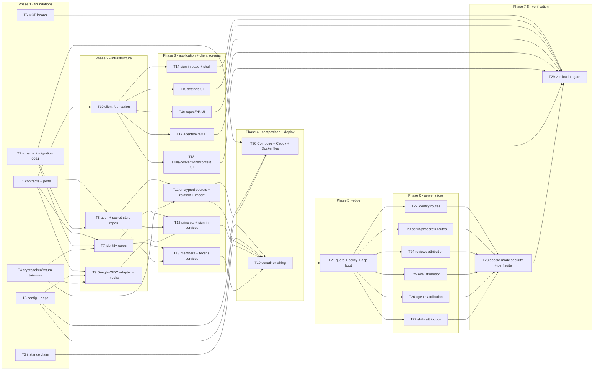

# Implementation Plan: Multi-user server mode (Google sign-in, Admin/Member, encrypted secrets)

> Source spec: `specs/2026-10-19-multi-user-server.md` (Spec ID `SPEC-2026-10-19-multi-user-server`,
> Status **approved**, 66 EARS ACs, 12 user stories, a Permission matrix and a UI gating table).
> This plan does not restate, extend or amend the spec. It maps every AC onto files and tasks.
> Branch at planning time: `feat/gitlab-integration-next-steps` (implement on a fresh branch from
> `main`, e.g. `feat/multi-user-server`).

## Overview

DevDigest today answers every request as one seeded system user (`LocalNoAuthProvider`), keeps
provider tokens and LLM keys in a plaintext 0600 JSON file with an env fallback, and hard-wires the
browser origin to `localhost`. This plan adds a second auth mode, `google`, behind one switch
(`AUTH_MODE`): Google OIDC sign-in restricted to `@onlytraf.com`, server-side sessions, Admin/Member
roles enforced by a central deny-by-default route policy, audit attribution, AES-256-GCM encrypted
secrets in Postgres, personal API tokens for the MCP server, and a single-VM Docker Compose
deployment behind Caddy. `local` mode (the default) stays byte-for-byte the same behaviour.
reviewer-core is untouched.

## Execution mode

**multi-agent (parallel)**. The user chose this up front. 29 tasks in 8 phases across server,
client, mcp and deployment. Contracts (T1) and the single schema/migration task (T2) come first.
Every phase lists the tasks that may run concurrently, and those tasks have **strictly
non-overlapping Owned paths**. Hot files each have exactly one owner:

| Hot file | Sole owner |
|---|---|
| `server/src/vendor/shared/index.ts` + client mirror | T1 |
| `server/src/db/schema/*`, `server/src/db/schema.ts`, `server/src/db/migrations/*`, `server/src/db/seed.ts` | T2 |
| `server/src/platform/config.ts`, `server/package.json`, `server/pnpm-lock.yaml` | T3 |
| `server/src/adapters/mocks.ts`, `server/src/adapters/index.ts` | T9 |
| `server/src/platform/container.ts` | T19 |
| `server/src/app.ts`, `server/src/server.ts`, `server/src/modules/_shared/context.ts` | T21 |
| `server/src/modules/index.ts` | T22 |
| `client/src/lib/api.ts`, `client/src/lib/providers.tsx`, `client/src/lib/hooks/{index,core,reviews,pr-sync}.ts` | T10 |

All implementers share one branch, no worktrees. **Never `git stash` while agents are working.**



## Requirements (verified)

Restated from the spec; the spec's AC-N ids are normative. The R-ids only group them. The full
AC → task table is at the end.

- **R1: Modes & boot** (AC-1–AC-5). `AUTH_MODE=local|google` (default `local`, anything else fails
  boot naming the allowed values). Local mode = exactly today. Google mode refuses to boot on a
  missing/invalid required setting, naming the setting and never its value (32-byte base64 master
  key, https public origin). Local mode + `NODE_ENV=production` refuses to boot without an explicit
  acknowledgement. Google mode takes an exclusive DB instance claim.
- **R2: Sign-in** (AC-6–AC-16). OIDC code flow + PKCE, single-use `state`/`nonce` bound to the
  browser, 10-minute expiry. Server-side ID-token verification (signature, iss, aud, exp ±60 s,
  nonce). Admission only when `hd` = domain, `email_verified`, exact case-insensitive email domain.
  Identity from verified claims only. First sign-in creates user (keyed by Google `sub`) + Member
  membership; returning users matched by `sub`, profile refreshed, role kept. Concurrent first
  sign-ins → one user. Deactivated → `auth_account_deactivated`. IdP failure →
  `auth_idp_unavailable`, no state. Same-origin relative return target only.
- **R3: Bootstrap & members** (AC-17–AC-23). Admin allowlist grants Admin on first sign-in or when
  zero active Admins; never demotes/overrides. No-admin + empty-allowlist → boot warning + Members
  banner. Everyone can list members; Admins change role / deactivate / reactivate with audit; the
  last-admin guard is serialized (`last_admin` 409); deactivation kills sessions and tokens
  synchronously.
- **R4: Sessions** (AC-24–AC-27). ≥256-bit opaque id, stored hashed server-side, `__Host-` cookie
  `HttpOnly; Secure; SameSite=Lax; Path=/`, rotated on sign-in. 24 h idle / 30 d absolute. Real
  sign-out. Role and status re-read every request.
- **R5: Authorization** (AC-28–AC-31, Permission matrix). Deny by default: every non-public route
  returns 401 before any handler/DB write/provider/LLM call; Member on Admin route → 403
  `forbidden_role` with no side effect; ownership rule (`forbidden_owner`) on run cancel and eval
  case edit/delete; workspace scoping unchanged.
- **R6: Client identity & gating** (AC-32–AC-35, UI gating table). Session probe once; shell
  identity + sign-out in google mode only; Member gating (disabled + associated "Admins only",
  destructive hidden, Settings read-only); 403 → toast + session re-read + re-render; 401 → one
  redirect to sign-in with return target, no loop.
- **R7: Secrets at rest** (AC-36–AC-44). Google mode: managed keys only in Postgres, AES-256-GCM,
  96-bit nonce, AAD = workspace + key name, non-reversible key id; master key from env only and
  never emitted; status = `set|unset|undecryptable` + updated_at/by, booleans true only for `set`;
  env vars ignored with one boot warning each; atomic save used without restart; wrong key →
  boot, `undecryptable`, `secret_undecryptable`, no fallback; previous key → one-transaction
  re-encrypt + audit; idempotent all-or-nothing import CLI.
- **R8: Audit attribution** (AC-45–AC-49, AC-52). Run initiator, finding actor (latest shown,
  every action audited), eval case creator, agent/skill creator/updater + version author. Additive
  nullable columns, only `owner`→`admin` rewritten, "—" / "Local user" labels. Local actor = system
  user. Audit events for the listed actions, never containing secrets/session ids/tokens/ID tokens.
- **R9: CSRF, CORS, rate limits, SSE** (AC-50, AC-51, AC-53, AC-54). Cookie mutations need exact
  `Origin`/`Referer` match + custom header (bearer exempt); CORS only for the public origin;
  per-user rate limit keys, 20/min/IP on sign-in start + callback; SSE requires auth before the
  stream opens, client opens with credentials.
- **R10: Personal tokens & MCP** (AC-55–AC-59). Self-service tokens (name 1–64, 1–365 d, default
  90), value shown once, hash stored, prefix shown; bearer auth with current role; session-only
  actions → `session_required`; revoke own / Admin any; 10 active max (`token_limit`); MCP sends
  `DEVDIGEST_API_TOKEN` and gives an actionable 401 message.
- **R11: Deployment & testing** (AC-60–AC-66). One Compose file: Caddy (only 80/443 published,
  auto-TLS, HTTP→HTTPS, forwarded IP/scheme), web, exactly one API, Postgres (internal), one-shot
  migration step; one hostname with `/api` → API; persistent clones/DB/certs; HSTS and no cookie on
  plain HTTP; e2e unchanged in local mode; no test login route in google mode; shared contracts
  extend-only.
- **NFRs** (fail closed, ≤5 ms p95 auth overhead @1 000 sessions, ≤300 ms p95 callback, JWKS cache
  + ≤1 refetch/min, constant-time compares, log redaction, WCAG 2.1 AA, `pnpm arch` 0 errors,
  reviewer-core unchanged) are attached to the tasks named in "Testing strategy".

## Open questions & recommendations

Nothing was asked interactively during planning (the caller fixed the execution mode). Each gap
below got a default the implementers follow unless the user overrides it before `/run-plan`.

- **Q1: Where does the detailed secrets status go?** The matrix lists only
  `GET /settings/secrets-status`, but the contract adds `{state, updated_at, updated_by}` and says
  the boolean `SecretsStatus` is untouched. → **default:** the same endpoint returns the existing
  booleans **plus** one new key `states: { [provider]: SecretStatusEntry }` (new schema
  `SecretsStatusDetailed = SecretsStatusHost.extend({ states })` in a new contract file). Old
  readers keep working; no new route.
- **Q2: Public origin vs hostname (AC-3 vs Contracts).** AC-3 says "public web origin must be
  https"; Contracts say the deploy setting is a hostname and the origin is `https://<hostname>`. →
  **default:** one setting `PUBLIC_HOSTNAME` (host[:port], no scheme, no path). A value with a
  scheme (e.g. `http://x`), path, userinfo or whitespace fails boot naming `PUBLIC_HOSTNAME`. The
  origin is always `https://<hostname>`, the browser API base `https://<hostname>/api`.
- **Q3: "Local user" label (AC-48).** `ActorRef = {user_id, name} | null` cannot say "this is the
  seeded system user". → **default:** the new `ActorRef` schema carries an optional
  `is_system: boolean` (it is a new schema, so this is not an edit of an existing contract). The
  client renders "Local user" when `is_system` is true, "—" when the ref is null.
- **Q4: HTTP status of `secret_undecryptable`.** Unspecified. → **default:** 409 with message
  "<KEY> can't be decrypted — re-enter it in Settings". `token_limit` and `last_admin` are 409 as
  specified; `auth_*` codes on the callback are redirects to `/sign-in?error=<code>`; JSON auth
  failures are 401 `unauthenticated`.
- **Q5: Production bootstrap of the team workspace.** Google mode needs the default workspace +
  system user, but `db:seed` also inserts demo data (`acme/payments-api`). → **default:** new
  idempotent `pnpm db:bootstrap` (`server/src/db/bootstrap.ts`) creates only the default workspace,
  the system user and its Admin membership (plus the built-in agents/skills/prompts if
  `seed.ts` exposes them as separable helpers; otherwise tenancy only, documented). The Compose
  migration step runs `db:migrate && db:bootstrap`.
- **Q6: Route paths for the new surface** (spec names them only by role). → **default:**
  `GET /auth/google/start?return_to=`, `GET /auth/google/callback`, `GET /auth/session`,
  `POST /auth/sign-out`, `GET /members`, `PATCH /members/:userId`, `GET /tokens` (own),
  `POST /tokens`, `DELETE /tokens/:id` (own, or any for Admin). Browser paths are the same under
  `/api`. In local mode `/auth/session` returns the local session and the Google routes return 404
  `auth_disabled`.
- **Q7: Default for an unclassified route.** AC-28 only requires "auth-required". → **default:**
  a route missing from the policy table is treated as **Admin + session or token**, and the matrix
  test (T21/T28) fails CI listing the unclassified route, so the author must classify it.
- **Q8: Workspace-wide settings rows.** `settings_ws_user_key_uq` includes `user_id`, so a second
  Admin's save would create a shadow row. → **default:** the settings repository updates by
  `(workspace_id, key)` first and inserts (with the acting user id) only if no row exists; reads
  dedupe by key. Acceptance: two Admins saving the same key → exactly one row.
- **Q9: Trusted proxy (AC-66).** Not in the spec's config list. → **default:** add `TRUST_PROXY`
  (IP/CIDR list passed to Fastify `trustProxy`, default unset = trust nothing). Compose pins
  Caddy to a static IP on the internal network and sets `TRUST_PROXY` to it.
- **Q10: Audit of finding actions.** AC-46 requires "two audit rows" for accept + dismiss, but
  AC-52's list omits findings. → **default:** record `finding.accept` / `finding.dismiss` events.
- **Q11: Members screen data for "joined-at".** Existing memberships have no join time. →
  **default:** new nullable `joined_at`; the DTO falls back to `users.created_at` when null.
- **Rec-1: central route policy instead of per-route tagging.** One table
  (`server/src/platform/auth/route-policy.ts`) keyed by `METHOD url` holds the whole Permission
  matrix plus declarative audit descriptors for route-driven events. This keeps 16 module
  `routes.ts` files untouched for authorization (parallel-friendly) and lets one test diff the
  registered routes against the matrix. Ownership checks (AC-30) stay in the services because they
  need data.
- **Rec-2: one `identity` module.** dependency-cruiser treats only `modules/<m>/routes.ts` as the
  presentation edge (`MODULE_INNARDS`), and `no-cross-module` is a counted warning. So auth,
  members and tokens live in **one** module `modules/identity/` with one `routes.ts`, and other
  slices reach identity data only through the container (`container.actorDirectory`,
  `container.audit`).
- **Rec-3: actor names via a batch lookup, not joins.** Repositories only persist and return actor
  ids; routes enrich DTOs with `withActors(dtos, lookup)` (`modules/_shared/actors.ts`), backed by
  one `IN (...)` query. This avoids rewriting existing repository queries in four modules.
- **Rec-4: keep `@devdigest/ui` edits minimal and additive.** Settings sections Members/API tokens
  are appended locally in `SettingsView/constants.ts` (no edit of `vendor/ui/nav.ts`). The shell
  needs optional props only (`userMenu?: ReactNode`, `addRepoDisabledReason?: string`) — T14 owns
  that additive edit and calls it out.
- **Rec-5: docs after the gate.** After T29 run `doc-writer` for `server/README.md` (new endpoints
  + matrix), `docs/architecture.md` (auth edge), a new `docs/deployment.md`, and `.env.example`
  notes. Out of scope here.
- **Task F coordination (user's parallel refactor).** This plan assumes the target shape
  `server/src/modules/settings/repository.ts` and a `PullListService` in `modules/pulls/`.
  **T23 edits `modules/settings/{routes,repository}.ts`** — start T23 only after Task F is merged
  into the branch. No task edits `modules/pulls/**` (pulls routes are covered by the central
  policy only).

## Affected modules & contracts

- **server / vendor shared** — new contract + port files (below), `export *` appended to the barrel.
- **server / db** — schema columns + 5 new tables, migration `0021_*`, `seed.ts` role value,
  new `bootstrap.ts`, `instance-claim.ts`.
- **server / platform** — `config.ts` (auth mode + deploy settings), `crypto/*`, `auth-errors.ts`,
  `auth/*` (guard, policy, CSRF, audit hook, return-to), `container.ts` wiring.
- **server / adapters** — `oidc/google.ts`, `secrets/encrypted.ts`, `secrets/local.ts` (status
  method), `mocks.ts` (`MockIdentityProvider`).
- **server / modules** — new `identity/` (repos, services, routes), `audit/` (repository),
  `secrets/` (repository, maintenance service, import); edits to `_shared/context.ts`, `settings`,
  `reviews`, `eval`, `agents`, `skills`, `index.ts`.
- **server / bootstrap** — `app.ts`, `server.ts`, new `src/cli/secrets-import.ts`.
- **client** — data layer (credentials, CSRF header, 401/403), session/members/tokens hooks,
  gating primitives, sign-in page, shell identity, Settings Members/API tokens/read-only keys,
  gating on every screen in the UI gating table, actor labels, i18n.
- **mcp** — bearer token config + 401 message.
- **deploy** — `deploy/compose.yml`, `deploy/Caddyfile`, `deploy/api.Dockerfile`,
  `deploy/web.Dockerfile`, `deploy/.env.example`.
- **e2e** — **no edits** (runs in local mode).
- **reviewer-core** — **unchanged** (`git diff --stat main -- reviewer-core` must be empty).
- **Contracts (all additive, new files; no existing schema edited):**
  - `server/src/vendor/shared/contracts/auth.ts`: `AuthMode` (`local|google`), `Role`
    (`admin|member`), `MemberStatus`, `CurrentSession` (`{mode, user:{id,email,name,avatar_url,role},
    workspace:{id,name}, allowed_domain?}`), `Member`, `MemberList` (`{members, has_active_admin}`),
    `MemberUpdate` (refine: ≥1 field), `ApiTokenCreateInput` (name 1–64, `expires_in_days` int
    1–365 default 90), `ApiTokenCreated`, `ApiTokenListItem`, `SignOutResult`, `AuthErrorCode`
    (`unauthenticated|auth_state_invalid|auth_token_invalid|auth_domain_not_allowed|
    auth_email_unverified|auth_account_deactivated|auth_idp_unavailable|auth_disabled`),
    `AuthzErrorCode` (`forbidden_role|forbidden_owner|csrf_rejected|session_required`),
    `MembersErrorCode` (`last_admin|token_limit`), `SecretErrorCode` (`secret_undecryptable`),
    constants `CSRF_HEADER = 'x-devdigest-csrf'`, `API_TOKEN_PREFIX = 'ddg_pat_'`.
  - `server/src/vendor/shared/contracts/actors.ts`: `ActorRef` (`{user_id, name, is_system?}`
    nullable, Q3) and extension schemas with **optional** actor fields only (so existing fixtures
    keep parsing): `RunSummaryWithActor` (`started_by`), `ReviewRecordWithActor` (`started_by`),
    `FindingRecordWithActor` (`acted_by`), `EvalCaseRecordWithActor` (`created_by`),
    `AgentWithActors` (`created_by`, `updated_by`), `AgentVersionWithAuthor` (`author`),
    `SkillWithActors`, and a skill-version extension (T1 must locate the existing skill-version DTO
    schema; if none exists in shared, define `SkillVersionAuthor = { author: ActorRef }` only).
  - `server/src/vendor/shared/contracts/secrets-status.ts`: `SecretState`
    (`set|unset|undecryptable`), `SecretStatusEntry`, `SecretsStatusDetailed` (Q1).
  - `server/src/vendor/shared/auth-ports.ts` (ports): `IdentityProvider` (OIDC conversation:
    `authorizationUrl`, `exchangeCode`, `verifyIdToken` → verified claims), `VerifiedIdentity`,
    `Principal` (`{userId, workspaceId, role, via:'local'|'session'|'token', sessionId?, tokenId?}`),
    `PrincipalProvider`, `AuditLog` + `AuditEventInput`, `SecretStore` (encrypted row CRUD),
    `SecretsInspector` (`status()`), `SecretsWriter` (`set(key, value, actorUserId)`),
    `ActorDirectory` (`lookup(ids) → Map<id, ActorRef>`), `Clock`.
  - `server/src/vendor/shared/index.ts`: **four appended `export *` lines only** (the barrel's
    documented extension mechanism). *Callout:* additive edit of an existing shared file, mirrored
    in lockstep in `client/src/vendor/shared/index.ts`.
  - Existing `AuthProvider`, `SecretsProvider`, `SecretsStatus`, `SecretsStatusHost`,
    `ApiErrorBody`, `RunSummary`, `FindingRecord`, `Agent`, `Skill`, `EvalCaseRecord` are **not
    edited**.

## Architecture changes

- **Core (contracts/ports)** — the four new files above. Ports are named after the conversation
  (`IdentityProvider`, `SecretStore`, `AuditLog`), not the vendor.
- **Infrastructure / db** (one migration `0021_*`, generated with `npx pnpm@11 db:generate`, then
  hand-appended data/trigger SQL):
  - `users`: `google_sub text unique` (nullable), `avatar_url text`, `last_sign_in_at timestamptz`;
    unique index on `lower(email) WHERE google_sub IS NOT NULL`.
  - `workspace_members`: `UPDATE ... SET role='admin' WHERE role='owner'`, `CHECK role IN
    ('admin','member')`, Drizzle enum `['admin','member']`; `status text not null default 'active'
    CHECK IN ('active','deactivated')`, `status_changed_at timestamptz`, `status_changed_by uuid`,
    `joined_at timestamptz` (nullable, Q11).
  - New `sessions` (`id`, `id_hash` unique, `user_id` FK cascade, `workspace_id`, `created_at`,
    `last_seen_at`, `expires_at`; index `user_id`).
  - New `oauth_flows` (`id`, `state_hash` unique, `binding_hash`, `nonce`, `code_verifier`,
    `return_to`, `created_at`, `expires_at`).
  - New `api_tokens` (`id`, `user_id`, `workspace_id`, `name`, `token_hash` unique, `prefix`,
    `created_at`, `last_used_at`, `expires_at`, `revoked_at`; index `(user_id) WHERE revoked_at IS
    NULL`).
  - New `encrypted_secrets` (`workspace_id`, `key_name`, `ciphertext bytea`, `nonce bytea`,
    `key_id text`, `updated_at`, `updated_by uuid null`; unique `(workspace_id, key_name)`).
  - New `audit_events` (`id`, `workspace_id`, `actor_user_id null`, `action`, `target_type`,
    `target_id null`, `metadata jsonb`, `ip text null`, `created_at`; index
    `(workspace_id, created_at)`); a `BEFORE UPDATE OR DELETE` trigger raises (append-only).
  - Actor columns (nullable, FK `users`, indexed): `agent_runs.initiated_by`, `findings.acted_by`,
    `eval_cases.created_by`, `agents.updated_by`, `skills.created_by`, `skills.updated_by`,
    `agent_versions.author_id`, `skill_versions.author_id`. Existing `agents.created_by` and
    `repos.created_by` are reused.
  - `db/instance-claim.ts`: `pg_try_advisory_lock(<fixed 64-bit key>)` on a dedicated
    `postgres(url, { max: 1 })` connection held for the process lifetime (released on `onClose`).
- **Infrastructure / adapters**:
  - `adapters/oidc/google.ts` — `GoogleIdentityProvider implements IdentityProvider`: fixed
    endpoints (`accounts.google.com`, `oauth2.googleapis.com/token`, JWKS
    `www.googleapis.com/oauth2/v3/certs`), `jose` `createRemoteJWKSet` (cache headers honoured,
    `cooldownDuration: 60_000`), `jwtVerify` with `issuer: ['https://accounts.google.com',
    'accounts.google.com']`, `audience: clientId`, `clockTolerance: 60`, nonce compared in constant
    time. Injectable `fetch`. Network/5xx → `auth_idp_unavailable`; any verification failure →
    `auth_token_invalid`. The client secret and authorization code never appear in errors/logs.
  - `adapters/secrets/encrypted.ts` — `EncryptedSecretsProvider implements SecretsProvider,
    SecretsWriter, SecretsInspector`: managed keys (`SECRET_KEY_BY_PROVIDER` values) from the
    `SecretStore` only; unset → `undefined`; key-id mismatch or GCM auth failure →
    `SecretUndecryptableError`; never consults `process.env`; no SQL (delegates to the port).
  - `adapters/secrets/local.ts` — gains `status()` (`set|unset`, `updated_at/by: null`); `get`/`set`
    unchanged.
- **Application** (`modules/identity/`, `modules/secrets/`):
  - `principal-service.ts` — `PrincipalService implements PrincipalProvider`: bearer
    (`Authorization: Bearer ddg_pat_…`) wins over cookie; hash lookup; joins user + membership on
    every request (AC-27); idle 24 h / absolute 30 d against injected `Clock`; `last_seen_at` /
    `last_used_at` touched at most once per 60 s; any error propagates (fail closed).
  - `sign-in-service.ts` — `start(returnTo)` and `callback(code, state, bindingCookie)`; admission
    rules, allowlist bootstrap, deactivated check, user upsert by `sub`, session creation, audit.
  - `members-service.ts`, `tokens-service.ts` — list/update with the last-admin guard under a
    per-workspace advisory transaction lock; deactivation revokes sessions + tokens in the same
    transaction; token create/list/revoke with the 10-active limit.
  - `modules/secrets/service.ts` — `SecretsMaintenance.bootCheck()` (rotation re-encrypt in one
    transaction + audit, undecryptable scan logging key names only, one warning per ignored env
    var), `modules/secrets/import.ts` — import logic used by `src/cli/secrets-import.ts`.
- **Infrastructure / repositories** — `modules/identity/repository.ts` (+
  `repository/{users,memberships,sessions,oauth-flows,api-tokens}.repo.ts`, `ActorDirectory`
  implementation), `modules/audit/repository.ts` (`AuditLog`), `modules/secrets/repository.ts`
  (`SecretStore`). All accept an optional `tx`.
- **Presentation** —
  - `platform/auth/guard.ts`: root `onRequest` hook registered **before** `@fastify/rate-limit`
    and before modules. It looks up `route-policy.ts`, resolves the principal (local mode:
    `container.auth`, role admin), enforces 401 / CSRF (`platform/auth/csrf.ts`) / `forbidden_role`
    / static `session_required`, and sets `req.principal`. A `preHandler` hook evaluates
    body-dependent `sessionOnly` predicates (test-connection with a key).
  - `platform/auth/audit-hook.ts`: `onSend` records declarative audit descriptors when
    `statusCode < 400`.
  - `modules/_shared/context.ts`: `getContext` reads `req.principal` and returns
    `{ workspaceId, userId, role, via }` (existing fields unchanged).
  - `modules/identity/routes.ts`: auth, members and tokens routes.
- **Composition root** — `platform/container.ts`: selects `LocalSecretsProvider` vs
  `EncryptedSecretsProvider` and `LocalNoAuthProvider` vs `PrincipalService` by `authMode`; new
  getters `identityRepo`, `audit`, `secretStore`, `secretsInspector`, `secretsWriter`,
  `identityProvider`, `principals`, `signIn`, `members`, `tokens`, `secretsMaintenance`,
  `actorDirectory`, `clock`; new `ContainerOverrides` slots `identityProvider`, `principals`,
  `audit`, `clock`, `secretStore`.
- **Client** — `lib/api.ts` (`credentials: 'include'`, `x-devdigest-csrf: 1` on non-GET),
  `lib/providers.tsx` (401 → one redirect; 403 `forbidden_*`/`csrf_rejected`/`session_required` →
  toast + invalidate `["session"]`), `components/auth-gate/` (mounted inside `Providers`),
  `lib/permissions.ts` (`useCan()`), `components/admin-gate/` (`AdminOnly` with
  `aria-disabled` + visible hint linked by `aria-describedby`), `components/actor-label/`.
- **Deploy** — `deploy/compose.yml` with services `proxy` (Caddy, only service with `ports`),
  `web`, `api` (`deploy.replicas: 1`), `postgres` (no `ports`), `migrate` (one-shot,
  `api` `depends_on: migrate: condition: service_completed_successfully`); volumes `pgdata`,
  `clones`, `caddy_data`, `caddy_config`.

## Phased tasks

### Phase 1 — Foundations (T1–T6 run concurrently)

- **T1: Shared contracts + ports (both vendored copies)**
  - **Action:**
    - Create `contracts/auth.ts`, `contracts/actors.ts`, `contracts/secrets-status.ts` and
      `auth-ports.ts` exactly as listed in "Contracts". New optional fields use `.optional()` /
      `.nullish()`, never bare `.nullable()`, so existing fixtures keep parsing.
    - Before writing `actors.ts`, read `contracts/trace.ts` (`RunSummary`), `review-api.ts`
      (`FindingRecord`, `ReviewRecord`), `eval-pipeline.ts` (`EvalCaseRecord`), `knowledge.ts`
      (`Agent`, `AgentVersion`, `Skill`) and extend those (`.extend`), never edit them.
    - Append four `export *` lines to `server/src/vendor/shared/index.ts`.
    - Copy all new files + the barrel byte-identically to `client/src/vendor/shared/`.
    - Hermetic test `server/test/contracts-auth.test.ts`: valid/invalid cases for `MemberUpdate`
      (empty object rejected), `ApiTokenCreateInput` (name 0/65 chars rejected, default 90),
      `CurrentSession`, `ActorRef` null, `SecretsStatusDetailed` (no value-length/prefix keys).
  - **Module:** server (+ client mirror) · **Type:** backend
  - **Skills to use:** zod, typescript-expert, onion-architecture
  - **Owned paths:** `server/src/vendor/shared/contracts/auth.ts`, `server/src/vendor/shared/contracts/actors.ts`, `server/src/vendor/shared/contracts/secrets-status.ts`, `server/src/vendor/shared/auth-ports.ts`, `server/src/vendor/shared/index.ts`, `client/src/vendor/shared/contracts/auth.ts`, `client/src/vendor/shared/contracts/actors.ts`, `client/src/vendor/shared/contracts/secrets-status.ts`, `client/src/vendor/shared/auth-ports.ts`, `client/src/vendor/shared/index.ts`, `server/test/contracts-auth.test.ts`
  - **Depends-on:** none
  - **Risk:** medium (lockstep contract)
  - **Known gotchas:** `.nullable()` = key required (root `INSIGHTS.md`, `RunStats.cost_usd`
    breakage). Port members as function-typed **properties**, not methods, so
    `strictFunctionTypes` applies (`server/INSIGHTS.md`, `host-git.ts`). ZodError is matched by
    shape. `auth-ports.ts` must not import Fastify types (`req: unknown`-style structural inputs:
    `{ headers: Record<string, string | string[] | undefined> }`).
  - **Acceptance:** `cd server && pnpm vitest run test/contracts-auth.test.ts` passes;
    `node scripts/check-shared-sync.mjs` exits 0; `git diff main --stat -- server/src/vendor/shared/contracts`
    lists only the three new files (AC-64); `cd server && pnpm typecheck` and
    `cd client && pnpm typecheck` pass.

- **T2: Schema, migration 0021, seed role, bootstrap script (sole DB-schema owner)**
  - **Action:**
    - Edit `db/schema/core.ts` (users + workspace_members columns, role enum `['admin','member']`),
      add `db/schema/identity.ts` (sessions, oauth_flows, api_tokens, encrypted_secrets,
      audit_events), add actor columns in `db/schema/{runs,reviews,eval,agents,skills}.ts`,
      register new tables in `db/schema.ts` (barrel + `schema` object).
    - `cd server && npx pnpm@11 db:generate` → `0021_*.sql` + snapshot + journal. Then append to
      the generated SQL: `UPDATE workspace_members SET role='admin' WHERE role='owner';`, the role
      and status CHECKs, the partial `lower(email)` unique index (if drizzle-kit can't express it),
      and the audit append-only trigger.
    - `db/seed.ts`: insert the membership with role `'admin'` (was `'owner'`); keep
      `DEFAULT_WORKSPACE_NAME` / `SYSTEM_USER_EMAIL` exports unchanged.
    - New `db/bootstrap.ts` (Q5): idempotent tenancy-only bootstrap, exported `bootstrap(db)` +
      CLI entry (`tsx src/db/bootstrap.ts`).
    - It-test `server/test/multi-user-migration.it.test.ts`: apply migrations through 0020, insert
      representative rows (owner membership, agent, run, finding, eval case, skill + versions),
      apply 0021, assert row counts/values unchanged except `role` (AC-48), new columns null,
      CHECKs reject `role='owner'`/`status='x'`, audit UPDATE/DELETE raise, unique
      `(workspace_id,key_name)` enforced, case-insensitive email unique for non-null `google_sub`.
    - It-test `server/test/db-bootstrap.it.test.ts`: on an empty migrated DB `bootstrap()` twice →
      one workspace, one system user, one admin membership, zero repos.
  - **Module:** server · **Type:** backend
  - **Skills to use:** drizzle-orm-patterns, postgresql-table-design, onion-architecture
  - **Owned paths:** `server/src/db/schema/core.ts`, `server/src/db/schema/identity.ts`, `server/src/db/schema/runs.ts`, `server/src/db/schema/reviews.ts`, `server/src/db/schema/eval.ts`, `server/src/db/schema/agents.ts`, `server/src/db/schema/skills.ts`, `server/src/db/schema.ts`, `server/src/db/rows.ts`, `server/src/db/migrations/0021_*.sql`, `server/src/db/migrations/meta/0021_snapshot.json`, `server/src/db/migrations/meta/_journal.json`, `server/src/db/seed.ts`, `server/src/db/bootstrap.ts`, `server/test/multi-user-migration.it.test.ts`, `server/test/db-bootstrap.it.test.ts`
  - **Depends-on:** none
  - **Risk:** high (single migration, data mapping)
  - **Known gotchas:** never edit `0000`–`0020`; server needs `npx pnpm@11`; Drizzle runs all
    pending migrations in **one** transaction (a `RAISE` rolls everything back,
    `server/INSIGHTS.md`); drizzle-kit can't express expression index targets
    (`reposIdentityWhere` precedent, `db/schema/repos.ts`); to test "pre-migration", run the
    migrator against a temp folder holding journal entries ≤ 0020 first; use unique repo
    `full_name`s in it-tests (seed already has `acme/payments-api`).
  - **Acceptance:** `cd server && pnpm vitest run test/multi-user-migration.it.test.ts test/db-bootstrap.it.test.ts`
    passes; `git diff main -- 'server/src/db/migrations/00[01]*' server/src/db/migrations/0020*` is
    empty; `pnpm db:migrate && pnpm db:seed` on a fresh local DB succeeds; existing
    `test/db-constraints.it.test.ts` still passes.

- **T3: Config, boot validation, dependencies**
  - **Action:**
    - `platform/config.ts`: add `AUTH_MODE` (`local|google`, default local; other values →
      error listing allowed values), `GOOGLE_CLIENT_ID`, `GOOGLE_CLIENT_SECRET`,
      `AUTH_ALLOWED_DOMAIN`, `AUTH_ADMIN_EMAILS` (comma list, trimmed, lower-cased),
      `PUBLIC_HOSTNAME` (Q2), `SECRETS_MASTER_KEY`, `SECRETS_MASTER_KEY_PREVIOUS`,
      `ALLOW_UNAUTHENTICATED_LOCAL_MODE` (`true|false`), `TRUST_PROXY` (Q9).
      New `AppConfig` fields: `authMode`, `google`, `allowedDomain`, `adminEmails`, `publicOrigin`,
      `publicApiBase` (`<origin>/api`), `masterKey: Buffer | null`, `previousMasterKey`,
      `trustProxy`, `allowUnauthenticatedLocal`. `webOrigin` = `publicOrigin` in google mode, else
      unchanged `http://localhost:<WEB_PORT>`.
    - Validation in a dedicated `validateAuthConfig(parsed)` that **collects every** offending
      setting and throws one `ConfigError` whose message names settings only (never values; do
      not surface raw ZodError issues, which can echo input). Rules: AC-3 list; master keys must
      decode (strict base64) to exactly 32 bytes; production + local without acknowledgement →
      error pointing to `AUTH_MODE=google` (AC-4).
    - Add deps: `npx pnpm@11 add jose @fastify/cookie` in `server/`. Add scripts
      `"db:bootstrap": "tsx src/db/bootstrap.ts"`, `"secrets:import": "tsx src/cli/secrets-import.ts"`.
    - Update `server/.env.example` with the new variables (empty values, comments). Do not read
      `server/.env`.
    - Hermetic test `server/test/config-auth-mode.test.ts`: unset → local; `google` with all
      valid → parsed; `AUTH_MODE=sso` → error names `AUTH_MODE` + allowed values; 16-byte key,
      `PUBLIC_HOSTNAME=http://x`, missing client id each → error naming exactly those settings and
      `expect(message).not.toContain(<value>)` and not the base64 key; production + local →
      error, + acknowledgement → ok.
  - **Module:** server · **Type:** backend
  - **Skills to use:** zod, typescript-expert, security
  - **Owned paths:** `server/src/platform/config.ts`, `server/package.json`, `server/pnpm-lock.yaml`, `server/.env.example`, `server/test/config-auth-mode.test.ts`
  - **Depends-on:** none
  - **Risk:** medium
  - **Known gotchas:** server's store is pnpm v11 (`npx pnpm@11 add`, root `INSIGHTS.md`); keep the
    existing `''` → undefined preprocess pattern for new optional knobs; `loadConfig` is called by
    tests with `{...process.env, NODE_ENV:'test'}` — local defaults must not require any new var.
  - **Acceptance:** `cd server && pnpm vitest run test/config-auth-mode.test.ts` passes (AC-1, AC-3,
    AC-4 config half); `cd server && pnpm typecheck && pnpm vitest run test/routes-smoke.test.ts`
    green (local defaults unchanged).

- **T4: Platform primitives — crypto, tokens, return-to, auth errors**
  - **Action:**
    - `platform/crypto/secret-box.ts`: `seal(plaintext, key, aad)` / `open(...)` with
      AES-256-GCM, `randomBytes(12)` nonce per call, 128-bit tag; `keyId(key)` =
      HMAC-SHA256(key, "devdigest/secret-key-id/v1") hex, first 16 bytes (non-reversible, AC-37);
      `aadFor(workspaceId, keyName)`.
    - `platform/crypto/tokens.ts`: `randomToken(bytes=32)` base64url, `sha256Hex`,
      `safeEqual` (`timingSafeEqual` on equal-length digests), `newApiToken()` →
      `{ value: 'ddg_pat_' + 43 chars, prefix: first 12 chars, hash }`, `newSessionId()`, PKCE
      `codeVerifier()` / `codeChallengeS256()`.
    - `platform/auth/return-to.ts`: `safeReturnTo(raw)` → path or `/` (rejects absolute URLs,
      `//`, `/\`, `\`, control chars, `javascript:`, encoded variants after one decode).
    - `platform/auth-errors.ts`: `AppError` subclasses `UnauthenticatedError` (401
      `unauthenticated`), `ForbiddenRoleError`, `ForbiddenOwnerError`, `CsrfRejectedError`,
      `SessionRequiredError` (403), `LastAdminError`, `TokenLimitError` (409),
      `SecretUndecryptableError` (409, Q4), `AuthFlowError(code)`.
    - Hermetic tests `server/test/secret-box.test.ts` (round-trip; fresh nonce each call; AAD swap
      → throws; tampered byte → throws; wrong key → throws; `keyId` stable and ≠ key bytes),
      `server/test/auth-tokens.test.ts` (entropy length ≥ 32 bytes, prefix, hash ≠ value),
      `server/test/return-to.test.ts` (AC-16 table: `https://evil.io`, `//evil.io`, `/\evil.io`,
      `javascript:alert(1)`, `%2F%2Fevil.io` → `/`; `/repos/x/pulls?y=1` kept).
  - **Module:** server · **Type:** backend
  - **Skills to use:** security, typescript-expert, onion-architecture
  - **Owned paths:** `server/src/platform/crypto/secret-box.ts`, `server/src/platform/crypto/tokens.ts`, `server/src/platform/auth/return-to.ts`, `server/src/platform/auth-errors.ts`, `server/test/secret-box.test.ts`, `server/test/auth-tokens.test.ts`, `server/test/return-to.test.ts`
  - **Depends-on:** none
  - **Risk:** medium (crypto correctness)
  - **Known gotchas:** `platform/errors.ts` is not owned by anyone — import `AppError` from it, do
    not edit it. Never log or include key material in `Error` messages.
  - **Acceptance:** `cd server && pnpm vitest run test/secret-box.test.ts test/auth-tokens.test.ts test/return-to.test.ts`
    passes (AC-16, AC-36 crypto half, AC-37 key-id half, NFR crypto/entropy).

- **T5: Single-instance DB claim**
  - **Action:** `db/instance-claim.ts` exporting `claimInstance(databaseUrl) → { release() }`.
    Uses a dedicated `postgres(url, { max: 1, idle_timeout: 0 })` and
    `select pg_try_advisory_lock(<constant bigint>)`; `false` → throws `ConfigError('another
    DevDigest API instance is running')`. It-test `server/test/instance-claim.it.test.ts`: claim A
    succeeds, claim B throws with that message, after `A.release()` claim B succeeds.
  - **Module:** server · **Type:** backend
  - **Skills to use:** drizzle-orm-patterns, postgresql-table-design
  - **Owned paths:** `server/src/db/instance-claim.ts`, `server/test/instance-claim.it.test.ts`
  - **Depends-on:** none
  - **Risk:** low
  - **Known gotchas:** a pooled connection would drop the session lock — keep the dedicated
    client alive; postgres-js connects lazily, so run the query eagerly.
  - **Acceptance:** `cd server && pnpm vitest run test/instance-claim.it.test.ts` passes (AC-5
    mechanism; boot wiring in T21).

- **T6: MCP bearer token**
  - **Action:** `mcp/src/config.ts` reads optional `DEVDIGEST_API_TOKEN`; `mcp/src/api.ts` adds
    `Authorization: Bearer <token>` only when set; `mcp/src/errors.ts` maps 401 to "DevDigest
    rejected the API token (or none is set). Create or renew one in Settings → API tokens and set
    DEVDIGEST_API_TOKEN." and passes 403 messages through. Tests in `mcp/test/api-auth.test.ts`:
    header present/absent (fetch stub), 401 message, no-token request has no `Authorization`
    header (local mode as today). Update `mcp/README.md` env table if present.
  - **Module:** mcp · **Type:** backend
  - **Skills to use:** typescript-expert, security
  - **Owned paths:** `mcp/src/config.ts`, `mcp/src/api.ts`, `mcp/src/errors.ts`, `mcp/test/api-auth.test.ts`, `mcp/README.md`
  - **Depends-on:** none
  - **Risk:** low
  - **Known gotchas:** never log the token; do not read `.mcp.json`.
  - **Acceptance:** `cd mcp && pnpm typecheck && pnpm test` passes (AC-59).

### Phase 2 — Infrastructure + client foundation (T7–T10 run concurrently)

- **T7: Identity repositories, constants, actor directory**
  - **Action:**
    - `modules/identity/constants.ts`: `SESSION_IDLE_MS = 24h`, `SESSION_ABSOLUTE_MS = 30d`,
      `OAUTH_FLOW_TTL_MS = 10min`, `TOUCH_THROTTLE_MS = 60s`, `TOKEN_LIMIT = 10`,
      `TOKEN_DEFAULT_DAYS = 90`, cookie names `__Host-ddg_session`, `__Host-ddg_oauth`.
    - `modules/identity/repository/users.repo.ts`: `upsertBySub(claims, tx)` (`ON CONFLICT
      (google_sub) DO UPDATE` email/name/avatar/last_sign_in_at, returns `{user, created}`),
      `findBySub`, `lookupActors(ids)` (implements `ActorDirectory`; system user → `is_system:true`).
    - `memberships.repo.ts`: `ensureMember(ws, user, role, tx)` (`ON CONFLICT DO NOTHING`),
      `get`, `list` (joined with users), `countActiveAdmins(ws, tx)`, `setRole`, `setStatus`,
      `withWorkspaceLock(ws, fn)` (`pg_advisory_xact_lock(hashtext('members:'||ws))` inside a
      transaction).
    - `sessions.repo.ts`: `create`, `findActiveByHash(hash, now)` (joins user + membership; filters
      idle/absolute), `touch`, `deleteByHash`, `deleteForUser(userId, tx)`.
    - `oauth-flows.repo.ts`: `create`, `consume(stateHash, now)` = `DELETE … RETURNING` where not
      expired (single use).
    - `api-tokens.repo.ts`: `create`, `findActiveByHash` (owner active, not expired/revoked),
      `listForUser`, `countActive`, `revoke(id)`, `revokeForUser(userId, tx)`, `touch`.
    - `modules/identity/repository.ts`: `IdentityRepository` facade exporting the above + domain
      row types mapped at the boundary (no `$inferSelect` leaks).
    - `modules/_shared/actors.ts`: pure `withActors(dtos, fields, lookup)` helper (Rec-3).
    - It-test `server/test/identity-repository.it.test.ts`: concurrent `upsertBySub` ×2 → 1 user,
      1 membership (AC-13); `consume` twice → second null (AC-7); expired flow → null; session
      idle/absolute filtering with explicit `now` (AC-25); two concurrent guarded demotions under
      `withWorkspaceLock` → admin count never 0 (AC-22 mechanism).
    - Hermetic `server/test/actors-helper.test.ts` for `withActors` (null ids → null ref).
  - **Module:** server · **Type:** backend
  - **Skills to use:** drizzle-orm-patterns, postgresql-table-design, onion-architecture, typescript-expert
  - **Owned paths:** `server/src/modules/identity/constants.ts`, `server/src/modules/identity/repository.ts`, `server/src/modules/identity/repository/users.repo.ts`, `server/src/modules/identity/repository/memberships.repo.ts`, `server/src/modules/identity/repository/sessions.repo.ts`, `server/src/modules/identity/repository/oauth-flows.repo.ts`, `server/src/modules/identity/repository/api-tokens.repo.ts`, `server/src/modules/_shared/actors.ts`, `server/test/identity-repository.it.test.ts`, `server/test/actors-helper.test.ts`
  - **Depends-on:** T1, T2, T4
  - **Risk:** medium
  - **Known gotchas:** repository methods speak domain (`consume`, not `deleteReturning`);
    accept optional `tx` so services own transactions; never return a query builder.
  - **Acceptance:** `cd server && pnpm vitest run test/identity-repository.it.test.ts test/actors-helper.test.ts`
    passes; `pnpm arch` shows no new warning from `modules/identity` or `modules/_shared`.

- **T8: Audit log + encrypted secret store repositories**
  - **Action:** `modules/audit/repository.ts` (`AuditRepository implements AuditLog`:
    `record(event, tx?)` only — no update/delete methods; metadata passed through a `scrubMetadata`
    allowlist that drops keys named like `value|token|secret|cookie|password|code|id_token`).
    `modules/secrets/repository.ts` (`SecretStoreRepository implements SecretStore`: `get(ws,key)`,
    `list(ws)`, `upsert(ws,key,{ciphertext,nonce,keyId}, actor, tx?)` atomic `ON CONFLICT DO
    UPDATE`, `insertIfAbsent` (import), `listByKeyId(ws, keyId, tx)`, `replaceMany(rows, tx)`).
    It-tests `server/test/audit-repository.it.test.ts` (row fields; scrubbed metadata; UPDATE
    raises) and `server/test/secret-store.it.test.ts` (upsert atomic, `insertIfAbsent` doesn't
    overwrite, unique per ws+key).
  - **Module:** server · **Type:** backend
  - **Skills to use:** drizzle-orm-patterns, postgresql-table-design, security
  - **Owned paths:** `server/src/modules/audit/repository.ts`, `server/src/modules/secrets/repository.ts`, `server/test/audit-repository.it.test.ts`, `server/test/secret-store.it.test.ts`
  - **Depends-on:** T1, T2
  - **Risk:** low
  - **Known gotchas:** store `bytea` as `Buffer`; never log row contents.
  - **Acceptance:** both it-tests pass (AC-52 storage half, AC-36/AC-40 atomic replace half).

- **T9: Google OIDC adapter + mocks**
  - **Action:** `adapters/oidc/google.ts` (as in Architecture) + `adapters/oidc/index.ts`;
    `adapters/mocks.ts` gains `MockIdentityProvider` (scriptable claims, failure modes
    `idp_down`, `bad_token`; records calls); export both from `adapters/index.ts`. Hermetic test
    `server/test/oidc-google.test.ts`: generate an RS256 key pair with `jose`, serve a stub JWKS via
    injected `fetch`; valid token → claims; bad signature, wrong `aud`, wrong `iss`, `exp` 61 s past,
    wrong nonce → `auth_token_invalid` each (AC-8); token endpoint 503 / network error →
    `auth_idp_unavailable` (AC-15); unknown `kid` → exactly one JWKS refetch within 60 s; the
    authorization URL contains `code_challenge_method=S256`, `hd=onlytraf.com`, `nonce`, `state`;
    error messages never contain the client secret or code.
  - **Module:** server · **Type:** backend
  - **Skills to use:** security, typescript-expert, onion-architecture
  - **Owned paths:** `server/src/adapters/oidc/google.ts`, `server/src/adapters/oidc/index.ts`, `server/src/adapters/mocks.ts`, `server/src/adapters/index.ts`, `server/test/oidc-google.test.ts`
  - **Depends-on:** T1, T3, T4
  - **Risk:** high (security boundary)
  - **Known gotchas:** `no-fastify-in-adapters` is an error rule; adapter must not import
    `platform/config.ts` types beyond plain options; `hd` hint only shapes the chooser — admission
    is decided in T12, never here.
  - **Acceptance:** `cd server && pnpm vitest run test/oidc-google.test.ts` passes; `pnpm arch`
    0 errors.

- **T10: Client foundation — data layer, session, gating primitives, auth gate**
  - **Action:**
    - `lib/api.ts`: `credentials: "include"`; add `CSRF_HEADER: "1"` on POST/PUT/PATCH/DELETE;
      keep `API_BASE` semantics (`NEXT_PUBLIC_API_BASE`, default `http://localhost:3001`; production
      build sets `/api`).
    - `lib/hooks/session.ts` (`useSession` key `["session"]`, `useSignOut`), `lib/hooks/members.ts`
      (`useMembers`, `useUpdateMember`), `lib/hooks/tokens.ts` (`useApiTokens`, `useCreateApiToken`,
      `useRevokeApiToken`); append to `lib/hooks/index.ts`; `lib/hooks/core.ts` `useSecretsStatus`
      typed as `SecretsStatusDetailed`.
    - `lib/hooks/reviews.ts` + `lib/hooks/pr-sync.ts`: `new EventSource(url, { withCredentials: true })`
      (AC-54).
    - `lib/providers.tsx`: on `ApiError` 401 → `redirectToSignIn(currentPath)` guarded by a
      module-level "already redirecting" flag and skipped on `/sign-in` (AC-35); on 403 with code
      `forbidden_role|forbidden_owner|csrf_rejected|session_required` → `notify.error(t(...))` +
      `invalidateQueries(["session"])` (AC-34). Mount `<AuthGate>` around children.
    - `components/auth-gate/`: google mode + 401 session → redirect to
      `/sign-in?return_to=<path>`; local mode → children immediately (AC-32 local half).
    - `lib/permissions.ts`: `useCan()` → `{ mode, isAdmin, userId, canCancelRun(run),
      canEditEvalCase(case) }` (own = `started_by/created_by.user_id === userId`; null owner → admin
      only, AC-30 UI half).
    - `components/admin-gate/`: `AdminOnly` render-prop giving `aria-disabled`, `tabIndex=0`,
      `aria-describedby` to a visible "Admins only" hint; `HiddenForMember`.
    - `components/actor-label/`: `ActorLabel({ actor, verb })` → "Run by A" / "Local user" / "—";
      text-only rendering, CSS-truncated; `ActorAvatar` accepts only `https://*.googleusercontent.com`
      URLs else default avatar.
    - `messages/en/auth.json` (sign-in strings, error codes, "Admins only", toasts).
    - RTL/unit tests: `lib/api.test.ts` (CSRF header on POST, none on GET, credentials include),
      `lib/providers.test.tsx` (401 → exactly one navigation, none on `/sign-in`; 403 → toast +
      session refetch), `components/admin-gate/AdminOnly.test.tsx` (Member: control focusable,
      `aria-disabled`, accessible description "Admins only"; Admin: enabled),
      `components/actor-label/ActorLabel.test.tsx` (null → "—", system → "Local user", markup in
      name rendered as text), `components/auth-gate/AuthGate.test.tsx` (local renders children; google
      401 → redirect with return_to).
  - **Module:** client · **Type:** ui
  - **Skills to use:** next-best-practices, react-best-practices, react-testing-library, frontend-ui-architecture, security
  - **Owned paths:** `client/src/lib/api.ts`, `client/src/lib/providers.tsx`, `client/src/lib/permissions.ts`, `client/src/lib/hooks/session.ts`, `client/src/lib/hooks/members.ts`, `client/src/lib/hooks/tokens.ts`, `client/src/lib/hooks/index.ts`, `client/src/lib/hooks/core.ts`, `client/src/lib/hooks/reviews.ts`, `client/src/lib/hooks/pr-sync.ts`, `client/src/components/auth-gate/**`, `client/src/components/admin-gate/**`, `client/src/components/actor-label/**`, `client/messages/en/auth.json`, `client/src/lib/*.test.ts*`
  - **Depends-on:** T1
  - **Risk:** medium (global fetch behaviour)
  - **Known gotchas:** global query errors toast only on network/5xx (`client/CLAUDE.md`) — keep
    that and add only the 401/403 branches; a `disabled` button is not focusable, so use
    `aria-disabled` (WCAG NFR); `EventSource` cannot send headers (GET only, no CSRF needed); the
    existing pr-sync fake-timer test must still assert 0 polling requests; styles via `styles.ts` +
    CSS tokens, not Tailwind.
  - **Acceptance:** `cd client && pnpm typecheck && pnpm test` passes including the five new test
    files (AC-32 local half, AC-33 primitive, AC-34, AC-35, AC-54 client half, AC-48 labels).

### Phase 3 — Application services + client screens (T11–T18 run concurrently)

- **T11: Encrypted secrets provider, rotation/boot check, import CLI**
  - **Action:**
    - `adapters/secrets/encrypted.ts` (Architecture); `adapters/secrets/local.ts` gains `status()`.
    - `modules/secrets/service.ts` — `SecretsMaintenance({ store, audit, masterKey, previousKey,
      env, log, workspaceId })`: `rotateIfNeeded()` re-encrypts every row with
      `key_id = keyId(previous)` in **one** transaction, logs `re-encrypted N secrets`, audits
      `secrets.reencrypt` (AC-42); `reportUndecryptable()` logs one error naming key names only
      (AC-41); `warnIgnoredEnv()` logs one warning per managed env var present (name only, AC-39).
    - `modules/secrets/import.ts` + `src/cli/secrets-import.ts` (`--file <path>` optional): reads
      the legacy JSON (malformed → abort) and managed env vars, encrypts, `insertIfAbsent` in one
      transaction, ignores unknown keys, prints imported/skipped/ignored names, audits
      `secrets.import`, never writes the source file; any failure → rollback + exit 1 (AC-43, AC-44).
      The CLI builds `Container` (composition root) — it does not import adapters directly.
    - Hermetic `server/test/encrypted-secrets.test.ts` (fake `SecretStore`): set→get round-trip;
      DB row has no plaintext substring; ciphertext copied onto another key → `undecryptable` and
      `get` throws `SecretUndecryptableError`; wrong master key → `undecryptable`; env
      `GITHUB_TOKEN` set + no row → `get` undefined, status `unset` (AC-36, AC-38, AC-39, AC-41).
    - It-tests `server/test/secrets-rotation.it.test.ts` (rotate → all `set` with the new key id,
      restart without previous key → `set`; audit row) and `server/test/secrets-import.it.test.ts`
      (run twice → second all skipped; UI-set key not overwritten; source checksum unchanged;
      injected failure on the 3rd key → 0 rows; invalid JSON → exit non-zero, 0 rows; output never
      contains values).
  - **Module:** server · **Type:** backend
  - **Skills to use:** security, onion-architecture, drizzle-orm-patterns, typescript-expert
  - **Owned paths:** `server/src/adapters/secrets/encrypted.ts`, `server/src/adapters/secrets/local.ts`, `server/src/modules/secrets/service.ts`, `server/src/modules/secrets/import.ts`, `server/src/cli/secrets-import.ts`, `server/test/encrypted-secrets.test.ts`, `server/test/secrets-rotation.it.test.ts`, `server/test/secrets-import.it.test.ts`
  - **Depends-on:** T1, T4, T8 (and T3 for config names)
  - **Risk:** high (data-at-rest, key handling)
  - **Known gotchas:** `container.invalidateSecretCaches()` must still be called after a save
    (T23); import must use the same `SECRET_KEY_BY_PROVIDER` set (import the constant through the
    container or duplicate it in `modules/secrets/constants` — do not import `modules/settings`
    (cross-module)); the CLI runs against the deploy DB — print names only.
  - **Acceptance:** the three test files pass; `pnpm arch` 0 errors, no new warning from
    `adapters/secrets` (no SQL in the adapter).

- **T12: Principal + sign-in services**
  - **Action:** `modules/identity/principal-service.ts` and `modules/identity/sign-in-service.ts`
    with explicit deps objects `{ repo, idp, audit, clock, config: { allowedDomain, adminEmails,
    publicApiBase }, workspace }` (no `Container`). Sign-in callback order: consume flow (missing /
    mismatched binding / used / expired → `auth_state_invalid`) → exchange (→ `auth_idp_unavailable`)
    → verify (→ `auth_token_invalid`) → admission (`hd === domain`, `email_verified === true`,
    `email.split('@')[1].toLowerCase() === domain`, else `auth_domain_not_allowed` /
    `auth_email_unverified`; audit rejected with verified email) → deactivated →
    `auth_account_deactivated` → under `withWorkspaceLock`: upsert by `sub`, ensure membership
    (role Admin iff allowlisted and (created or zero active Admins), AC-17/18), → create session,
    audit `auth.sign_in`. Returns `{ sessionValue, returnTo }`; request-supplied email/hd/role
    never read (AC-10). Hermetic `server/test/sign-in-service.test.ts` (fake repo/idp/audit/clock):
    AC-9 table (`x@gmail.com` no hd, `x@sub.onlytraf.com`, `x@onlytraf.com.evil.io`,
    `email_verified=false`) → rejected, `upsertBySub` never called; AC-17/18 scenarios; AC-14;
    AC-15 no repo writes; AC-12 role unchanged. Hermetic `server/test/principal-service.test.ts`:
    idle 24 h + 1 s → null, used every 23 h → null at day 30 (AC-25), token expired/revoked/
    deactivated owner → null (AC-56), role read fresh each call (AC-27), repo throw → throws (fail
    closed), bearer wins over cookie.
  - **Module:** server · **Type:** backend
  - **Skills to use:** security, onion-architecture, typescript-expert
  - **Owned paths:** `server/src/modules/identity/principal-service.ts`, `server/src/modules/identity/sign-in-service.ts`, `server/test/sign-in-service.test.ts`, `server/test/principal-service.test.ts`
  - **Depends-on:** T7, T8, T9 (T4 primitives)
  - **Risk:** high
  - **Known gotchas:** "If a service test needs Postgres, the layering is wrong" (onion §10) —
    keep these hermetic; compare hashes with `safeEqual`.
  - **Acceptance:** both test files pass (AC-7, AC-9–AC-15, AC-17, AC-18, AC-25, AC-27, AC-56
    service halves).

- **T13: Members + personal tokens services**
  - **Action:** `modules/identity/members-service.ts` (`list` → `{members, has_active_admin}`;
    `update(actor, userId, patch)` inside `withWorkspaceLock`: compute the post-change active-admin
    count, `0` → `LastAdminError` with no write (AC-22); deactivation → `deleteForUser` +
    `revokeForUser` in the same transaction (AC-23); audit `member.role_change` /
    `member.deactivate` / `member.reactivate` (AC-21)). `modules/identity/tokens-service.ts`
    (`create` with `countActive >= 10` → `TokenLimitError` (AC-58), name/expiry from contract;
    `list` own; `revoke(actor, id)` own or Admin, else `ForbiddenOwnerError`; audit `token.create`
    / `token.revoke` with token id and name only). Hermetic tests
    `server/test/members-service.test.ts`, `server/test/tokens-service.test.ts`; it-test
    `server/test/members-concurrency.it.test.ts` (two Admins demote each other concurrently → one
    success, one `last_admin`, count ≥1 throughout).
  - **Module:** server · **Type:** backend
  - **Skills to use:** onion-architecture, drizzle-orm-patterns, security
  - **Owned paths:** `server/src/modules/identity/members-service.ts`, `server/src/modules/identity/tokens-service.ts`, `server/test/members-service.test.ts`, `server/test/tokens-service.test.ts`, `server/test/members-concurrency.it.test.ts`
  - **Depends-on:** T7, T8
  - **Risk:** medium
  - **Known gotchas:** the created token value is returned once and never logged or audited.
  - **Acceptance:** the three test files pass (AC-20–AC-23, AC-55, AC-58 service halves).

- **T14: Sign-in screen + app-shell identity**
  - **Action:** `app/sign-in/page.tsx` + `app/sign-in/_components/SignInView/` (single "Sign in with
    Google" link to `${API_BASE}/auth/google/start?return_to=…`, names `allowed_domain`, maps
    `?error=` codes to i18n messages (unknown → generic), "Try again" for `auth_idp_unavailable`,
    "contact an admin" for `auth_account_deactivated`; signed-in visit → redirect to return_to).
    App shell: identity menu (avatar via `ActorAvatar`, name truncated, role, "Sign out") only in
    google mode; Member → `onRemoveRepo` undefined (hidden) and "Add repository" disabled with the
    hint. Additive optional props in `@devdigest/ui` shell (`userMenu?: ReactNode`,
    `addRepoDisabledReason?: string`) — *callout: vendored design-system edit, additive only*.
    `next.config.mjs`: `images.remotePatterns` for `*.googleusercontent.com` if `next/image` is used.
    `messages/en/shell.json`. RTL tests: `SignInView.test.tsx` (AC-6 domain + action, AC-15 error +
    retry, AC-14 copy, unknown error code generic), `AppShell.identity.test.tsx` (google: avatar,
    name, role, Sign out calls `useSignOut` then navigates to `/sign-in`; local: no Sign out (AC-32);
    Member: remove hidden, add disabled with accessible hint).
  - **Module:** client · **Type:** ui
  - **Skills to use:** next-best-practices, react-best-practices, react-testing-library, frontend-ui-architecture, security
  - **Owned paths:** `client/src/app/sign-in/**`, `client/src/components/app-shell/**`, `client/src/vendor/ui/shell/types.ts`, `client/src/vendor/ui/shell/Topbar.tsx`, `client/src/vendor/ui/shell/RepoSwitcher.tsx`, `client/next.config.mjs`, `client/messages/en/shell.json`
  - **Depends-on:** T10
  - **Risk:** medium
  - **Known gotchas:** `useSearchParams` needs a Suspense boundary (next-best-practices); the root
    layout already wraps in `<Suspense>`; never render the Google `error` text raw.
  - **Acceptance:** `cd client && pnpm test -- src/app/sign-in src/components/app-shell` passes;
    `pnpm typecheck` green (AC-6, AC-14, AC-15, AC-32, AC-33 shell rows).

- **T15: Settings — Members, API tokens, read-only keys/models**
  - **Action:** extend `SettingsView` sections locally (`members`, `api-tokens`; tokens section
    only when `mode === 'google'`). `SettingsMembers` (list with avatar/name/email/role/status/
    joined/last sign-in; Admin: role selector + Deactivate/Reactivate; Member: list only; "No admin —
    set the admin allowlist and sign in" banner when `has_active_admin === false`; `last_admin` →
    inline error). `SettingsApiTokens` (create form name 1–64 + expiry 1–365 default 90, value
    shown once with copy button and cleared on close/reload; list name/prefix/created/last
    used/expiry; revoke). `SettingsApiKeys`: Member → inputs and Save & Test hidden, per-key badge
    Configured / Not set / Needs re-entry from `states`, notice "Only admins can change API keys";
    Admin → unchanged plus "Needs re-entry" badge. `SettingsModels`: Member → selectors and Save
    disabled with the hint. `messages/en/settings.json`. RTL tests per component covering AC-19
    banner, AC-20, AC-33 Settings rows (Member/Admin), AC-55 shown-once, AC-58 `token_limit` message,
    AC-41 badge.
  - **Module:** client · **Type:** ui
  - **Skills to use:** react-best-practices, react-testing-library, frontend-ui-architecture, next-best-practices
  - **Owned paths:** `client/src/app/settings/**`, `client/messages/en/settings.json`
  - **Depends-on:** T10
  - **Risk:** medium
  - **Known gotchas:** the token value must live only in component state (never in the Query
    cache); `SETTINGS_SECTIONS` lives in `vendor/ui/nav.ts` — do not edit it (Rec-4).
  - **Acceptance:** `cd client && pnpm test -- src/app/settings` passes (AC-19, AC-20, AC-33,
    AC-38/41 UI, AC-55, AC-58 UI).

- **T16: Repos onboarding + PR page gating and actor labels**
  - **Action:** `AddRepoView` disabled + hint for Members; PR page: Cancel run shown only when
    `canCancelRun`, Delete review / Delete run hidden for Members, "Run by …" in `RunHistory` /
    `ReviewRunAccordion` via `ActorLabel(started_by)`, "Accepted by / Dismissed by …" on
    `FindingCard` via `acted_by`; Run review, Accept/Dismiss, Post comment, Regenerate, Create eval
    case stay enabled. i18n in `prReview.json`, `runs.json`, `onboarding.json`, `repos.json`. RTL
    tests: AddRepoView (Member disabled + description), RunHistory (own vs other's cancel; Member
    no delete; "Run by A", "Local user", "—"), FindingCard ("Dismissed by B").
  - **Module:** client · **Type:** ui
  - **Skills to use:** react-best-practices, react-testing-library, frontend-ui-architecture
  - **Owned paths:** `client/src/app/onboarding/**`, `client/src/app/repos/[repoId]/pulls/[number]/**`, `client/messages/en/prReview.json`, `client/messages/en/runs.json`, `client/messages/en/onboarding.json`, `client/messages/en/repos.json`
  - **Depends-on:** T10
  - **Risk:** low
  - **Known gotchas:** routes keyed by PR number, APIs by uuid (`client/CLAUDE.md`); keep existing
    e2e-visible texts unchanged in local mode (flows 02/04/05 assert PR page texts).
  - **Acceptance:** `cd client && pnpm test -- src/app/onboarding src/app/repos` passes (AC-33 Repos
    + PR rows, AC-45, AC-46, AC-48 UI).

- **T17: Agents + Evals gating**
  - **Action:** Agents: New agent, Edit (config/skills/context tabs Save), Promote version,
    attach skills/docs → disabled + hint for Members; Delete agent hidden; Run eval(s) enabled.
    Evals + `EvalCaseEditorModal`: edit/delete only on cases with `canEditEvalCase`. i18n in
    `agents.json`, `eval.json`. RTL tests: AgentCard / AgentsListView / AgentEditor (Member
    disabled + description, no delete), EvalsTab / CaseEditorForm (own vs other's vs legacy case).
  - **Module:** client · **Type:** ui
  - **Skills to use:** react-best-practices, react-testing-library, frontend-ui-architecture
  - **Owned paths:** `client/src/app/agents/**`, `client/src/app/evals/**`, `client/src/components/EvalCaseEditorModal/**`, `client/messages/en/agents.json`, `client/messages/en/eval.json`
  - **Depends-on:** T10
  - **Risk:** low
  - **Known gotchas:** `EvalsTab` lives under `app/agents/**` — owned here, not by T16.
  - **Acceptance:** `cd client && pnpm test -- src/app/agents src/app/evals src/components/EvalCaseEditorModal`
    passes (AC-33 Agents/Evals rows, AC-30 UI).

- **T18: Skills, Conventions, Project context gating**
  - **Action:** Skills: New, Import, Edit, Restore version → disabled + hint; Delete hidden.
    Conventions: Extract, Accept/Reject (single + bulk) disabled + hint. Project context: read-only
    document view + hint for Members. i18n in `skills.json`, `conventions.json`,
    `projectContext.json`. RTL tests per screen (Member vs Admin).
  - **Module:** client · **Type:** ui
  - **Skills to use:** react-best-practices, react-testing-library, frontend-ui-architecture
  - **Owned paths:** `client/src/app/skills/**`, `client/src/app/conventions/**`, `client/src/app/repos/[repoId]/project-context/**`, `client/messages/en/skills.json`, `client/messages/en/conventions.json`, `client/messages/en/projectContext.json`
  - **Depends-on:** T10
  - **Risk:** low
  - **Known gotchas:** none beyond T10's `aria-disabled` rule.
  - **Acceptance:** `cd client && pnpm test -- src/app/skills src/app/conventions src/app/repos/[repoId]/project-context`
    passes (AC-33 Skills/Conventions/Project-context rows).

### Phase 4 — Composition root + deployment (T19, T20 run concurrently)

- **T19: Container wiring**
  - **Action:** in `platform/container.ts` add the getters and override slots listed in
    Architecture; pick secrets/auth implementations by `config.authMode`; resolve the team
    workspace id once (default workspace by name) for the encrypted store/AAD; `secretsInspector`
    for both modes; `actorDirectory` from `IdentityRepository`. Hermetic
    `server/test/container-auth.test.ts`: local mode → `LocalSecretsProvider` +
    `LocalNoAuthProvider` (unchanged), google mode → `EncryptedSecretsProvider` +
    `PrincipalService`; overrides win; google-mode `secrets.get('GITHUB_TOKEN')` with env set and
    empty store → undefined.
  - **Module:** server · **Type:** backend
  - **Skills to use:** onion-architecture, typescript-expert
  - **Owned paths:** `server/src/platform/container.ts`, `server/test/container-auth.test.ts`
  - **Depends-on:** T3, T5, T11, T12, T13
  - **Risk:** medium (hot file)
  - **Known gotchas:** follow the `??=` + `overrides` first pattern; only the container names
    concrete classes; keep `invalidateSecretCaches()` semantics.
  - **Acceptance:** `cd server && pnpm vitest run test/container-auth.test.ts test/container-hosts.test.ts`
    passes; `pnpm arch` 0 errors.

- **T20: Docker Compose deployment (Caddy, Dockerfiles)**
  - **Action:** `deploy/compose.yml` (Architecture → Deploy; internal network with fixed subnet;
    Caddy static IP; `api` env `AUTH_MODE=google`, `TRUST_PROXY=<caddy ip>`, `NODE_ENV=production`,
    `DEVDIGEST_CLONE_DIR=/data/clones`; healthchecks on `/health/ready`), `deploy/Caddyfile`
    (`{$PUBLIC_HOSTNAME}`; `handle_path /api/* { reverse_proxy api:3001 }`; `reverse_proxy web:3000`;
    HSTS header; automatic HTTPS + HTTP→HTTPS redirect), `deploy/api.Dockerfile` (copies `server/`
    + `reviewer-core/`, `npm ci` in reviewer-core, `pnpm install --frozen-lockfile` in server, runs
    `tsx src/server.ts`), `deploy/web.Dockerfile` (`ARG NEXT_PUBLIC_API_BASE=/api`, `next build`,
    `next start`), `deploy/.env.example` (names only). Static check script
    `deploy/check-compose.sh`: `docker compose -f deploy/compose.yml config` succeeds; only `proxy`
    has `ports`; `api` replicas = 1; `migrate` runs `pnpm db:migrate && pnpm db:bootstrap`; `api`
    depends on `migrate` completing.
  - **Module:** deploy · **Type:** backend
  - **Skills to use:** security, next-best-practices (`self-hosting.md`), fastify-best-practices (`deployment.md`)
  - **Owned paths:** `deploy/compose.yml`, `deploy/Caddyfile`, `deploy/api.Dockerfile`, `deploy/web.Dockerfile`, `deploy/.env.example`, `deploy/check-compose.sh`
  - **Depends-on:** T2, T3, T11
  - **Risk:** medium (not testable end-to-end in CI)
  - **Known gotchas:** reviewer-core is consumed as raw source and its deps resolve from
    `reviewer-core/node_modules` — install them in the image (root `INSIGHTS.md`); never bake
    secrets into images; do not change the root dev `docker-compose.yml` (local Postgres).
  - **Acceptance:** `bash deploy/check-compose.sh` exits 0; `docker build -f deploy/api.Dockerfile .`
    and `-f deploy/web.Dockerfile .` succeed. Manual VM checklist (AC-60, AC-61, AC-65, AC-66):
    `docker compose up` healthy; `curl -I http://<host>` → 308; `https://<host>/api/health` → ok;
    `nmap` shows only 80/443; restart keeps repos/clones/reviews/certs.

### Phase 5 — Edge: guard, policy, app boot (T21 alone)

- **T21: Auth guard, route policy, CSRF, audit hook, app/server boot**
  - **Action:**
    - `platform/auth/route-policy.ts`: the complete Permission matrix (every row of the spec table
      plus `/health*`, `OPTIONS *`, and Q6 routes) as `Record<'METHOD /url', RoutePolicy>`;
      `HEAD` resolves to `GET`. Declarative audit descriptors for repo add/remove, agent/skill
      create/update/delete/restore/promote/skills/docs, review/run delete, settings update (changed
      key names from body), secret save (test-connection with `key`, key name only), finding
      accept/dismiss (Q10).
    - `platform/auth/guard.ts`, `platform/auth/csrf.ts`, `platform/auth/audit-hook.ts`,
      `platform/auth/request-principal.ts` (Fastify `decorateRequest('principal', null)` typing).
      Unclassified route → Admin (Q7). CSRF: google mode, cookie-authenticated mutation, `Origin`
      (else `Referer` origin) must equal `config.publicOrigin` exactly and `x-devdigest-csrf`
      present; bearer exempt (AC-50). Errors in principal resolution propagate (5xx), never
      anonymous.
    - `modules/_shared/context.ts`: return `role` + `via` from `req.principal` (falls back to
      `container.auth` when no principal, preserving existing tests).
    - `app.ts`: `Fastify({ trustProxy: config.trustProxy, logger: { redact:
      ['req.headers.authorization','req.headers.cookie','res.headers["set-cookie"]'] } })`;
      register `@fastify/cookie`; CORS origin = `config.webOrigin` (google: public origin only,
      AC-51); helmet HSTS on in google mode (AC-62); boot sequence in google mode (skippable via
      `BuildAppOptions.bootChecks=false` for hermetic tests): `claimInstance` (T5) →
      `secretsMaintenance.rotateIfNeeded/reportUndecryptable/warnIgnoredEnv` → AC-19 warning when
      no active admin and empty allowlist → existing stale-run reaping; production+local
      acknowledgement warning (AC-4); add guard hooks **before** `rateLimit`; `rateLimit` with
      `keyGenerator: req => req.principal ? 'u:' + req.principal.userId : 'ip:' + req.ip`
      (AC-53); new option `rateLimit?: boolean` so a test can enable it under `NODE_ENV=test`;
      release the instance claim `onClose`.
    - `server.ts`: catch `ConfigError` from `loadConfig`/`buildApp`, print the message to stderr,
      `process.exit(1)`.
    - Test helper `server/test/helpers/google-mode.ts`: builds a google-mode app with
      `MockIdentityProvider`, fixed clock, and helpers that create users/sessions/tokens **directly
      through `IdentityRepository`** (no HTTP login shortcut, AC-63).
    - Hermetic `server/test/auth-guard-matrix.test.ts` (fake `principals` override, no DB):
      enumerate routes via an `onRoute` collector; every non-public route → 401 without
      credentials; Member × every Admin route → 403 `forbidden_role`; bearer × session-only routes
      → 403 `session_required`; recording mocks (GitHub, LLM, repoService) show 0 calls (AC-28,
      AC-29, AC-57); every registered route has a policy entry. `server/test/csrf.test.ts`
      (AC-50 three cases + Referer fallback), `server/test/cors-hsts.test.ts` (foreign preflight →
      no ACAO; HSTS header present; AC-51, AC-62), `server/test/rate-limit-per-user.test.ts`
      (two users one IP 120 req/min each → no 429; 21st sign-in start from one IP → 429; AC-53),
      `server/test/boot-google.it.test.ts` (second app on same DB → rejects with "another
      DevDigest API instance is running"; AC-19 log line; AC-39 warning names `GITHUB_TOKEN` once;
      AC-41 wrong key → app boots; AC-42 re-encryption log), `server/test/fail-closed.test.ts`
      (principal resolver throws → non-2xx, handler not called).
  - **Module:** server · **Type:** backend
  - **Skills to use:** fastify-best-practices (`hooks.md`, `authentication.md`, `cors-security.md`), security, onion-architecture, typescript-expert
  - **Owned paths:** `server/src/platform/auth/route-policy.ts`, `server/src/platform/auth/guard.ts`, `server/src/platform/auth/csrf.ts`, `server/src/platform/auth/audit-hook.ts`, `server/src/platform/auth/request-principal.ts`, `server/src/modules/_shared/context.ts`, `server/src/app.ts`, `server/src/server.ts`, `server/test/helpers/google-mode.ts`, `server/test/auth-guard-matrix.test.ts`, `server/test/csrf.test.ts`, `server/test/cors-hsts.test.ts`, `server/test/rate-limit-per-user.test.ts`, `server/test/boot-google.it.test.ts`, `server/test/fail-closed.test.ts`
  - **Depends-on:** T19 (T3, T4, T5 transitively)
  - **Risk:** high (every request passes through it)
  - **Known gotchas:** Fastify runs hooks in registration order — the guard's `onRequest` must be
    added before `@fastify/rate-limit` registers its own; root hooks added before module
    registration apply to all encapsulated module plugins; body is not parsed at `onRequest`
    (body-dependent `sessionOnly` in `preHandler`); `req.routeOptions.url` is undefined for 404s
    (let them 404); rate-limit is disabled under `NODE_ENV=test` today; `pnpm arch` needs Node 22.
  - **Acceptance:** `cd server && pnpm vitest run test/auth-guard-matrix.test.ts test/csrf.test.ts test/cors-hsts.test.ts test/rate-limit-per-user.test.ts test/boot-google.it.test.ts test/fail-closed.test.ts`
    passes; **the full existing suite passes unchanged** (`cd server && pnpm test`, AC-2); `pnpm
    arch` 0 errors.

### Phase 6 — Server slices (T22–T27 run concurrently)

- **T22: Identity routes (auth, members, tokens) + registry**
  - **Action:** `modules/identity/routes.ts` with Zod-typed params/body; `modules/identity/helpers.ts`
    (DTO mappers, avatar URL → null unless `https://*.googleusercontent.com`, cookie options);
    register `identity` in `modules/index.ts`.
    - `GET /auth/google/start`: create flow, set `__Host-ddg_oauth` (HttpOnly, Secure, Lax, 10 min),
      302 to Google; 20/min/IP limit.
    - `GET /auth/google/callback`: require `req.protocol === 'https'` before setting any cookie
      (AC-62); on success clear the oauth cookie, delete any pre-existing session for the old
      cookie value, set `__Host-ddg_session` (AC-24), 302 to `publicOrigin + returnTo`; on failure
      302 to `/sign-in?error=<code>`; 20/min/IP.
    - `GET /auth/session` (public): local → local session; google → 200 `CurrentSession` or 401.
    - `POST /auth/sign-out` (session only): delete session, clear cookie, `{ok:true}`, audit.
    - `GET /members`, `PATCH /members/:userId`; `GET/POST /tokens`, `DELETE /tokens/:id`.
    - Local mode: Google routes 404 `auth_disabled`.
    - It-tests: `server/test/auth-signin.it.test.ts` (AC-6 return target round-trip, AC-7 state
      missing/mismatched/reused/expired/cross-browser, AC-8 via mock IdP failures, AC-9 DB user
      count unchanged, AC-10 injected `hd`/`email` query + `role: admin` header ignored, AC-11,
      AC-12, AC-13 parallel callbacks, AC-14, AC-15, AC-16, AC-24 Set-Cookie attributes and
      rotation, AC-26 replay after sign-out → 401, plain-HTTP callback sets no cookie);
      `server/test/members.it.test.ts` (AC-17–AC-23, AC-27 demoted Admin's next call → 403);
      `server/test/api-tokens.it.test.ts` (AC-55–AC-58, deactivated owner → 401);
      `server/test/route-policy-complete.test.ts` (registered routes == policy keys, no route
      matching `/test|/dev-login|/impersonate/` in google mode, AC-63).
  - **Module:** server · **Type:** backend
  - **Skills to use:** fastify-best-practices, security, zod, onion-architecture
  - **Owned paths:** `server/src/modules/identity/routes.ts`, `server/src/modules/identity/helpers.ts`, `server/src/modules/index.ts`, `server/test/auth-signin.it.test.ts`, `server/test/members.it.test.ts`, `server/test/api-tokens.it.test.ts`, `server/test/route-policy-complete.test.ts`
  - **Depends-on:** T21
  - **Risk:** high
  - **Known gotchas:** the oauth binding cookie must be `SameSite=Lax` (Strict is not sent on the
    top-level redirect back from Google); `app.inject` needs `x-forwarded-proto: https` with
    `trustProxy` set in tests; the session cookie value never appears in logs or audit.
  - **Acceptance:** the four test files pass; `cd server && pnpm test` green.

- **T23: Settings + secrets surface** (*edits Task F target files* `modules/settings/{routes,repository}.ts` — start after Task F is merged)
  - **Action:** `GET /settings/secrets-status` returns booleans (`true` only for `set`) + `states`
    from `container.secretsInspector` (Q1, AC-38); test-connection with `key` uses
    `container.secretsWriter.set(key, value, ctx.userId)` in google mode (fallback `secrets.set` in
    local), then `invalidateSecretCaches()` (AC-40); `SecretUndecryptableError` surfaces as
    `secret_undecryptable` (AC-41); `PUT /settings` writes workspace-wide (Q8). It-test
    `server/test/settings-secrets-google.it.test.ts`: status schema has no length/prefix hints; save
    GitHub token → next `container.github()` uses it, status shows updated_by/at; wrong-key row →
    `undecryptable` and a review needing OpenRouter fails with `secret_undecryptable`, re-enter →
    `set`; two Admins save the same setting → one row; API responses never contain the stored
    value. Hermetic update of existing `settings-gitlab.test.ts` only if its fakes need `status()`.
  - **Module:** server · **Type:** backend
  - **Skills to use:** fastify-best-practices, onion-architecture, drizzle-orm-patterns, security
  - **Owned paths:** `server/src/modules/settings/routes.ts`, `server/src/modules/settings/repository.ts`, `server/src/modules/settings/helpers.ts`, `server/test/settings-secrets-google.it.test.ts`, `server/test/settings-gitlab.test.ts`
  - **Depends-on:** T21 (and Task F merged)
  - **Risk:** medium
  - **Known gotchas:** the key is never echoed — keep `redactSecret`; `settings.feature-models.ts`
    is not edited.
  - **Acceptance:** `cd server && pnpm vitest run test/settings-secrets-google.it.test.ts test/settings-gitlab.test.ts test/settings-models.it.test.ts`
    passes (AC-36, AC-38, AC-40, AC-41, AC-57 test-connection row).

- **T24: Reviews — initiator, finding actor, cancel ownership**
  - **Action:** persist `agent_runs.initiated_by = ctx.userId` on run creation; `findings.acted_by`
    on accept/dismiss; `cancel(runId, actor)` → Member not initiator (or null initiator) →
    `ForbiddenOwnerError` (AC-30); runs/reviews DTOs include `started_by`, findings `acted_by` via
    `withActors(…, container.actorDirectory)`. Service gets actor as a plain argument (no request
    objects). Tests: hermetic `server/test/reviews-ownership.test.ts`; it-test
    `server/test/reviews-attribution.it.test.ts` (Member A run → DTO `started_by` = A (AC-45); A
    accepts, B dismisses → `acted_by` B + two audit rows (AC-46); Member B cancels A's run → 403,
    Admin → 200; legacy run → `started_by: null`; local mode → system user with `is_system`
    (AC-49)).
  - **Module:** server · **Type:** backend
  - **Skills to use:** onion-architecture, drizzle-orm-patterns, fastify-best-practices
  - **Owned paths:** `server/src/modules/reviews/**`, `server/test/reviews-ownership.test.ts`, `server/test/reviews-attribution.it.test.ts`
  - **Depends-on:** T21
  - **Risk:** medium
  - **Known gotchas:** `reviews.it.test.ts` "map-reduce + grounding" flakes under full load (Task E,
    root `INSIGHTS.md`) — don't misattribute; `run-executor.ts` types parameters as
    `$inferSelect` (existing backlog) — don't add more; fire-and-forget runs: assert after
    completion, not on a fixed sleep.
  - **Acceptance:** both new tests pass; `cd server && pnpm vitest run test/reviews.it.test.ts` green.

- **T25: Eval — case creator + edit/delete ownership**
  - **Action:** `eval_cases.created_by` on every create path (`POST /eval-cases`,
    `POST /findings/:id/eval-case`); `PUT/DELETE /eval-cases/:id` → owner or Admin, legacy → Admin
    only (AC-30); DTOs carry `created_by`. Tests `server/test/eval-ownership.test.ts` (hermetic
    service fakes) and `server/test/eval-attribution.it.test.ts`.
  - **Module:** server · **Type:** backend
  - **Skills to use:** onion-architecture, drizzle-orm-patterns
  - **Owned paths:** `server/src/modules/eval/**`, `server/test/eval-ownership.test.ts`, `server/test/eval-attribution.it.test.ts`
  - **Depends-on:** T21
  - **Risk:** low
  - **Known gotchas:** `eval-scoring-purity` arch rule — do not import repositories into
    `eval/{scoring,alerts,naming,prompt-diff,constants}.ts`; static `accept|dismiss` segments
    (comment in `eval/routes.ts`).
  - **Acceptance:** both new tests pass; `pnpm vitest run test/eval-service.test.ts test/eval.it.test.ts` green (AC-30, AC-47 eval half).

- **T26: Agents — creator/updater + version author**
  - **Action:** set `created_by` (existing column) and `updated_by` on create/update/delete/
    promote/skills/docs; `agent_versions.author_id` on every version-producing write; DTOs
    `created_by`, `updated_by`, versions `author`. Tests `server/test/agents-attribution.it.test.ts`
    (Admin edits → `updated_by` Admin, new version author Admin; AC-47).
  - **Module:** server · **Type:** backend
  - **Skills to use:** onion-architecture, drizzle-orm-patterns
  - **Owned paths:** `server/src/modules/agents/**`, `server/test/agents-attribution.it.test.ts`
  - **Depends-on:** T21
  - **Risk:** low
  - **Known gotchas:** `agents-versions.it.test.ts` must stay green.
  - **Acceptance:** `cd server && pnpm vitest run test/agents-attribution.it.test.ts test/agents-versions.it.test.ts` passes.

- **T27: Skills — creator/updater + version author**
  - **Action:** as T26 for skills (create, import, update, docs, delete, restore). Test
    `server/test/skills-attribution.it.test.ts`.
  - **Module:** server · **Type:** backend
  - **Skills to use:** onion-architecture, drizzle-orm-patterns
  - **Owned paths:** `server/src/modules/skills/**`, `server/test/skills-attribution.it.test.ts`
  - **Depends-on:** T21
  - **Risk:** low
  - **Known gotchas:** multipart import route — actor is read from `getContext`, not the form.
  - **Acceptance:** `cd server && pnpm vitest run test/skills-attribution.it.test.ts test/skills.it.test.ts test/skills-service.test.ts` passes (AC-47 skills half).

### Phase 7 — Cross-cutting google-mode suite (T28 alone)

- **T28: Security scans + performance NFRs (google mode, end to end over `app.inject`)**
  - **Action:** `server/test/google-mode-security.it.test.ts`: drive a full scenario (sign-in via
    mock IdP, save every managed key, run a review with mock LLM, accept/dismiss, create token,
    deactivate member, rotate key) capturing logs (pino destination stream) and all responses, then
    `pg_dump`-equivalent `SELECT` of every text/jsonb/bytea column: no secret value, no master key
    (raw or base64), no session cookie value, no token value, no ID token in logs, DB, responses,
    run traces or audit metadata (AC-37, AC-52, Non-functional logging); every AC-52 action yields
    one audit row with actor/action/target/time; SSE `/runs/:id/events` and
    `/repos/:id/pulls/sync/events` without cookie → 401 before any stream (AC-54).
    `server/test/auth-perf.it.test.ts`: 1 000 sessions seeded; p95 of principal resolution ≤ 5 ms;
    callback server-side p95 ≤ 300 ms with mock IdP (NFR).
  - **Module:** server · **Type:** backend
  - **Skills to use:** security, fastify-best-practices
  - **Owned paths:** `server/test/google-mode-security.it.test.ts`, `server/test/auth-perf.it.test.ts`
  - **Depends-on:** T22, T23, T24, T25, T26, T27
  - **Risk:** medium (perf thresholds on CI hardware — measure server-side only, warm up first)
  - **Known gotchas:** reuse `test/helpers/google-mode.ts`; unique repo full_names.
  - **Acceptance:** `cd server && pnpm vitest run test/google-mode-security.it.test.ts test/auth-perf.it.test.ts` passes.

### Phase 8 — Verification gate (T29, no new code)

- **T29: Verification gate**
  - **Action:** run the matrix below; route failures back to the owning task; fix nothing outside
    an owning task.
  - **Module:** server, client, mcp, e2e, deploy · **Type:** backend
  - **Skills to use:** onion-architecture, security
  - **Owned paths:** none
  - **Depends-on:** T6, T14, T15, T16, T17, T18, T20, T28
  - **Risk:** low
  - **Known gotchas:** record the `pnpm arch` warning count on `main` **before** starting (40 per
    `docs/plans/2026-10-19-next-steps.md`, fewer after Task F); `rtk proxy` for lint output.
  - **Acceptance:** all commands in "Final verification matrix" exit 0.

## Testing strategy

- **server, hermetic** (`cd server && pnpm vitest run <file>`; fakes from `adapters/mocks.ts` +
  `ContainerOverrides`, no Docker/network/keys): `contracts-auth`, `config-auth-mode`,
  `secret-box`, `auth-tokens`, `return-to`, `actors-helper`, `oidc-google`, `encrypted-secrets`,
  `sign-in-service`, `principal-service`, `members-service`, `tokens-service`, `container-auth`,
  `auth-guard-matrix`, `csrf`, `cors-hsts`, `rate-limit-per-user`, `fail-closed`,
  `route-policy-complete`, `reviews-ownership`, `eval-ownership`.
- **server, Postgres** (`*.it.test.ts`, testcontainers): `multi-user-migration`, `db-bootstrap`,
  `instance-claim`, `identity-repository`, `audit-repository`, `secret-store`,
  `secrets-rotation`, `secrets-import`, `members-concurrency`, `boot-google`, `auth-signin`,
  `members`, `api-tokens`, `settings-secrets-google`, `reviews-attribution`, `eval-attribution`,
  `agents-attribution`, `skills-attribution`, `google-mode-security`, `auth-perf`.
- **Local-mode regression:** the whole existing server suite (`pnpm test`), the existing client
  suite and `./scripts/e2e.sh` (11 flows) with **no flow edits and no new env** (AC-2, AC-63).
- **client** (`cd client && pnpm test`, vitest + jsdom + RTL, fetch mocked): T10 primitives and
  data layer, T14 sign-in + shell, T15 settings, T16 PR/onboarding, T17 agents/evals, T18
  skills/conventions/project-context. Each gating-table row has a Member and an Admin assertion
  (AC-33); accessible description asserted with `toHaveAccessibleDescription(/admins only/i)`.
- **mcp:** `cd mcp && pnpm typecheck && pnpm test`.
- **deploy:** `bash deploy/check-compose.sh` + image builds; manual VM checklist in T20.
- **Security carried by tests:** admission table (T12, T22), state/nonce/PKCE (T7, T9, T22),
  signature/aud/exp (T9), return-to (T4, T22), CSRF (T21), CORS/HSTS (T21), cookie attributes and
  plain-HTTP refusal (T22), secret non-disclosure scans (T11, T28), fail-closed (T21),
  constant-time compares (T4).

## Final verification matrix

```
cd server && pnpm typecheck && pnpm test                       # Docker required for *.it.test.ts
cd server && PATH="$HOME/.nvm/versions/node/v22.14.0/bin:$PATH" pnpm arch   # 0 errors; warnings <= main baseline
cd client && pnpm typecheck && rtk proxy pnpm lint && pnpm test
cd reviewer-core && pnpm typecheck && pnpm test && git diff --stat main -- . | wc -l   # last must print 0
cd mcp && pnpm typecheck && pnpm test
node scripts/check-shared-sync.mjs
git diff main --stat -- server/src/vendor/shared/contracts | grep -v -E 'auth.ts|actors.ts|secrets-status.ts' | grep -c '|'   # 0 edited existing contract files
git diff main -- 'server/src/db/migrations/00[01][0-9]_*.sql' server/src/db/migrations/0020_*.sql | wc -l   # 0
bash deploy/check-compose.sh
./scripts/e2e.sh                                               # 11 flows, local mode, no flow edits
git diff main --stat -- e2e/specs | wc -l                      # 0
```

## Risks & mitigations

- **A route slips through unguarded.** → Central policy + deny-by-default (unclassified = Admin) +
  `route-policy-complete` equality test + matrix test enumerating real routes (T21, T22).
- **Hook ordering lets rate-limit or a handler run before auth.** → Guard registered first on the
  root instance; `fail-closed` and matrix tests assert handler/mocks untouched (T21).
- **Local mode regresses** (e2e, existing tests). → Local branch keeps `LocalNoAuthProvider` +
  `LocalSecretsProvider`, no CSRF/cookie; T21 acceptance requires the unchanged full suite; T29
  runs e2e with no edits.
- **Master key or secret leaks** via ZodError messages, logs, traces or audit metadata. → Custom
  config validation (T3), pino redact (T21), metadata scrub (T8), end-to-end scan (T28).
- **Last-admin race.** → Per-workspace advisory transaction lock + concurrency it-test (T7, T13).
- **Wrong master key bricks the instance.** → Boot continues, keys flagged `undecryptable`,
  re-entry recovers (T11, T23); no env fallback (T19 test).
- **Migration mistake on live data.** → One migration, additive only, pre-migration snapshot test
  (T2); Drizzle's single-transaction migrator rolls back on any error.
- **Task F collision on settings files.** → T23 is gated on Task F being merged; no other task
  touches settings or pulls internals.
- **Vendored UI edit** (`vendor/ui/shell`). → Additive optional props only, owned by T14, called
  out; nav sections extended locally.
- **Perf thresholds flaky on CI.** → Server-side timing only, warm-up, p95 over ≥200 samples
  (T28); if CI hardware is too slow, keep the test but gate thresholds behind `PERF_STRICT=1` and
  record the decision.
- **Deployment untestable in CI.** → Static compose checks + image builds + a written VM checklist
  (T20); a real-VM smoke test is the user's step.
- **Single-instance assumption.** → Instance claim (T5, T21); scale-out changes stay listed in the
  spec's Non-functional section.

## Requirement → task traceability (AC → tasks)

| AC | Tasks | AC | Tasks | AC | Tasks |
|---|---|---|---|---|---|
| AC-1 | T3, T21 | AC-23 | T7, T13, T22 | AC-45 | T2, T24, T16 |
| AC-2 | T19, T21, T29 | AC-24 | T4, T22 | AC-46 | T2, T24, T16 |
| AC-3 | T3, T21 | AC-25 | T7, T12 | AC-47 | T2, T25, T26, T27 |
| AC-4 | T3, T21 | AC-26 | T22 | AC-48 | T2, T1, T10, T16 |
| AC-5 | T5, T21 | AC-27 | T12, T22 | AC-49 | T24, T26 |
| AC-6 | T10, T14, T22 | AC-28 | T21, T22 | AC-50 | T10, T21 |
| AC-7 | T4, T7, T12, T22 | AC-29 | T21 | AC-51 | T21 |
| AC-8 | T9, T22 | AC-30 | T24, T25, T10, T16, T17 | AC-52 | T8, T11, T12, T13, T21, T28 |
| AC-9 | T12, T22 | AC-31 | T21, T24 | AC-53 | T21, T22 |
| AC-10 | T12, T22 | AC-32 | T10, T14 | AC-54 | T10, T21, T28 |
| AC-11 | T7, T12, T22 | AC-33 | T10, T14–T18 | AC-55 | T13, T22, T15 |
| AC-12 | T7, T12, T22 | AC-34 | T10 | AC-56 | T12, T22 |
| AC-13 | T7, T22 | AC-35 | T10, T14 | AC-57 | T21, T23 |
| AC-14 | T12, T14, T22 | AC-36 | T4, T11, T23 | AC-58 | T13, T22, T15 |
| AC-15 | T9, T12, T14, T22 | AC-37 | T3, T4, T28 | AC-59 | T6 |
| AC-16 | T4, T22 | AC-38 | T1, T11, T23, T15 | AC-60 | T20 |
| AC-17 | T12, T22 | AC-39 | T11, T19, T21 | AC-61 | T2, T20 |
| AC-18 | T12, T22 | AC-40 | T8, T23 | AC-62 | T21, T22, T20 |
| AC-19 | T21, T15 | AC-41 | T11, T21, T23, T15 | AC-63 | T21, T22, T29 |
| AC-20 | T13, T22, T15 | AC-42 | T11, T21 | AC-64 | T1, T29 |
| AC-21 | T13, T22, T15 | AC-43 | T11 | AC-65 | T20, T3, T10 |
| AC-22 | T7, T13, T22 | AC-44 | T11 | AC-66 | T20, T21, T3 |

NFR mapping: fail closed → T12, T21; auth overhead ≤5 ms p95 and callback ≤300 ms p95 → T28;
JWKS caching/refetch → T9; entropy, lifetimes, constant-time → T4, T7, T12; rate limits → T21,
T22; log redaction → T21, T28; HSTS → T21, T20; single instance → T5, T21; accessibility → T10,
T14, T15 (aria tests) ; `pnpm arch` / reviewer-core unchanged → T29.

## Red-flags check

- [x] Every requirement maps to a task (66/66 ACs in the table above, plus NFRs).
- [x] No specification was authored or edited — `specs/2026-10-19-multi-user-server.md` was taken
      as input; gaps are recorded as Q1–Q11 with defaults.
- [x] Execution mode is recorded (multi-agent) and the plan is shaped for it (8 phases, DAG,
      concurrency lists, single owners for hot files).
- [x] Dependencies form a DAG: P1 → P2 → P3 → P4 → P5 → P6 → P7 → P8; client chain T1 → T10 →
      T14–T18 → T29; no back edges.
- [x] (multi-agent) Concurrent tasks have non-overlapping Owned paths: P1 (T1–T6), P2 (T7–T10),
      P3 (T11–T18: `adapters/secrets`+`modules/secrets` vs two disjoint `modules/identity/*`
      service files vs disjoint client route trees and i18n files), P4 (container vs `deploy/`),
      P6 (six distinct module folders + distinct test files).
- [x] Every Acceptance is a command plus named test file, or an observable result.
- [x] No edits to existing shared contracts — only four appended `export *` lines in both
      `index.ts` copies, called out under "Contracts". Additive `vendor/ui/shell` props (T14) and
      Task F file edits (T23) are called out.
