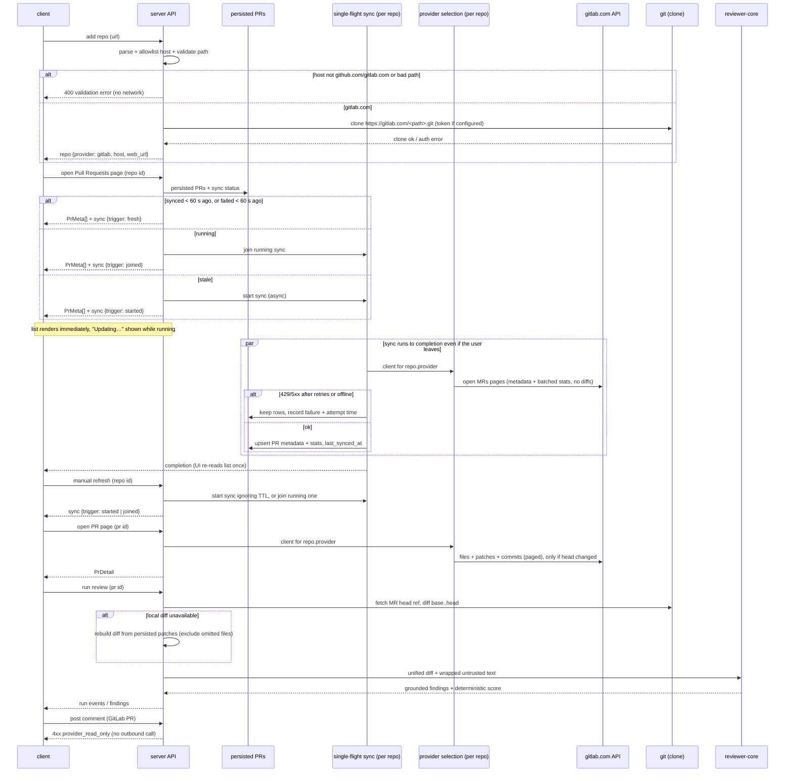

# Spec: GitLab repository & merge-request support (read-only MVP)   |   Spec ID: SPEC-2026-10-16-gitlab-merge-requests   |   Status: approved
Supersedes: none. Extends the repo/pulls/settings behaviour that every feature spec in this
directory builds on (`04-intent-layer.md`, `05-smart-diff.md`, `06-eval-pipeline.md`,
`2026-08-27-pr-brief.md`); none of their rules are changed, only made provider-aware.

Scope: cross-module — server (repos, pulls, polling, settings, brief/intent issue lookup,
smart-diff wiring heuristic), client (Add repo, Settings → API keys, PR list/detail, deep
links, comment composer), vendored shared contracts (server copy **and** client copy,
extension-only), mcp (wording only). reviewer-core is **unchanged**.

## Problem & why
DevDigest can only review repositories hosted on github.com. Every external PR call goes
through one global GitHub client built from a single `GITHUB_TOKEN`; repo identity accepts
only `github.com/<owner>/<name>` (exactly two path segments); the repo record has no notion
of provider or host; the UI hard-codes github.com deep links and "View on GitHub" copy.

The user's real target project is `https://gitlab.com/space-profit/platform/crm-frontend` —
a **nested-group, likely private** gitlab.com project. It cannot be added today at all. The
review engine itself is diff-generic (it reviews a unified diff and grounds findings against
it), so the gap is entirely at the host-integration edge: identity, auth, MR import, links,
and honest read-only UX. Closing it unlocks the whole existing feature set (review, findings,
Intent, PR Brief, Smart Diff, Blast Radius, Eval cases) for GitLab users without touching the
engine.

## Goals / Non-goals
- Goal: a workspace can add a **gitlab.com** project by URL — including nested groups of
  arbitrary supported depth and private projects — then clone and index it.
- Goal: open merge requests are imported and synced (list + detail: diff, per-file stats,
  commits, description, linked issue) and stored as PRs keyed by the MR `iid`.
- Goal: every existing PR-scoped feature (review runs, findings, Intent, PR Brief, Smart
  Diff, Blast Radius, Eval cases from a PR) works on a GitLab MR with no engine change.
- Goal: **mixed workspace** — GitHub and GitLab repositories coexist; the provider is a
  per-repository property, never a global switch.
- Goal: provider-correct deep links in the UI, with uniform "Pull request" terminology for
  both providers.
- Goal: **one** GitLab token per workspace can be stored and tested from Settings,
  independently of the GitHub token.
- Goal: zero regression for existing GitHub repos, PRs, clones and links after migration.
- Goal: **sync-on-open for all repositories (GitHub and GitLab)**, in preparation for a
  shared, server-hosted deployment: opening a repository's Pull Requests page renders the
  persisted list immediately and (unless synced within a 60 s TTL) revalidates it against the
  provider in a single-flight sync per repository, so provider traffic does not grow with the
  number of viewers. GitHub users see the same data as today, fresh as of page open (subject
  to the TTL).
- Goal: the PR list sync stores only metadata and line/file stats; diffs, per-file patches
  and commits are fetched only when a specific PR page is opened or refreshed.
- Non-goal: **self-managed GitLab** (any host other than `gitlab.com`). Not planned; only
  `gitlab.com` is supported and no design is reserved for other hosts.
- Non-goal: per-repository GitLab tokens — exactly one GitLab token per workspace. That
  token acts as a **service account**: every GitLab call (sync, PR page, clone, connection
  test) is made as that account, whoever triggers it; per-user provider identity is out.
- Non-goal: **multi-user server mode** — login, roles, per-user visibility of repos/PRs.
  It will be a separate spec; this spec only makes sync behaviour safe for many viewers.
- Non-goal: **writing to GitLab** — posting inline comments, replies, approvals, MR notes,
  or labels. The UI states this explicitly for GitLab MRs (next phase).
- Non-goal: reading existing GitLab MR discussions/threads into DevDigest.
- Non-goal: GitLab CI export / agent-runner / `.gitlab-ci.yml` generation (the eval-CI
  export stays GitHub-only).
- Non-goal: OAuth application flow. Auth is **Personal / Project / Group Access Token only**.
- Non-goal: webhooks (GitHub or GitLab) — freshness comes from sync-on-open plus manual
  refresh; push-based sync is a future spec.
- Non-goal: any scheduled / periodic sync — no server scheduler, no interval, and no
  client-side periodic auto-refetch of the PR list while the page stays open.
- Non-goal: changing reviewer-core, the grounding gate, or the deterministic re-score.
- Non-goal: any "merge request" / "MR" / `!iid` wording in the UI — GitLab MRs are shown as
  "Pull requests" with `#<number>` everywhere, and routes, keys and contracts keep "pull"
  naming. (This spec uses "MR" only to name the GitLab-side object.)
- Non-goal: GitHub draft-PR marking (draft indicator is specified for GitLab only).

## User stories
- US-1: As a workspace owner, I want to store a GitLab access token and test it, so that I
  know DevDigest can read my gitlab.com projects before I add one.
- US-2: As a workspace owner, I want to add `https://gitlab.com/space-profit/platform/crm-frontend`
  (nested, private) by pasting its URL in any common form, so that it is cloned and indexed
  like a GitHub repo.
- US-3: As a reviewer, I want to see the project's open merge requests in the PR list with
  correct status and change stats, so that I can pick one to review.
- US-4: As a reviewer, I want to open a merge request and run a review (and use Intent,
  PR Brief, Smart Diff, Blast Radius, Eval cases), so that GitLab MRs get the same analysis
  as GitHub PRs.
- US-5: As a reviewer, I want every "open on the host" link (MR, file, line) to go to the
  right place on gitlab.com, so that I never land on a broken github.com URL.
- US-6: As a workspace owner, I want GitHub and GitLab repos side by side in one workspace,
  so that I don't need separate workspaces per host.
- US-7: As a reviewer on a GitLab MR, I want to be told clearly that DevDigest cannot post
  comments to GitLab yet, so that I don't write a comment that silently goes nowhere.
- US-8: As an existing GitHub user, I want my repos, PRs, reviews and clones to keep working
  untouched after the upgrade, so that adding GitLab costs me nothing.
- US-9: As a team running DevDigest on a shared server, I want the PR list to load
  instantly from stored data and refresh from the provider at most once per repository at a
  time (and not again within a minute), however many of us open it, so that we stay within
  GitHub/GitLab rate limits.

## Acceptance criteria (EARS)

### Token & connection test (US-1)
- AC-1: The system **shall** accept exactly one gitlab.com access token per workspace,
  stored and reported (configured: yes/no) independently of the GitHub token, and used for
  every GitLab repository of that workspace.   _(observable: saving a GitLab token leaves the GitHub token status unchanged and vice versa; secrets-status response carries a separate gitlab boolean; saving a second token replaces the first)_
- AC-2: **WHEN** the user runs the GitLab connection test, the system **shall** call
  gitlab.com with the stored (or just-entered) token and report success together with the
  authenticated username.   _(observable: test-connection with provider `gitlab` and a valid token returns `ok: true` and a message containing the username)_
- AC-3: **IF** the GitLab token is rejected by gitlab.com (401/403, revoked, expired),
  **THEN** the connection test **shall** return `ok: false` with a message that names the
  failure (invalid / expired / revoked) and never echoes the token.   _(observable: test with a bad token → ok false, message has no token substring)_
- AC-4: **IF** the token is valid but lacks the read scopes required for the MVP
  (`read_api` and `read_repository`, or the superset `api`), **THEN** the connection test
  **shall** return `ok: false` naming the missing scope(s).   _(observable: a token with only `read_user` → ok false, message lists `read_api`, `read_repository`)_
- AC-5: **WHERE** the token's scopes cannot be introspected (e.g. a token type that does not
  expose its scopes), the connection test **shall** report `ok: true` for identity with a
  warning that scope sufficiency is verified on first repo access.   _(observable: message contains a scope-unverified warning)_

### Adding a repository (US-2, US-6)
- AC-6: **WHEN** the user submits a repository URL whose host is exactly `gitlab.com`
  (case-insensitive), the system **shall** register the repository with provider `gitlab`,
  host `gitlab.com`, and the full project path as its identity.   _(observable: created repo DTO shows provider gitlab, host gitlab.com, full_name `space-profit/platform/crm-frontend`)_
- AC-7: The system **shall** accept a gitlab.com project path of 2 to 21 segments (a
  namespace of 1–20 group levels plus the project), and represent it as namespace =
  all segments but the last, name = last segment, full name = the whole path.   _(observable: `a/b/c/d/e` → owner `a/b/c/d`, name `e`; a 22-segment path is rejected)_
- AC-8: The system **shall** normalise these gitlab.com URL forms to the same canonical
  project path: `https://gitlab.com/<path>`, with a trailing `/`, with a `.git` suffix, with
  a `/-/…` route suffix (e.g. `/-/tree/main`, `/-/merge_requests/5`, `/-/blob/…`), and the
  SSH scp form `git@gitlab.com:<path>.git`.   _(observable: all five forms of the crm-frontend URL add the same repo; a second add of any form is a duplicate)_
- AC-9: **IF** a submitted URL's host is anything other than `github.com` or `gitlab.com`
  (including other GitLab hosts, subdomains such as `www.gitlab.com` unless explicitly
  allowed, IP literals, non-default ports, or embedded userinfo), **THEN** the system
  **shall** reject it with a validation error that names the supported hosts, without making
  any network request.   _(observable: `https://gitlab.example.com/a/b` → 400 "only github.com and gitlab.com are supported"; no outbound call recorded)_
- AC-10: **IF** any path segment of a gitlab.com URL is empty, `.` or `..`, contains
  characters outside GitLab's allowed path set (letters, digits, `_`, `-`, `.`), or begins
  or ends with a character GitLab disallows, **THEN** the system **shall** reject the URL
  before any clone or filesystem operation.   _(observable: `gitlab.com/a/../b`, `gitlab.com/a/%2e%2e/b`, `gitlab.com/a/b;rm` all → 400)_
- AC-11: The system **shall** keep the existing github.com URL rules (exactly two segments,
  existing SSRF/path-traversal hardening, SSH form) unchanged.   _(observable: existing GitHub URL-parsing tests pass unmodified)_
- AC-12: **WHEN** a gitlab.com repository is added, the system **shall** clone it over
  HTTPS, authenticating with the GitLab token when one is configured, and then index it
  exactly as a GitHub repo is indexed.   _(observable: clone job completes; repo-intel status reaches the same ready state as for a GitHub repo)_
- AC-13: **IF** a gitlab.com project is private (or not found) and no GitLab token is
  configured, **THEN** the system **shall** fail the add/clone with a message telling the user
  to connect a GitLab token in Settings, and **shall not** retry with the GitHub token.   _(observable: clone job error message references GitLab token; outbound request carries no GitHub credential)_
- AC-14: **IF** the GitLab token is configured but gitlab.com denies access to the project
  (404/403 — GitLab returns 404 for projects the token cannot see), **THEN** the system
  **shall** report "project not found or token has no access", distinguishing it from an
  invalid token.   _(observable: distinct error code/message vs AC-3 case)_
- AC-15: The system **shall** treat the same `<path>` on GitHub and on GitLab as two
  different repositories that can both exist in one workspace, with separate clones that
  never overwrite each other.   _(observable: add `github.com/acme/web` and `gitlab.com/acme/web` → two repo rows, two distinct clone paths, both indexable)_
- AC-16: The system **shall** reject a duplicate add only when provider, host and full path
  all match an existing repo in the workspace, comparing GitLab full paths
  case-insensitively.   _(observable: second add of the same gitlab URL, or of `gitlab.com/Space-Profit/Platform/CRM-Frontend`, → existing duplicate error; GitHub twin does not trigger it)_
- AC-52: **WHEN** a gitlab.com repository is added, the system **shall** store as its
  canonical full path the `path_with_namespace` value gitlab.com returns for the project,
  regardless of the casing in the submitted URL.   _(observable: add with mixed-case URL → repo full_name equals gitlab.com's `path_with_namespace`)_
- AC-17: **WHEN** a gitlab.com repository is refreshed/re-cloned, the system **shall**
  rebuild its remote from the stored provider, host and full path, never from a
  github.com template.   _(observable: refresh of a GitLab repo fetches from gitlab.com)_

### Merge-request import & sync (US-3)
- AC-18: **WHEN** a PR-list sync runs for a GitLab repository, the system **shall** store
  for every open (`opened`) merge request only its list metadata — `iid` as PR number, title,
  author username, source branch, target branch, head SHA, state, draft flag, opened/updated
  timestamps — plus its line/file stats (AC-20), and **shall not** download any diff, patch or
  commit list.   _(observable: list shows the MR with iid 5 as PR #5 with matching title/branches/sha; outbound-call recorder shows no diffs/commits requests during the sync)_
- AC-19: The system **shall** map GitLab MR states to the existing PR states as: `opened` →
  open, `locked` → open, `merged` → merged, `closed` → closed; DevDigest's review-derived
  statuses (needs_review / reviewed / stale) **shall** keep applying on top exactly as for
  GitHub.   _(observable: a `locked` MR renders as open; a merged MR as merged)_
- AC-20: **WHEN** a PR-list sync fetches a page of open GitLab MRs, the system **shall**
  obtain additions, deletions and files-changed count for every MR on that page in one
  batched request per page, without fetching any diff, and **shall not** use GitLab's capped
  string `changes_count`. (Verified 2026-10-16: gitlab.com's GraphQL API exposes a per-MR
  diff-stats summary — additions, deletions, changes, fileCount — on the merge-request type
  reachable through the project's paginated merge-request connection, so per-page batching
  is possible.)   _(observable: sync of 120 MRs issues ≤ 2 stats requests and 0 diff requests; list row shows +additions / −deletions / N files matching gitlab.com)_
- AC-54: **IF** stats for an MR are not returned by the batched request (field null, request
  rejected, or the MR has no diff yet), **THEN** the PR list **shall** show "—" for that MR's
  stats instead of 0, and fill them on a later sync or when the PR page is opened.   _(observable: stubbed null stats → row shows "—"; after opening the PR page the row shows real numbers)_
- AC-21: **WHEN** a GitLab PR page is opened or refreshed, the system **shall** fetch and
  persist its description, commits (sha, message, author, committed-at), and per-file
  changes (path, previous path when renamed, new/deleted/renamed flags, additions,
  deletions, patch); this is the only path that downloads diffs, patches or commits.   _(observable: detail view shows commits tab and files list for the MR; diffs/commits requests appear only after the page is opened)_
- AC-22: The system **shall** paginate every GitLab list call (open MRs during sync; MR files
  and commits on the PR page) until the last page, with no upper limit on the number of MRs
  per sync or files per MR.   _(observable: fixtures with 120 open MRs and an MR with 1 200 files import all 120 MRs and, on opening that PR page, all 1 200 files; no item dropped)_
- AC-50: **WHERE** a GitLab MR is marked draft on gitlab.com, the PR list **shall** show a
  draft indicator on its row, and **WHEN** a sync observes the MR is no longer draft the
  indicator **shall** disappear.   _(observable: draft MR row shows "Draft" badge; after un-drafting on GitLab and re-sync, badge gone)_
- AC-51: **WHERE** a GitLab MR is marked draft, the PR page **shall** show the same draft
  indicator in its header, while the PR remains fully reviewable like any open PR.   _(observable: PR page header shows "Draft"; review run succeeds)_
- AC-23: **WHEN** an MR description or GitLab's "closes issues" relation references an issue
  of the **same project**, the system **shall** fetch that issue (title, body, state, labels)
  as the linked issue used by Intent and PR Brief, exactly as GitHub linked issues are used.   _(observable: MR with "Closes #12" → Intent/Brief input includes issue 12's title/body)_
- AC-24: **IF** GitLab returns a file entry with no diff because it is too large or
  collapsed, **THEN** the system **shall** persist the file without a patch, flagged as
  omitted-by-host, and **shall not** fail the import.   _(observable: an MR with a too_large file imports; that file shows "diff too large on GitLab")_
- AC-25: **IF** a GitLab API call returns 429 or 5xx, **THEN** the system **shall** retry with
  backoff (honouring `Retry-After` when present) as defined in Non-functional, and **IF** the
  sync still fails **THEN** keep the last persisted PRs unchanged, record the failure on the
  repository's sync status, and the PR list **shall** show a "showing data from <last
  successful sync time>" notice instead of an error page.   _(observable: with gitlab.com stubbed to 429, list still returns persisted rows; repo sync status = failed; notice shows last-success time)_
- AC-26: **WHILE** gitlab.com is unreachable or no GitLab token is configured, the system
  **shall** keep serving previously persisted MRs, reviews and findings for GitLab repos.   _(observable: offline mode lists previously synced MRs; reviews remain viewable)_
- AC-27: **WHEN** a PR-list sync runs for a repository, the system **shall** use the
  client for that repository's provider, so that a failure on one provider does not stop
  syncing of the other provider's repos.   _(observable: GitHub token revoked → GitLab repos still sync successfully, and vice versa)_

### Sync-on-open — all providers (US-9, US-8)
- AC-55: **WHEN** a user opens a repository's Pull Requests page (GitHub or GitLab), the
  system **shall** render the persisted PR list immediately, without waiting on any provider
  call.   _(observable: with the provider stubbed to hang, the page shows persisted rows within the list-read budget; list response is served from persisted data)_
- AC-56: **WHEN** a user opens a repository's Pull Requests page **and** the repository has
  no successful sync within the last 60 s (TTL), the system **shall** start a PR-list sync
  for that repository concurrently with rendering, unless one is already running (AC-57).   _(observable: open after 61 s since last success → exactly 1 sync starts; page already shows persisted rows)_
- AC-61: **WHEN** a user opens a repository's Pull Requests page **and** its last successful
  sync is less than 60 s old, the system **shall not** call the provider.   _(observable: open twice within 30 s → 0 provider calls on the second open)_
- AC-62: **IF** the last sync attempt for a repository failed less than 60 s ago, **THEN**
  opening its Pull Requests page **shall not** start another sync (manual refresh still can),
  so that a failing provider is not retried once per viewer.   _(observable: provider stubbed to 500; 10 opens within 60 s → 1 sync attempt)_
- AC-57: **WHILE** a PR-list sync for a repository is running, the system **shall not** start
  another for that repository; every further page open or manual refresh for it **shall**
  join the running sync and receive its outcome.   _(observable: 10 users open the page during a 20 s sync → 1 sync in the trace; all 10 lists update when it completes)_
- AC-58: **WHEN** a user triggers manual refresh of a repository's PR list, the system
  **shall** start a sync regardless of the TTL, or join the running one if a sync is already
  in progress (AC-57), and the list **shall** update in place when that sync finishes.   _(observable: refresh 5 s after a successful sync → a new sync runs; 5 rapid refresh clicks from 2 tabs → exactly 1 sync; response reports joined for the extra clicks)_
- AC-59: **WHILE** a sync for the open repository is running, the Pull Requests page **shall**
  show an "updating" indicator over the already-rendered list, and **shall** always show the
  time of the last successful sync; **WHEN** the sync completes the list **shall** update in
  place without a full page reload.   _(observable: header shows "Updating…" then "synced just now"; rows change without navigation)_
- AC-63: **WHILE** the Pull Requests page stays open and no sync is running, the client
  **shall not** re-fetch the list periodically; it re-fetches only on open, on manual refresh,
  or once on completion of a sync it started or joined.   _(observable: page left open 10 min after sync completion → 0 list requests and 0 provider calls)_
- AC-64: **IF** the user navigates away or closes the page while a sync is running, **THEN**
  the sync **shall** run to completion and persist its result, so the next open benefits
  from it (TTL applies from its completion).   _(observable: start sync, close tab; persisted rows + last_synced_at update; reopen within 60 s → 0 provider calls)_
- AC-60: **WHERE** a repository's provider is `github`, the Pull Requests page **shall** show
  the same PRs and fields as before this change, fresh as of page open subject to the 60 s
  TTL (data never older than 60 s at open while the provider is reachable, plus the sync's own
  duration).   _(observable: GitHub list snapshot before/after the change is field-identical; a PR opened on GitHub > 60 s after the last sync appears after the next page open without manual refresh)_
- AC-28: **WHEN** a sync observes that a previously open MR is now merged/closed, the system
  **shall** update its state accordingly (same rule as for GitHub PRs).   _(observable: merge MR on GitLab → next sync shows merged)_

### Review and dependent features on an MR (US-4)
- AC-29: **WHEN** a review is run on a GitLab MR, the system **shall** produce the diff from
  the local clone (target branch base vs MR head) and run the unchanged review engine,
  including the grounding gate and deterministic re-score.   _(observable: run trace shows the same pipeline stages as a GitHub run; ungrounded findings are dropped)_
- AC-30: **WHERE** the MR comes from a fork, the system **shall** obtain the MR head commit
  from the target project's merge-request ref, so that the local diff is available without
  access to the fork.   _(observable: review of a fork MR uses a local diff, not the fallback)_
- AC-31: **IF** the local diff cannot be produced, **THEN** the system **shall** fall back to
  the unified diff rebuilt from persisted per-file patches (as for GitHub), excluding files
  flagged omitted-by-host, and **shall** record in the run trace and show in the UI how many
  files were excluded.   _(observable: forced fallback on an MR with 2 too-large files → trace + UI note "2 files not reviewed (diff unavailable)")_
- AC-32: **IF** after exclusion the fallback diff is empty, **THEN** the system **shall**
  finish the run with a clear "no reviewable diff" outcome instead of calling the model.   _(observable: no LLM call recorded; run ends with that reason)_
- AC-33: The system **shall** render renamed, new and deleted files in a GitLab MR with the
  same semantics as GitHub (rename shows old → new path; deleted files are not targets for
  line-level findings).   _(observable: Files changed shows rename arrow; grounding rejects findings on deleted-file lines)_
- AC-34: The system **shall** make Intent, PR Brief, Smart Diff, Blast Radius and Eval-case
  creation available for GitLab MRs with the same behaviour and contracts as for GitHub PRs.   _(observable: each feature's existing e2e/it scenario passes against a GitLab-fixture MR)_
- AC-35: The Smart Diff wiring classification **shall** treat `.gitlab-ci.yml` and paths
  under `.gitlab/` as wiring/config, alongside the existing `.github/` rule, for any repo.   _(observable: classifier test: `.gitlab-ci.yml` → wiring)_

### Deep links & terminology (US-5)
- AC-36: The system **shall** expose, per repository, the provider, host and canonical web
  URL, so that the client never constructs a host URL from assumptions.   _(observable: repo DTO contains provider/host/web_url; client has no hard-coded gitlab.com/github.com for repo links)_
- AC-37: **WHERE** a repository's provider is `gitlab`, the client **shall** link MRs to
  `<web_url>/-/merge_requests/<iid>`, files to `<web_url>/-/blob/<sha>/<path>`, and lines to
  the same with `#L<n>` (and range `#L<a>-<b>`).   _(observable: link-builder unit test + e2e asserts href on a GitLab MR)_
- AC-38: **WHERE** a repository's provider is `github`, the client **shall** produce exactly
  the links it produces today.   _(observable: existing GitHub link-builder tests pass unmodified)_
- AC-39: The UI **shall** use "Pull request" terminology and the `#<number>` reference form
  on every surface for both providers — including a GitLab MR's own pages — and **shall**
  name the provider only in the external-link label ("View on GitLab" / "View on GitHub").   _(observable: PR header for GitLab iid 5 shows "#5" and "View on GitLab"; no "Merge request", "MR" or "!5" text anywhere in the UI)_
- AC-40: All newly added UI strings **shall** be served through the existing i18n catalogs,
  with no hard-coded English in components.   _(observable: new keys present in the client English catalog; no literal strings in new components)_
- AC-41: The Add repository screen **shall** state that github.com and gitlab.com URLs are
  supported and show an example of each (including a nested-group GitLab example).   _(observable: Add repository copy and placeholder mention both hosts)_
- AC-42: The MCP tools **shall** describe the PR number parameter provider-neutrally (PR
  number on GitHub or MR iid on GitLab).   _(observable: tool descriptions no longer say "as shown on GitHub" only)_

### Read-only commenting (US-7)
- AC-43: **WHERE** a PR belongs to a GitLab repository, the client **shall** not offer an
  enabled "post comment / reply to host" action and **shall** show an explanation that
  posting to GitLab is not supported yet, with copy-to-clipboard of the finding text as the
  available alternative.   _(observable: GitLab MR finding panel shows disabled post control + tooltip/inline note; copy works)_
- AC-44: **IF** a request to post a review comment targets a GitLab MR, **THEN** the server
  **shall** reject it with a dedicated, stable error code meaning "provider is read-only"
  (distinct from "token missing") and make no outbound call.   _(observable: POST comments on a GitLab PR → 4xx with that code; no gitlab.com request)_
- AC-45: **WHEN** existing host review comments are requested for a GitLab MR, the server
  **shall** return an empty list (no error), consistent with the read-only Non-goal.   _(observable: GET comments on a GitLab PR → 200 [])_

### Migration & no-regression (US-8)
- AC-46: **WHEN** the schema migration runs, the system **shall** assign every existing
  repository provider `github` and host `github.com` without changing its id, full name, PRs,
  reviews, findings or clone path.   _(observable: migration it-test on a seeded DB: row counts/ids unchanged, provider backfilled)_
- AC-47: **WHEN** an existing GitHub repository is refreshed after migration, the system
  **shall** reuse its existing clone in place (no re-clone, no path move).   _(observable: refresh does not create a new directory; clone_path unchanged)_
- AC-48: The system **shall** keep the GitHub client behaviour (data fetched by list sync,
  detail refresh, comments, linked issue, connection test) unchanged for GitHub repos; only
  *when* list sync runs changes (sync-on-open with TTL and single-flight instead of a
  blocking sync on every read, AC-55–AC-64).   _(observable: existing server pulls/settings/repos test suites pass, with list-read tests adjusted only for the read-from-persisted behaviour)_
- AC-49: The PR-number-keyed client route and uuid-keyed API surface **shall** remain
  unchanged; a GitLab MR is addressed by its `iid` in the route.   _(observable: `/repos/<id>/pulls/5` opens the MR with iid 5)_

### Settings guidance (US-1)
- AC-53: The GitLab token field in Settings **shall** show a hint listing the minimal scopes
  for read-only use (`read_api` + `read_repository`).   _(observable: Settings → API keys GitLab entry displays both scope names)_

## Edge cases
- No GitLab token, public project → clone + MR read work anonymously (subject to lower
  anonymous rate limits) → AC-12, AC-25.
- No GitLab token, private project → AC-13.
- Token invalid / expired / revoked → AC-3; at sync time → AC-25/AC-26 (persisted data + notice).
- Token valid but insufficient scope → AC-4; discovered later at clone/sync → AC-14 message.
- Token scopes not introspectable → AC-5.
- Nested path depth: 1 group (`a/b`) up to 20 groups; 22+ segments → AC-7.
- URL forms `.git`, trailing slash, `/-/tree/...`, `/-/merge_requests/N`, SSH scp form → AC-8.
- URL with query string or fragment (`?ref=main`, `#readme`) → stripped during normalisation → AC-8.
- Mixed-case path (`Space-Profit/Platform`) → canonical form is gitlab.com's
  `path_with_namespace`; duplicates compared case-insensitively → AC-16, AC-52.
- Non-gitlab.com GitLab host, `www.gitlab.com`, IP, port, userinfo, `http:` → AC-9.
- Path traversal / encoded traversal / shell metacharacters → AC-10.
- Same path on GitHub and GitLab → AC-15, AC-16.
- Project renamed/transferred on GitLab after add (path changes) → accepted: no handling;
  sync reports "project not found" via AC-14 and the user re-adds the repository.
- Too-large / collapsed file diffs → AC-24, AC-31 (handled on the PR page only); whole MR
  exceeds GitLab's diff limits → list stats still come from the host's stats summary (AC-20),
  review uses the complete local diff (AC-29).
- Stats missing / null for an MR in the batched request → "—" in the list → AC-54.
- Many users / tabs opening the same list at once → one sync, everyone joins → AC-57.
- Rapid re-open within the TTL (back/forward, tab switch) → no provider call → AC-61.
- Manual refresh while a sync is running, or repeated clicks → joined, not duplicated → AC-58.
- Provider failing while many users open the page → one attempt per 60 s → AC-62.
- Sync slower than the user stays on the page → indicator, list updates when done → AC-59;
  user navigates away mid-sync → sync completes and persists → AC-64.
- Page left open for a long time → list not auto-refreshed; user uses manual refresh → AC-63.
- PR page opened while list metadata is older than the host (head moved) → the PR page
  refresh fetches current detail → AC-21; the list catches up on the next open after the
  TTL or on manual refresh → AC-56, AC-58.
- Fallback diff empty after exclusions → AC-32.
- Rename / new / deleted / binary files → AC-21, AC-33 (binary: no patch, same as GitHub).
- `generated_file` flag from GitLab → accepted: no special handling (Smart Diff's own
  classifier decides).
- `locked` state → AC-19.
- Draft MRs → imported as open like any `opened` MR, visibly marked draft → AC-50, AC-51.
- Fork MRs → AC-30; fork deleted after MR opened → AC-30 still works (ref lives in target).
- Shallow clone lacks MR base commit → local diff fails → AC-31 fallback.
- Very many open MRs / files → all fetched, no cap → AC-22; latency scales with page count
  (see Non-functional).
- 429 / 5xx / network timeout → AC-25, AC-26.
- Linked issue in another project (`group/other#12`) or external tracker (Jira) → accepted:
  not fetched; Intent/Brief proceed without a linked issue.
- Linked issue confidential and not visible to the token → treated as "no linked issue",
  no error → AC-23.
- GitHub token revoked while GitLab works (and vice versa) → AC-27.
- Posting a comment on a GitLab MR via API/MCP → AC-44.
- Existing GitHub rows/clones after migration → AC-46, AC-47.
- Two concurrent syncs of the same repo → prevented → AC-57; a PR page refresh racing a
  list sync for the same PR → idempotent upsert-by-(repo, number) → accepted: existing
  behaviour.
- Server restart mid-sync → the interrupted sync is abandoned (no "running" state survives
  the restart); persisted data stays as of the last completed sync and the next open after
  the TTL syncs normally → accepted: no special handling.
- MR iid reused? GitLab iids are unique per project and never reused → accepted: no handling.

## Non-functional
- **Security — SSRF / host allowlist:** outbound host traffic (API and git) for GitLab repos
  goes only to `https://gitlab.com` (port 443). The allowlist is exact-match on the
  normalised host; no user-supplied host, port, or redirect target is followed to another
  host. API redirects to a different host are treated as errors.
- **Security — path safety:** every repository path segment is validated (AC-10) before use
  in any URL, git argument, or filesystem path; clone paths for different providers/hosts
  are namespaced so no two repos can resolve to the same directory, and the resolved clone
  path must stay inside the clone root.
- **Security — secrets:** the GitLab token is never logged (including in error `cause`,
  job errors, run traces, and git stderr captured into logs), never returned by any API
  (secrets status is boolean only), never sent to github.com, and never sent to the LLM.
  Git stderr/stdout forwarded to users or logs is redacted for the token value.
- **Security — least privilege:** the documented minimal token scopes are `read_api` +
  `read_repository`; Settings shows them as a hint (AC-53). Decision: **no** warning when the
  token carries the write-capable `api` scope (phase-2 commenting will need it).
- **Service account:** in server mode every provider call uses the workspace's single token;
  provider-side audit therefore attributes all DevDigest reads to that account.
- **Performance — list read:** reading the PR list (from persisted data, AC-55) is p95
  ≤ 300 ms server-side for a repository with 1 000 PRs, whether or not a sync is triggered
  or running.
- **Performance — sync / PR page (decision: no absolute wall-clock bound):** the budget is
  per page, not per sync. Every provider list call uses the maximum page size the host allows
  (100). Server-side processing overhead per fetched page (parse + persist, excluding host
  response time) is p95 ≤ 200 ms. A GitLab list sync issues ≤ ceil(open MRs / 100) page
  requests (metadata + batched stats, AC-20) and **zero** diff/patch/commit requests (AC-18).
  A PR page refresh re-downloads files and commits **only** when the PR's head SHA differs
  from the one persisted with its detail; otherwise it serves the persisted detail.
- **Provider call volume:** per repository, at most one PR-list sync in flight at any time
  and at most one open-triggered sync per 60 s (TTL, AC-56/61/62); only manual refresh can
  add more. Provider calls are independent of the number of viewers. Repositories nobody
  opens are never synced. The TTL is **deployment configuration with a default of 60 s**
  (recommended; not exposed in the UI).
- **Rate limiting / resilience:** on 429 or 5xx, retry at most 3 times with exponential
  backoff (1 s, 2 s, 4 s, ± 20 % jitter), honouring `Retry-After` up to 30 s; total extra wait
  per call ≤ 60 s; per-call timeout 15 s. A PR-list sync issues at most 1 concurrent request
  per repository and stays within the host's published authenticated API limit.
- **No regression:** existing GitHub-path test suites pass unchanged; reviewer-core
  dependency rules (`pnpm arch` error rules) stay at 0 violations.
- **Accessibility:** the disabled "post to GitLab" control and its explanation meet WCAG 2.1
  AA (explanation is programmatically associated with the control and reachable by keyboard
  and screen reader, not tooltip-on-hover only).

## Cross-module interactions

Modules: **client** (Add repo, Settings, PR list/detail, links, composer) → **server API**
(repos, pulls, polling, settings, brief, intent, smart-diff, reviews) → **provider client**
selected per repo (existing GitHub client, new GitLab client behind the same host-access
conversation) → **github.com / gitlab.com**; **git** clone from the host; **reviewer-core**
receives only a unified diff + already-resolved text (unchanged). **mcp** proxies HTTP and is
unaffected beyond wording.

Sync model (stale-while-revalidate): opening the Pull Requests page reads persisted data
immediately (AC-55) and, outside the 60 s TTL, triggers a server-side single-flight sync for
that repo that runs concurrently and independently of the requesting client (AC-56/57/61/
62/64); manual refresh bypasses the TTL but joins a running sync (AC-58). There is no
scheduler. Only the PR page fetches diffs/patches/commits (AC-21).

Failure contract: provider failures never surface as 5xx to the client for read paths —
the server serves persisted data with the last-successful-sync time (AC-25/26/59). Write paths on
GitLab fail fast with a read-only error (AC-44). A failure of one provider never affects
repos of the other (AC-27). The engine never sees provider errors.

## Contracts
Shapes only. All shared-contract changes are **extensions in new files**, mirrored
identically in the server vendor copy and the client copy; no existing schema is edited.

- **Repository provider** — enum `RepoProvider = 'github' | 'gitlab'`.
- **Repository DTO extension** (response, server → client): existing `Repo` fields plus
  - `provider: RepoProvider` (required in responses; `github` for all migrated rows)
  - `host: string` (`github.com` | `gitlab.com`; used for identity and deep links only)
  - `web_url: string` (canonical https project URL, e.g.
    `https://gitlab.com/space-profit/platform/crm-frontend`)
  - semantics of existing fields for GitLab: `owner` = full namespace path (may contain `/`),
    `name` = project path segment, `full_name` = full project path.
  - sync status (all providers): `last_synced_at: string | null` (last **successful** sync),
    `last_attempt_at: string | null`, `sync_state: 'idle' | 'running' | 'failed'`,
    `last_sync_error?: string | null` (no secrets, human-readable).
- **PR list read** (server → client) — existing PR list plus a `sync` object:
  `{ trigger: 'fresh' | 'started' | 'joined', state, last_synced_at, last_sync_error? }`
  (`fresh` = within TTL or failure back-off, no provider call).
- **Manual refresh** (client → server, per repo id) — request has no body; response
  `{ trigger: 'started' | 'joined' }`.
- **Sync completion signal** — the client learns that a started/joined sync finished
  (success or failure) so it can re-read the list once; delivery mechanism is a planning
  decision, but it **shall not** degrade into periodic list polling once no sync is running
  (AC-63).
- **Sync TTL** — server deployment configuration (seconds; default 60); not a client-facing
  contract.
- **Repo add input** — unchanged shape (`{ url }`); provider/host are derived from the URL,
  never accepted from the client.
- **Repo identity (server-internal, persisted)** — uniqueness becomes (workspace, provider,
  host, full_name); existing rows backfilled `github` / `github.com`.
- **Host repo reference (port input)** — a provider-neutral reference able to carry a nested
  path (provider, host, full path); the existing two-field reference remains valid for GitHub.
- **PR/MR data** — existing `PrMeta`, `PrDetail`, `PrFile`, `PrCommit`, `IssueMeta` reused.
  Additive optional fields (new extension schema):
  - on file: `previous_path?: string`, `change_type?: 'added' | 'modified' | 'deleted' | 'renamed'`,
    `patch_omitted?: 'too_large' | 'collapsed' | null`
  - on PR meta: `is_draft?: boolean` (populated for GitLab from the MR `draft` flag; absent
    for GitHub); `additions` / `deletions` / `files_count` may be unknown for an MR — shape
    for "unknown" is an additive optional `stats_known?: boolean` (false ⇒ client shows "—",
    AC-54), leaving the existing integer fields untouched
  - on PR detail: `files_omitted_by_host?: number` (count of files with `patch_omitted`)
  - GitLab `iid` → `number`; state mapping per AC-19 into the existing `PrStatus`.
- **Connection test** — provider enum extended (via a new extension schema) with `gitlab`;
  request/result shapes otherwise identical. Secrets status gains `gitlab: boolean` via an
  extension schema (existing `SecretsStatus` untouched).
- **Secret key** — `GITLAB_TOKEN` (open string key; no contract edit needed).
- **Error codes** (stable strings in the existing error envelope): `gitlab_token_missing`,
  `gitlab_token_invalid`, `gitlab_project_inaccessible`, `unsupported_repo_host`,
  `provider_read_only`.
- **Terminology** — "Pull request" / `#<number>` everywhere (UI, contracts, routes); only
  the external-link label names the provider.

## Untrusted inputs
Yes. From gitlab.com the feature reads MR title, description, commit messages, branch
names, author names, linked-issue title/body/labels, file paths, and diff content. All of it
is attacker-controllable (anyone who can open an MR or issue). It **shall** follow exactly
the GitHub path: wrapped as untrusted data before it reaches any prompt (Intent, PR Brief,
review), never interpreted as instructions, and findings stay subject to the grounding gate.
In the client it is rendered as text (no raw HTML); links built from it are restricted to
`https:` on the repo's own host. The pasted repository URL is also untrusted (AC-9/AC-10).

## Open questions
Resolved (2026-10-16): no write-scope warning (AC-53 hint only); no absolute sync
wall-clock bound (per-page budget + changed-only PR-page refetch, list read p95 ≤ 300 ms).
Obsolete (2026-10-16, sync-on-open replaced scheduled sync): sync interval in UI vs deploy
config; pausing sync for idle repos — there is no scheduler, and unopened repos never sync.
Resolved (2026-10-16): the 60 s back-off after a failed sync (AC-62) is confirmed.

No open questions remain.
