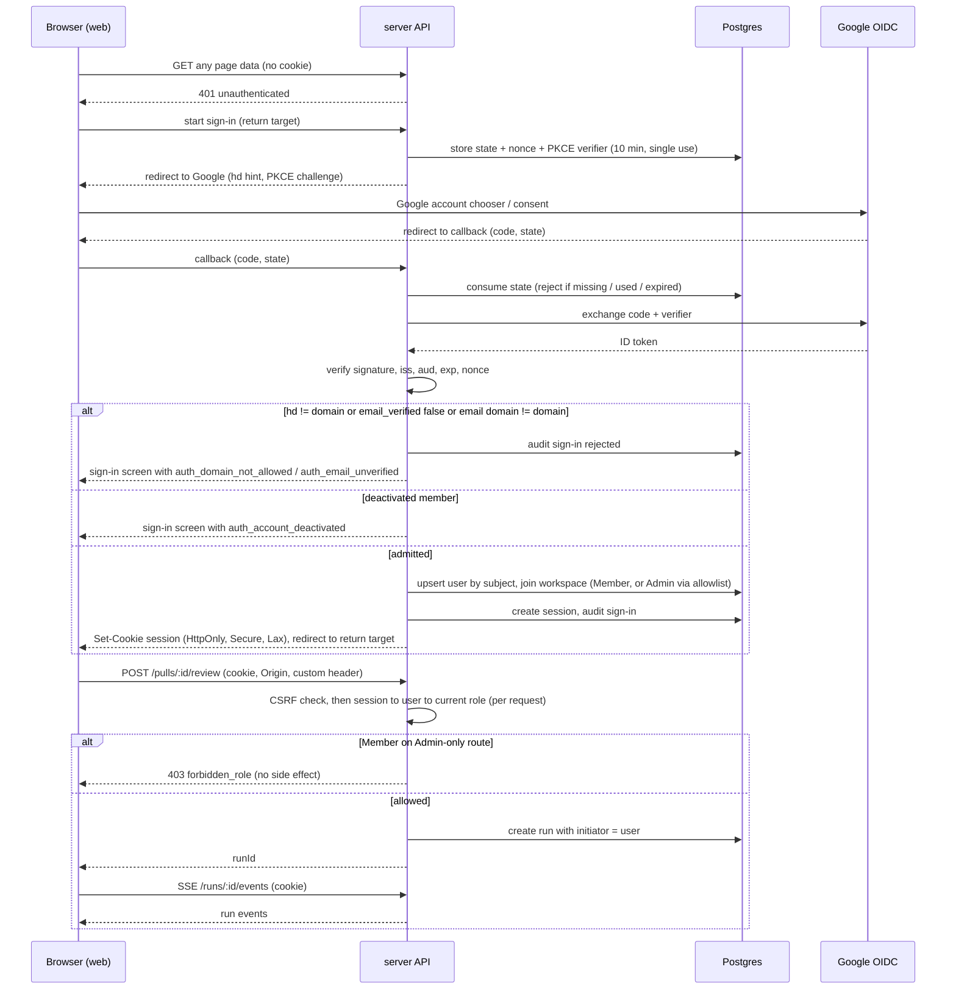
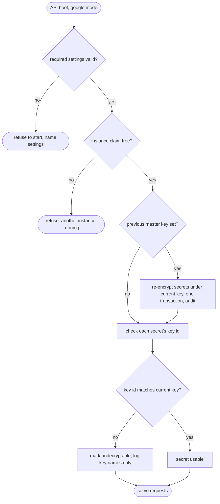

# Spec: Multi-user server mode (Google sign-in, Admin/Member roles, encrypted secrets)   |   Spec ID: SPEC-2026-10-19-multi-user-server   |   Status: approved
Supersedes: none. Builds on `2026-10-16-gitlab-merge-requests.md`, which made PR-list sync
safe for many viewers and listed "multi-user server mode" as its own future spec. No rule of
that spec changes. Its single-flight, TTL and service-account rules carry over unchanged.

Scope: cross-module.
- **server**: a new auth/session/members/tokens/audit surface; an authorization guard on every
  existing module; settings; the secrets backend; boot checks.
- **client**: sign-in screen, app-shell identity, role-gated controls, Settings → Members and
  Settings → API tokens, read-only API Keys/Models for Members.
- **vendored shared contracts**: new files only, mirrored into the server and client copies.
- **mcp**: bearer token.
- **e2e**: unchanged flows in local mode.
- **deployment**: Docker Compose.
- **reviewer-core**: **unchanged**.

## Problem & why
DevDigest is a single-user, local-first tool today:
- **No identity.** A no-auth provider answers every request as one seeded system user in one
  default workspace. There is no login, no notion of who did what, and no permission check.
  Anyone who can reach the API port can change API keys, delete repositories or delete
  review history. The API already listens on all interfaces.
- **Plaintext secrets.** Provider tokens (GitHub, GitLab) and LLM keys (OpenAI, Anthropic,
  OpenRouter) sit in plaintext. They live in a 0600 JSON file in the server user's home
  directory, with a fallback to process environment variables.
- **Localhost-only browser setup.** The browser origin, CORS and API base URL are all
  hard-wired to `localhost`.

The team wants one DevDigest instance on a shared VM for everyone at `onlytraf.com`. That
needs four things:
- **Authentication**: Google, corporate domain only.
- **Authorization**: Admin vs Member.
- **Attribution**: who ran a review, who accepted a finding, who changed a key.
- **Secrets that survive a shared host**: encrypted at rest, with the key held outside the DB.

The groundwork already exists:
- Every domain table carries `workspace_id`.
- Every route resolves tenancy through one shared request-context helper.
- A `users` / `workspace_members` schema exists.
- The PR-list sync is already single-flight per repository, with a TTL.

So this is mostly an edge concern: who is calling, are they allowed, and where are the keys
kept. It does not change the review engine.

Doing it now unblocks Task D (GitLab comment posting), which needs to know whose identity
writes to the provider. The answer is the service account. This spec pins that decision.

## Goals / Non-goals
- Goal: sign in with a **Google account restricted to `@onlytraf.com`**, enforced server-side
  from the verified ID token: the `hd` claim, `email_verified` and the email domain.
- Goal: **server-side sessions** in secure, httpOnly cookies, with idle and absolute expiry and
  a real sign-out.
- Goal: **two roles** in **one** team workspace: **Admin** and **Member**. A fixed permission
  matrix covers every existing endpoint and is enforced server-side, deny-by-default. The UI
  disables or hides admin-only controls according to a fixed gating table.
- Goal: first-admin **bootstrap** from a deployment allowlist, plus a recovery path when no
  admin remains. Any `@onlytraf.com` user auto-joins as Member on first sign-in.
- Goal: Admins manage members: change roles, deactivate and reactivate. A last-admin guard
  applies.
- Goal: **secrets in Postgres, encrypted at rest** (AES-256-GCM) under a master key supplied by
  env. The key is never stored, logged or returned. The spec defines behaviour for a missing,
  mismatched or rotated key. It also defines a one-time, idempotent import of existing local
  secrets.
- Goal: **audit attribution**. Review runs, finding accept/dismiss, eval cases,
  agent/skill/settings/secret/member changes and sign-ins record the acting user, using
  additive migrations only.
- Goal: **personal API tokens**, so the local MCP server keeps working against a shared
  instance.
- Goal: **local dev mode stays exactly as today** behind one config switch: no login, the
  system user, the file/env secrets.
- Goal: a **Docker Compose** deployment on one VM: Postgres + one API + web behind an
  in-stack HTTPS reverse proxy on one public hostname, with a guard against accidentally
  running two API instances.
- Non-goal: **per-user provider identity.** One GitHub token and one GitLab token per workspace
  stay the service account for every provider call, whoever triggers it. That includes
  Task D's future GitLab comments. There is no per-user OAuth to GitHub or GitLab.
- Non-goal: other identity providers, passwords, magic links, SAML, and MFA beyond what Google
  enforces for the corporate domain.
- Non-goal: **multiple workspaces**, workspace switching, or per-user visibility of repos/PRs.
  Every member sees everything in the one team workspace.
- Non-goal: roles other than Admin/Member (no viewer or reviewer split), and fine-grained or
  per-repo permissions.
- Non-goal: email invitations or pre-provisioning members. Members appear on their first
  sign-in.
- Non-goal: an audit-log viewer UI or export. Audit events are persisted only (Open questions).
- Non-goal: per-user preferences. Workspace settings stay workspace-wide.
- Non-goal: **horizontal scale-out** (more than one API process per DB). See *Non-functional →
  Single instance* for what would have to change.
- Non-goal: deleting or clearing a stored secret from the UI. Replacing a value is supported,
  as today.
- Non-goal: changing reviewer-core, the grounding gate, the deterministic re-score, or prompt
  assembly.
- Non-goal: a secrets vault (Vault, KMS, cloud secret managers). The master key comes from env.

## User stories
- US-1: As an `@onlytraf.com` employee, I want to sign in with my Google work account, so
  that I can use the team's DevDigest without a separate password.
- US-2: As the team, we want anyone outside `@onlytraf.com` (personal Gmail, other Google
  Workspace domains, unverified emails) refused, so that our code and findings stay internal.
- US-3: As the operator deploying DevDigest, I want designated people to become Admin
  automatically on first sign-in, and admin access to be recoverable if every admin is gone,
  so that the instance is never unmanageable.
- US-4: As an Admin, I want to see all members and change their role or deactivate them, so
  that I control who can configure the instance and who can still get in.
- US-5: As a Member, I want to run reviews, accept/dismiss findings, create eval cases and
  refresh PR lists, so that I can do day-to-day review work without admin rights.
- US-6: As a Member, I want admin-only controls to be visibly unavailable with an
  explanation, rather than clickable and failing, so that I know what I can do and whom to ask.
- US-7: As an Admin, I want to set provider tokens and LLM keys in Settings and have them
  stored encrypted and never shown back to anyone, so that a DB dump or a curious user does not
  leak them.
- US-8: As the operator, I want to provide, rotate and recover the master key, and to import
  the keys from my existing local install once, so that moving to the server costs no
  re-typing and a key rotation is routine.
- US-9: As a team member, I want to see who ran a review and who accepted or dismissed a
  finding, so that decisions are accountable and I know whom to ask.
- US-10: As a developer, I want to run DevDigest locally with no login exactly as today, so
  that local development and the course flow are unaffected.
- US-11: As a developer using Claude Code, I want the DevDigest MCP tools to authenticate to
  the shared server with a personal token, so that I can run agents and read findings from my
  editor.
- US-12: As a user, I want to sign out, and I want sessions to expire on their own, so that a
  shared or lost laptop doesn't keep access forever.

## Acceptance criteria (EARS)

### Modes & boot (US-10, US-3, US-8)
- AC-1: The system **shall** support exactly two auth modes, selected by one deployment
  setting: `local` (the default when unset) and `google`.   _(observable: with the setting unset, the server boots in local mode; with `google`, in server mode; any other value fails startup naming the allowed values)_
- AC-2: **WHERE** auth mode is `local`, the system **shall** behave exactly as before this
  spec:
  - no sign-in;
  - every request acts as the seeded system user with the Admin role;
  - secrets are read from and written to the existing local file/env backend;
  - no session cookie, CSRF check or bearer token is required.

  _(observable: the full existing server and client test suites and all existing e2e flows pass with no new configuration)_
- AC-3: **WHERE** auth mode is `google`, **IF** any required server-mode setting is missing
  or invalid, **THEN** the server **shall** refuse to start with a message naming each
  offending setting and never its value. The required settings are:
  - the Google OIDC client id and client secret;
  - the allowed domain;
  - the public web origin, which must be `https`;
  - the master key, which must be 32 bytes after base64 decoding.

  _(observable: boot with a 16-byte master key or an `http://` public origin exits non-zero; stderr names the setting; the value never appears in output)_
- AC-4: **IF** auth mode is `local` **AND** the runtime environment is `production`, **THEN**
  the server **shall** refuse to start unless an explicit "allow unauthenticated local mode"
  acknowledgement setting is `true`.   _(observable: `NODE_ENV=production` plus local mode → exit non-zero with a message pointing to `google` mode; with the acknowledgement set → boots and logs a warning)_
- AC-5: **WHERE** auth mode is `google`, **WHEN** the API process starts, the system **shall**
  take an exclusive instance claim on the database. **IF** another live API process already
  holds it, the system **shall** refuse to start. Per-process sync single-flight, the
  in-memory run event bus and stale-run reaping on boot all rely on a single instance.   _(observable: starting a second API against the same DB exits non-zero with "another DevDigest API instance is running"; after the first stops, the second starts)_

### Sign-in (US-1, US-2)
- AC-6: **WHERE** auth mode is `google`, **WHEN** an unauthenticated browser opens any app
  page, the client **shall** show a sign-in screen. The screen has a single "Sign in with
  Google" action and names the allowed domain. After a successful sign-in the client
  **shall** return the user to the page they first requested.   _(observable: open `/repos/<id>/pulls` signed-out → sign-in screen; after sign-in → lands on `/repos/<id>/pulls`)_
- AC-7: **WHEN** a sign-in starts, the system **shall** use the OIDC authorization-code flow
  with PKCE. It uses a single-use `state` and `nonce` bound to the initiating browser, which
  expire 10 minutes after issue.   _(observable: a callback with missing, mismatched, reused or >10-min-old state → rejected with `auth_state_invalid`, no session created)_
- AC-8: **WHEN** the sign-in callback receives an ID token, the system **shall** verify it
  server-side before reading any claim. The checks are:
  - the signature against Google's published signing keys;
  - the issuer is Google;
  - the audience equals the configured client id;
  - the token is not expired (≤ 60 s clock-skew tolerance);
  - the nonce matches.

  _(observable: tokens with a bad signature, a wrong `aud`, an expired `exp` or a wrong nonce are each rejected with `auth_token_invalid`)_
- AC-9: The system **shall** admit an identity only when **all** of the following hold:
  - the `hd` claim equals the allowed domain (`onlytraf.com`);
  - `email_verified` is `true`;
  - the email's domain part equals the allowed domain, compared case-insensitively and exactly
    (no subdomains, no suffix match).

  Otherwise the system **shall** reject the sign-in with `auth_domain_not_allowed` or
  `auth_email_unverified` and create no user, membership or session.   _(observable: tokens for `x@gmail.com` (no `hd`), `x@sub.onlytraf.com`, `x@onlytraf.com.evil.io`, and `hd=onlytraf.com` with `email_verified=false` are all rejected; DB user count unchanged)_
- AC-10: The system **shall** derive identity, domain and role only from the verified ID token
  and server-side data. It **shall** ignore any email, domain, role or user id supplied by the
  client (query, body, headers or cookies other than the session). The domain hint sent to
  Google only shapes the account chooser.   _(observable: a callback request with an injected `hd`/`email` query parameter and a non-corporate token is still rejected; a request header claiming `role: admin` has no effect)_
- AC-11: **WHEN** an admitted identity signs in for the first time, the system **shall**:
  - create a user keyed by the Google subject identifier, with email, display name and avatar;
  - add the user to the single team workspace as **Member**, unless AC-16 applies.

  _(observable: a first sign-in of `new@onlytraf.com` creates one user plus one Member membership; the Members list shows them)_
- AC-12: **WHEN** a returning user signs in, the system **shall** match them by Google subject
  identifier, not by email. It **shall** refresh their stored email, name and avatar from the
  token and leave their role unchanged.   _(observable: a changed display name at Google appears after the next sign-in; role is unchanged; no duplicate user)_
- AC-13: **IF** two first sign-ins for the same Google subject complete concurrently, **THEN**
  the system **shall** end with exactly one user and one membership.   _(observable: parallel callback test → one user row)_
- AC-14: **IF** the identity belongs to a deactivated member, **THEN** the system **shall**
  reject the sign-in with `auth_account_deactivated` and **shall not** re-admit them through
  auto-join. The sign-in screen tells them to contact an admin.   _(observable: deactivate → sign in again → rejected; membership stays deactivated)_
- AC-15: **IF** Google is unreachable or returns an error during sign-in, **THEN** the sign-in
  screen **shall** show a retryable error naming the cause class (`auth_idp_unavailable`), and
  no user or session state **shall** be created.   _(observable: stubbed IdP 503 → error with a "Try again" action; DB unchanged)_
- AC-16: The post-sign-in return target **shall** be accepted only if it is a same-origin
  relative path. Any other value (an absolute URL, `//host`, a `javascript:` URL, or a
  backslash variant) **shall** fall back to the app home.   _(observable: return target `https://evil.io` or `//evil.io` → redirected to `/`)_

### Admin bootstrap & members (US-3, US-4)
- AC-17: **WHEN** a user signs in whose verified email matches an entry in the admin-allowlist
  setting (case-insensitive, comma-separated), **AND** either they are signing in for the
  first time or the workspace has zero active Admins, **THEN** the system **shall** give them
  the Admin role.   _(observable: allowlisted first sign-in → Admin; allowlisted existing Member signs in while another Admin exists → stays Member; same Member signs in after the last Admin was deactivated directly in the DB → Admin)_
- AC-18: The admin allowlist **shall never** demote, deactivate or block anyone, and **shall
  not** override a role an Admin set in the UI while at least one active Admin exists.   _(observable: an Admin demotes an allowlisted user → the user stays Member across later sign-ins)_
- AC-19: **IF** the workspace has no active Admin **AND** the admin allowlist is empty,
  **THEN** the server **shall** log a warning at boot and the Members screen **shall** show a
  "No admin — set the admin allowlist and sign in" notice. Sign-ins continue as Member.   _(observable: boot log line; banner on Settings → Members)_
- AC-20: Every authenticated user **shall** be able to view the member list: name, email,
  avatar, role, status (active/deactivated), joined-at and last-sign-in-at.   _(observable: Member calling the members list → 200 with all members)_
- AC-21: **WHEN** an Admin changes a member's role (Admin ↔ Member), deactivates a member or
  reactivates one, the system **shall** apply the change and record an audit event (AC-52).   _(observable: role and status change visible in the list; audit row present)_
- AC-22: **IF** a role change or deactivation would leave zero active Admins (including an
  Admin demoting or deactivating themselves), **THEN** the system **shall** reject it with
  `last_admin` (409) and change nothing. Concurrent requests **shall** be serialized so the
  workspace never passes through a zero-Admin state.   _(observable: with two Admins, simultaneous mutual demotion → exactly one succeeds, one gets 409; the Admin count never reaches 0)_
- AC-23: **WHEN** a member is deactivated, the system **shall** invalidate all their sessions
  and revoke all their personal API tokens before the request returns.   _(observable: their next request with the old cookie or token → 401)_

### Sessions (US-12)
- AC-24: **WHEN** a sign-in succeeds, the system **shall** issue a new session:
  - its id is opaque and random, with ≥ 256 bits of entropy;
  - it is stored server-side;
  - it is delivered in a cookie that is `HttpOnly`, `Secure`, `SameSite=Lax`, `Path=/`,
    host-only (no `Domain`);
  - the cookie carries no identity, email or role data;
  - any session cookie the browser already held is discarded, not reused.

  _(observable: `Set-Cookie` attributes in the callback response; the cookie value is not decodable to user data; the pre-login cookie value ≠ the post-login cookie value)_
- AC-25: The system **shall** end a session after **24 hours without activity** or **30 days
  after issue**, whichever comes first. An ended session **shall** get 401 `unauthenticated`.   _(observable: with a test clock, a request 24 h + 1 s after the last use → 401; a session used at least every 23 h → 401 at day 30)_
- AC-26: **WHEN** a user signs out, the system **shall** delete the session server-side and
  clear the cookie. A later request replaying the old cookie value **shall** get 401.   _(observable: sign out, replay the captured cookie → 401)_
- AC-27: The system **shall** resolve the caller's role and membership status from server-side
  data on **every** request, so that role changes and deactivations take effect on the
  caller's next request.   _(observable: demote an Admin; their very next admin-only call → 403 without signing out)_

### Authorization (US-4, US-5)
- AC-28: **WHERE** auth mode is `google`, the system **shall** deny by default. Every API
  endpoint except the public set (*Contracts → Permission matrix*) **shall** reject a request
  with no valid session or token with 401 `unauthenticated`, before any handler logic,
  database write, provider call or LLM call runs.   _(observable: a test enumerates every registered route; each non-public route returns 401 without credentials; adding a route without an explicit public marker makes it auth-required)_
- AC-29: The system **shall** enforce the *Permission matrix* server-side for every endpoint.
  A Member calling an Admin-only endpoint **shall** get 403 `forbidden_role` with no side
  effect.   _(observable: matrix-driven test, Member × each Admin-only route → 403; DB, outbound-call and LLM recorders show nothing)_
- AC-30: **IF** a Member cancels a review run they did not start, or edits or deletes an eval
  case they did not create, **THEN** the system **shall** reject the request with 403
  `forbidden_owner`. Admins **shall** be allowed on any such resource. Resources with no
  recorded actor (created before this spec) **shall** be Admin-only for these actions.   _(observable: Member B cancels Member A's run → 403; Admin → 200; a legacy eval case → Member 403, Admin 200)_
- AC-31: The system **shall** keep scoping every resource to the team workspace exactly as
  today. Server mode **shall not** add any per-user visibility filter.   _(observable: Member A sees PRs, reviews, findings and eval cases created by Member B)_

### Client identity & gating (US-6, US-12)
- AC-32: **WHEN** the client loads, it **shall** read the current session (mode, user, role)
  once.
  - **WHERE** auth mode is `google`, it **shall** show the user's avatar, name and role in the
    app shell, plus a "Sign out" action.
  - **WHERE** auth mode is `local`, it **shall** show neither a sign-in screen nor a "Sign out"
    action.

  _(observable: component test for both modes; e2e local flows see no sign-in screen)_
- AC-33: **WHERE** the current user is a Member, the client **shall** render every
  Admin-only control as specified in *UI gating*:
  - in-context create/edit/configure actions are **disabled**, with a visible explanation
    ("Admins only") that is programmatically associated with the control;
  - destructive actions (delete/remove) are **hidden**;
  - Settings API Keys and Models are **read-only**: status badges are visible, and there are
    no inputs or Save/Test actions.

  _(observable: component tests per gating-table row for Member and Admin; the explanation is reachable by keyboard and screen reader)_
- AC-34: **IF** an API call returns 403 `forbidden_role` or `forbidden_owner`, **THEN** the
  client **shall**:
  - show a non-blocking message;
  - re-read the current session;
  - re-render the gating without a full page reload.

  _(observable: demote the user mid-session, click Save in Settings → toast; the controls become read-only)_
- AC-35: **IF** any API call returns 401 `unauthenticated`, **THEN** the client **shall** go to
  the sign-in screen once, keeping the current path as the return target, and **shall not**
  loop between the sign-in screen and the app.   _(observable: expire the session, click any action → one redirect to sign-in; after sign-in → back on the same page)_

### Secrets at rest (US-7, US-8)
- AC-36: **WHERE** auth mode is `google`, the system **shall** store every provider token and
  LLM key that Settings → API Keys manages only in Postgres. The keys are OpenAI, Anthropic,
  OpenRouter, GitHub and GitLab, plus any key added to that screen later. Each value
  **shall**:
  - be encrypted with AES-256-GCM;
  - use a fresh random 96-bit nonce per encryption;
  - bind the workspace and the key name as authenticated associated data.

  _(observable: the DB row holds no plaintext substring of the value; copying one key's ciphertext onto another key's row → decryption fails, the key is reported `undecryptable`)_
- AC-37: The system **shall** take the master key only from the process environment at
  startup. It **shall never** write the key to the database, a file, a log line, an error
  message, an API response, a run trace or an audit event. Each ciphertext **shall** be stored
  with a non-reversible identifier of the key that encrypted it.   _(observable: grep of logs, DB dump and API responses for the key (and its base64) → no match; the stored key id cannot be used to decrypt)_
- AC-38: No API **shall** return a secret's value or ciphertext. The secrets status **shall**
  report only, per key:
  - the state: `set`, `unset` or `undecryptable`;
  - when it was last updated;
  - who updated it.

  The existing per-provider booleans **shall** be `true` only for `set`.   _(observable: response schema test; a status response contains no value-length or prefix hints)_
- AC-39: **WHERE** auth mode is `google`, the system **shall** resolve these secrets from the
  encrypted store only. Same-named environment variables **shall** be ignored. At boot the
  system **shall** log one warning per such variable, naming the variable and never its value.   _(observable: `GITHUB_TOKEN` in env plus no stored GitHub token → status `unset` and GitHub calls fail as "not configured"; the boot log names `GITHUB_TOKEN` once)_
- AC-40: **WHEN** an Admin saves a key through the existing save-and-test flow, the system
  **shall** replace the stored value atomically and use it for the next provider/LLM call
  without a restart. It **shall** record who saved it and when (AC-52).   _(observable: save a new GitHub token → the next sync uses it; the status shows the new updated-by and updated-at)_
- AC-41: **IF** a stored secret was encrypted under a key that differs from the current master
  key, and no previous master key is configured that matches it, **THEN**:
  - the server **shall** still start;
  - it **shall** mark that secret `undecryptable` and log an error naming the affected key
    names only;
  - every feature that needs the secret **shall** fail with `secret_undecryptable`, whose
    message says "re-enter it in Settings";
  - Settings **shall** show "Needs re-entry" for it;
  - the system **shall never** fall back to an environment variable or another credential.

  _(observable: boot with a different master key → server up; status shows `undecryptable`; a review needing OpenRouter fails with that code; re-entering the key → `set`)_
- AC-42: **WHERE** a previous master key is configured alongside the current one, **WHEN**
  the server starts, the system **shall** re-encrypt, in one transaction, every secret that
  is encrypted under the previous key so it is under the current key. It **shall** log the
  number re-encrypted and record an audit event. Afterwards the previous key can be removed
  from the configuration.   _(observable: rotate keys → boot log "re-encrypted N secrets"; restart without the previous key → all secrets `set`)_
- AC-43: **WHEN** the operator runs the one-time secrets import against a configured database
  and master key, the system **shall**:
  - read the legacy local secrets file (at a path the operator gives) and the legacy
    environment variables for the managed keys;
  - store each value encrypted;
  - skip, never overwrite, any key that already has a stored value;
  - ignore unknown key names;
  - report imported, skipped and ignored key names (never values);
  - leave the source file unmodified;
  - record an audit event.

  _(observable: run twice → the second run reports all keys skipped; a stored key edited in the UI between runs is not overwritten; the file checksum is unchanged)_
- AC-44: **IF** the import runs without a valid master key, or any value fails to store,
  **THEN** it **shall** exit non-zero and write nothing (all-or-nothing).   _(observable: an injected failure on the 3rd key → zero rows written)_

### Audit attribution (US-9)
- AC-45: **WHEN** a user starts a review run, the system **shall** record that user as the
  run's initiator. The PR's run/review history **shall** show "Run by <name>".   _(observable: run by Member A → the run DTO carries A's user id and name; the UI shows "Run by A")_
- AC-46: **WHEN** a user accepts or dismisses a finding, the system **shall** record the actor
  with the action time. The finding **shall** show "Accepted by <name>" or "Dismissed by
  <name>" for its latest action. A later action replaces the shown actor, and the audit trail
  keeps every action.   _(observable: A accepts, B dismisses → the finding shows "Dismissed by B"; two audit rows)_
- AC-47: **WHEN** a user creates an eval case, or creates, updates, promotes a version of,
  restores or deletes an agent or skill, the system **shall** record the acting user. On the
  entity this is its creator and last updater; for version-producing actions it is also the
  version's author.   _(observable: Admin edits an agent → agent `updated_by` = Admin; the new version's author = Admin)_
- AC-48: Data created before this spec **shall** keep working unchanged:
  - **The schema changes are additive.** New actor columns are added as nullable.
  - **No existing row is rewritten**, with one exception: the existing membership role value
    `owner` becomes `admin`.
  - **The UI labels pre-existing data.** It shows "—" where no actor is recorded, and "Local
    user" for the seeded system user.

  _(observable: migration test on a pre-migration DB snapshot → no row count or value change except the role mapping; legacy run shows "Run by Local user" or "—")_
- AC-49: **WHERE** auth mode is `local`, every recorded actor **shall** be the seeded system
  user.   _(observable: local-mode run → initiator = system user)_

### CSRF, CORS, rate limits (security)
- AC-50: **WHERE** auth mode is `google`, **IF** a cookie-authenticated `POST`, `PUT`, `PATCH`
  or `DELETE` request fails either of the following checks, **THEN** the system **shall**
  reject it with 403 `csrf_rejected` and no side effect:
  - its `Origin` (or, when absent, `Referer` origin) must exactly equal the configured public
    web origin;
  - it must carry the application's custom request header.

  Bearer-token requests **shall** be exempt.   _(observable: a cross-site form POST with a valid cookie → 403; the same request from the web origin with the header → 200; a bearer-token POST without Origin → 200)_
- AC-51: **WHERE** auth mode is `google`, the system **shall** allow cross-origin credentialed
  requests only from the configured public web origin.   _(observable: a preflight from another origin → no `Access-Control-Allow-Origin`)_
- AC-52: The system **shall** append an audit event for each of the following, and **shall
  never** include secret values, ciphertexts, session ids, token values or ID tokens:
  - **Sign-in.** Successful sign-ins, rejected sign-ins (with the reason code and the verified
    email if one is present), and sign-outs.
  - **Members.** Role changes, deactivations and reactivations.
  - **Secrets and settings.** Secret saves (key name only), settings changes (names of the
    changed keys), master-key re-encryption and secrets import.
  - **Repositories.** Repository add and remove.
  - **Agents and skills.** Create, update, delete, restore and version promote.
  - **Destructive deletes.** Review or run deletion.
  - **Tokens.** Personal-token creation and revocation.

  Each event **shall** record the actor (null for rejected sign-ins), the action, the target
  type and id, and the time.   _(observable: each listed action → one audit row with the documented fields; a DB scan for secret substrings → none)_
- AC-53: **WHERE** auth mode is `google`, the system **shall** key rate limits for
  authenticated requests by user, not by client IP, so that a team behind one NAT address
  doesn't share one budget. The sign-in start and callback endpoints **shall** be limited to
  20 requests/min per IP. Existing per-route limits (review, brief, intent, test-connection)
  **shall** apply per user.   _(observable: two users from one IP each make 120 req/min without a 429; the 21st sign-in start from one IP in a minute → 429)_

### Streaming (SSE)
- AC-54: The system **shall** require the same authentication on the SSE endpoints (review run
  events, PR-list sync completion) as on other reads. A request with no valid session or token
  **shall** get 401 before any stream opens. The client **shall** open these streams with
  credentials.   _(observable: an EventSource without the cookie → 401; with the cookie → events received)_

### Personal API tokens & MCP (US-11)
- AC-55: **WHERE** auth mode is `google`, any user **shall** be able to create a personal API
  token for themselves from Settings → API tokens. They give it a name (1–64 characters) and an
  expiry of 1–365 days (default 90).
  - The token value is shown **exactly once**.
  - Only a hash of the value is stored.
  - The token list shows its name, a non-secret display prefix, created-at, last-used-at
    and expiry.

  _(observable: create → value shown once; a reload shows only the prefix; the DB has no plaintext)_
- AC-56: **WHEN** a request carries `Authorization: Bearer <token>` with a valid, unexpired,
  unrevoked token whose owner is active, the system **shall** authenticate it as the owner, with
  the owner's **current** role. Otherwise the system **shall** return 401 `unauthenticated`.   _(observable: a Member's token on an Admin-only route → 403; after the owner is promoted → 200; expired, revoked or deactivated-owner token → 401)_
- AC-57: **IF** a bearer-token request targets personal-token management, member management,
  sign-out or secret writes, **THEN** the system **shall** reject it with 403
  `session_required`. These actions require an interactive session.   _(observable: an Admin's token POSTing to the save-and-test flow with a key → 403)_
- AC-58: A user **shall** be able to revoke their own tokens, and an Admin **shall** be able to
  revoke anyone's. **IF** a user already has 10 active tokens, **THEN** creating another
  **shall** be rejected with `token_limit`.   _(observable: revoke → the next use → 401; the 11th create → 409)_
- AC-59: **WHERE** a DevDigest API token is configured in the MCP server's environment, the
  MCP server **shall** send it as a bearer token on every request. **IF** the API answers
  401, **THEN** the MCP tool **shall** return an error telling the user to create or renew a
  token in Settings → API tokens. **WHERE** no token is configured, the MCP server **shall**
  behave exactly as today.   _(observable: MCP against server mode with a token → tools work; without one → actionable 401 message; against local mode with no token → works as today)_

### Deployment & testing (US-8, US-10)
- AC-60: The deployment **shall** provide a single Docker Compose definition that runs, on one
  VM:
  - Postgres (with pgvector);
  - exactly one API instance;
  - the web app;
  - a reverse proxy (Caddy preferred; nginx acceptable), which is the **only** service
    published on the VM's public interface (ports 80 and 443).

  Postgres and the API **shall not** be published on any public host interface. Repository
  clones, the database and the proxy's certificate state **shall** persist across container
  restarts.   _(observable: `docker compose up` → healthy; `docker compose restart` → repos, clones, reviews and certificates still present; port scan of the VM shows only 80/443 open)_
- AC-65: The reverse proxy **shall** serve web and API on **one** public hostname, given as a
  deploy-time setting. Browser paths under `/api` go to the API and every other path goes to
  the web app (or an equivalent same-origin routing). The browser therefore sees web and API
  as the same origin. The public web origin (AC-3), the CORS origin (AC-51), the CSRF `Origin`
  check (AC-50) and the client's API base all derive from that hostname.   _(observable: with hostname `devdigest.example`, `https://devdigest.example/` serves the app and `https://devdigest.example/api/health` returns the API health; client API calls and SSE go to `/api/...` on the same origin with no CORS preflight to another host)_
- AC-66: The reverse proxy **shall** terminate HTTPS with automatically obtained and renewed
  certificates for the configured hostname. It **shall** redirect plain HTTP to HTTPS and
  **shall** forward the original client IP and scheme to the API. The API **shall** trust
  those forwarded values only from the proxy, so that rate limits (AC-53) and audit IPs
  (AC-52) see the real client.   _(observable: first boot obtains a certificate with no manual step; `http://` → 308 to `https://`; two clients with different IPs get separate per-IP sign-in budgets; a forged `X-Forwarded-For` sent straight to the API container is not trusted)_
- AC-61: The deployment **shall** apply pending database migrations as an explicit step that
  completes before the API accepts traffic. The API's own boot **shall not** run migrations,
  as today.   _(observable: fresh volume → migration step runs, then the API turns ready; the API boot log has no migration activity)_
- AC-62: **WHERE** auth mode is `google`, the system **shall** be reachable for browsers only
  over HTTPS at the configured public origin (via the proxy, AC-66) and **shall** send
  `Strict-Transport-Security`. Session cookies **shall never** be set on a plain-HTTP
  response.   _(observable: an `http://` request → redirect, no `Set-Cookie`; HSTS header present on HTTPS)_
- AC-63: The existing e2e flows **shall** keep running in `local` mode, unchanged.
  Server-mode sign-in and the permission matrix **shall** be covered by server tests against a
  stubbed identity provider. No test-only sign-in shortcut **shall** be reachable when auth
  mode is `google`.   _(observable: e2e suite green with no flow edits; the matrix test from AC-29 runs in CI; a route-table check shows no test login route registered in google mode)_
- AC-64: The system **shall** keep the vendored shared contracts extend-only. New shapes
  (session, members, tokens, actor refs, secrets status extension, error codes) live in new
  contract files, mirrored identically in the server and client copies.   _(observable: the shared-sync check passes; `git diff` shows no edits to existing contract files)_

## Permission matrix
Roles: **Public** (no credentials), **Member** (any active authenticated user), **Admin**.
"Member" endpoints are also allowed for Admins. **own** means the ownership rule in AC-30.
In `local` mode the system user is Admin, so everything is allowed.

| Group | Endpoint(s) | Required |
|---|---|---|
| Health | `GET /health`, `GET /health/ready` | Public |
| Auth | sign-in start, sign-in callback, current-session probe (answers 401 when signed out) | Public |
| Auth | sign-out | Member (session only) |
| Members | list members | Member |
| Members | change role, deactivate, reactivate | Admin (session only) |
| Personal tokens | list / create / revoke **own** tokens | Member (session only) |
| Personal tokens | revoke **another user's** token | Admin (session only) |
| Repos | `GET /repos`, `GET /workspace` | Member |
| Repos | `POST /repos` (add), `DELETE /repos/:id` | Admin |
| Repos | `POST /repos/:id/refresh`, `POST /repos/:id/resync`, `GET /repos/:id/index-state` | Member |
| PR list | `GET /repos/:id/pulls`, `GET /repos/:id/pulls/page`, `POST /repos/:id/pulls/sync`, `POST /repos/:id/poll`, SSE `GET /repos/:id/pulls/sync/events` | Member |
| PR detail | `GET /pulls/:id`, `GET /pulls/:id/comments`, `GET /pulls/:id/smart-diff`, `GET /pulls/:id/blast`, `GET /pulls/:id/intent`, `GET /pulls/:id/brief` | Member |
| PR actions | `POST /pulls/:id/comments` (posts as the service account), `POST /pulls/:id/intent`, `POST /pulls/:id/brief` | Member |
| Reviews & runs | `POST /pulls/:id/review`, `GET /pulls/:id/runs`, `GET /pulls/:id/runs/active`, `GET /pulls/:id/reviews`, `GET /runs/:id/trace`, SSE `GET /runs/:id/events` | Member |
| Reviews & runs | `POST /runs/:id/cancel` | Member **own** / Admin any |
| Reviews & runs | `DELETE /runs/:id`, `DELETE /reviews/:id` | Admin |
| Findings | `POST /findings/:id/accept`, `POST /findings/:id/dismiss` | Member |
| Eval cases | `POST /findings/:id/eval-case`, `GET /findings/:id/eval-case-draft`, `POST /eval-cases`, all eval `GET`s (`/pulls/:id/eval-cases`, `/agents/:id/eval-cases`, `/eval-cases/:id`, `/evals/batches/:batchId`, `/agents/:id/eval-batches`, `/agents/:id/eval-runs` (GET), `/agents/:id/eval-dashboard`, `/evals/dashboard`, `/evals/compare`) | Member |
| Eval cases | `PUT /eval-cases/:id`, `DELETE /eval-cases/:id` | Member **own** / Admin any |
| Eval runs | `POST /eval-cases/:id/run`, `POST /agents/:id/eval-cases/run-draft`, `POST /agents/:id/eval-runs`, `POST /evals/run-all` | Member |
| Agents | `GET /agents`, `GET /agents/:id`, `GET /agents/:id/versions`, `GET /agents/:id/versions/:version`, `GET /agents/:id/skills`, `GET /agents/:id/models`, `GET /providers/:id/models` | Member |
| Agents | `POST /agents`, `PUT /agents/:id`, `DELETE /agents/:id`, `POST /agents/:id/versions/:version/promote`, `POST /agents/:id/skills`, `PUT /agents/:id/attached-docs` | Admin |
| Skills | `GET /skills`, `GET /skills/usage`, `GET /skills/:id`, `GET /skills/:id/stats`, `GET /skills/:id/versions`, `GET /skills/:id/versions/:v` | Member |
| Skills | `POST /skills`, `POST /skills/import`, `PUT /skills/:id`, `PUT /skills/:id/attached-docs`, `DELETE /skills/:id`, `POST /skills/:id/restore` | Admin |
| Conventions | `GET /repos/:id/conventions` | Member |
| Conventions | `POST /repos/:id/conventions/extract`, `PATCH /repos/:id/conventions`, `PATCH /conventions/:id` | Admin |
| Project context | `GET /repos/:repoId/project-context`, `GET /repos/:repoId/project-context/document` | Member |
| Project context | `PUT /repos/:repoId/project-context/document` | Admin |
| Settings | `GET /settings`, `GET /settings/secrets-status` | Member |
| Settings | `PUT /settings`, `POST /settings/test-connection` (with or without a key) | Admin; with a key, session only (AC-57) |

Rule for routes added later: a new route is auth-required by default (AC-28). Its author
must place it in this matrix. A route that changes configuration shared by every review
(agents, skills, conventions, project context, settings, secrets, repositories) is Admin.

Reasoning for the defaulted rows:
- **Comments, intent/brief regeneration and eval runs are Member.** They are review work, they
  don't change shared configuration, and their cost is bounded by per-user rate limits
  (AC-53).
- **Refresh/resync is Member.** It is non-destructive, like refreshing a PR list.
- **Deleting review history is Admin.** It removes shared team records.
- **Conventions and project context are Admin.** They alter every future review prompt.

## UI gating (Member view; Admin sees everything enabled)
| Screen | Control | Member behaviour |
|---|---|---|
| Repos | Add repository | disabled + "Admins only" |
| Repos | Remove repository | hidden |
| Repos | Refresh / Resync / PR-list Refresh | enabled |
| PR page | Run review, Accept/Dismiss, Post comment, Regenerate Intent / PR Brief, Create eval case | enabled |
| PR page | Cancel run | shown only on runs the user started |
| PR page | Delete review / delete run | hidden |
| Agents | New agent, Edit, Promote version, attach skills/docs | disabled + "Admins only" |
| Agents | Delete agent | hidden |
| Agents / Evals | Run eval(s) | enabled |
| Evals | Edit / delete eval case | shown only on eval cases the user created |
| Skills | New, Import, Edit, Restore version | disabled + "Admins only" |
| Skills | Delete skill | hidden |
| Conventions | Extract, Accept/Reject (single and bulk) | disabled + "Admins only" |
| Project context | Edit document | read-only view + "Admins only" |
| Settings → API Keys | key inputs, Save & Test | hidden. Per-key state badge (Configured / Not set / Needs re-entry) plus "Only admins can change API keys" notice shown |
| Settings → Models | model selectors, Save | disabled + "Admins only" |
| Settings → Members | role selector, Deactivate / Reactivate | hidden (list visible) |
| Settings → API tokens | create / revoke own tokens | enabled (google mode only; section hidden in local mode) |

## Edge cases
- Personal Gmail, another Workspace domain, a subdomain or a look-alike domain → AC-9.
- `hd` present but `email_verified=false` → AC-9.
- A client-forged `hd`/email/role in the request → AC-10.
- Replayed, expired or cross-browser OAuth `state` → AC-7.
- ID token signed with a rotated Google key: an unknown key id → keys refetched once, then
  verified or rejected → AC-8 / Non-functional.
- An employee's email is renamed at Google (same subject) → AC-12.
- Two tabs complete the first sign-in at the same moment → AC-13.
- A deactivated user tries to sign back in through auto-join → AC-14.
- An allowlisted user whom an Admin demoted → AC-18.
- Every Admin is gone (left the company or was deactivated in the DB) → AC-17 recovery, or the
  AC-19 notice.
- The last Admin demotes or deactivates themselves, or two Admins demote each other
  concurrently → AC-22.
- Role changed or member deactivated while they have the app open → AC-27, AC-34, AC-23.
- Session expires mid-action or mid-form → AC-35. Unsaved form input is lost; accepted.
- An employee is offboarded at Google but never deactivated in DevDigest: their existing
  session lives until the 24-hour idle limit (or the 30-day absolute limit, if they keep using
  it) → AC-25. Accepted residual risk (decided 2026-10-19): access ends within 24 h of their
  last use. An Admin deactivating them ends it immediately (AC-23).
- An open SSE stream when the session is revoked: the stream was authorised at connect and
  runs until the run or sync ends → accepted: no handling (bounded by run duration; it only
  carries progress of data the user could already read).
- Sync-on-open is triggered by a `GET`. A cross-site top-level navigation could make a
  signed-in user's browser trigger a PR-list sync → accepted: no handling. The sync is
  idempotent, single-flight and TTL-bounded, and returns nothing to the attacker.
- Cross-site POST with the victim's cookie → AC-50.
- Many teammates behind one corporate NAT IP hit the global per-IP limit → AC-53.
- Two API instances started against one DB (e.g. `docker compose up --scale api=2`) → AC-5.
- `local` mode accidentally deployed to production → AC-4.
- Master key missing or wrong length → AC-3.
- Master key replaced without supplying the previous one → AC-41.
- Rotation with the previous key supplied → AC-42.
- Ciphertext moved between key names or tampered with → AC-36, reported `undecryptable` via
  AC-41.
- A provider token left in `.env` on the VM after moving to DB secrets → AC-39 (ignored and
  warned about).
- Secrets import run twice, or run after an Admin already set a key in the UI → AC-43.
- Import crashes halfway → AC-44.
- The legacy secrets file has unknown keys or invalid JSON: unknown keys are ignored (AC-43).
  Invalid JSON makes the import exit non-zero and write nothing → AC-44.
- A Member's personal token used on Admin routes → AC-56.
- A leaked token is used to mint more tokens or to change secrets → AC-57.
- A token whose owner is deactivated → AC-23 / AC-56.
- MCP configured without a token against server mode → AC-59.
- A post-login return target pointing off-site → AC-16.
- A user's Google display name contains markup or a very long string: rendered as text,
  truncated in the shell → Untrusted inputs.
- An avatar URL that is not an `https` Google-hosted image → a default avatar is shown
  (Untrusted inputs).
- Legacy rows with no actor, or the seeded system user as actor → AC-48.
- A Member tries to cancel someone else's run, or edit a legacy eval case → AC-30.
- Google is down during sign-in → AC-15. Already signed-in users are unaffected, because
  sessions don't call Google.
- Postgres is down: every authenticated request fails with the existing 5xx/readiness
  behaviour. Auth fails closed, never open → AC-28.

## Non-functional
- **Fail closed:** any error while resolving a session, token, role or secret denies the
  request (401/403/`secret_undecryptable`). It never falls through to an anonymous or
  system-user context.
- **Auth overhead:** resolving the session or token plus the role adds ≤ 5 ms p95
  server-side per request, with 1 000 active sessions.
- **Sign-in latency:** the callback's server-side processing, excluding Google's own response
  time, is ≤ 300 ms p95. Google's signing keys are cached according to their cache headers,
  and an unknown key id triggers at most one refetch per minute.
- **Session entropy and lifetime:**
  - session ids have ≥ 256 bits of entropy;
  - idle timeout is 24 hours and absolute lifetime is 30 days (AC-25);
  - the OAuth flow expires after 10 minutes;
  - personal tokens have ≥ 256 bits of entropy, expire after 1–365 days (default 90), and are
    limited to 10 active per user.
- **Crypto:** AES-256-GCM with a 96-bit random nonce per write and a 128-bit tag. The master
  key is exactly 32 bytes. The comparisons of session ids, tokens, `state` and `nonce` are
  constant-time.
- **Rate limits** (google mode):
  - sign-in start and callback: 20/min per IP;
  - authenticated traffic: the existing global 120/min, keyed per user;
  - existing per-route limits (review 10/min, intent 10/min, brief 10/min, test-connection
    20/min), keyed per user.
- **Logging:** request logs redact `Authorization`, `Cookie` and `Set-Cookie` headers. No log
  line contains:
  - a secret value or the master key;
  - a session id or token value;
  - an ID token or authorization code.

  Auth failures are logged with the reason code, IP and (when verified) email.
- **Headers:** the existing security headers stay. HSTS is added in google mode (AC-62).
- **Single instance (non-goal to scale out):** google mode runs exactly one API process per
  database (AC-5). The following stay valid as-is: per-process PR-sync single-flight, the
  in-memory run event bus feeding SSE, the in-memory rate-limit store, and stale-run reaping
  on boot. Scaling out later would need four changes:
  - a DB-level per-repo sync lock (e.g. an advisory lock keyed by repo) or a single sync owner;
  - a shared pub/sub for run and sync events;
  - per-instance run ownership with heartbeats instead of reap-all-on-boot;
  - a shared rate-limit store.

  The instance claim in AC-5 would then be removed.
- **Availability:** an API restart in google mode keeps sessions, which are server-side and
  persisted. Runs in flight at restart are reaped as today.
- **Accessibility:** the sign-in screen, the app-shell identity menu, the Members and API
  tokens screens, and every "Admins only" explanation meet WCAG 2.1 AA. Each explanation is
  programmatically associated with its control and reachable by keyboard and screen reader,
  not only as a hover tooltip.
- **No regression:** local mode passes every existing test and e2e flow unchanged (AC-2,
  AC-63). The `pnpm arch` error rules stay at 0 violations, and reviewer-core purity is
  unchanged.

## Cross-module interactions

Modules involved:
- **client (web)**: the sign-in screen, the session probe, gating, the Members and API tokens
  screens, and credentialed fetch and SSE.
- **server API**:
  - a new auth, session, members, personal-token and audit surface;
  - an authorization guard ahead of every module route;
  - an encrypted secrets backend behind the existing secrets port;
  - instance claim, mode checks and key rotation at boot.
- **Postgres**: users, memberships, sessions, tokens, encrypted secrets, audit events, and
  the new actor columns.
- **Google OIDC** (external): the authorization endpoint, token endpoint and signing keys.
- **mcp**: the bearer token from its environment.
- **e2e**: runs in local mode.
- **reviewer-core**: receives nothing new. Actor identity never enters a prompt.
- **GitHub/GitLab**: still called only with the workspace service-account tokens, now read
  from the encrypted store.

What crosses each boundary:
- **Browser → reverse proxy → API:** all browser traffic enters through the in-stack HTTPS
  proxy on one hostname (`/` → web, `/api` → API, AC-65). It carries the session cookie, the
  custom CSRF header and `Origin`, and the proxy adds the forwarded client IP and scheme
  (AC-66).
- **API → browser:** the session DTO, role-aware data and actor refs.
- **API → Google:** client id/secret, the authorization code and the PKCE verifier.
- **Google → API:** the ID token, of which only verified claims are used.
- **MCP → API:** the bearer token.
- **API → providers:** service-account tokens only. Secret values never cross to the browser
  or the MCP server.

Failure contract:
- **Auth failure:** 401 `unauthenticated` leads the client to the sign-in screen.
- **Authorization failure:** 403 `forbidden_role` / `forbidden_owner` / `csrf_rejected` /
  `session_required` leads to a toast and a gating refresh.
- **IdP failure:** blocks new sign-ins only (AC-15).
- **Secret failure:** fails only the features that need the secret (`secret_undecryptable`,
  "not configured"). Read paths over persisted data keep working.
- **Provider failures** keep the GitLab spec's stale-while-revalidate contract.

## Contracts
Shapes only. Every shared-contract addition goes in a **new** file, mirrored identically
into the server vendor copy and the client copy. No existing schema is edited. Config names
are indicative; the planner may finalise them, but there must be exactly one setting per
concept.

- **Role**: `'admin' | 'member'`. The persisted membership role `owner` maps to `admin`
  (AC-48).
- **Current session** (server → client; the response of the public session probe; 401 when
  signed out in google mode):
  `{ mode: 'local' | 'google', user: { id, email, name, avatar_url: string | null, role: Role },
  workspace: { id, name }, allowed_domain?: string }`.
- **Sign-in start** (browser → server): optional `return_to` (a relative path; AC-16).
  Response: a redirect to Google.
- **Sign-in callback** (Google → server via the browser): `code` and `state`.
  - On success: a session cookie plus a redirect to `return_to`.
  - On failure: a redirect to the sign-in screen with an `error` code from the auth error set.
- **Sign-out** (client → server): no body. Response `{ ok: true }` plus a cleared cookie.
- **Member** (server → client):
  `{ user_id, email, name, avatar_url: string | null, role: Role, status: 'active' | 'deactivated',
  joined_at, last_sign_in_at: string | null }`.
  The list response is `{ members: Member[], has_active_admin: boolean }`.
- **Member update** (client → server, Admin, session only):
  `{ role?: Role, status?: 'active' | 'deactivated' }`, at least one field present.
  Response: `Member`.
- **Personal token**:
  - Create input: `{ name: string (1–64), expires_in_days?: integer 1–365 (default 90) }`.
  - Create result: `{ id, name, token: string /* shown once */, prefix, created_at, expires_at }`.
  - List item: `{ id, name, prefix, created_at, last_used_at: string | null, expires_at }`.
  - Revoke: by id, no body.
- **Bearer auth**: `Authorization: Bearer <token>`. The token is opaque with a recognisable
  fixed prefix, so secret scanners can detect it.
- **Actor ref**: `{ user_id: string, name: string } | null`. It is added as optional fields
  in new extension schemas:
  - the review run / review DTO: `started_by`;
  - the finding DTO: `acted_by` (with the existing accepted/dismissed timestamps);
  - the eval case DTO: `created_by`;
  - the agent and skill DTOs: `created_by`, `updated_by`;
  - the agent and skill version DTOs: `author`.
- **Secrets status extension** (server → client):
  `{ [provider]: { state: 'set' | 'unset' | 'undecryptable', updated_at: string | null,
  updated_by: ActorRef } }`. The existing boolean `SecretsStatus` is untouched and is `true`
  only when the state is `set` (AC-38).
- **Error codes** (stable strings in the existing error envelope):
  - auth: `unauthenticated` (401), `auth_state_invalid`, `auth_token_invalid`,
    `auth_domain_not_allowed`, `auth_email_unverified`, `auth_account_deactivated`,
    `auth_idp_unavailable`;
  - authorization: `forbidden_role` (403), `forbidden_owner` (403), `csrf_rejected` (403),
    `session_required` (403);
  - members and tokens: `last_admin` (409), `token_limit` (409);
  - secrets: `secret_undecryptable`.
- **Session cookie**: a single host-only cookie (`__Host-` prefix) with the attributes in
  AC-24. Its value is the opaque session id.
- **CSRF**: every state-changing request from the web client carries one fixed custom header,
  and the server checks `Origin` against the public web origin (AC-50).
- **Deployment config (server)**:
  - auth mode: `local` | `google`;
  - the Google OIDC client id and client secret. The client secret is a deployment secret,
    supplied by env, never stored in the DB and never logged;
  - the allowed domain (`onlytraf.com`);
  - the admin allowlist (comma-separated emails);
  - the public hostname (deploy-time). The public web origin is `https://<hostname>`, and the
    browser-facing API base is the same origin under `/api` (AC-65);
  - the master key (base64, 32 bytes) and an optional previous master key;
  - the "allow unauthenticated local mode in production" acknowledgement (AC-4).

  The browser-facing API base, the CORS origin and the CSRF `Origin` check derive from the
  hostname instead of a hard-coded `localhost`.
- **Deployment topology (Compose)**: five services:
  - the reverse proxy (Caddy preferred, nginx acceptable). It is the only one publishing
    ports, 80 and 443, and it keeps its certificate state on a volume;
  - the web app;
  - the API (exactly one replica);
  - Postgres (internal network only, data volume);
  - the one-shot migration step (AC-61).

  The clone directory is a volume. Inbound routing on the single hostname is `/api/*` → API
  and everything else → web.
- **Deployment config (mcp)**: an optional DevDigest API token, next to the existing API base
  setting.
- **Secrets import** (operator command): input is a legacy secrets file path (optional) plus
  the process environment. Output is lists of the imported, skipped and ignored key names, and
  a non-zero exit on failure.
- **Persisted data (server-internal, additive migrations only)**:
  - **User.** Gains a unique Google subject id, an avatar URL and a last-sign-in time. Email
    gets a case-insensitive unique index for non-system users.
  - **Membership.** Gains a status (active/deactivated) with a time and actor.
  - **Session.** Holds the id hash, user, created, last-seen and expiry.
  - **OAuth flow state.** Holds the state, nonce, PKCE verifier, return target and expiry.
    It is single-use.
  - **Personal token.** Holds the hash, prefix, name, owner, created, last-used, expiry and
    revoked time.
  - **Encrypted secret.** Holds the workspace, key name, ciphertext, nonce, key id, updated
    time and updater. It is unique per (workspace, key name).
  - **Audit event.** Holds the workspace, actor (nullable), action, target type, target id,
    metadata without secrets, and time. It is append-only.
  - **Actor columns.** Nullable actor columns are added on review runs (initiator), findings
    (last actor), eval cases (creator), agents/skills (updater) and agent/skill versions
    (author). The existing `created_by` on agents and repos is reused.
  - **Instance claim.** A database-held single-instance claim (AC-5).
- **Workspace settings**: unchanged shape and still workspace-wide. A save by any Admin
  updates the one workspace value, regardless of which user id the row carries. Server mode
  never creates per-user settings rows that would shadow or duplicate workspace values.

## Untrusted inputs
- **Google ID token claims** (`name`, `picture`, `email`): user-controlled at Google.
  - They are used only after token verification (AC-8).
  - `name` is rendered as plain text, length-capped in the UI.
  - `picture` is used only if it is an `https` URL on Google's image host; otherwise a default
    avatar is shown.
  - They never reach an LLM prompt, a shell, a file path or a SQL string.
  - The `hd` and email domain checks run on verified claims only (AC-9/10).
- **OAuth callback parameters** (`code`, `state`, `error`) and the **return target**: these
  are attacker-controllable. `state` is validated as single-use and bound (AC-7). The return
  target must be a relative path (AC-16). The callback's `error` text from Google is never
  rendered raw; it is mapped to an auth error code.
- **Bearer tokens and session cookies**: compared in constant time, looked up by hash, and
  never logged.
- **Legacy secrets file** (import): parsed defensively. Unknown keys are ignored, malformed
  JSON aborts the import, and values are treated as opaque strings that are never echoed
  (AC-43/44).
- **Member names in the UI** ("Run by …", "Accepted by …", Members list): rendered as text.
- **PR/MR content, diffs, issue text, conventions and skills**: unchanged. They are still
  wrapped as untrusted data before any prompt and remain subject to the grounding gate. This
  spec adds no new path from third-party text into prompts.

## Open questions
Decisions taken by default (accepted by the user 2026-10-19):
- **Bootstrap.** The admin allowlist grants Admin on a user's first sign-in, and whenever the
  workspace has zero active Admins (recovery). It never demotes anyone. Reason: it is
  deterministic, needs no CLI on day one, and gives a lockout escape hatch without letting the
  env silently override UI decisions.
- **Auto-join.** Any verified `@onlytraf.com` user auto-joins as Member. Deactivation is the
  way to keep someone out, because auto-join would re-admit a merely deleted member.
- **Session lifetime.** 24 hours idle / 30 days absolute, plus server-side revocation on
  sign-out and on deactivation. (User decision 2026-10-19: idle shortened from 7 d to 24 h,
  which bounds the offboarding gap.)
- **MCP.** Self-service personal API tokens: any user, scoped to their own current role,
  unable to manage tokens, members or secrets. Reason: this is least privilege. An
  admin-issued token would hand Members a credential minted by someone else.
- **CSRF.** `SameSite=Lax` plus an exact `Origin` check plus a fixed custom header for
  cookie-authenticated mutations. Bearer requests are exempt.
- **SSE.** Authorised at connect, with the same rules as reads. A revoked session's open
  stream is accepted until it ends.
- **Server-mode secrets ignore env vars** for managed keys (AC-39). The one-time import is
  the bridge from `.env` and the legacy JSON file.
- **Wrong master key.** The server still boots with that key's secrets marked
  `undecryptable`, rather than refusing to start. That way an Admin can recover by re-entering
  keys. A missing or malformed key refuses to start.
Resolved by the user (2026-10-19):
- **TLS and hostname.** A reverse proxy inside the Compose stack (Caddy preferred, nginx
  acceptable) terminates HTTPS with automatic certificates. It serves web (`/`) and API
  (`/api`) on one public hostname, which is deploy-time configuration. Postgres and the API
  are not exposed publicly (AC-60, AC-65, AC-66).
- **Member permissions.** Members may post GitHub comments (as the service account) and may
  run evals, including run-all, as in the Permission matrix.
- **e2e.** There is no browser e2e for sign-in. Server tests against a stubbed IdP plus client
  component tests are sufficient (AC-63).
- **Offboarding.** The idle timeout is 24 h (AC-25), so the residual session gap is accepted.

Decided (defaults kept, 2026-10-19):
- **Audit retention.** Audit events are kept indefinitely, with no automatic pruning. An
  audit viewer stays a non-goal and is left for a possible follow-up spec.
- **`GET /workspace`** keeps showing the server clone directory path to Members in google
  mode, because it is not a secret.

No open questions remain.
