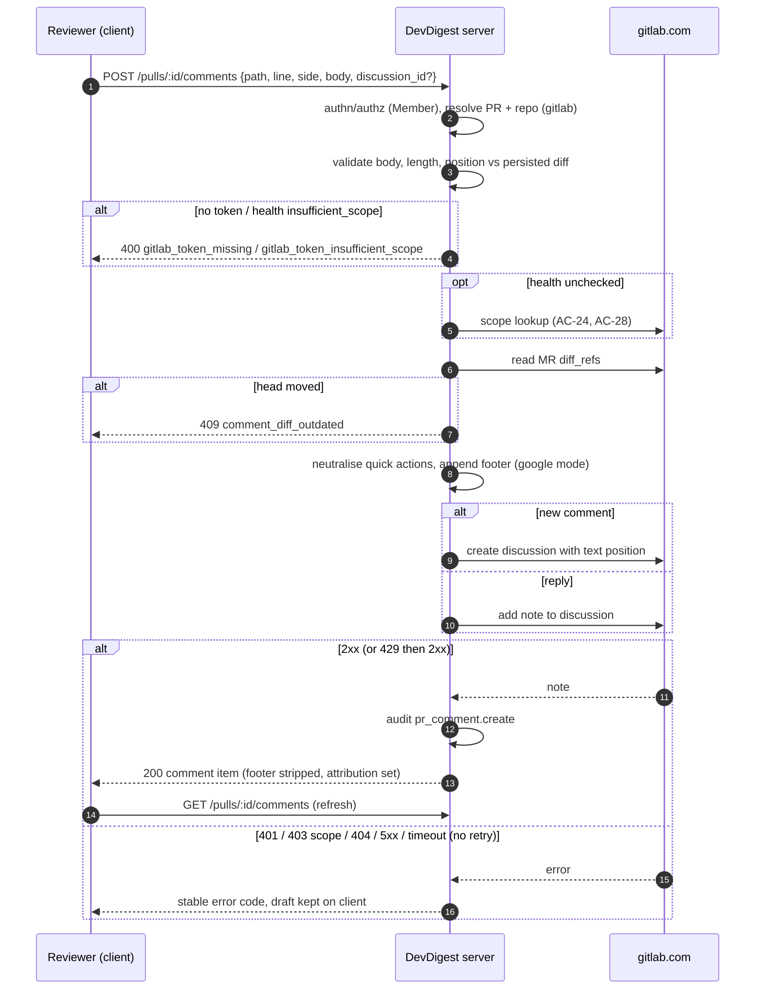

# Spec: GitLab phase 2 — posting inline comments and replies   |   Spec ID: SPEC-2026-10-20-gitlab-comments   |   Status: Approved (2026-10-20)
Supersedes / amends, in [`2026-10-16-gitlab-merge-requests.md`](./2026-10-16-gitlab-merge-requests.md):

| Old item | Effect | Replaced by |
|---|---|---|
| AC-4 (missing read scopes → `ok:false`; `read_api` + `read_repository` sufficient) | **superseded** — the `api` scope is now required | AC-21, AC-22 |
| AC-5 (scopes not introspectable → `ok:true` with a warning) | **superseded** | AC-28 |
| AC-12 (clone authenticates "with the GitLab token when one is configured") | **amended** — a stored token without `api` blocks clone/refresh; no anonymous fallback | AC-23 |
| AC-43 (no enabled post action on GitLab; "not supported yet" note) | **superseded** | AC-35, AC-38, AC-40 |
| AC-44 (POST comment on GitLab → `provider_read_only`) | **superseded** | AC-8, AC-19 |
| AC-45 (GET comments on GitLab → `[]`) | **superseded** | AC-1 – AC-7 |
| AC-53 (hint: minimal scopes `read_api` + `read_repository`) | **superseded** | AC-27 |
| Non-functional "least privilege: minimal scopes `read_api` + `read_repository`; no warning for `api`" | **superseded** | *Non-functional* below |
| Open questions "Resolved (2026-10-16): no write-scope warning" | **superseded** | Decision D-4 |
| Non-goals "writing to GitLab — posting inline comments, replies …" and "reading existing GitLab MR discussions/threads" | **superseded for inline diff comments only**; approvals, MR notes, labels stay non-goals | *Goals / Non-goals* below |

All other ACs of that spec remain in force. That includes AC-13 and AC-26: with **no** GitLab
token, public projects are still read anonymously and persisted data is still served.

Builds on [`2026-10-19-multi-user-server.md`](./2026-10-19-multi-user-server.md), unchanged:
- the permission-matrix row "`POST /pulls/:id/comments` (posts as the service account) — Member";
- the non-goal "no per-user provider identity";
- the audit mechanism. This spec **adds** one audited action to its AC-52 list (AC-42).

Scope: cross-module.
- **server:** the pulls comments surface, the GitLab host adapter, the GitHub comment-posting
  retry rule, the settings save/test flow and secrets status, and GitLab sync/clone/detail
  gating.
- **client:** the Files changed tab, FindingCard host actions, Settings → API Keys, the PR list
  and PR page token notice, and i18n.
- **shared contracts:** the vendored server copy **and** the client copy, as a **new file
  only**.

reviewer-core and mcp are **unchanged**.

## Problem & why
GitLab MRs are read-only in DevDigest today. On a GitLab PR:
- the Files changed tab shows a disabled "Post comment" control with "Posting comments to
  GitLab isn't supported yet — copy the text instead";
- existing GitLab discussions are never shown (`GET /pulls/:id/comments` → `[]`);
- `POST /pulls/:id/comments` → 400 `provider_read_only`.

The team's real target project is on gitlab.com. Reviewers have to copy text out of DevDigest
and paste it into GitLab by hand, and they can't see what colleagues already said on a line.

Task C (multi-user server) settled the blocking prerequisite: posts are written by the
workspace's single GitLab token, acting as a **service account**. Because every DevDigest post
then looks identical on GitLab, this spec also adds attribution: a visible footer on GitLab,
plus an audit event on both providers.

GitHub already has the full loop: read threads inline, post a new comment, reply to a thread.
This spec brings GitLab to parity. It also fixes a duplicate-post risk that exists today on
both providers.

## Goals / Non-goals
- Goal: show existing **diff-anchored** GitLab discussions inline in the Files changed tab of a
  GitLab PR, grouped into threads, in the same places GitHub threads appear.
- Goal: post a **new inline comment** on an added, removed or unchanged line of a GitLab MR
  diff, creating a positioned GitLab discussion. Also: **reply** to an existing GitLab diff
  discussion.
- Goal: every post is made **as the workspace GitLab service account**. The workspace GitLab
  token **must** carry the `api` scope; a token without it is invalid for all GitLab use.
- Goal: attribution. Posts on GitLab carry a visible "posted by <name> via DevDigest" footer
  (google auth mode only). Every successful post or reply on either provider is audited.
- Goal: honest failure UX. Every failure gets a distinct, stable error code and a human message,
  and the user's draft is never lost. A comment write is never re-sent automatically after it
  may have reached the host (both providers).
- Goal: everything else on GitHub stays **unchanged**.
- Non-goal: per-user GitLab identity (OAuth, per-user tokens, "post as me"); decided in Task C.
  Also: self-managed GitLab.
- Non-goal: general (non-diff) MR notes, i.e. the MR "Overview" conversation. They are neither
  shown nor posted. System notes are not shown either.
- Non-goal: editing or deleting posted comments, resolving or unresolving discussions, showing
  a resolved badge, reactions, suggestion blocks, approvals, labels, assignees, MR state
  changes.
- Non-goal: **publishing findings to the host**, either as a batch "publish review"
  (GitLab draft notes / GitHub reviews) or as a per-finding "post as comment". This is a
  candidate **future spec** ("Publish findings to host"). It would need its own grounding of
  the finding line against the current head.
- Non-goal: multi-line (range) comments.
- Non-goal: a local mirror of host comments. Comments stay proxied live. They never feed
  review prompts.
- Non-goal: MCP tools for posting comments.
- Non-goal: real-time thread updates. There is no polling and no webhooks.
- Non-goal: changing GitHub comment **reads**, including their current 100-comment page cap.
  Fixing that cap is a follow-up.
- Non-goal: a dedicated per-route posting rate limit.

## User stories
- US-1: As a reviewer on a GitLab PR, I want to see colleagues' existing inline discussions
  on the diff, so that I don't repeat a point that was already raised.
- US-2: As a reviewer on a GitLab PR, I want to post an inline comment on a diff line from
  DevDigest, so that I don't have to copy text into GitLab by hand.
- US-3: As a reviewer, I want to reply to an existing GitLab discussion from DevDigest, so
  that a conversation stays in one thread.
- US-4: As an Admin configuring the GitLab token, I want DevDigest to refuse a token that cannot
  post and to tell me clearly when the stored one is unusable, so that reviewers never hit a
  half-working integration.
- US-5: As a reviewer whose post failed, I want a clear reason and to keep my text, so that I
  can fix the cause or copy the text elsewhere.
- US-6: As a GitLab project member, I want comments posted by the DevDigest service account
  never to perform side effects (merge, close, approve, mass-mention), so that a comment can
  never change the MR's state.
- US-7: As a GitHub user, I want GitHub PRs to behave as before, except that a failed post is
  never silently duplicated.
- US-8: As a teammate reading an MR on gitlab.com, or an Admin reviewing activity, I want to
  know which DevDigest user wrote a service-account comment, so that accountability survives
  the shared identity.

## Acceptance criteria (EARS)

### Reading GitLab discussions (US-1, US-8)
- AC-1: **WHEN** existing host review comments are requested for a GitLab PR, the system
  **shall** return every note of every **diff-anchored, text-positioned** discussion of that MR,
  across all pages, each as one comment item. It **shall** exclude system notes, non-diff
  (overview) discussions and non-text (image/file) positions.   _(observable: fixture MR with 2 diff discussions (3 notes), 1 overview note, 2 system notes, 1 image-positioned note → 3 items; fixture with 150 diff discussions across 2 pages → all returned)_
- AC-2: The system **shall** represent each GitLab note so that the existing thread grouping
  works unchanged:
  - a discussion's first note is the thread root;
  - every later note carries the root note's numeric id as its reply-to id;
  - every note carries its discussion id.

  _(observable: client thread grouping on the mapped fixture yields one thread per discussion, notes oldest-first)_
- AC-3: The system **shall** map a note's diff position to the existing line/side model:
  - a position with a new-side line → side `RIGHT` at that line;
  - a position with only an old-side line → side `LEFT` at that line.

  _(observable: mapper unit test for added, removed and unchanged-line positions)_
- AC-4: **IF** a discussion's position refers to a head other than the MR's current head,
  **THEN** the system **shall** return its comments marked outdated with no line. The client
  renders them in the existing "outdated" treatment.   _(observable: note whose position head SHA ≠ MR head → `is_outdated: true`, `line: null`)_
- AC-5: The system **shall** give each GitLab comment a server-built link to that note:
  `<project web_url>/-/merge_requests/<iid>#note_<note id>`.   _(observable: DTO `html_url` for a fixture note equals that form)_
- AC-6: **IF** reading GitLab discussions fails for any reason, **THEN** the system **shall**
  answer with an empty list and log a secret-free warning, as GitHub reads do today. Reasons
  include no token, an invalid or insufficient-scope token, network errors, 5xx and rate
  limits. The token states are surfaced by AC-25 instead.   _(observable: injected 500 → 200 `[]`; log has no token substring)_
- AC-7: **WHEN** the system returns a note authored by the service account (the user the
  stored GitLab token authenticates as) whose body ends with an attribution footer in the
  exact AC-16 format, the system **shall**:
  - return the body **without** the footer;
  - return the attributed name separately.

  The client **shall** show the attribution as "via DevDigest · <name>" next to the
  service-account username. A footer-shaped line in a note by any other author **shall** be
  left in the body and **shall not** produce an attribution.   _(observable: service-account note with footer → body without footer + attribution "Jane Doe"; identical text from another author → body unchanged, no attribution)_

### Posting a new inline comment (US-2, US-6)
- AC-8: **WHEN** a Member posts a new inline comment on a GitLab PR, the system **shall** create
  one new GitLab MR discussion. The discussion is positioned on the requested file, side and
  line, using the MR's **current** base/start/head diff references. The system **shall**
  return the created note in the read shape (AC-1 – AC-7).   _(observable: it-test against a fake GitLab records one create-discussion request with a text position carrying base/start/head SHAs, old/new path and line; response has discussion id and `line`)_
- AC-9: The system **shall** anchor the comment by line type:
  - an **unchanged (context)** line → both its old and its new line number;
  - an added line → the new line only;
  - a removed line → the old line only.

  _(observable: three position payloads asserted for ctx/add/del targets)_
- AC-10: **WHEN** the target file was renamed in the MR, the system **shall** send the previous
  path as the old path and the current path as the new path.   _(observable: renamed-file fixture → old path ≠ new path in the position)_
- AC-11: **IF** the requested file, side and line is not a line of the PR diff DevDigest has
  persisted, **THEN** the system **shall** reject it with `comment_position_invalid` and make no
  GitLab call. This covers a file that is absent, a patch withheld by the host, a line outside
  every hunk, `LEFT` on an added file, and `RIGHT` on a deleted file.   _(observable: 5 invalid-target cases → 400 `comment_position_invalid`; fake GitLab records 0 requests)_
- AC-12: **WHEN** a valid post is about to be made, the system **shall** read the MR's current
  diff references from GitLab. **IF** the current head SHA differs from the head SHA of the
  persisted PR diff, **THEN** the system **shall** reject the post with
  `409 comment_diff_outdated` and the message "New commits were pushed — reload the diff". It
  **shall** make no write call. Otherwise it **shall** post with those current references.
  This applies to replies too.   _(observable: head moved → 409 `comment_diff_outdated`, 1 read request and 0 write requests; head equal → 1 read + 1 write using the read refs)_
- AC-13: The system **shall** ensure that no text it posts to GitLab executes a GitLab quick
  action (`/merge`, `/close`, `/approve`, `/assign`, `/label`, …):
  - the user-visible text **shall** preserve what the user typed, including text inside fenced
    code blocks;
  - the MR's state, approvals, labels and assignees **shall** be unchanged by the post.

  _(observable: posting "/merge\n/close\nLGTM" → the body the fake GitLab receives has no line that GitLab parses as a quick action; manual check on a sandbox MR: MR stays open, text renders as typed)_

  > **Amended 2026-10-20:** every command-shaped line (`/` + command name, then end of line
  > or whitespace, after an optional lead of spaces / zero-width characters) is neutralised
  > wherever it appears, so safety no longer depends on guessing which lines GitLab's
  > renderer treats as code. Fenced code is still visually preserved: a command-shaped line
  > inside a code block gets an invisible U+200B ZERO WIDTH SPACE before its `/`; outside
  > code it gets `\/` (renders as `/`). Lines that are not command-shaped (`/usr/bin/env`,
  > `// c`) are unchanged.
- AC-14: **IF** the comment body is empty or whitespace-only, **THEN** the system **shall**
  reject it with a validation error and make no host call. The client **shall** keep the post
  button disabled for such a body. This applies to both providers.   _(observable: body "   " → 400; composer button disabled)_
- AC-15: **IF** the text that would be posted to GitLab exceeds 1,000,000 characters, **THEN**
  the system **shall** reject it with `comment_too_long` and make no GitLab call. The text that
  counts is the user body plus the AC-16 footer when one applies.   _(observable: body of 1,000,000 − footer length + 1 chars in google mode → 400 `comment_too_long`; same body in local mode (no footer) → accepted)_

### Attribution footer (US-8, US-6)
- AC-16: **WHERE** auth mode is `google` **and** the PR belongs to a GitLab repository, the
  system **shall** append exactly this to every posted comment and reply:
  - two newline characters;
  - then the line ``— posted by `<name>` via DevDigest``.

  `—` is U+2014. `<name>` is the acting user's display name, or their email when the name is
  empty, sanitised by AC-18.   _(observable: body "Nit" by "Jane Doe" → GitLab receives "Nit\n\n— posted by `Jane Doe` via DevDigest")_
- AC-17: **WHERE** auth mode is `local`, or the PR belongs to a GitHub repository, the system
  **shall not** append any footer.   _(observable: local-mode GitLab post and google-mode GitHub post → body forwarded unchanged)_
- AC-18: The system **shall** sanitise `<name>` before it goes into the footer:
  - remove control characters, line breaks and backticks;
  - collapse whitespace;
  - truncate to 100 characters;
  - fall back to "a DevDigest user" when the result is empty.

  As a result, the footer line never starts with `/` and its name, rendered as inline code,
  never triggers a GitLab mention, reference or quick action.   _(observable: name "@all\n/merge" → footer "— posted by `@all /merge` via DevDigest"; fake GitLab sees no line starting with `/`; sandbox: no mention notification)_

### Replying (US-3)
- AC-19: **WHEN** a Member replies to a GitLab thread, the system **shall** add one note to that
  thread's GitLab discussion, identified by its discussion id. It **shall** return the new note
  in the read shape, with the thread root's id as its reply-to id. AC-12 – AC-18 apply.   _(observable: fake GitLab records one add-note request for that discussion id; response `in_reply_to_id` = root note id)_
- AC-20: **IF** a reply targets a discussion that does not exist on that MR, **THEN** the system
  **shall** reject it with `404 comment_thread_not_found` and post nothing.   _(observable: fake GitLab 404 on the discussion → 404 `comment_thread_not_found`; 0 notes created)_

### GitLab token: `api` scope is mandatory (US-4)
- AC-21: **WHEN** an Admin saves or tests a GitLab token, **IF** the token's scopes are known
  and do not include `api`, **THEN** the system **shall** answer `ok: false` with code
  `gitlab_token_insufficient_scope` and the message "This token is missing the api scope.
  Required scope: api (Reporter role recommended)." On save it **shall not** store the token,
  and any previously stored token stays unchanged.   _(observable: save with a `read_api`+`read_repository` token → ok false, that code, secrets-status unchanged; test-only → same result)_
- AC-22: **WHEN** an Admin saves or tests a GitLab token whose scopes include `api`, the system
  **shall** store it (on save) and answer `ok: true` with "Connected as @<username>".   _(observable: `api` token → ok true; health becomes `ok` (AC-26))_
- AC-23: **WHILE** the stored GitLab token is known to lack `api` (health
  `insufficient_scope`), every GitLab operation of the workspace **shall** fail with
  `gitlab_token_insufficient_scope` and make no GitLab request apart from the scope check
  itself. GitLab operations here are:
  - repository add/import;
  - clone, refresh and resync;
  - PR-list sync, both on open and manual;
  - PR detail refresh;
  - comment reads and posts;
  - the issue lookups used by intent and brief.

  In this state the system **shall not** fall back to anonymous access for public projects.
  Persisted repositories, PRs, reviews and findings **shall** stay readable (as in old
  AC-26).   _(observable: stored `read_api` token → add repo 400 `gitlab_token_insufficient_scope`; sync records failure with that code, 0 MR requests; PR page serves persisted detail; GET comments → `[]`; POST comment → that code)_
- AC-24: The system **shall** determine the stored token's scope health:
  - when the token is saved (AC-21/22);
  - for a token stored before this spec, or whose health is unknown, before its first GitLab
    use.

  It **shall** remember the result until the stored token value changes, and re-check it when
  GitLab answers any request with 401 or 403 `insufficient_scope`.   _(observable: legacy stored `read_api` token → first sync after deploy performs 1 scope check, then fails with `gitlab_token_insufficient_scope`; a second sync performs no new scope check; saving a new token resets the health)_
- AC-25: **WHILE** the workspace GitLab token health is `insufficient_scope` or `invalid`, a
  GitLab repository's Pull Requests page and PR page **shall**:
  - keep rendering persisted data;
  - show a persistent, non-dismissible notice: "The GitLab token is invalid (missing the api
    scope | rejected by GitLab). An admin must save a token with the api scope in Settings →
    API Keys.";
  - for Admins, link the notice to that screen. Members see the text "Ask an admin to update
    it." instead of the link;
  - **not** show the generic "showing data from <time>" sync-failure notice in its place.

  The composer post button **shall** be disabled and point at the same notice.   _(observable: component tests for Admin and Member variants; GitLab PR page with health `insufficient_scope` → notice visible, post disabled, persisted rows rendered)_
- AC-26: Settings → API Keys **shall** show the GitLab row's health next to its existing
  configured state:
  - `ok` → "Configured";
  - `insufficient_scope` → "Invalid — missing api scope";
  - `invalid` → "Invalid — rejected by GitLab";
  - `unchecked` → "Configured — not verified yet".

  Admins **shall** see the key input and Save & Test enabled. Members **shall** see the badge
  and the existing "Only admins can change API keys" notice.   _(observable: secrets-status carries the GitLab health; badge text per state; Member view has no input)_
- AC-27: The GitLab token hint in Settings **shall** read "Required scope: api (Reporter role
  recommended)", served via i18n. The `read_api` + `read_repository` hint **shall** be
  removed.   _(observable: hint text equals the catalog value; no "read_api" in the rendered Settings page)_
- AC-28: **IF** the token's scopes cannot be determined when saving, testing or checking it,
  **THEN** the system **shall** decide by the reason:
  - **Transient failure** (timeout, network, 429, 5xx on the scope lookup): on save/test,
    answer `ok: false` with `gitlab_token_unverified` ("Couldn't verify the token's scopes —
    try again") and not store the token. For a stored token, leave health `unchecked` and fail
    the triggering operation like any GitLab outage. It is re-checked on the next use.
  - **Definitive non-answer** (the scope lookup answers 403/404, or returns no scope list):
    treat the token as lacking `api`, which gives health `insufficient_scope` and AC-21/AC-23.

  _(observable: fake scope lookup 503 → save rejected `gitlab_token_unverified`, nothing stored; fake 404 → `gitlab_token_insufficient_scope`)_

### Errors on post (US-5)
- AC-29: **IF** no GitLab token is configured, **THEN** a GitLab post **shall** fail with
  `gitlab_token_missing` and make no GitLab call. **IF** GitLab rejects the token (401:
  invalid, expired or revoked), **THEN** the post **shall** fail with `gitlab_token_invalid`,
  and health becomes `invalid`.   _(observable: no secret → `gitlab_token_missing`, 0 requests; fake 401 → `gitlab_token_invalid`, health `invalid`)_
- AC-30: **IF** GitLab rejects a post for any other reason, **THEN** the system **shall** answer
  with `gitlab_comment_failed` and a human, secret-free message. Such reasons include a locked
  MR or discussion, a 4xx validation error, a 5xx and a timeout. A 403/404 on the project itself
  instead answers with `gitlab_project_inaccessible`.   _(observable: locked-discussion 403 → `gitlab_comment_failed`; no token substring in body or logs)_
- AC-31: **IF** GitLab answers a comment-creating request with 429, **THEN** the system
  **shall** retry within the existing GitLab back-off budget. **IF** that request fails with a
  5xx, a timeout or a network error after it may have reached GitLab, **THEN** the system
  **shall** make **no** further attempt. It **shall** answer `gitlab_comment_failed` with the
  message "GitLab didn't confirm the comment — check the MR before posting again."   _(observable: fake 429→201 → 2 write requests, 1 note, 200; fake 502 → exactly 1 write request; fake timeout → exactly 1 write request)_
- AC-32: **WHEN** a post fails on either provider, the client **shall**:
  - keep the composer open with the user's text intact;
  - show the error message in an announced live region;
  - offer "Copy text".

  _(observable: component test: rejected mutation → textarea holds the draft; `role="alert"` message; copy button present)_

### GitHub changes (US-7)
- AC-33: **IF** GitHub answers a comment-creating request (new comment or reply) with 429 or a
  secondary rate limit, **THEN** the system **shall** retry it with the existing back-off. **IF**
  the request fails with a 5xx, a timeout or a network error after it may have reached GitHub,
  **THEN** the system **shall** make **no** further attempt. It **shall** answer
  `github_comment_failed` with the message "GitHub didn't confirm the comment — check the PR
  before posting again."   _(observable: hermetic test with a stub GitHub: 502 → exactly 1 create request; 429→201 → 2 requests, 1 comment)_
- AC-34: **WHERE** a repository's provider is `github`, everything else about comments
  **shall** behave exactly as today:
  - GET comments: same shape, same 100-comment page, same retries on reads, `[]` on failure;
  - POST: same request and response shape, codes `github_unavailable` /
    `github_comment_failed`, no footer;
  - the same Files changed UI;
  - a FindingCard with no host post action.

  The only additions are AC-14 (whitespace-only rejection), AC-32 (draft kept) and AC-42
  (audit).   _(observable: existing GitHub comment tests pass unmodified except for the new retry and whitespace cases)_

### Client behaviour (US-1, US-2, US-3)
- AC-35: **WHERE** a PR belongs to a GitLab repository with an open status and token health
  `ok` or `unchecked`, the Files changed tab **shall** offer the same features as for GitHub:
  - the "+" new-comment affordance;
  - thread rendering;
  - the reply composer;
  - the "Show/Hide comments (n)" toggle.

  It **shall not** render the read-only notice.   _(observable: DiffTab test on a GitLab PR: no read-only note; post enabled with a non-empty body)_
- AC-36: **WHILE** a post is in flight, the client **shall** disable that composer's post
  button.   _(observable: two rapid clicks → one request)_
- AC-37: **WHEN** a post succeeds, the client **shall** refresh the PR's comment list and reveal
  comments, so the new note is visible on its line.   _(observable: the new thread renders on the target line)_
- AC-38: **WHERE** a PR belongs to a GitLab repository, the FindingCard **shall** show "Copy
  finding". It **shall not** show the disabled "Post comment" control or the "not supported
  yet" note. The GitHub FindingCard **shall** stay unchanged, with no Copy and no post action.   _(observable: GitLab card: Copy present, no disabled post, no note; GitHub card unchanged snapshot)_
- AC-39: The client **shall** label each comment with the host author's username as returned
  by the host. For a GitLab note with an attribution (AC-7), it **shall** add "via DevDigest ·
  <name>".   _(observable: thread item shows service-account username + attribution)_
- AC-40: All new or changed UI strings **shall** come from the existing i18n catalogs. The
  "Posting comments to GitLab isn't supported yet" copy **shall** no longer render anywhere.   _(observable: new keys in the English catalog; GitLab PR page has no "isn't supported yet")_

### Authorization & audit (US-2, US-3, US-8)
- AC-41: The system **shall** allow posting and replying to any active Member or Admin; the
  permission-matrix row is unchanged. An unauthenticated request **shall** be rejected with
  401 and no host call.   _(observable: Member → 200, no session → 401, 0 host requests)_
- AC-42: **WHEN** a post or reply succeeds on **either** provider, the system **shall** append
  one audit event wherever audit events are recorded. Under the multi-user spec that is
  `google` mode; local mode records none. The event has:
  - action `pr_comment.create` (one action, with replies distinguished by a field rather than
    a separate action);
  - the actor, target type `pull_request` and the PR uuid as target id;
  - metadata `{ provider, host_comment_id, discussion_id (GitLab only), is_reply }`.

  It **shall never** contain the comment body or footer. A failed post **shall** record no
  event.   _(observable: GitLab reply → 1 row with `is_reply: true` and discussion id; GitHub comment → 1 row with `is_reply: false`; failed post → 0 rows; DB scan finds no body text)_

## Traceability
| Story | ACs |
|---|---|
| US-1 | AC-1 – AC-6, AC-35, AC-37 |
| US-2 | AC-8 – AC-15, AC-35 – AC-37, AC-41 |
| US-3 | AC-12, AC-19, AC-20, AC-35 |
| US-4 | AC-21 – AC-28 |
| US-5 | AC-29 – AC-32 |
| US-6 | AC-13, AC-18 |
| US-7 | AC-33, AC-34, AC-38 |
| US-8 | AC-7, AC-16 – AC-18, AC-39, AC-42 |

## Edge cases
- **Stored token has only `read_api` + `read_repository`** (legacy setup) → becomes
  `insufficient_scope` on first use → GitLab sync, import and clone stop. Persisted data stays
  visible with a notice → AC-23, AC-24, AC-25. Admin fix → AC-21, AC-22, AC-26.
- **Saving a token without `api`** → rejected, previous token kept → AC-21.
- **Token whose scopes can't be read:**
  - transient lookup failure → AC-28 (`gitlab_token_unverified` / `unchecked`);
  - definitive non-answer → AC-28 (`insufficient_scope`).
- **No GitLab token at all** → anonymous public reads continue (old AC-13/AC-26); posting fails
  fast → AC-29.
- **Token revoked between page load and post** → AC-29 (`gitlab_token_invalid`, health
  `invalid`) → AC-25 notice on the next render.
- **Scope downgraded on gitlab.com after a successful check** → the next 403
  `insufficient_scope` triggers a re-check → AC-24.
- **Comment target lines:**
  - unchanged context line → AC-9;
  - removed line, added file, deleted file, renamed file → AC-9, AC-10, AC-11;
  - patch withheld by GitLab → no "+" rendered; a crafted call is rejected → AC-11.
- **MR head moved since the diff was loaded** → AC-12. Reply on a moved head → AC-12, so the
  user reloads first.
- **Quick actions in the body** (`/merge`, `/approve`, `/close`, `/label ~x`, `/assign @u`,
  indented, or inside code fences) → AC-13.
- **Hostile display name** (`@all`, `/merge`, newlines, backticks, 500 chars, empty) → AC-18.
- **User types a footer-looking line themselves** → it is posted as text. Only a trailing exact
  footer on a service-account note is stripped → AC-7.
- **Footer pushes the body over the GitLab limit** → AC-15.
- **Mentions in the user's own body** → GitLab notifies those users as the service account.
  Accepted: no handling.
- **Duplicate-post risks:**
  - double click → AC-36;
  - deliberate posts from two tabs → two notes. Accepted: no dedup;
  - host 5xx or timeout on create → no auto retry, user warned → AC-31 (GitLab), AC-33
    (GitHub).
- **Discussion state:** deleted → AC-20; resolved → replying allowed, state not shown
  (accepted: no handling); MR or discussion locked → AC-30.
- **MR or PR state:**
  - closed or merged → no composer (existing `open` gating); a crafted call is passed to the
    host → AC-30. Accepted: no server-side status gate (parity with GitHub);
  - draft MR → commenting allowed → AC-35.
- **Notes that are not shown:** overview, system and image-positioned notes → excluded → AC-1.
  Notes on an older diff version → outdated → AC-4.
- **Hundreds of discussions** → all pages → AC-1; latency is bounded in *Non-functional*.
- **GitLab read failure** shows as "no comments" (`[]`) → AC-6. Token-health problems are
  surfaced separately → AC-25.
- **Auth mode and roles:**
  - local mode → no footer, no audit → AC-17, AC-42;
  - Member vs Admin → both may post → AC-41;
  - Settings view differs by role → AC-26.
- **Mixed workspace** (GitHub + GitLab) → a GitLab token problem never affects GitHub repos →
  AC-23 (GitLab-only), AC-34.

## Non-functional
- **Security: no privilege escalation through the service account.**
  - A Member can trigger no GitLab action other than "create a note" (AC-13, AC-18).
  - The hint recommends the **Reporter** role (AC-27), the lowest role that can comment on a
    private project's MRs. It cannot merge, so a missed quick action still cannot merge.
  - The `api` scope is broad. Least privilege is enforced by the role, not the scope.
- **Security: secrets.** The GitLab token and the GitHub token never appear in:
  - an error message, response, log line, audit event or trace;
  - the secrets-status payload, which carries health enums only.

  Comment bodies and footers are not logged or audited.
- **Security: origin pinning.** GitLab write calls go to `https://gitlab.com` only, and
  redirects are not followed. The existing GitLab HTTP rules extend to writes.
- **Rate limits:** posting stays under the existing per-user API limit of 120 req/min in google
  mode (multi-user spec AC-53). There is no new per-route limit.
- **Latency** (fake host at 300 ms per request):
  - `POST /pulls/:id/comments` for a GitLab PR: p95 ≤ 3 s, which is 1 head read + 1 write
    (+ 1 scope check on first use);
  - `GET /pulls/:id/comments` for an MR with ≤ 300 diff notes: p95 ≤ 4 s, at most
    1 + ⌈discussions / 100⌉ sequential host requests.
- **Scope-check cost:** at most one scope lookup per stored-token value, plus one after each
  401 or 403 `insufficient_scope` (AC-24). It is never once per request.
- **Timeouts:** every host write is bounded by the existing provider request timeout. A
  timeout surfaces as AC-31 or AC-33, never as a hung request.
- **Accessibility, WCAG 2.1 AA:**
  - the composer, reply button, error message, "Copy text" fallback and the token notice are
    keyboard reachable;
  - errors are announced through a live region;
  - focus stays in the composer on failure;
  - the disabled post control is described by the visible notice (`aria-describedby`).

## Cross-module interactions
Modules:
- **client:** Files changed tab, FindingCard, Settings → API Keys, PR list / PR page notice;
- **server:** pulls comments endpoints, GitLab and GitHub host adapters, settings save/test,
  secrets status, the GitLab gate on sync/clone/detail, audit;
- **gitlab.com** REST API and **api.github.com**.

reviewer-core and mcp are not involved.

Data crossing boundaries:
- **client → server:** PR uuid; comment input (path, line, side, body, optional reply target).
- **server → GitLab:**
  - project path and MR iid;
  - discussion id (replies);
  - note body (neutralised, plus footer);
  - text position (base/start/head SHA, old/new path, old/new line);
  - token scope lookup.
- **GitLab → server:**
  - discussions and notes (id, discussion id, author username, body, created_at, position,
    system flag);
  - MR diff references;
  - token identity and scopes.
- **server → client:**
  - comment items in the read shape, or the `ApiErrorBody` envelope with a code from
    *Contracts*;
  - GitLab token health in secrets status;
  - sync results carrying `gitlab_token_insufficient_scope` / `gitlab_token_invalid`.

Failure contract:
- Comment reads never fail the page: any host failure → `[]` plus a server warning (AC-6).
- Writes fail loudly with a stable code, and the client keeps the draft (AC-29 – AC-33).
- Local validation fails **before** any host call: empty body, position, length, missing
  token, known-bad token health (AC-11, AC-14, AC-15, AC-23, AC-29).
- A GitLab token problem blocks GitLab operations only. GitHub repos in the same workspace are
  unaffected.

## Contracts
Shapes only. All additions go in **one new contract file** under the vendored shared contracts
(server copy). The file is mirrored byte-identical into the client copy and kept in sync by the
existing shared-sync guard. No existing contract file is edited.

- **Host comment** (response item). Extends `PrReviewComment`; existing fields keep their type
  and meaning:
  - `id`: number. For GitLab, the note id, which is numeric.
  - `in_reply_to_id`: number | null. For GitLab, the root note id.
  - `user`: the host author username. `body` has the footer stripped (AC-7).
  - New, optional: `discussion_id` (string | null), GitLab only.
  - New, optional: `provider` (`github` | `gitlab`).
  - New, optional: `devdigest_attribution` (`{ name: string }` | null), set only per AC-7.
  - Used by `GET /pulls/:id/comments` (array) and `POST /pulls/:id/comments` (single).
- **Host comment input** (request body). Extends `PrCommentInput`:
  - New, optional: `discussion_id` (non-empty string), the GitLab reply target. It is required
    for GitLab replies and ignored for GitHub.
  - At most one of `in_reply_to` / `discussion_id` may be set.
  - The body must contain a non-whitespace character (AC-14).
- **GitLab token health**: enum `ok` | `insufficient_scope` | `invalid` | `unchecked`.
  - Exposed as a new optional `gitlab_health` field on an extension of the secrets-status
    response (Member-readable, no secret).
  - The connection-test result is extended with an optional `code` (one of the error codes
    below) so the client can branch without parsing messages.
  - The draft's tri-state `can_post` is **removed**: posting is possible exactly when health is
    `ok` (or `unchecked`, pending the check).
- **New error codes** (stable strings in `ApiErrorBody`, new enum in the new file):

  | Code | HTTP |
  |---|---|
  | `comment_position_invalid` | 400 |
  | `comment_diff_outdated` | 409 |
  | `comment_thread_not_found` | 404 |
  | `comment_too_long` | 400 |
  | `gitlab_token_insufficient_scope` | 400 on gated operations; `ok:false` + code in test/save |
  | `gitlab_token_unverified` | 503 on gated operations; `ok:false` + code in test/save |
  | `gitlab_comment_failed` | 502 for a host 5xx/timeout, 400 otherwise |

  Reused codes: `gitlab_token_missing`, `gitlab_token_invalid`, `gitlab_project_inaccessible`,
  `github_unavailable`, `github_comment_failed`. `provider_read_only` stays in the existing enum
  (extend-only) and is **no longer emitted** for comments.
- **Audit event**: action `pr_comment.create`; target `pull_request` / PR uuid; metadata
  `{ provider, host_comment_id, discussion_id?, is_reply }`; never the body.

## Untrusted inputs
- **Host note bodies and author names** are written by anyone with MR access. They are data:
  - they are rendered through the same safe Markdown/text path as GitHub comments (no raw HTML,
    http/https links only);
  - they are never sent to an LLM;
  - footer stripping (AC-7) is an exact-suffix rule limited to service-account notes, so a
    third party cannot forge an attribution.
- **The user's comment body** is untrusted relative to the service account's privileges.
  GitLab executes quick actions in note text with the token's rights; AC-13 makes the body
  inert.
- **The acting user's display name** comes from the Google profile and is untrusted. It is
  sanitised and inline-coded before it reaches GitLab (AC-18).
- **Discussion ids, paths and line numbers** from the client are:
  - validated against the persisted diff or the MR (AC-11, AC-20);
  - URL-encoded;
  - unable to change the target host (gitlab.com origin pin).
- reviewer-core is untouched. `wrapUntrusted()` and the grounding gate are unaffected.

## Decisions (2026-10-20, user-confirmed)
- **D-1 (was OQ-1): diff version.** The server reads the MR's current `diff_refs` at post time.
  If the head moved since the persisted diff, it answers 409 `comment_diff_outdated`; otherwise
  it posts with the current refs → AC-12.
- **D-2 (was OQ-2): attribution.**
  - Both providers: audit event `pr_comment.create` (actor, PR, host comment id; never the
    body). Replies use the **same action** with an `is_reply` field → AC-42.
  - GitLab in google mode only: a visible footer, ``— posted by `<name>` via DevDigest``,
    whose length counts toward the body limit → AC-15 – AC-18.
  - On read-back, the footer is **stripped** and shown as a "via DevDigest · <name>" label, for
    service-account notes only → AC-7, AC-39.
  - The name is inline-coded so it cannot mention, reference or quick-act.
- **D-3 (was OQ-3): finding cards.** GitLab cards drop the disabled "Post comment" and the
  "not supported yet" note, and keep "Copy finding" (GitLab only) → AC-38. Publishing findings
  to the host is a **future spec**.
- **D-4 (was OQ-4): `api` scope is mandatory.**
  - Saving or testing a token without `api` is rejected.
  - An already-stored token without `api` is invalid for every GitLab operation, reads
    included, with no anonymous fallback, until an Admin saves a token with `api`.
  - Hint copy: "Required scope: api (Reporter role recommended)".
  - `can_post` is replaced by token health.
  - Supersedes old AC-4, AC-5 and AC-53 and the "no write-scope warning" decision; amends old
    AC-12 → AC-21 – AC-28.
- **D-5 (was OQ-5): GitHub retry.** GitHub comment creation retries only on 429 / rate limit,
  never after a 5xx, timeout or network error → AC-33. Everything else on GitHub is unchanged →
  AC-34.
- **D-6 (was OQ-7): failed comment reads** stay `[]` (parity). Token problems are surfaced by
  the token notice instead → AC-6, AC-25.
- **D-7 (was OQ-8): rate limit.** No dedicated posting limit; the existing per-user 120
  req/min applies.
- **D-8 (was OQ-9): GitHub read pagination** (first 100 only) is out of scope. It is a
  follow-up task, not changed here.
- **D-9 (was OQ-10): resolved state** of GitLab discussions is not shown (Non-goal).
- **D-10 (scopes not introspectable, from code):** the scope lookup returns no answer only on a
  host error or an unusual token type. gitlab.com personal, project and group access tokens can
  report their own scopes. So: a transient failure → `gitlab_token_unverified` / `unchecked`,
  and the token is not stored. A definitive non-answer → treated as missing `api` → AC-28.
  Revisit only if a supported token type is found that cannot report its scopes.

## Open questions
- [NEEDS CLARIFICATION: technique for quick-action neutralisation (AC-13). The behaviour is
  fixed. The planner picks the technique and must verify it against gitlab.com, for example
  escaping a leading `/` with an invisible or escape character, or wrapping such lines as
  inline code. It must preserve the visible text and must not alter fenced code blocks.
  Non-blocking.]
