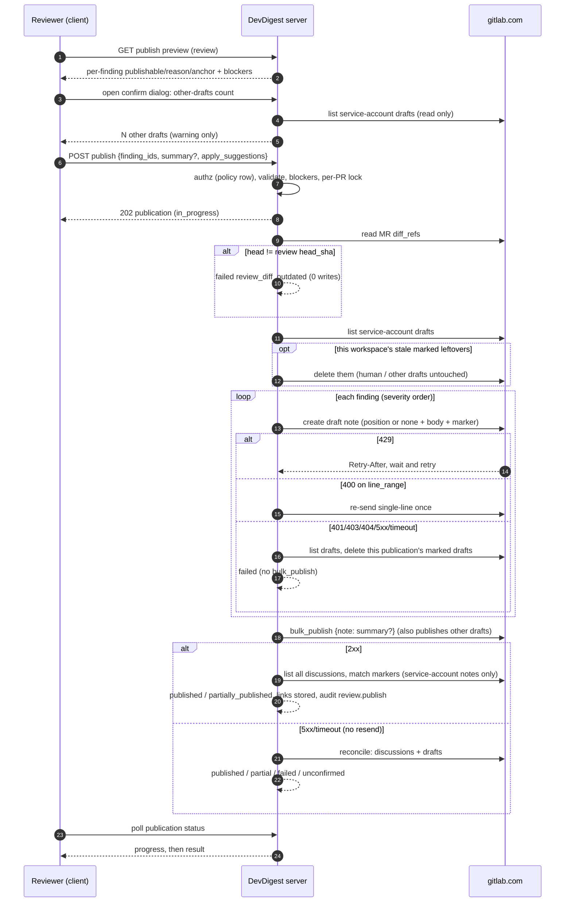
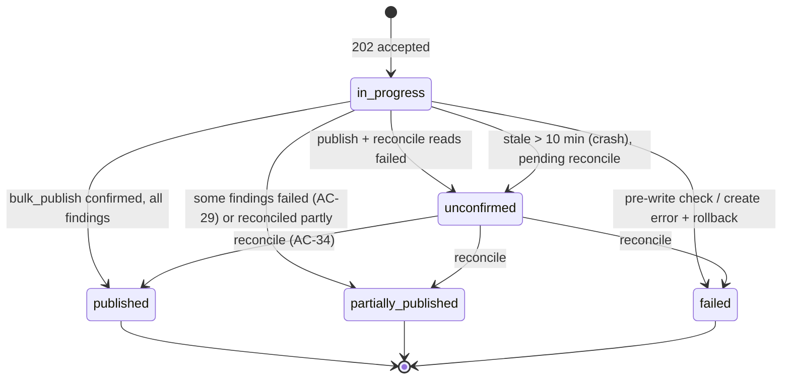

# Spec: Publish review findings to a GitLab MR (batch, via draft notes)   |   Spec ID: SPEC-2026-10-21-gitlab-publish-findings   |   Status: Approved (2026-10-21)
Supersedes: none. It **amends** these specs:

- [`2026-10-20-gitlab-comments.md`](./2026-10-20-gitlab-comments.md). That spec listed
  "publishing findings to the host" as a future spec, and this is that spec. Two of its
  non-goals are lifted **for published findings only**:
  - "suggestion blocks": a published finding may carry an applicable suggestion block, under
    AC-17;
  - "general (non-diff) MR notes … neither shown nor posted": a finding that cannot be anchored
    to a diff line is **posted** as an unpositioned general MR note in the same review (AC-9,
    AC-10, decision D-6). General notes are still **not shown** in DevDigest.

  Both non-goals stay in force for hand-written comments.
- [`2026-10-19-multi-user-server.md`](./2026-10-19-multi-user-server.md). This spec adds one
  permission-matrix row (AC-40) and one audited action (AC-41).

Everything else in both specs stays in force and is **reused** here:

- the `api`-scope token gate and token health (comments AC-21 – AC-29);
- quick-action neutralisation (comments AC-13, as amended on 2026-10-20);
- the attribution footer, `google` mode only (comments AC-16 – AC-18);
- the 1,000,000-character limit (comments AC-15);
- the no-resend-after-5xx write rule (comments AC-31);
- origin pinning to `https://gitlab.com`;
- the service-account identity (no per-user GitLab identity).

Scope: cross-module. Location: top-level `specs/`.

- **server:** the reviews surface (publish, preview, status), the GitLab host adapter (draft
  notes), the review run (records the reviewed head), audit, the route policy, and
  boot-time reconciliation.
- **client:** the FindingsTab review accordion, FindingCard, a confirm dialog, the progress and
  result views, and i18n.
- **shared contracts:** one **new** contract file in the vendored server copy, mirrored to the
  client copy. No existing contract file is edited.
- **reviewer-core:** its behaviour is unchanged. The grounding gate is neither bypassed nor
  relaxed. Publish adds a **second, stricter** line check against GitLab's own MR diff (AC-9).
- **mcp, e2e:** unchanged. No MCP tool is added.

## Problem & why
DevDigest produces grounded findings, but a GitLab MR never sees them. To share a finding,
a reviewer has to click "Copy finding" (comments spec AC-38) and paste it into GitLab by
hand, one finding at a time. That is slow and error-prone:

- the line is wrong after a copy-paste;
- severity and context are lost;
- nothing records which findings already went out, so the same finding gets pasted twice.

GitLab has a native batch review: a user creates **draft notes** on an MR and **bulk-publishes**
them as one review. Publishing sends one notification and can carry an optional summary.
DevDigest should use it, so a reviewer can choose N findings, add a summary and publish them
as one GitLab review. Each finding then lands as a positioned diff discussion and stays linked
to the note it produced.

Prerequisite gap found while grounding this spec: reviews and runs do **not** record the head
SHA they reviewed. Only `pr_intent` and `pr_brief` store `head_sha`. Without it, DevDigest
cannot tell whether a finding's line numbers still describe the MR. AC-1 closes this gap.

## Goals / Non-goals
- Goal: a user selects 1–50 findings of **one** review of a GitLab PR, optionally adds a
  summary, and publishes them as **one GitLab review**. Each finding that maps to a diff line
  becomes one diff-positioned discussion. A finding that does not map to a diff line becomes
  one unpositioned general MR note, with its location as text. The summary is published as the
  review's summary note.
- Goal: be transparent about GitLab's batch semantics. `bulk_publish` publishes **every**
  pending draft of the service account on the MR, including drafts a human wrote in GitLab.
  These are published together with the batch, and the user is warned with a count before
  confirming (AC-23, AC-38).
- Goal: before anything is sent, show which findings can be published and the reason for each
  one that cannot.
- Goal: no finding is ever published twice. The link from a finding to its GitLab note is
  persisted and shown.
- Goal: honest failure handling.
  - A failure partway through never leaves duplicate notes on GitLab.
  - It never leaves half-made drafts that a later publish would sweep into GitLab.
  - A write is never re-sent automatically after it may have reached GitLab.
- Goal: the same safety guarantees as hand-written comments: neutralised quick actions,
  an attribution footer in `google` mode, the `api`-scope gate, and an audit event.
- Goal: the permission is **one policy row**, open to Members and Admins today, that can be
  tightened later without touching any other code path.
- Non-goal: **GitHub.** GitHub behaviour does not change. `GitHubClient.postReview` exists but
  is not wired, and it stays unwired. A GitHub PR shows no publish UI.
- Non-goal: setting a GitLab reviewer state or approval. Publishing never requests changes,
  marks the MR reviewed, or approves it (`bulk_publish`'s `reviewer_state` is not sent).
- Non-goal: internal or confidential summary notes (`internal` is not sent).
- Non-goal: publishing findings from **several** reviews in one batch. Also: cross-review
  dedupe of "the same issue" re-found by a later run.
- Non-goal: editing, re-publishing, resolving, or deleting a finding note after it has been
  published. Also: detecting that it was deleted on GitLab.
- Non-goal: cancelling a publish while it is in progress.
- Non-goal: replying to existing discussions with a finding (`in_reply_to_discussion_id`), and
  `resolve_discussion`.
- Non-goal: per-user GitLab identity. Every draft is created as the workspace service account.
- Non-goal: an MCP tool, a CLI, or CI publishing.
- Non-goal: changing the grounding gate, the re-score, or reviewer-core prompts. In particular,
  the model is **not** asked to emit replacement code.

## User stories
- US-1: As a reviewer on a GitLab PR, I want to choose findings from a review and publish them
  to the MR as one GitLab review, so that the author sees them on the right lines without me
  copying text.
- US-2: As a reviewer, I want to see which findings can't be published and why, so that I'm
  not surprised by what lands on GitLab.
- US-3: As a reviewer, I want to add an optional summary to the published review, so that the
  author gets context in one notification.
- US-4: As a reviewer, I want to see progress and a clear result, with links to what was
  published, so that I know exactly what the author received.
- US-5: As a reviewer or teammate, I want a finding that was already published to be marked as
  such, with a link, and impossible to publish again, so that the MR isn't spammed with
  duplicates.
- US-6: As a GitLab project member, I want published notes never to execute quick actions,
  mass-mention people, or apply wrong code, so that the service account can't change the MR
  through AI-generated text.
- US-7: As an Admin, I want to know who published what, and to be able to restrict publishing
  later by changing one policy, so that accountability survives the shared GitLab identity.
- US-8: As a reviewer whose publish failed partway, I want GitLab and DevDigest left
  consistent and to be able to retry safely, so that a failure never creates duplicates or
  stray drafts.

## Acceptance criteria (EARS)

### Reviewed head (prerequisite; US-1, US-5)
- AC-1: **WHEN** a review run produces a review for a PR, the system **shall** record on that
  review the head commit SHA of the diff the run actually reviewed:
  - the PR head it diffed for a local diff;
  - the head the persisted PR files were fetched at for the persisted-files fallback.

  The SHA **shall** be exposed on the review's read shape as `head_sha`. Reviews created before
  this spec have `head_sha: null`.   _(observable: it-test: run on a PR whose head is `abc` → review row and `GET /pulls/:id/reviews` item carry `head_sha: "abc"`; fallback-diff run → the persisted detail head; pre-existing row → null)_

### Publishability preview (US-2, US-5)
- AC-2: **WHEN** the publish state of a review is requested, the system **shall** return one
  entry per finding of that review. Each entry has:
  - `publishable` (boolean);
  - when it is not publishable, exactly one reason code from *Contracts*;
  - the planned anchor: kind `multi_line`, `single_line` or `general` (unpositioned, AC-9),
    plus path, start line and end line;
  - whether its suggestion is **eligible** to be an applicable suggestion (AC-17). It becomes
    applicable only when the dialog toggle is on;
  - when it is already published: who published it, when, and a GitLab link.

  It **shall** also return review-level blockers. The preview **shall not** call GitLab: the
  MR-head check runs at publish time (AC-12).   _(observable: hermetic test over a fixture review with one finding per reason → one entry each with the expected reason; fake GitLab records 0 requests)_
- AC-3: **WHERE** the review's PR belongs to a GitHub repository, the system **shall** report
  the review-level blocker `provider_not_supported`. The client **shall** render no publish
  affordance for it.   _(observable: GitHub PR → blocker present; FindingsTab on a GitHub PR has no checkbox and no "Publish" button; existing GitHub snapshots unchanged)_
- AC-4: **IF** the review's `head_sha` is null, **THEN** the system **shall** report the blocker
  `review_head_unknown` with the message "This review predates publish support — re-run the
  review to publish its findings."   _(observable: legacy review → blocker; POST publish → 409 `review_head_unknown`, 0 GitLab requests)_ — decision D-2.
- AC-5: **IF** the review's `head_sha` differs from the PR's persisted head, or from the head
  the persisted PR files were fetched at, **THEN** the system **shall** report the blocker
  `review_diff_outdated` with the message "New commits were pushed since this review — re-run
  the review to publish."   _(observable: PR synced to a newer head → blocker present)_ — decision D-1.
- AC-6: **WHILE** a publication of any review of the same PR is in progress, the system
  **shall** report the blocker `publish_in_progress` with that publication's id.   _(observable: in-progress publication fixture → blocker carries its id)_
- AC-7: **WHILE** the workspace GitLab token is missing, or its health is `insufficient_scope`
  or `invalid`, the system **shall** report the matching blocker: `gitlab_token_missing`,
  `gitlab_token_insufficient_scope` or `gitlab_token_invalid`.   _(observable: each health state → its blocker; persisted findings still listed)_
- AC-8: **IF** the PR's persisted state is not `open`, **THEN** the system **shall** report the
  blocker `pr_not_open`. A draft MR is open.   _(observable: merged PR → blocker; draft MR → no blocker)_

### Anchoring (US-1, US-2)
- AC-9: The system **shall** decide each finding's anchor only against the **persisted GitLab
  MR diff** at the review's head, using new-side lines (added and context lines) of the
  finding's file. It **shall not** use the review's local diff for this. **IF** no line in
  `[min(start,end), max(start,end)]` is a new-side line of that file, **THEN** the finding
  **shall** still be publishable, with anchor kind `general`. It is published as an
  **unpositioned** draft note, which becomes a general MR note in the same review, and carries
  its location as text (AC-14). The anchor records why, as `off_diff_reason: not_on_diff_line`.

  This covers:
  - a file that is absent from the MR diff;
  - a deleted file;
  - a range that sits wholly between or outside hunks;
  - full-file kinds (`secret_leak`, `lethal_trifecta`, `phantom`, `hook`) whose range does not
    touch the diff.

  _(observable: pure-function test: 6 fixtures → anchor `general` with `not_on_diff_line`; the fake GitLab create payload for them has no position; a grounded finding whose range only partly touches a hunk → positioned)_ — decision D-6.
- AC-10: **IF** the finding's file has its patch withheld or omitted by GitLab, **THEN** the
  finding **shall** be published with anchor kind `general` and
  `off_diff_reason: patch_unavailable` (AC-9).   _(observable: `patch_omitted` fixture → `general` anchor with that reason; no position sent)_
- AC-11: For a finding with at least one new-side line in its range, the system **shall**
  choose the anchor as follows:
  - **Multi-line:** when `start < end` and **every** line `start..end` is a new-side line of
    the **same hunk**, the position spans `start..end`. It is anchored at `end`, with a
    `line_range` from `start` to `end`.
  - **Single-line:** otherwise, the position is a single line `A`. `A` is `end` when `end` is a
    new-side line. Failing that, `A` is the new-side line inside the range closest to `end`;
    on a tie, the lower line.

  Context lines carry both their old and new line numbers. Added lines carry only the new
  number (comments AC-9). A renamed file sends its previous path as the old path (comments
  AC-10).   _(observable: pure-function tests: contiguous added range → multi-line `start..end`; range spanning two hunks → single line at nearest-to-end; `end` on an unchanged line outside the hunk → nearest new-side line; context-line anchor carries old+new)_
- AC-12: **WHEN** a publish starts, the system **shall** read the MR's current diff
  references from GitLab before any write. **IF** the current head differs from the review's
  `head_sha`, **THEN** the system **shall** reject the whole publish with
  `409 review_diff_outdated`. It **shall** make no write call, and the client **shall** offer
  "Re-run review". Otherwise every **positioned** draft uses exactly those current references.   _(observable: fake GitLab head ≠ review head → 409, 1 read + 0 writes; equal → every positioned draft carries the read base/start/head SHAs)_ — decision D-1.
- AC-13: **IF** GitLab rejects a **multi-line** draft's position with a 400 validation error,
  **THEN** the system **shall** re-send that finding once as a single-line draft anchored at
  `end`. When the suggestion block depended on the range, it is downgraded to a plain code
  block (AC-17). A 400 means the first draft was not created, so the re-send cannot duplicate
  it.   _(observable: fake GitLab 400 on a `line_range` payload → exactly one more create request for that finding, single-line; 1 draft results)_

### Note body (US-1, US-6)
- AC-14: The system **shall** compose each finding's note in this order. Items 2, 5, 6 and 8
  are present only when they apply:
  1. a header line: the severity label (`CRITICAL` / `WARNING` / `SUGGESTION`), the category,
     and the finding title, flattened to one line;
  2. for anchor kind `general` only: a location line, `` `<file>:<start>–<end>` `` in inline
     code (`` `<file>:<line>` `` when start = end), with backticks and line breaks removed
     from the path, followed by "(not on a changed line of this MR)";
  3. a blank line;
  4. the rationale;
  5. when a suggestion exists: a "Suggestion" label followed by the suggestion, rendered per
     AC-17;
  6. for `lethal_trifecta` findings with evidence: an "Evidence" list, one item per entry,
     each as component plus `file:line` in inline code;
  7. the publish marker (AC-24);
  8. in `google` mode: the comments-spec footer, ``— posted by `<name>` via DevDigest``.

  The footer is always the final line, so comments-spec AC-7 still strips it on read-back.   _(observable: snapshot of composed bodies for a plain finding, a general (off-diff) finding, a finding with suggestion, a trifecta finding; google vs local)_
- AC-15: The system **shall** neutralise quick actions in every text it sends to GitLab: each
  finding body, the summary and the footer name. This applies comments-spec AC-13 (amended)
  unchanged, so no published line is parsed by GitLab as a quick action, including on
  `bulk_publish`.   _(observable: finding title "/merge", rationale with "/close" and "/approve" lines, summary "/label ~x" → fake GitLab receives no command-shaped line; sandbox MR state unchanged after publish)_
- AC-16: The system **shall** ensure that finding-derived text never triggers a GitLab user or
  group mention. Finding-derived text means the title, rationale, suggestion and evidence. A
  mention-shaped token outside code (for example `@all`, `@group`, `@Override`) **shall**
  render as the same visible text without notifying anyone. The same applies outside code to:
  - GitLab cross-references (`#123`, `!45`, `~label`, `%milestone`, `group/project#1`): no
    cross-reference system note is created anywhere;
  - Markdown images (``): they render as a plain, non-auto-loading link with the
    same URL text, so viewing the MR fetches nothing from a URL the model chose.

  Text inside code spans and fenced code is unchanged. The user-written **summary** keeps
  mentions, references and images, as hand-written comments do.   _(observable: rationale "ping @all, see #12 " → body sent has no token GitLab parses as a mention or reference and no image syntax; sandbox: no notification, no "mentioned in" system note, no image request)_
- AC-17: The system **shall** render the suggestion as an **applicable** GitLab suggestion block
  (`suggestion:-N+0`, where `N = end − start`, anchored at `end`) **only when all** of these
  hold. Otherwise it **shall** render the suggestion as ordinary Markdown, with any code in a
  plain fenced block whose fence is longer than any backtick run inside it:
  - the user turned on "Make code suggestions applicable" in the confirm dialog for this
    publish (default **off**, AC-38);
  - the anchor kind is not `general`;
  - the finding kind is `finding` (or absent);
  - the anchor is multi-line per AC-11, or `start == end` and that line is an **added** line;
  - every line of `start..end` is an **added** line;
  - `N ≤ 100`;
  - the trimmed suggestion is exactly one fenced code block, with nothing outside it;
  - the code contains no command-shaped line (AC-15). Inserting a neutralising character would
    corrupt applied code.

  The preview's `suggestion_eligible` flag reports every condition except the toggle.   _(observable: pure-function table test: each failing precondition, including toggle off → plain block; all hold → `suggestion:-N+0` fence)_ — decision D-5.
- AC-18: **IF** a finding's composed body would exceed 1,000,000 characters, counting the
  marker and the footer, **THEN** the finding is not publishable with reason `body_too_long`.   _(observable: oversized rationale fixture → that reason; never sent)_
- AC-19: **WHERE** the finding kind is `secret_leak`, the system **shall** publish a fixed,
  redacted body instead of the rationale and suggestion: the header, the text "A possible
  secret was detected on this line. Rotate it and remove it from history.", the marker and the
  footer. It **shall never** send that finding's rationale, suggestion or any matched value.   _(observable: secret_leak fixture whose rationale contains `AKIA…` → sent body has no rationale text and no key substring)_ — decision D-7.

### Publish request & validation (US-1, US-3, US-5)
- AC-20: **WHEN** a user requests to publish findings of a review, the system **shall**
  validate the request **before any GitLab request**, in this order:
  1. permission (AC-40);
  2. the review exists in the user's workspace;
  3. a non-empty list of 1–50 **unique** finding ids, all belonging to that review;
  4. an optional summary of at most 10,000 characters that is not whitespace-only when given,
     and an optional `apply_suggestions` boolean (default `false`);
  5. the review-level blockers of AC-3 – AC-8;
  6. every selected finding is publishable (not `dismissed`, not over the length limit of
     AC-18, not `publish_unconfirmed`) and not already published. Off-diff findings **are**
     publishable (AC-9).

  Any failure **shall** reject the **whole** request with its code. Nothing is partially
  accepted.   _(observable: 51 ids → 400 `publish_selection_invalid`; an id from another review → 400 `publish_selection_invalid`; one dismissed id → 400 `finding_not_publishable` listing it; an off-diff id → accepted; one already-published id → 409 `finding_already_published` listing it; fake GitLab 0 requests in every case)_
- AC-21: **WHEN** validation passes, the system **shall** create a publication record (status
  `in_progress`), answer `202` with it, and continue the publish in the background. The answer
  **shall** arrive within 1 s regardless of batch size.   _(observable: 50-finding request with fake GitLab at 300 ms/request → 202 in < 1 s with a publication id)_
- AC-22: The system **shall** allow at most **one** in-progress publication per PR, across all
  reviews and users of the workspace. **IF** a second publish request arrives for the same PR
  meanwhile, **THEN** it **shall** be rejected with `409 publish_in_progress`, carrying the
  running publication's id, and make no GitLab request. The guard **shall** hold across
  concurrent requests, not only sequential ones.   _(observable: it-test: two simultaneous POSTs for different reviews of one PR → exactly one 202 and one 409; fake GitLab sees one batch)_

### Publish execution (US-1, US-3, US-8)
- AC-23: **WHEN** the publish runs, the system **shall** list the service account's existing
  draft notes on the MR before creating any draft, and treat them like this:
  - **Other drafts** have no DevDigest marker of **this workspace**: drafts a human wrote in
    GitLab as the service account, or drafts marked by another workspace. They **shall** be
    left untouched, neither edited nor deleted. They **shall** be published together with the
    batch by `bulk_publish`. Their count is recorded on the publication as
    `other_drafts_published`. They are never refused and never block the publish.
  - **Stale DevDigest leftovers** carry this workspace's marker for a publication **other
    than the current one**, for example from an earlier rolled-back or crashed publish. They
    **shall** be deleted before any new draft is created, so a stale or duplicate finding never
    goes out. Each finding they referenced that is not `published` is recorded as
    `rolled_back` on its old publication.

  _(observable: fake GitLab with 2 human drafts + 1 stale marked draft → 1 delete (the marked one), the 2 human drafts untouched and published by the single bulk_publish, `other_drafts_published: 2`)_ — decision D-3.
- AC-24: The system **shall** embed in every finding draft, positioned or general, a
  deterministic marker that identifies the workspace, the publication and the finding. The
  marker **shall** be invisible in GitLab's rendered note and **shall** contain only ids. When a note is matched back to a finding, only
  notes and drafts **authored by the service account** are considered, so a third party cannot
  forge a "published" link by pasting a marker.   _(observable: marker present in every create payload; a note with a copied marker by another author is ignored by reconciliation; rendered sandbox note shows no marker)_
- AC-25: The system **shall** create one draft note per selected finding. A finding with a
  diff anchor is positioned per AC-11 with the AC-12 references. A `general` finding gets no
  position (AC-9). Drafts are created in severity order (CRITICAL, WARNING, SUGGESTION), then by file and
  line. After each draft it **shall** persist that finding's draft id and update the
  publication's progress counter.   _(observable: progress readable after each create; persisted draft ids match the fake's)_
- AC-26: **WHEN** every draft has been created, the system **shall** issue exactly **one**
  `bulk_publish` for the MR:
  - when a summary was given, it is sent as the review summary note, neutralised and with the
    footer in `google` mode;
  - no reviewer state is sent and the note is not internal.

  It **shall** then read **all** of the MR's discussions, both diff-anchored and general. It
  **shall** match the published notes by marker (AC-24), and persist for each finding its
  GitLab discussion id, note id and a link of the form
  `<project web_url>/-/merge_requests/<iid>#note_<note id>`. The link has the same form for
  positioned and general notes. Notes without this publication's marker, including the human
  drafts published alongside (AC-23), are **not** linked to any finding.   _(observable: fake GitLab records N creates + 1 bulk_publish carrying the summary; each published finding, positioned and general, has a stored link; a human draft published in the same batch is linked to nothing)_
- AC-27: **IF** a published finding's note cannot be found by marker after a confirmed
  `bulk_publish`, **THEN** the system **shall** mark it `published` without a note link and
  show "Published — link unavailable". It **shall not** re-publish it.   _(observable: fake that hides one note on read-back → finding published, link null, no extra writes)_
- AC-28: **IF** GitLab answers a draft-create or `bulk_publish` request with 429, **THEN** the
  system **shall** wait as `Retry-After` says and retry, up to 60 s of total waiting per
  publication. **IF** the budget runs out, **THEN** it **shall** stop and roll back (AC-30) with
  `gitlab_rate_limited`.   _(observable: fake 429 (Retry-After 1) → 201 → 2 requests, continues; fake persistent 429 → rollback, code `gitlab_rate_limited`)_
- AC-29: **IF** a single draft-create fails with a **definitive** 4xx that concerns that finding
  only (400/422 validation, after AC-13), **THEN** the system **shall** mark that finding
  `failed` with code `gitlab_position_rejected`, continue with the rest, and still publish the
  batch when at least one of **this publication's** drafts exists. The result is
  `partially_published`. **IF** every finding fails this way, **THEN** `bulk_publish` **shall
  not** be called, so no human drafts are published alone, and the publication ends `failed`.   _(observable: fake 422 on the 3rd of 5 → 4 drafts, 1 bulk_publish, finding 3 `failed`, status `partially_published`; 422 on all → 0 bulk_publish, `failed`)_ — decision D-8.
- AC-30: **IF** a draft-create fails with 401, 403, 404, 5xx, a timeout or a network error,
  **THEN** the system **shall**:
  - **not** re-send that request (comments AC-31);
  - stop creating drafts;
  - list the service account's drafts on the MR and delete every one carrying **this**
    publication's marker, including one whose create was unconfirmed but did land;
  - **never** touch any other draft (human drafts, other workspaces' drafts);
  - **not** call `bulk_publish`;
  - end the publication `failed` with the mapped code (`gitlab_token_invalid`,
    `gitlab_project_inaccessible`, `gitlab_publish_failed`), with no finding published.

  Deletes and list reads are idempotent, so they may be retried within the existing back-off
  budget.   _(observable: fake 502 on the 3rd create, with the draft actually stored → exactly one create request for finding 3; afterwards the fake holds 0 marked drafts, its pre-existing human draft unchanged, and 0 published notes; status `failed`)_ — decision D-4.
- AC-31: **IF** rollback cannot delete every marked draft, **THEN** the publication **shall**
  end `failed` with `gitlab_drafts_left_behind`, and the message **shall** say that drafts
  remain on the service account. The next publish on that MR removes them (AC-23).   _(observable: fake DELETE 500 → status/code as stated; next publish deletes the leftover first)_
- AC-32: **IF** `bulk_publish` fails with a 5xx, a timeout or a network error, **THEN** the
  system **shall not** re-send it. It **shall** reconcile by reading GitLab:
  - findings whose marked note now exists as a published note → `published`;
  - the service account's remaining drafts with this publication's marker → deleted (AC-30)
    and their findings left unpublished;
  - other drafts → untouched.

  The publication ends `published`, `partially_published` or `failed` to match.   _(observable: fake that publishes then answers 504 → status `published`, all links stored, 1 bulk_publish request; fake that answers 504 without publishing → drafts deleted, status `failed` `gitlab_publish_unconfirmed`)_
- AC-33: **IF** the reconciliation reads of AC-32 themselves fail, **THEN** the publication
  **shall** end `unconfirmed` with the message "GitLab didn't confirm the publish — check the
  MR before publishing again." The selected findings **shall** stay non-selectable (reason
  `publish_unconfirmed`) until a later reconciliation (AC-34) settles them.   _(observable: fake fails publish and all reads → status `unconfirmed`; preview shows the reason)_
- AC-34: **WHEN** the server starts, or a review's publish state is requested, the system
  **shall** reconcile every publication of that scope that is `in_progress` for more than
  10 minutes, or `unconfirmed`. It applies the AC-32 rules, and no write is re-sent except
  idempotent deletes of marked drafts.   _(observable: kill the server mid-batch in an it-test → after restart the publication is reconciled to a terminal status and the fake holds no marked drafts)_
- AC-35: The system **shall** never record the same finding as published twice, and **shall**
  never create a second draft for a finding that is `published` or has a draft in an
  in-progress publication.   _(observable: DB constraint/it-test: a second publication including a published finding → rejected; retry after any failure path → GitLab note count per finding ≤ 1)_

### Client (US-1 – US-5, US-8)
- AC-36: **WHERE** a review belongs to a GitLab PR and the user holds the publish permission,
  each review accordion on FindingsTab **shall** offer selection:
  - a checkbox per publishable finding;
  - a tri-state "Select all publishable" control and a "Publish N to GitLab" button, disabled
    at N = 0;
  - findings that cannot be published show a disabled checkbox and the reason text from AC-2;
  - off-diff findings (anchor `general`) are selectable and labelled "Posts as a general MR
    comment (not on a changed line)";
  - already-published findings show "Published by <name> · <time>" and a "View on GitLab"
    link (http/https only; opens in a new tab with `rel="noopener noreferrer"`) instead of a
    checkbox.

  Nothing is selected by default, and selection is not persisted across page loads.   _(observable: component tests: reasons rendered; select-all selects only publishable; N updates; published state with link)_
- AC-37: **WHILE** a review-level blocker applies (AC-4 – AC-8), the accordion **shall** show a
  single notice with the blocker's message, and keep the button disabled with
  `aria-describedby` pointing at the notice. For `review_head_unknown` and
  `review_diff_outdated` the notice **shall** offer "Re-run review". For token blockers it
  reuses the comments-spec token notice (Admin link vs Member text).   _(observable: per-blocker component tests)_
- AC-38: **WHEN** the user clicks "Publish N to GitLab", the client **shall** open a modal
  confirm dialog showing:
  - the MR reference (`!<iid>`);
  - the count per severity, and how many findings post as general MR comments;
  - a "Make code suggestions applicable" toggle, default **off**, showing how many selected
    findings are eligible (AC-17). It is hidden when none are eligible;
  - the **other-drafts warning**: when the dialog opens, the client requests the number of
    the service account's drafts on the MR that `bulk_publish` would publish together with the
    batch (AC-23: human drafts and other workspaces' drafts, excluding this workspace's stale
    DevDigest leftovers, which are deleted). When N > 0 it shows "N other draft comments of
    this account will be published together". When the count cannot be read it shows "Couldn't
    check for other draft comments of this account — any will be published together". This is
    a warning only and never disables "Publish";
  - an optional summary textarea with a live character counter (max 10,000);
  - in `google` mode, the note "Comments are posted as the GitLab service account and signed
    with your name";
  - "Publish" and "Cancel".

  Focus **shall** be trapped in the dialog, Esc cancels, and focus returns to the trigger on
  close. The other-drafts count read is a single GitLab list request. It never creates,
  edits or deletes anything.   _(observable: component test incl. keyboard-only flow; fake count 3 → warning text with 3, Publish enabled; count read 500 → fallback warning, Publish enabled; toggle off by default and sent as `apply_suggestions: false`)_
- AC-39: **WHILE** a publication is in progress, the client **shall** show "Publishing k of N…"
  in a polite live region, updated at least every 2 s, and disable selection on that PR. On
  completion it **shall** show the result:
  - **published:** "Published N findings to GitLab" with a link to the MR, plus "M other
    draft comments of this account were published with them" when M > 0;
  - **partially_published:** published and failed counts, with each failed finding and its
    reason;
  - **failed / unconfirmed:** the message for its code, plus "Try again" (failed) or "Check
    GitLab" (unconfirmed).

  Results are announced via `role="status"`, and failures via `role="alert"`. The findings'
  states refresh afterwards.   _(observable: component tests per outcome; reload during a publish resumes the progress view from the server state)_

### Authorization & audit (US-7)
- AC-40: The system **shall** grant publishing through a **single** permission-matrix row for
  the publish route, at access level `member` (Admins and Members). The client **shall** derive
  the visibility of the publish affordance from the same permission. Changing that one row to `admin` (or a future role) **shall** be sufficient to
  restrict publishing on both server and client. The status read, the preview read and the
  other-drafts count read (AC-38) are `member`. Both sessions and personal API tokens may call
  these routes, as for the comments route. An unauthenticated request → 401, a lacking role →
  403, both with no GitLab request.   _(observable: route-policy matrix test lists the row; flipping it to admin in a test → Member gets 403 and the client hides the button)_
- AC-41: **WHERE** audit events are recorded (`google` mode), **WHEN** a publication reaches a
  terminal status after at least one GitLab write, the system **shall** append exactly one
  event:
  - action `review.publish`;
  - the actor;
  - target type `review` and the review uuid;
  - metadata `{ provider: "gitlab", publication_id, pr_id, outcome, requested, published,
    failed, general_notes, other_drafts_published, applicable_suggestions, has_summary }`.

  The event **shall never** contain a note body, the summary, a finding title or rationale, or
  any GitLab draft or note id beyond counts. A publish rejected before any write records no
  event. Local mode records none. No `pr_comment.create` events are emitted for published
  findings.   _(observable: published → 1 row with counts; partial → 1 row outcome `partially_published`; validation 409 → 0 rows; DB scan finds no body text)_
- AC-42: **WHERE** auth mode is `local`, the system **shall not** append a footer to any
  published note or summary, and **shall** record no audit event. Publishing is otherwise
  identical.   _(observable: local-mode publish → bodies end with the marker, no footer; 0 audit rows)_

### Read-back in Files changed (US-1)
- AC-43: **WHEN** comments are read for a GitLab PR (comments spec AC-1), the system **shall**
  strip the publish marker from notes authored by the service account before returning them,
  the same way it strips the footer (comments AC-7). Notes by other authors keep their text
  unchanged. General (unpositioned) finding notes stay **not shown** in Files changed, per the
  comments spec. They are reachable through the finding's "View on GitLab" link (AC-36).   _(observable: published finding note read back → body without marker, attribution present; same text by another author → unchanged)_

## Traceability
| Story | ACs |
|---|---|
| US-1 | AC-1, AC-9 – AC-14, AC-20 – AC-26, AC-36, AC-38, AC-43 |
| US-2 | AC-2 – AC-10, AC-18, AC-36, AC-37 |
| US-3 | AC-20, AC-26, AC-38 |
| US-4 | AC-21, AC-23, AC-25, AC-26, AC-38, AC-39 |
| US-5 | AC-2, AC-20, AC-27, AC-35, AC-36 |
| US-6 | AC-15 – AC-17, AC-19, AC-24, AC-38 |
| US-7 | AC-40 – AC-42 |
| US-8 | AC-22, AC-23, AC-28 – AC-35, AC-39 |

## Edge cases
- **Multi-line finding:**
  - fully inside one hunk of new-side lines → `line_range` (AC-11);
  - spanning two hunks or unchanged lines → single line at the nearest-to-end diff line
    (AC-11);
  - GitLab rejects the range (known open GitLab bug on `line_range` payloads) → one
    single-line re-send (AC-13).
- **`start_line > end_line`** (malformed model output that passed grounding) → normalised to
  min/max → AC-9, AC-11.
- **Off-diff finding:**
  - file not in the MR diff, line outside the hunks, deleted file → general MR note with the
    location as text, `not_on_diff_line` (AC-9, AC-14);
  - patch withheld → general MR note, `patch_unavailable` (AC-10);
  - never an applicable suggestion (AC-17);
  - linked back by marker like positioned notes (AC-26);
  - not shown in Files changed (AC-43).
- **Local diff ≠ GitLab diff.** A review may run on a local `git diff` whose hunks differ from
  GitLab's MR diff (merge-base, whitespace). Anchors are validated against GitLab's own diff
  → AC-9.
- **Full-file kinds:**
  - `phantom` / `hook` / `lethal_trifecta` inside the diff → positioned; outside → general
    (AC-9);
  - trifecta evidence pointing at files outside the diff → listed as text only (AC-14);
  - `secret_leak` → redacted body (AC-19).
- **Suggestion is prose, a multi-block sketch, or a test sketch** (agents are prompted for
  "sketches") → plain Markdown, not applicable → AC-17.
- **The user leaves "Make code suggestions applicable" off** (the default) → every suggestion
  is a plain block, even when eligible → AC-17, AC-38.
- **Suggestion contains a `/command` line** → plain block, because neutralising it would corrupt
  applied code → AC-17.
- **Suggestion contains triple backticks** → the rendered block must not break out of its
  fence, so a fence longer than any backtick run inside is used → AC-17 (the planner picks the
  technique).
- **AI text containing quick actions, `@all`, newlines in the title** → AC-14, AC-15, AC-16.
- **Markdown images or cross-references in AI text** (a possible exfiltration beacon; "mentioned
  in" noise elsewhere) → neutralised → AC-16. Plain links stay clickable. Accepted: a
  click-through is a deliberate human action.
- **Body over 1,000,000 characters** → `body_too_long` → AC-18.
- **Summary:** empty → no summary note; whitespace-only or over 10,000 characters → 400
  (AC-20); contains `/merge` → neutralised (AC-15).
- **Head moved since the review** → 409 `review_diff_outdated`, "Re-run review" (AC-5, AC-12;
  D-1).
- **Legacy review without `head_sha`** → `review_head_unknown`, "Re-run review" (AC-4; D-2).
- **Persisted PR files stale versus the review head** → `review_diff_outdated` (AC-5).
- **Service account already has drafts on the MR:**
  - a human's drafts (or another workspace's) → published together with the batch, untouched
    otherwise; counted and warned in the dialog and in the result (AC-23, AC-38, AC-39; D-3);
  - this workspace's stale DevDigest leftovers → deleted before the new drafts (AC-23, AC-31);
  - a human adds a draft between the dialog's count and `bulk_publish` → it is published too,
    and the count shown was low. Accepted: the warning states that any such drafts go out.
  - a human's draft contains a quick action → GitLab executes it on publish with the service
    account's rights. Accepted: the human already held that token. DevDigest neutralises only
    text it composes (Untrusted inputs).
- **Every selected finding is rejected with a 4xx** → no `bulk_publish`, so human drafts are not
  published on their own → AC-29.
- **Two users publish the same, or different, reviews of one PR at once** → one wins, the other
  gets 409 `publish_in_progress` (AC-22).
- **Two PRs in parallel** → independent; both count toward GitLab's note rate limit → AC-28.
- **Same token shared by two DevDigest workspaces** publishing to the same MR → the per-PR lock
  does not span workspaces. The marker carries the workspace id (AC-24), so the other
  workspace's drafts count as "other drafts" and are never deleted (AC-23, AC-30). Accepted:
  if both workspaces publish within the same seconds, one `bulk_publish` may carry the other's
  drafts; each side still links only its own marked notes (AC-26).
- **Double-click on Publish** → button disabled while the request is in flight; a second
  request gets 409 → AC-22, AC-39.
- **Finding already published / published by someone else since the preview** → 409
  `finding_already_published` → AC-20, AC-35.
- **Failures:**
  - draft-create 5xx or timeout → no resend, rollback (AC-30);
  - rollback delete fails → AC-31;
  - `bulk_publish` 5xx → reconcile (AC-32);
  - reconcile fails → `unconfirmed` (AC-33);
  - server crash mid-batch → AC-34.
- **Rate limit:** gitlab.com caps note creation at 60/min → 429 with `Retry-After` honoured
  (AC-28). The 50-finding cap keeps one batch plus its summary at ≤ 51 note writes.
- **Token:**
  - revoked mid-batch → 401 → `gitlab_token_invalid`, health `invalid`, rollback (AC-30);
  - missing or bad health before the start → blocker (AC-7).
- **MR closed or merged after the preview** → locally not yet known; a GitLab rejection
  follows AC-29 (per-finding 4xx) or AC-30 (401/403/404/5xx). GitLab's actual behaviour is
  confirmed in *Manual verification before merge*. Once synced, the PR is not open →
  `pr_not_open` (AC-8).
- **MR or discussions locked** → 403 on create → AC-30 (`gitlab_publish_failed`).
- **Review deleted by an Admin while a publication runs** → the publication continues to its
  end; notes already on GitLab stay. DevDigest records cascade with the review. Accepted: no
  handling.
- **Finding dismissed** → not publishable, reason `dismissed`; un-dismiss it first. Accepted
  or neutral → publishable (AC-2, AC-20). This is the stated default: a dismissal is the team's
  "not worth raising".
- **Published note later deleted or resolved on GitLab** → the stale link remains. Accepted: no
  handling (Non-goal).
- **Re-run produces "the same" finding in a new review** → it is publishable again. Accepted:
  no cross-review dedupe (Non-goal).
- **Reload or navigate away during a publish** → it continues server-side, and the progress
  view resumes (AC-21, AC-39).
- **GitHub PR** → no UI, blocker `provider_not_supported` → AC-3.

## Non-functional
- **Latency** (fake GitLab at 300 ms per request):
  - the publish request answers `202` in < 1 s (AC-21);
  - a 50-finding publication reaches a terminal status in p95 ≤ 25 s, with no 429. That is
    about 1 refs read + 1 drafts list + 50 creates + 1 bulk_publish + ⌈discussions/100⌉ reads;
  - the preview is p95 ≤ 500 ms for a review with ≤ 100 findings, with no host calls;
  - the dialog's other-drafts count is p95 ≤ 2 s (one GitLab list read, plus a scope check on
    first use). The dialog is usable while it loads;
  - progress is visible within 2 s of each draft (AC-39).
- **Batch cap:** 50 findings per publication.
- **Rate limits:**
  - GitLab 429 waits ≤ 60 s total per publication (AC-28);
  - the existing DevDigest per-user limit of 120 req/min applies to the publish, status and
    preview routes;
  - progress polling ≤ 1 request/2 s per open view.
- **Writes:**
  - no non-idempotent GitLab write (draft create, `bulk_publish`) is ever re-sent after a 5xx,
    a timeout or a network error;
  - only 429 is retried;
  - deletes and reads may be retried within the existing back-off.
- **Security:**
  - GitLab calls go to `https://gitlab.com` only, with no redirects followed;
  - tokens never appear in responses, logs, traces, audit events or the publication record;
  - note bodies and summaries are not logged;
  - the publication record stores ids, statuses and codes only, never bodies;
  - the Reporter role remains the recommendation. Applying a published suggestion still
    requires a human with Developer+ on GitLab (GitLab rule), so DevDigest never changes code
    itself.
- **Accessibility, WCAG 2.1 AA:**
  - checkboxes are labelled with the finding title and location;
  - disabled checkboxes expose their reason via `aria-describedby`;
  - the dialog is a modal with a focus trap and Esc;
  - progress uses `role="status"` / `aria-live="polite"`, and failures use `role="alert"`;
  - everything is keyboard reachable;
  - status is not conveyed by color alone.
- **i18n:** every new string comes from the existing catalogs.

## Cross-module interactions
Modules:
- **client:** FindingsTab, FindingCard, publish dialog, progress and result views;
- **server:** review publish/preview/status, review-run head recording, GitLab adapter,
  token gate, route policy, audit, boot reconciliation;
- **gitlab.com** REST API: draft notes, MR diff refs, discussions.

reviewer-core is unchanged. It still grounds findings; publish only reads its persisted
output.

Data crossing boundaries:
- **client → server:**
  - review uuid;
  - selected finding uuids;
  - optional summary and the `apply_suggestions` toggle;
  - the other-drafts count request (dialog open);
  - status polling by publication uuid.
- **server → GitLab:**
  - project path and MR iid;
  - draft note body (neutralised, mention- and reference-safe, location line for general
    notes, marker, footer);
  - text position (base/start/head SHA, old/new path, old/new line, optional line range), or
    no position for general notes;
  - draft ids for deletes;
  - `bulk_publish` with the optional summary note.
- **GitLab → server:**
  - diff refs;
  - draft notes (id, author, note);
  - discussions and notes (id, discussion id, author, body);
  - token identity and scopes (existing gate).
- **server → client:**
  - publish preview;
  - other-drafts count;
  - publication status with per-finding states, links and `other_drafts_published`;
  - error codes in `ApiErrorBody`.

Failure contract:
- Every local check, every blocker and the per-PR lock fail **before** any GitLab request.
- After the first write, the publish never ends with:
  - stray drafts carrying its marker (except AC-31, which is reported and self-heals);
  - any human draft deleted or edited (human drafts are only ever published, by a
    `bulk_publish` that also carries at least one of this publication's drafts);
  - duplicate notes;
  - a status that claims more than GitLab shows.
- A GitLab problem never affects GitHub repos or other PRs.

## Contracts
Shapes only. All additions go in **one new contract file** in the vendored shared contracts
(server copy). It is mirrored byte-identical to the client copy and covered by the existing
shared-sync guard. No existing contract file is edited.

- **Review read shape (extension):** `ReviewRecord` + `head_sha: string | null` (AC-1). The new
  field is optional, so old payloads still parse.
- **Publish preview** (server → client, per review):
  - `review_id`;
  - `provider`;
  - `mr_iid`;
  - `blockers: { code: PublishBlockerCode, message, publication_id? }[]`;
  - `findings: { finding_id, publishable: boolean, reason: FindingUnpublishableReason | null,
    anchor: { kind: "multi_line" | "single_line" | "general", path, start_line, end_line,
    off_diff_reason: "not_on_diff_line" | "patch_unavailable" | null },
    suggestion_eligible: boolean, published: PublishedLink | null }[]`.
- **Other-drafts count** (server → client, per review/PR, read on dialog open):
  `{ other_drafts: number | null }`. `null` means it could not be read; the client shows the
  fallback warning.
- **PublishedLink:**
  - `discussion_id: string | null`;
  - `note_id: number | null`;
  - `url: string | null` (https only);
  - `published_at`;
  - `published_by: { id, name } | null`;
  - `publication_id`.
- **Publish request** (client → server):
  - `finding_ids: string[]` (1–50, unique uuids);
  - `summary?: string` (≤ 10,000 chars, not whitespace-only);
  - `apply_suggestions?: boolean` (default `false`).
- **Publication** (server → client; the 202 response and the status read):
  - `id`, `review_id`, `pr_id`;
  - `status: in_progress | published | partially_published | failed | unconfirmed`;
  - `code: PublishErrorCode | null`, `message: string | null`;
  - `requested`, `drafted`, `published`, `failed`, `general_notes`,
    `other_drafts_published` (counts);
  - `has_summary`, `apply_suggestions`;
  - `created_by`, `created_at`, `finished_at | null`;
  - `items: { finding_id, state: pending | drafted | published | failed | rolled_back,
    code | null, link: PublishedLink | null }[]`.
- **Route surface** (names are indicative; the planner fixes them, but the surface must be
  review-scoped and uuid-keyed, per the repo convention):
  - read the publish preview of a review;
  - read the other-drafts count for a review's MR;
  - create a publication for a review (`202`);
  - read a publication by id;
  - list a review's publications.
- **Enums:**
  - `PublishBlockerCode`: `provider_not_supported`, `review_head_unknown`,
    `review_diff_outdated`, `publish_in_progress`, `pr_not_open`, `gitlab_token_missing`,
    `gitlab_token_insufficient_scope`, `gitlab_token_invalid`;
  - `FindingUnpublishableReason`: `body_too_long`, `dismissed`, `already_published`,
    `publish_unconfirmed`. Off-diff findings are publishable and are described by
    `anchor.off_diff_reason` instead (D-6);
  - `PublishErrorCode` (`ApiErrorBody.code` / publication `code`):

    | Code | HTTP when synchronous |
    |---|---|
    | `publish_selection_invalid` | 400 |
    | `publish_summary_invalid` | 400 |
    | `finding_not_publishable` | 400 (with ids) |
    | `finding_already_published` | 409 (with ids) |
    | `publish_in_progress` | 409 |
    | `provider_not_supported` | 400 |
    | `review_head_unknown` | 409 |
    | `review_diff_outdated` | 409 |
    | `pr_not_open` | 409 |
    | `gitlab_drafts_left_behind` | publication `code` |
    | `gitlab_position_rejected` | item `code` |
    | `gitlab_rate_limited` | publication `code` |
    | `gitlab_publish_failed` | publication `code` |
    | `gitlab_publish_unconfirmed` | publication `code` |

    Reused codes: `gitlab_token_missing`, `gitlab_token_invalid`,
    `gitlab_token_insufficient_scope`, `gitlab_token_unverified`,
    `gitlab_project_inaccessible`.
- **Publish marker** (crosses into GitLab note source): a fixed-format, invisible token
  carrying the workspace id, the publication id and the finding id only. The format is
  stable, because leftover cleanup (AC-23), reconciliation and read-back stripping (AC-43)
  depend on it.
- **Audit metadata** `review.publish` (strict object): `{ provider: "gitlab", publication_id,
  pr_id, outcome, requested, published, failed, general_notes, other_drafts_published,
  applicable_suggestions, has_summary }`.
- **Ports (conversation shape):** the GitLab host port gains these operations:
  - list own draft notes on an MR;
  - create a draft note (body plus an optional text position with an optional line range;
    no position means a general note);
  - list all discussions of an MR, general ones included (the existing diff-only listing is
    unchanged);
  - delete a draft note;
  - bulk-publish (optional summary).

  Create and bulk-publish follow the write retry policy (429 only). List and delete follow the
  read/idempotent policy.

## Untrusted inputs
- **Finding text** (title, rationale, suggestion, evidence) is **LLM output derived from the
  untrusted PR diff and PR body**. reviewer-core already wraps those inputs with
  `wrapUntrusted()` before the model sees them. Its output is still treated as untrusted on the
  way **out**:
  - quick actions are neutralised (AC-15);
  - mentions, cross-references and images are neutralised (AC-16);
  - the title and the general-note location path are flattened to one line (AC-14);
  - suggestions are only applicable under strict deterministic rules and an explicit per-publish
    opt-in (AC-17, AC-38);
  - secrets are never echoed (AC-19);
  - lengths are capped (AC-18).
- **The user's summary** is untrusted relative to the service account's privileges: quick
  actions are neutralised (AC-15), but mentions are allowed, as in hand-written comments.
- **The acting user's display name**: sanitised and inline-coded by comments AC-18.
- **Other drafts of the service account** (written by humans in GitLab, or by another
  workspace) are published **as they are** by `bulk_publish` (D-3). DevDigest never reads them
  into a prompt, never edits them, and does not neutralise them. A quick action inside such a
  draft runs with the service account's rights, which their author already holds. The user is
  warned with a count before confirming (AC-38).
- **GitLab draft and note bodies read back** (for reconciliation and read-back) are data.
  Markers count only on service-account-authored items (AC-24). Bodies are never sent to an LLM.
- **Client-supplied ids** (review, findings, publication) are validated against the workspace
  and the review (AC-20) and URL-encoded. They cannot change the target host.
- The grounding gate and the deterministic re-score are untouched. Anchoring (AC-9 – AC-11)
  is an additional, stricter placement check on already-grounded findings.

## Decisions (2026-10-21, user-confirmed)
- **D-1 (was OQ-1): MR head moved since the review.** The whole publish is rejected with
  `409 review_diff_outdated`, and the UI offers "Re-run review". No partial publish of
  unchanged lines, and no publish against an older diff version → AC-5, AC-12, AC-37.
- **D-2 (was OQ-2): legacy reviews without `head_sha`.** Not publishable. The blocker
  `review_head_unknown` shows its reason and offers a re-run → AC-1, AC-4, AC-37.
- **D-3 (was OQ-3, changed from the recommendation): existing drafts of the service account.**
  Publishing sends **all** pending drafts of the service account on the MR, through the single
  `bulk_publish`. That includes drafts a human wrote in GitLab. They are never refused, edited
  or deleted.
  - The confirm dialog warns "N other draft comments of this account will be published
    together". The warning never blocks → AC-38.
  - This workspace's DevDigest-marked drafts that belong to a publication **other than the
    current one** are deleted before new drafts are created, so stale or duplicate findings
    never go out. Drafts marked by another workspace count as other drafts → AC-23, AC-24.
  - One publish per PR at a time is kept → AC-22.
  - Read-back links only notes carrying this publication's marker. Human drafts published
    alongside are linked to no finding → AC-26.
  - `bulk_publish` is never called when this publication has no draft of its own, so human
    drafts are never published on their own → AC-29, AC-30.
  - The refusal code `gitlab_drafts_pending` and its AC are removed.
- **D-4 (was OQ-4): partial failure while drafting** (5xx, timeout, 401/403/404). The system
  rolls back by deleting only **this** publication's marked drafts and never touches human
  drafts. `bulk_publish` is not called, and the user retries from scratch → AC-30, AC-31.
- **D-5 (was OQ-5): applicable suggestions.** A `suggestion:-N+0` block is emitted only when
  the strict AC-17 rules hold **and** the confirm dialog's "Make code suggestions applicable"
  toggle is on. The toggle defaults to **off**. Otherwise a plain code block is used → AC-17,
  AC-38.
- **D-6 (was OQ-6, changed from the recommendation): findings not on a diff line.** They are
  published as **unpositioned** draft notes, which become general MR notes in the same review.
  Each carries its file and line range as text in a location line. They are linked back by
  marker like positioned notes. This supersedes the comments spec's non-goal "no general MR
  notes" for **this feature only** → AC-9, AC-10, AC-14, AC-26, AC-36, AC-43.
- **D-7 (was OQ-7): `secret_leak`.** It is published with a fixed redacted body. The rationale,
  the suggestion and any matched value are never sent → AC-19.
- **D-8 (was OQ-8): a definitive 4xx on one draft.** That finding is marked `failed` with its
  reason, and the rest are published (`partially_published`) → AC-29.

### Defaults resolved from the code and the docs (formerly non-blocking)
- **Dismissed findings** are not publishable (reason `dismissed`). Accepted and neutral findings
  are publishable → AC-20, edge cases.
- **Images and cross-references** in finding-derived text are neutralised outside code, as
  mentions are. The user's summary is left as typed → AC-16.
- **Bearer tokens:** personal API tokens may publish, the same as for the comments route
  (`POST /pulls/:id/comments` is not session-only today) → AC-40.
- **Summary cap:** 10,000 characters, a UX cap well below GitLab's 1,000,000 → AC-20, AC-38.
- **Shared token across workspaces:** the marker carries the workspace id. Another workspace's
  drafts are "other drafts" and are never deleted → AC-23, AC-24, edge cases.
- **Cross-review "similar finding already published" hint:** stays a non-goal.

## Manual verification before merge (gitlab.com sandbox MR)
GitLab's docs leave the following undocumented. Each item must be checked on a throwaway
gitlab.com project with a Reporter-role `api` token before the feature merges. If a result
contradicts an AC, the AC is amended through a spec revision before merge, not silently in
code.

1. Status codes and response bodies of draft create, delete, list and `bulk_publish`
   (AC-25 – AC-32).
2. Whether `bulk_publish` is atomic, and what a partial failure looks like (AC-32).
3. Whether an invalid position fails at draft create or only at `bulk_publish` (AC-13,
   AC-29).
4. Multi-line `line_range` payloads, given the open bug gitlab-org/gitlab#571619 (400 "must be
   a valid json schema" when `old_line`/`new_line` are inside `line_range`): the payload shape
   that works, and how `line_code` is computed (AC-11, AC-13).
5. Whether each draft create, or each published note, counts toward gitlab.com's
   60-per-minute note-creation limit, and the `Retry-After` values seen (AC-28).
6. Behaviour on closed, merged and locked MRs, and with locked discussions (edge cases).
7. The minimum role for creating draft notes (Guest vs Reporter), and whether a Reporter can
   publish suggestions (Non-functional).
8. Applicable suggestions created as drafts work after `bulk_publish` (AC-17).
9. The marker technique (an HTML comment is assumed): invisible when rendered, and preserved
   in the raw note after `bulk_publish`'s normalisation ("runs and removes quick actions,
   strips carriage returns, and trims trailing whitespace") (AC-24, AC-43).
10. Unpositioned drafts publish as general MR notes inside the same review, and their
    `#note_<id>` link resolves (AC-9, AC-26).
11. Human drafts of the service account are published by the same `bulk_publish` and are left
    untouched otherwise (AC-23).
12. Neutralisation of quick actions, mentions, references and images, verified on the
    rendered sandbox notes, including the summary note (AC-15, AC-16).

## Open questions
- None blocking. The *Manual verification before merge* list is a gate, not an open
  decision.
