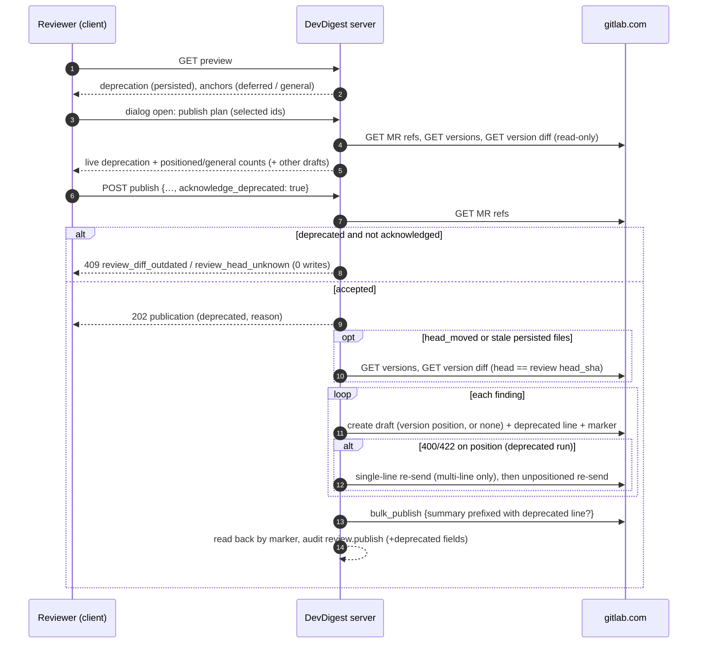

# Spec: Publish findings from an outdated review run, marked "deprecated"   |   Spec ID: SPEC-2026-10-23-gitlab-publish-outdated-findings   |   Status: Approved (2026-10-23)
Supersedes (in part): [`2026-10-21-gitlab-publish-findings.md`](./2026-10-21-gitlab-publish-findings.md),
referred to below as **the base spec**. This spec replaces these parts of it:

| Base item | What happens to it |
|---|---|
| **D-1**, base **AC-5**, and the rejection half of base **AC-12** | Replaced. A moved head no longer blocks a publish. It makes the run *deprecated* (AC-3, AC-4). The live-refs read of base AC-12 stays. |
| **D-2**, base **AC-4** | Replaced. A review without `head_sha` can be published as deprecated, with general notes only (AC-9). |
| Base **AC-9** (anchor source) | Narrowed. The persisted MR diff is used only when its head is the reviewed head. Otherwise the anchor source is the reviewed GitLab diff version (AC-6). |
| Base **AC-12** ("every positioned draft uses exactly those current references") | Narrowed to runs anchored on the persisted diff. Version-anchored drafts use the version's refs (AC-7). |
| Base **AC-14** | Extended with the deprecated line and deprecated location-line suffixes (AC-14, AC-15). |
| Base **AC-17** | Extended with one more precondition: the run is not deprecated (AC-16). |
| Base **AC-18** | Extended: the length check counts the worst-case overhead (AC-18). |
| Base **AC-20** step 5 | The two head blockers are removed. An acknowledgement check is added (AC-4). |
| Base **AC-29** | Extended for deprecated runs with a general-note fallback (AC-12). |
| Base **AC-37** for `review_head_unknown` / `review_diff_outdated` | Replaced by a non-blocking notice (AC-20). |
| Base **AC-38**, **AC-39**, **AC-41** | Extended (AC-21 – AC-26). |
| Base edge cases "Head moved since the review", "Legacy review without `head_sha`", "Persisted PR files stale versus the review head" | Replaced by this spec's edge cases. |

Everything else in the base spec stays in force unchanged and applies to deprecated runs too:

- selection limits (1–50, one review) and the summary rules;
- the other-drafts warning and D-3;
- the marker, idempotency and AC-35;
- rollback (AC-30, AC-31), reconciliation (AC-32 – AC-34), and the 429 policy (AC-28);
- the audit rules, the `secret_leak` redaction (AC-19), and the mention, reference and image
  guard (AC-16);
- quick-action neutralisation (AC-15), the footer, local mode (AC-42), and permissions (AC-40);
- read-back stripping (AC-43).

Scope: cross-module (server publish module + GitLab adapter, client publish UI, shared
contracts). Location: top-level `specs/`. reviewer-core, mcp and e2e are unchanged.

## Problem & why
Today, a review whose MR received new commits after the run cannot be published at all
(`review_diff_outdated`). A legacy review without a recorded head cannot be published either
(`review_head_unknown`). The only way out is a full re-run. A re-run costs LLM time and money,
and its findings differ from what the reviewer already triaged. Reviewers still want to share
the findings they read, even when the MR has moved on, as long as the author can see clearly
that they describe an older state of the MR.

GitLab keeps every MR diff version, with its own `base`, `start` and `head` commit SHAs. A
draft note positioned against an older version is shown by GitLab as an **outdated**
discussion on the lines that were reviewed. DevDigest can therefore publish an outdated run
faithfully. It anchors each finding to the version the agent actually reviewed, falls back to
a general note when that is impossible, and marks every note as deprecated.

Gap found while grounding this spec: DevDigest persists only **one** set of PR files per PR,
the latest synced diff, and replaces it on sync. The diff an outdated review ran on is
therefore **not** available locally. It has to be read from GitLab's diff version for the
reviewed head (AC-6).

## Goals / Non-goals
- Goal: a review whose head differs from the MR's live head can be published. Each finding is
  positioned on the GitLab diff version whose head is the reviewed head. Where that is
  impossible, the finding becomes a general MR note. Every note carries a visible deprecated
  line.
- Goal: a review without `head_sha` can be published. All its findings become general notes,
  each with a deprecated line.
- Goal: the user always confirms knowingly. The confirm dialog states that the run is outdated
  and how many findings become general notes. The server refuses a deprecated publish that the
  client did not acknowledge.
- Goal: "Re-run review" stays available next to the warning as the recommended alternative.
- Goal: every base-spec guarantee holds for deprecated runs: no duplicates, no stray drafts,
  no re-sent writes, and the same neutralisation and audit.
- Non-goal: re-mapping an outdated finding's lines onto the current diff (line tracking across
  commits).
- Non-goal: deciding whether an outdated finding is still valid on the new head, or hiding
  findings that the new commits "fixed".
- Non-goal: dedupe between a deprecated publish and a later re-run's publish of "the same"
  finding. The base non-goal on cross-review dedupe stands.
- Non-goal: the general-note fallback after a position rejection for **non**-deprecated runs.
  Base AC-29 is unchanged there (AC-13).
- Non-goal: storing historic diffs in DevDigest. The reviewed version is read from GitLab at
  publish and dialog time.
- Non-goal: GitHub. It still has no publish UI (base AC-3).
- Non-goal: applicable suggestions on deprecated notes (AC-16).

## User stories
- US-1: As a reviewer, I want to publish findings from a review whose MR has moved on, so that
  the author gets my triaged feedback without a costly re-run.
- US-2: As an MR author, I want every such note clearly marked as deprecated, with the
  reviewed commit, and placed on the lines that were reviewed, so that I know it may no longer
  apply.
- US-3: As a reviewer, I want to see before confirming that the run is outdated and how many
  findings will land as general comments, so that nothing on GitLab surprises me.
- US-4: As a reviewer with a legacy review that has no recorded head, I want to publish it
  anyway as deprecated general comments, so that old reviews are not dead ends.
- US-5: As an Admin, I want deprecated publishes to be distinguishable in the publication
  record and the audit log, so that accountability covers them.
- US-6: As a reviewer, I want a deprecated publish to keep every safety guarantee (no
  duplicates, rollback, neutralisation, no applicable code), so that it is as safe as a normal
  publish.

## Acceptance criteria (EARS)

### Deprecation status (US-1, US-3, US-4)
- AC-1: **WHEN** the publish state of a GitLab review is requested, the system **shall** report
  a review-level `deprecation`, derived from persisted state only, with no GitLab request:
  - `{ reason: "head_unknown", reviewed_head_sha: null }` when the review's `head_sha` is null;
  - `{ reason: "head_moved", reviewed_head_sha }` when it differs from the PR's persisted head;
  - `null` otherwise.

  _(observable: hermetic preview tests for three fixtures (legacy, synced-to-newer, current) → the expected `deprecation`; fake GitLab records 0 requests)_
- AC-2: The system **shall not** report `review_head_unknown` or `review_diff_outdated` as
  review-level blockers. The other blockers of base AC-3, AC-6, AC-7 and AC-8 are unchanged.
  A review whose only former blocker was one of these two is publishable.   _(observable: legacy and outdated fixtures → `blockers` empty and findings `publishable: true`; a merged-PR fixture still → `pr_not_open`)_
- AC-3: **WHEN** a publish starts, the system **shall** read the MR's live diff references
  before any write, as in base AC-12. It **shall** treat the run as **deprecated** when the
  review's `head_sha` is null (reason `head_unknown`) or differs from the live head (reason
  `head_moved`). The status is decided **once** per publication and recorded on it.   _(observable: fake live head ≠ review head → publication `deprecated: true, deprecation_reason: "head_moved"`; equal → `deprecated: false`)_
- AC-4: **IF** the run is deprecated **AND** the request does not carry
  `acknowledge_deprecated: true`, **THEN** the system **shall** reject the whole publish:
  - the code is `409 review_diff_outdated` (for `head_moved`) or `409 review_head_unknown`
    (for `head_unknown`);
  - the message is "This review is outdated — confirm publishing its findings as deprecated.";
  - no GitLab write is made, and no publication is kept.

  _(observable: fake head moved + request without the flag → 409, 1 refs read, 0 writes, 0 publication rows; same request with the flag → 202)_
- AC-5: **WHERE** the run is not deprecated, the system **shall** publish exactly as the base
  spec says: no deprecated line, and `acknowledge_deprecated` is ignored.   _(observable: current-head fixture with the flag true → bodies byte-identical to the base-spec snapshots)_

### Anchor source (US-2)
- AC-6: The system **shall** decide anchors against the persisted MR diff (base AC-9 – AC-11)
  only when the run is not deprecated **and** the persisted files were fetched at the review's
  `head_sha`. Otherwise, for `head_moved` or for stale persisted files, the system **shall**:
  1. list the MR's diff versions;
  2. select the **most recent** version whose head commit SHA equals the review's `head_sha`;
  3. read that version's diff;
  4. apply the base AC-9 – AC-11 rules to it: new-side lines, multi-line versus single-line,
     the nearest-to-end rule, old and new numbers on context lines, and the previous path for
     renamed files.

  _(observable: pure-function tests on a version-diff fixture give the same anchor outcomes as the base fixtures; it-test: persisted files at a newer head + matching version → anchors follow the version diff, not the persisted files)_
- AC-7: **WHEN** a finding is positioned against the reviewed version, its draft position
  **shall** carry that version's base, start and head commit SHAs, not the live references.   _(observable: fake GitLab create payloads carry the version's three SHAs; the live refs appear in none)_
- AC-8: **IF** no version's head equals the review's `head_sha`, or the version list or the
  version diff stays unreadable after the idempotent read retries (5xx, timeout, network),
  **THEN** the system **shall** publish every selected finding as a general note with
  `off_diff_reason: reviewed_version_unavailable`.

  **IF** those reads answer 401, 403 or 404, **THEN** the system **shall** end the publication
  `failed` with the base AC-30 mapped code, before any write. Its findings become selectable
  again.   _(observable: fake versions list without the head → all creates unpositioned, reason recorded; versions 503 ×N → same; versions 401 → `failed` `gitlab_token_invalid`, 0 writes)_
- AC-9: **WHERE** the deprecation reason is `head_unknown`, the system **shall** make no version
  lookup. It **shall** publish every selected finding as a general note with
  `off_diff_reason: review_head_unknown`.   _(observable: legacy fixture → 0 version reads; all creates unpositioned)_
- AC-10: **IF** a file in the reviewed version's diff is too large, collapsed, or has an empty
  diff, **THEN** its findings **shall** be general with `patch_unavailable`. **IF** the file is
  absent from that version, deleted, or the range misses every new-side line, **THEN** they
  **shall** be general with `not_on_diff_line`. These are the base AC-9 and AC-10 rules,
  applied to the version.   _(observable: version-diff fixtures per case → expected reason; no position sent)_
- AC-11: The system **shall** perform the version lookup and the version-diff read for a
  publication in the background, after the `202`. The `202` **shall** still arrive within 1 s
  (base AC-21). The lookup makes no write.   _(observable: fake GitLab at 300 ms/request + 3 version pages → 202 < 1 s; version reads recorded after the 202)_

### Position fallback (US-2, US-6)
- AC-12: **WHILE** the run is deprecated, **IF** GitLab rejects a positioned draft with a
  definitive 400 or 422, **THEN** the system **shall** apply base AC-13 first (a multi-line
  draft is re-sent once as a single line). **IF** the draft is still rejected, **THEN** the
  system **shall** re-send the finding **once** as a general note with
  `off_diff_reason: position_rejected`, and count it in `position_fallbacks`.

  Only when the general draft is also rejected does the finding become `failed` with
  `gitlab_position_rejected` (base AC-29). A finding gets at most 3 create requests, and each
  re-send follows a definitive 400/422 only. Any other failure follows base AC-30 with no
  re-send.   _(observable: fake 400 on positioned + 201 on unpositioned → 2 creates, 1 draft, `position_fallbacks: 1`; 400 on all three → 3 creates, finding `failed`; 502 on the first → 1 create, rollback)_
- AC-13: **WHERE** the run is not deprecated, the system **shall** keep base AC-29 unchanged:
  there is no general-note fallback after a position rejection.   _(observable: current-head fixture, 400 on single-line → finding `failed`, no unpositioned create)_

### Note body (US-2, US-6)
- AC-14: **WHERE** the run is deprecated, the system **shall** insert a deprecated line
  directly after the header line (base AC-14 item 1) of every finding note: positioned,
  general, and the redacted `secret_leak` body. The wording is:
  - `head_moved`: ``⚠ Deprecated: reviewed at `<sha>`; the MR has changed since.``
  - `head_unknown`: "⚠ Deprecated: the reviewed commit is unknown; the MR may have changed
    since."

  `<sha>` is the first 8 characters of the review's `head_sha`, used only when the SHA is
  lowercase hexadecimal. Otherwise the `head_unknown` wording is used. The marker and footer
  rules of base AC-14 and AC-24 are unchanged.   _(observable: snapshots of a positioned, a general and a secret_leak deprecated body for both reasons; a non-hex fixture SHA → head_unknown wording)_
- AC-15: **WHERE** a deprecated run's note is general, the location line (base AC-14 item 2)
  **shall** end with the suffix for its `off_diff_reason` instead of "(not on a changed line of
  this MR)":

  | `off_diff_reason` | Suffix |
  |---|---|
  | `not_on_diff_line` | "(not on a changed line of the reviewed version)" |
  | `patch_unavailable` | "(the reviewed version's diff of this file is unavailable)" |
  | `reviewed_version_unavailable` | "(the reviewed version of the diff was not found on GitLab)" |
  | `review_head_unknown` | "(the reviewed commit is unknown)" |
  | `position_rejected` | "(GitLab could not place it on the reviewed version)" |

  _(observable: snapshot per reason)_
- AC-16: **WHERE** the run is deprecated, the system **shall** render every suggestion as
  ordinary Markdown, never as an applicable suggestion block, whatever `apply_suggestions`
  says. **WHILE** the preview's `deprecation` is not null, every `suggestion_eligible`
  **shall** be `false`.   _(observable: deprecated publish with `apply_suggestions: true` on an otherwise eligible finding → plain fenced block, `applicable_suggestions: 0`; preview flags all false)_
- AC-17: **WHERE** the run is deprecated and a summary is given, the summary note **shall** begin
  with the same deprecated line, followed by a blank line and the user's summary. Quick-action
  neutralisation and the footer apply as in base AC-26. Without a summary, no summary note is
  sent.   _(observable: bulk_publish payload begins with the deprecated line; no summary → no note field)_
- AC-18: The `body_too_long` check (base AC-18) **shall** always count the worst-case overhead:
  the longest deprecated line plus the longest location line. The preview and the publish
  therefore cannot disagree about it.   _(observable: a fixture 50 characters below the limit without overhead → `body_too_long` in the preview and in the publish validation)_

### Preview & client (US-1, US-3, US-4)
- AC-19: **WHILE** the preview's `deprecation` is `head_moved`, each finding's anchor **shall**
  be reported with kind `deferred` (placement decided at publish), with path and lines, and
  `off_diff_reason: null`. **WHILE** it is `head_unknown`, the anchor **shall** be reported as
  `general` with `off_diff_reason: review_head_unknown`. The client **shall** label a deferred
  anchor "Placement decided at publish (outdated review)".   _(observable: preview fixtures; FindingCard component test shows the label)_
- AC-20: **WHILE** the preview's `deprecation` is not null, the review accordion **shall** show
  one non-blocking warning notice, and keep selection and "Publish N to GitLab" enabled. The
  Publish button **shall** reference the notice through `aria-describedby`. The notice offers
  "Re-run review" and reads:
  - `head_moved`: ``This review ran on `<sha>`; the MR has changed since. Findings will be
    published marked as deprecated.``
  - `head_unknown`: "This review predates commit tracking. Findings will be published as
    deprecated general comments."

  _(observable: component tests for both reasons: notice text, Re-run button present, Publish enabled)_
- AC-21: **WHEN** the confirm dialog opens, the client **shall** request a read-only publish plan
  that extends the other-drafts count read (base AC-38). The system **shall** compute the plan
  from live GitLab reads only: diff refs, the version list and the version diff, per AC-3 and
  AC-6 – AC-10. The plan contains:
  - the live deprecation (reason, the reviewed and the live head);
  - for the selected findings, the number to be positioned and the number to be posted as
    general notes.

  The plan read **shall never** write.   _(observable: fake GitLab records only GETs on dialog open; counts match a fixture)_
- AC-22: **WHILE** the plan (or, if it is unavailable, the preview) reports a deprecation, the
  confirm dialog **shall** show a warning block above the actions:
  - the heading "Outdated review";
  - for `head_moved`: ``Reviewed at `<sha>`, the MR is now at `<live sha>`. Findings will be
    published marked as deprecated.``;
  - for `head_unknown`: "The reviewed commit is unknown. All findings will be posted as
    deprecated general MR comments.";
  - the placement line: "K of N will be posted as general MR comments (not on a diff line)",
    or "All N will be posted as general MR comments" when K = N;
  - when the plan read failed: "Couldn't check how findings will be placed — some or all may be
    posted as general comments.";
  - "Code suggestions can't be made applicable for an outdated review." in place of the
    hidden toggle.

  The confirm button **shall** read "Publish as deprecated", and the request **shall** carry
  `acknowledge_deprecated: true`. Without a deprecation, the dialog is the base AC-38 dialog
  and sends `acknowledge_deprecated: false`.   _(observable: component tests per variant incl. plan-read failure; request body flag asserted)_
- AC-23: **IF** the publish answers `409 review_diff_outdated` or `409 review_head_unknown`
  (AC-4), **THEN** the client **shall** keep the dialog open and refresh the preview and the
  plan. It **shall** then show the AC-22 warning and require a second explicit confirm. It
  **shall not** retry automatically.   _(observable: component test: 409 → warning appears, 1 request sent until the user confirms again)_
- AC-24: **WHEN** a deprecated publication completes, the result view **shall** show "Published N
  findings to GitLab as deprecated", plus "M were posted as general MR comments" when M > 0
  (fallbacks included). All other base AC-39 rules apply. A finding published by a deprecated
  publication **shall** show "Published as deprecated by <name> · <time>" with its
  "View on GitLab" link.   _(observable: component tests for the result and FindingCard published state)_

### Record, audit, invariants (US-5, US-6)
- AC-25: The publication read shape **shall** expose:
  - `deprecated` (boolean);
  - `deprecation_reason` (`head_moved` | `head_unknown` | null);
  - `reviewed_version_found` (boolean, or null when no lookup was made);
  - `position_fallbacks` (count).

  `general_notes` **shall** count fallbacks too.   _(observable: status read after a deprecated publish with 1 fallback → fields as stated)_
- AC-26: **WHERE** audit events are recorded, the `review.publish` metadata **shall** also carry
  `deprecated`, `deprecation_reason`, `reviewed_version_found` and `position_fallbacks`. It
  **shall** still carry no body, summary, title, rationale, SHA or note id.   _(observable: audit row after deprecated publish has the 4 fields; DB scan finds no SHA or body text)_
- AC-27: The system **shall** apply base AC-23 – AC-35 unchanged to deprecated runs:
  - every deprecated draft, including a general fallback, carries the marker;
  - rollback deletes only this publication's marked drafts;
  - reconciliation matches positioned and general notes by marker;
  - no finding is published twice.

  _(observable: base failure-path tests re-run with a deprecated fixture → same outcomes)_
- AC-28: **IF** the MR head moves after the publish read its live references, **THEN** the
  system **shall** keep the deprecation status and the anchor source decided at start
  (AC-3, AC-6), and **shall not** re-read them. Notes of a non-deprecated run carry no
  deprecated line, and stay positioned against the version that was current at start.   _(observable: fake head changes after the refs read → no further refs/version reads; bodies without a deprecated line; positions carry the start refs)_

## Traceability
| Story | ACs |
|---|---|
| US-1 | AC-1 – AC-3, AC-6, AC-7, AC-11, AC-19 – AC-21, AC-24 |
| US-2 | AC-6 – AC-8, AC-10, AC-12, AC-14, AC-15, AC-17 |
| US-3 | AC-4, AC-19 – AC-23 |
| US-4 | AC-1, AC-2, AC-9, AC-14, AC-20, AC-22 |
| US-5 | AC-25, AC-26 |
| US-6 | AC-5, AC-12, AC-13, AC-16, AC-18, AC-27, AC-28 |

## Edge cases
- **The persisted head looks current, but the live head has moved** (PR not yet synced). The
  preview shows no warning, while the plan read shows one (AC-21, AC-22). If the plan read
  failed, the publish answers 409, and the client re-confirms (AC-4, AC-23).
- **The persisted head looks outdated, but the live head equals the review head** (a later
  sync is pending, or a force-push restored the reviewed head). The live state wins: the run
  is not deprecated (AC-3, AC-5).
- **The review head equals the live head, but the persisted files are stale.** The run is not
  deprecated, and anchors come from the reviewed version (AC-6). This replaces the old
  `review_diff_outdated`-for-stale-files case.
- **Several versions share the reviewed head** (for example, a target-branch change
  recalculated the diff). The most recent one is used (AC-6).
- **A force-push removed the reviewed commit from the branch.** GitLab still keeps the
  version, so the finding is positioned on it (AC-6). If GitLab no longer lists the version →
  all general, `reviewed_version_unavailable` (AC-8).
- **The review ran on a local `git diff` whose merge-base differs from GitLab's version
  base.** Anchors are validated against GitLab's version diff, not the local diff (AC-6;
  base AC-9 rationale).
- **The reviewed version's diff is truncated or collapsed for a file** → `patch_unavailable`
  (AC-10). GitLab's exact signal is in *Manual verification*.
- **The version list or the version diff is temporarily unreadable** → all general (AC-8).
  401/403/404 → failed before any write (AC-8).
- **A multi-line deprecated finding is rejected, then rejected as a single line** → a general
  fallback (AC-12). Up to 3 creates per finding can hit the 60/min note limit. The 429 policy
  and its 60 s budget (base AC-28) apply → may end `gitlab_rate_limited`. Accepted.
- **An eligible suggestion while `apply_suggestions` is on and the run turns out deprecated**
  → plain block (AC-16).
- **A finding within ~200 characters of the 1,000,000 limit** → `body_too_long` everywhere,
  because the worst-case overhead is always counted (AC-18).
- **A `secret_leak` finding in a deprecated run** → the redacted body plus the deprecated line.
  No finding text is sent (AC-14; base AC-19).
- **The head moves during the publish** → the decisions taken at start hold, and nothing is
  re-read (AC-28). GitLab may show the notes as outdated. Accepted.
- **The head moves between the dialog's plan read and the publish:**
  - the review was already outdated and acknowledged → a deprecated publish against the same
    reviewed version (AC-3, AC-6);
  - the review was current at the dialog → 409 and re-confirm (AC-4, AC-23).
- **The same finding was already published by a deprecated publication** → `already_published`
  (base AC-20, AC-35).
- **A re-run later re-finds the issue on the new head** → it is publishable again, so a
  duplicate-looking note is possible. Accepted (Non-goal, base non-goal).
- **A deprecated positioned note read back in Files changed** → the marker is stripped (base
  AC-43). The deprecated line stays visible as note content. Whether an outdated-position
  discussion is listed follows the comments spec's existing handling of outdated positions.
  Accepted: no new handling.
- **A legacy review has a fallback-diff head but no `head_sha`** → treated as `head_unknown`
  (AC-9). The fallback head is not inferred retroactively.
- **A GitHub PR** → unchanged: no UI, `provider_not_supported` (base AC-3).

## Non-functional
- **Latency** (fake GitLab at 300 ms per request):
  - the publish answers `202` in < 1 s (AC-11);
  - the dialog's publish plan is p95 ≤ 3 s: refs, the version list (≤ 100 per page) and one
    version diff. The other-drafts count may run in parallel. The dialog stays usable while
    the plan loads;
  - a deprecated 50-finding publication reaches a terminal status in p95 ≤ 30 s with no
    fallbacks and no 429.
- **Version lookup bound:** at most 20 pages of versions (2,000 versions). Beyond that, the
  version counts as not found (AC-8).
- **Writes:** worst case 3 create requests per finding, each after a definitive 400/422
  (AC-12). Creates and `bulk_publish` are never re-sent after a 5xx, a timeout or a network
  error (base rule). Version reads are idempotent and retried within the existing back-off.
- **Security:**
  - the SHA shown in notes and UI is hex-validated and truncated (AC-14);
  - the audit log carries no SHA (AC-26);
  - version-diff text read from GitLab is data, never sent to an LLM (Untrusted inputs);
  - calls go to `https://gitlab.com` only, and no redirects are followed (base).
- **Accessibility, WCAG 2.1 AA:**
  - the accordion notice is linked via `aria-describedby`;
  - the dialog's warning block is inside the focus-trapped modal and is read before the
    confirm button;
  - the deprecated state is conveyed by text, not by color or icon alone (the "⚠" is
    decorative next to the word "Deprecated").
- **i18n:** every new client string comes from the existing catalogs. Note bodies sent to
  GitLab are English, as in the base spec.

## Cross-module interactions
Modules:
- **client:** the accordion notice, the deferred anchor label, the confirm dialog warning and
  the acknowledgement, the 409 re-confirm, the result and published labels;
- **server:** the preview deprecation, the publish plan read, the deprecation decision, the
  version lookup, version-based anchoring, the general fallback, note-body additions, the
  publication fields, the audit fields;
- **gitlab.com:** MR diff refs, the MR diff version list, a single version's diff, draft notes,
  and `bulk_publish`.

Data crossing boundaries:
- **client → server:**
  - `acknowledge_deprecated` on the publish request;
  - the publish-plan request with the selected finding ids (dialog open).
- **server → GitLab (reads):**
  - MR refs;
  - the version list (id, head/base/start commit SHAs, created time);
  - one version's diffs (old/new path, renamed/deleted/new flags, diff text, size signals).
- **server → GitLab (writes):** positioned drafts carrying a **version's** SHAs, or
  unpositioned drafts; the body includes the deprecated line.
- **server → client:**
  - the preview's `deprecation` and `deferred` anchors;
  - the plan (live deprecation and placement counts);
  - the publication's deprecation fields.

Failure contract:
- The acknowledgement check fails before any write (AC-4).
- A missing or unreadable version degrades to general notes, never to a refused publish
  (AC-8). Auth and access failures fail before writes.
- A position rejection degrades to a general note for deprecated runs only (AC-12).
- All base rollback and reconcile guarantees hold (AC-27).

## Contracts
Shapes only. These are additive changes. Following the repo rule, they go in a **new**
contract file in the vendored shared contracts that extends the publish shapes. It is
mirrored to the client copy, and no existing contract file is edited. The planner decides how
the widened enums are expressed.

- **Deprecation:** `{ reason: "head_moved" | "head_unknown", reviewed_head_sha: string | null }`.
- **Publish preview (extension):**
  - `deprecation: Deprecation | null`;
  - `anchor.kind` gains `"deferred"`;
  - `anchor.off_diff_reason` gains `reviewed_version_unavailable`, `review_head_unknown` and
    `position_rejected`. The preview only ever reports `review_head_unknown`; the other two
    are decided at publish time and are not reported there.
- **Publish plan** (server → client, on dialog open; extends the other-drafts count):
  - `other_drafts: number | null`;
  - `deprecation: (Deprecation & { live_head_sha: string }) | null`, or absent when the plan
    could not be read;
  - `placement: { positioned: number, general: number } | null` for the requested ids;
  - `plan_available: boolean`.
- **Publish request (extension):** `acknowledge_deprecated?: boolean`, default `false`.
- **Publication (extension):**
  - `deprecated: boolean`;
  - `deprecation_reason: "head_moved" | "head_unknown" | null`;
  - `reviewed_version_found: boolean | null`;
  - `position_fallbacks: number`.
- **Audit metadata `review.publish` (extension):** `deprecated`, `deprecation_reason`,
  `reviewed_version_found`, `position_fallbacks`.
- **Error codes:** `review_diff_outdated` and `review_head_unknown` stay 409, and now mean
  "deprecated publish not acknowledged" (AC-4). Both share one new message. Neither is a
  `PublishBlockerCode` any more in practice. The enum keeps them for compatibility.
- **Ports (conversation shape):** the GitLab host port gains two operations:
  - list MR diff versions (paginated);
  - read one version's diffs.

  Both follow the read and idempotent retry policy.

## Untrusted inputs
- **Version-diff text** from GitLab comes from the PR author, so it is untrusted. It is used
  only to compute line positions, deterministically. It is never put into a prompt, a note
  body, a log or the publication record.
- **Finding text** in deprecated notes follows base AC-15, AC-16 and AC-19 unchanged.
- **The deprecated line** is composed by DevDigest. Its only variable is the hex-validated
  8-character SHA, inside inline code (AC-14), so it cannot carry a mention, a reference or a
  quick action.
- **Client-supplied `acknowledge_deprecated`** is a boolean. It can only permit what the
  server's own live-head check decides (AC-3, AC-4), and never forces deprecation off.

## Decisions (2026-10-23, user-confirmed)
- **D-9 (user, replaces D-1):** a moved head makes the run deprecated instead of blocking it.
  Anchors use the reviewed GitLab diff version (Option A), with a general-note fallback.
- **D-10 (user, replaces D-2):** a review without `head_sha` is publishable as deprecated, with
  general notes only.
- **D-11 (user):** the confirm dialog warns explicitly. "Re-run review" stays available.
- **D-12 (user-confirmed):** the server requires `acknowledge_deprecated` for a deprecated
  run, and the client re-confirms after a 409 (AC-4, AC-23). Without it, a stale persisted
  head could turn a normal-looking confirm into a deprecated publish the user never saw.
- **D-13 (user-confirmed):** a version that is not found **or** unreadable (5xx, timeout,
  network) degrades to all-general notes. 401/403/404 fail the publication before any write
  (AC-8).
- **D-16 (user-confirmed):** the summary note of a deprecated publish begins with the
  deprecated line (AC-17).
- **D-17 (user-confirmed):** the proposed wording is final: the deprecated line (AC-14), the
  location-line suffixes (AC-15), the notice (AC-20), the dialog warning (AC-22), the result
  labels (AC-24) and the AC-4 message.
- **D-14 (spec author, recommended default):** suggestions are never applicable on deprecated
  notes (AC-16). The reviewed code no longer matches the head, so applying a suggestion would
  be wrong or refused by GitLab.
- **D-15 (spec author, recommended default):** the general-note fallback after a position
  rejection applies to deprecated runs only (AC-12, AC-13), to keep base behaviour stable.

## Manual verification before merge (gitlab.com sandbox MR)
1. A draft positioned with an older version's base, start and head SHAs is accepted. After
   `bulk_publish` it shows as an outdated discussion on the reviewed lines (AC-7).
2. The version-list fields, the pagination, and the version-diff fields, including the
   signals for too-large or collapsed files and truncation of large MRs (AC-6, AC-10).
3. Whether several versions can share a head SHA, and which one GitLab itself prefers
   (AC-6).
4. The status code GitLab gives when a position is invalid for the given version: 400 or 422,
   at create time or only at publish time (AC-12).
5. Whether a rejected create counts toward the 60/min note limit (AC-12, rate limits).
6. The "⚠" line survives `bulk_publish` normalisation and renders as plain text (AC-14).

## Open questions
- None blocking. The *Manual verification before merge* list is a gate, not an open
  decision.
